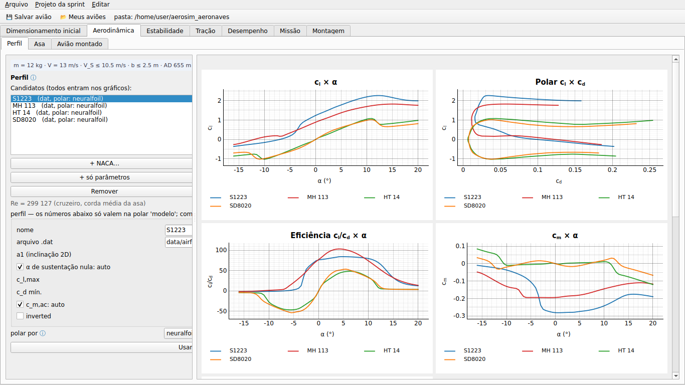
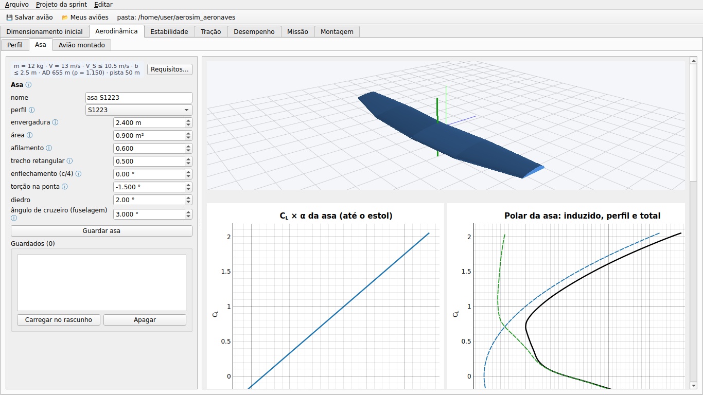
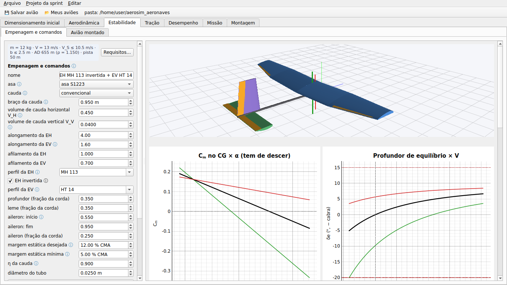
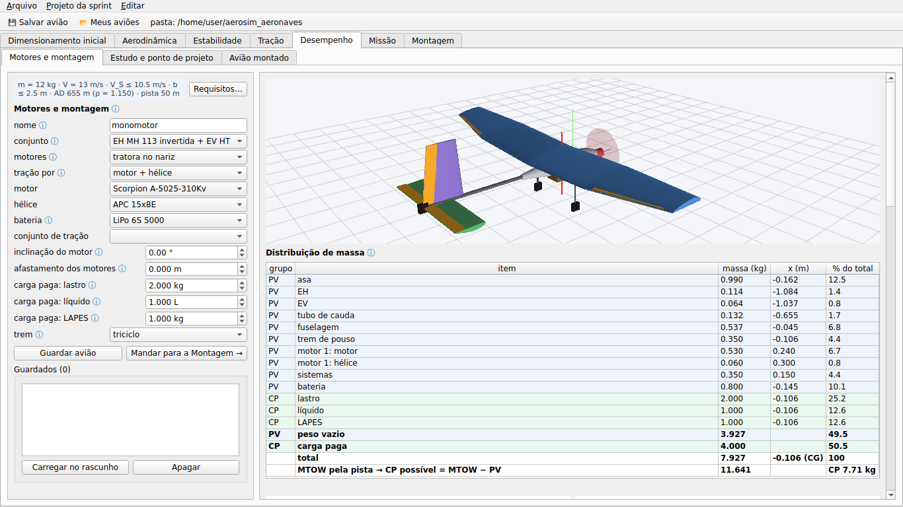
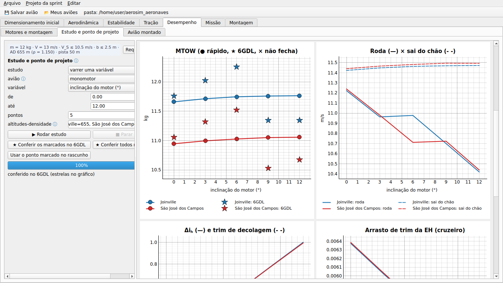
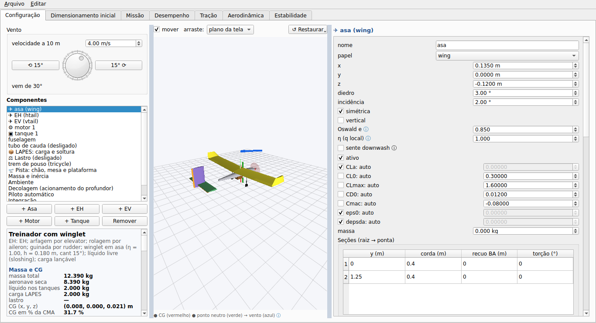
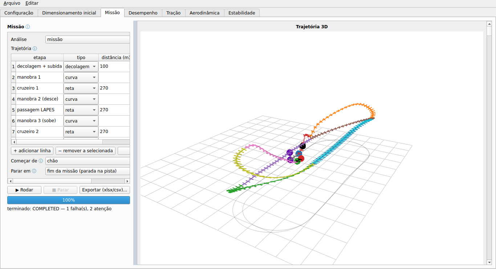
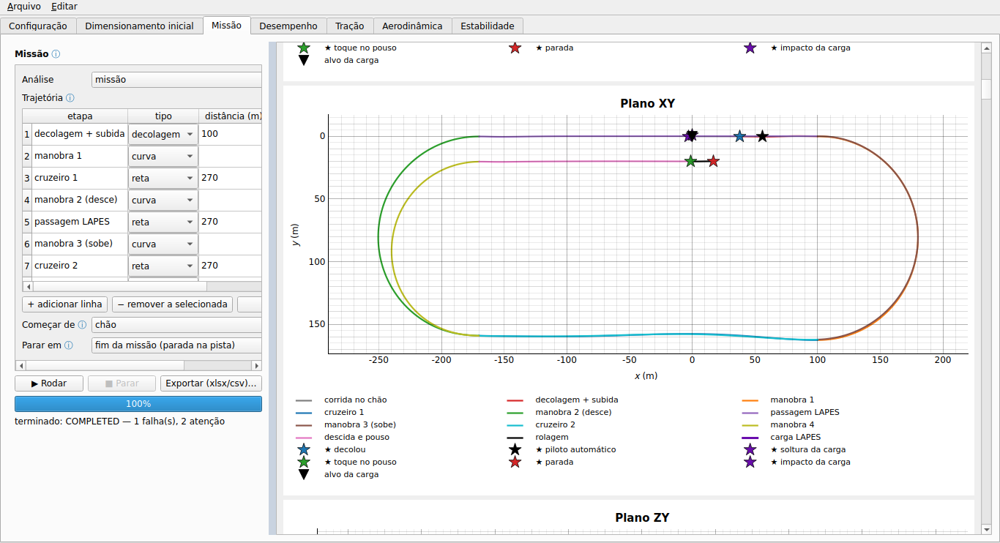
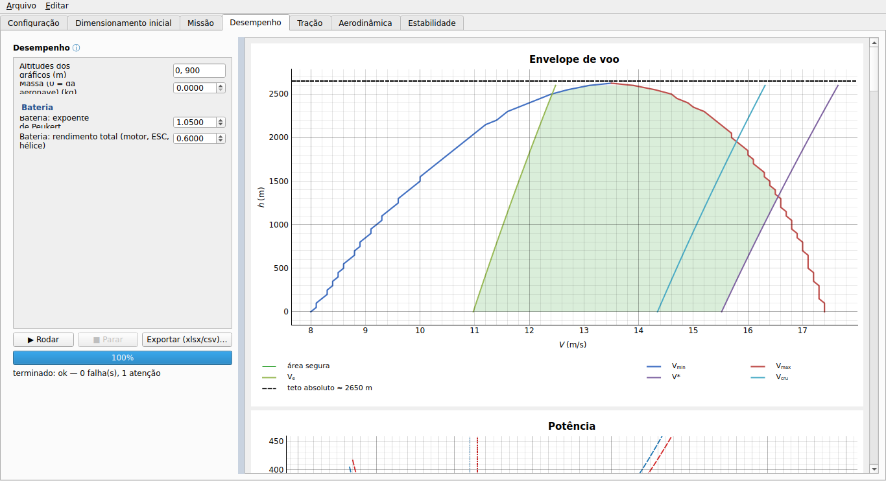
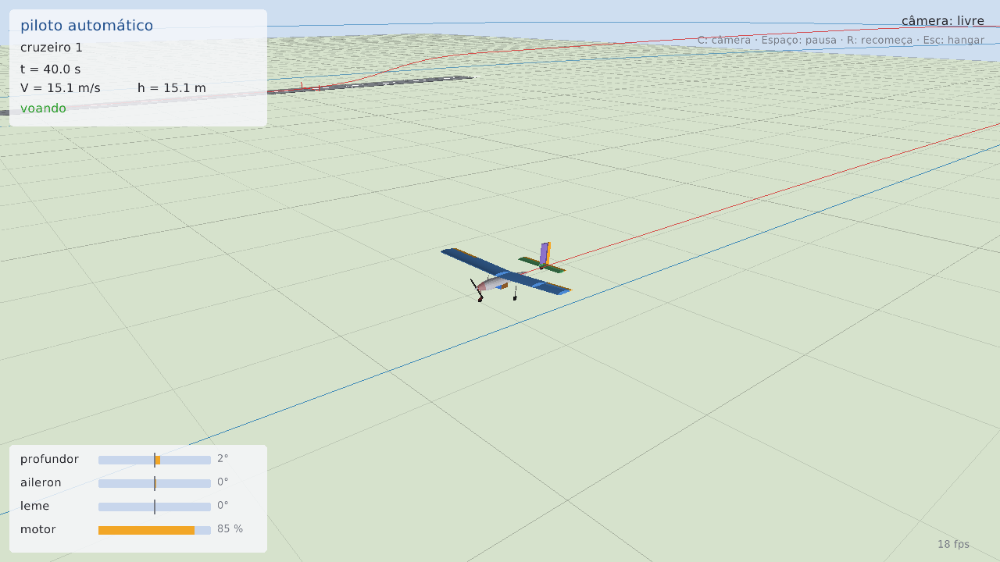

# aerosim

Simulador e ferramenta de projeto para aeronaves pequenas (AeroDesign): você monta o avião (asas,
caudas, motores, trem, tanques com líquido, carga LAPES), e o programa calcula aerodinâmica,
estabilidade, desempenho e simula a missão inteira em 6 graus de liberdade — decolagem do chão ou de
uma mesa, curvas, soltura da carga e pouso numa plataforma — dizendo o que passou, o que falhou e o que
mudar.

- **GUI** (Python + PyQt6): projeto do zero em etapas — perfil → asa → empenagem → motores → avião
  inteiro — e a análise detalhada do avião montado (aerodinâmica, estabilidade, tração, desempenho, missão),
  com diagnóstico em cada aba e Ctrl+Z; a montagem do avião em 3D fica na última aba. Vários aviões (ou
  variantes do mesmo) abertos ao mesmo tempo, trocados com ◀ ▶.
- **Núcleo de física em Zig**: a missão completa (165 s de voo) roda em cerca de 1 s.
- **[AeroDrive](aerodrive/README.md)**: o mesmo avião num simulador em tempo real (raylib), pilotado
  com controle de Xbox ou pelo piloto automático; grava vídeo e dados do voo.





















---

## Instalar

Precisa de **Git** e **Python 3.10 ou mais novo** (testado no 3.11). O compilador Zig 0.16 vem pelo
`pip` (pacote `ziglang`).

### 1. Bibliotecas do sistema (só Linux)

A GUI (PyQt6) precisa de OpenGL e X11. Ubuntu / Debian / Mint:

```sh
sudo apt install libegl1 libgl1 libxkbcommon-x11-0 libxcb-cursor0 libxcb-icccm4 libxcb-keysyms1 \
                 libxcb-shape0 libxcb-xinerama0 libxcb-randr0 libxcb-render-util0 libxcb-image0 \
                 libfontconfig1 libdbus-1-3
```

Fedora: `sudo dnf install mesa-libGL mesa-libEGL libxkbcommon-x11 xcb-util-cursor xcb-util-wm xcb-util-keysyms`.
Windows e macOS: nada.

### 2. Repositório e pacotes Python

```sh
git clone https://github.com/vitordallolivo/AircraftSimulation.git
cd AircraftSimulation

python -m venv .venv
source .venv/bin/activate              # Linux/macOS
.venv\Scripts\activate                 # Windows (PowerShell: .venv\Scripts\Activate.ps1)

pip install -r requirements.txt
pip install -r requirements-aero.txt   # opcional: lltdrek e AeroSandbox (comparação na aba Aerodinâmica)
```

### 3. Núcleo em Zig

```sh
cd core
python -m ziglang build --release=fast
cd ..
```

Esse passo é opcional: o Python compila o núcleo sozinho na primeira vez que precisar (e de novo quando
um `.zig` mudar). Com o `zig` 0.16 no PATH, troque `python -m ziglang` por `zig`.

---

## Rodar

### GUI

```sh
python -m aerosim.gui                                              # aeronave convencional
python -m aerosim.gui data/aircraft/Asa_voadora.json               # abre um avião (.json, .cfg ou .xlsx)
```

- **💾 Salvar avião / 📂 Meus aviões** guardam seus aviões (pasta `~/aerosim_aeronaves`, ou a variável
  `AEROSIM_PROJETOS`). Exemplos prontos em `data/aircraft/`.
- Em cada aba: preencha os campos (o **ⓘ** explica cada um), clique em **▶ Rodar**; os gráficos
  atualizam enquanto roda; no fim vêm o **diagnóstico** (clique numa linha para ver o porquê e o que
  mudar) e a tabela de resultados; **Exportar** grava `.xlsx` ou `.csv`.
- **Projeto do zero** (subabas de Aerodinâmica, Estabilidade e Desempenho): **Perfil** (candidatos e polar
  2D: NACA, .dat, só parâmetros ou polar do XFLR5) → **Asa** (planta, linha sustentadora, onde estola,
  incidência pelo ângulo de cruzeiro) → **Empenagem e comandos** (cauda por volume, tubo, CG na margem
  pedida, faixa de CG, rotação na decolagem) → **Motores e montagem** (motores, distribuição de massa com PV
  e carga paga = lastro + líquido + LAPES, bateria no ponto do CG, trem, desempenho e o MTOW pela pista) →
  **Mandar para a Montagem**; **Estudo e ponto de projeto** (Desempenho) acopla as áreas e varre uma variável (ex.: inclinação do motor) nas altitudes-densidade pedidas (exemplos prontos: `data/aircraft/S1223_*.json` e `data/sprint/projeto_s1223.json`). Cada etapa guarda candidatos com nome; o programa compara,
  não escolhe. Requisitos (massa, velocidades, AD, envergadura, pista) e regras no botão **Requisitos…**.
  Detalhes em [aerosim/design](aerosim/design/README.md).
- **Montagem** (última aba): componentes, 3D editável, ambiente (altitude-densidade, vento) e envelope
  de voo (ângulo de cruzeiro, fator de carga). As subabas "Avião montado" e a Missão mostram o avião
  atual em 3D acima dos gráficos.
- **Vários aviões:** **Arquivo → Abrir ao lado** ou **＋ variante** abre mais um; ◀ ▶ troca, e todas
  as abas rodam o escolhido.
- **Ctrl+Z / Ctrl+Y** desfaz e refaz qualquer mudança, na montagem e nas abas.

### Simulador pilotado (AeroDrive)

```sh
cd aerodrive
zig build run -- ../data/aircraft/Convencional_original.json
```

Instalação e comandos em [aerodrive/README.md](aerodrive/README.md).

### Pelo Python (sem GUI)

Rode da raiz do repositório:

```python
from aerosim.manager import SimulationManager
from aerosim.data import load_aircraft

m = SimulationManager()
ac = load_aircraft("data/aircraft/Convencional_original.json")

r = m.run("mission", ac, {"mode": "só decolagem"})   # decolagem otimizada para x_warning e z_warning
print(r.status, r.summary["n_dec"])                  # COMPLETED 51.4

r = m.run("mission", ac)                             # missão inteira, etapa por etapa
print(r.log["t"][-1], r.summary["energia_Wh"])
for c in r.checks:                                   # o diagnóstico
    print(c.status, c.item, c.value)
```

Simulações: `sizing`, `mission`, `performance`, `thrust`, `aerodynamics`, `stability` (mais detalhes em
[aerosim/manager/README.md](aerosim/manager/README.md)).

### Testes

```sh
python -m pytest                       # tudo (~3 min)
python -m pytest tests/manager         # uma parte
(cd core && python -m ziglang build test)        # testes do núcleo em Zig
(cd aerodrive && python -m ziglang build test)   # testes e fuzzing do aerodrive
```

### Fotos das abas (sem tela)

```sh
xvfb-run -a python tools/capturas.py capturas/
```

---

## Problemas comuns

| sintoma | solução |
|---|---|
| `ImportError: libEGL.so.1` / `could not load the Qt platform plugin "xcb"` | instale as bibliotecas do passo 1 |
| `ModuleNotFoundError: No module named 'aerosim'` | rode da raiz do repositório (ou `export PYTHONPATH=$PWD`) |
| `FileNotFoundError: zig` | `pip install ziglang==0.16.0` ou ponha o `zig` 0.16 no PATH |
| erro de compilação do Zig | use exatamente o Zig **0.16** |
| tela cortada em notebook / Wayland | as divisórias entre as colunas são largas: arraste para alargar o painel |
| sem 3D numa máquina remota | o 3D precisa de OpenGL; sem tela use `QT_QPA_PLATFORM=offscreen` (as simulações funcionam) |
