# Aircraft Simulation

O Aircraft Simulation nasceu para preencher uma lacuna clássica na engenharia aeronáutica: a distância entre o projeto conceitual em planilhas/papel e a validação em um simulador de voo real. É uma ferramenta completa que une o dimensionamento paramétrico avançado, a análise aerodinâmica e de estabilidade, e uma simulação de voo 3D interativa de alta performance.

Seja para projetar uma aeronave do zero (como competições de Aerodesign, VANTs ou protótipos experimentais), otimizar o peso máximo de decolagem (MTOW) sob restrições severas de pista, ou testar o comportamento dinâmico em tempo real, este ecossistema coloca todo o controle na suas mãos de forma modular.

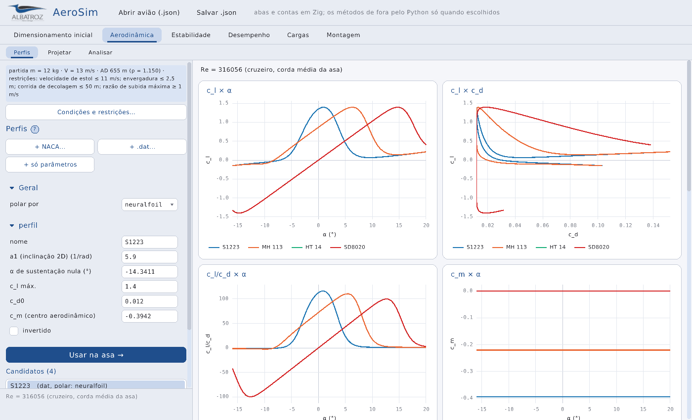

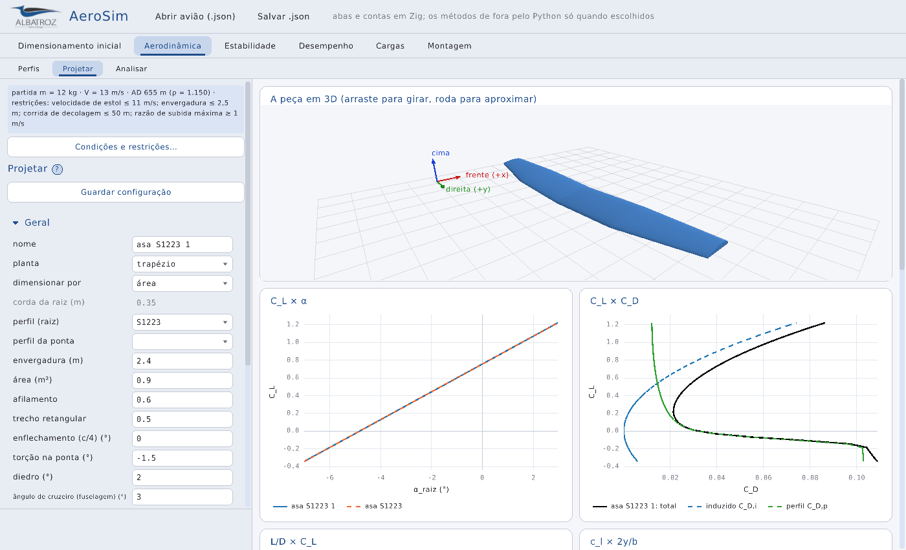

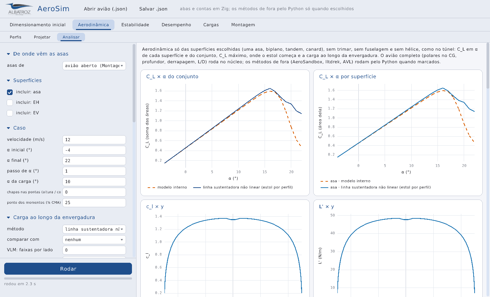

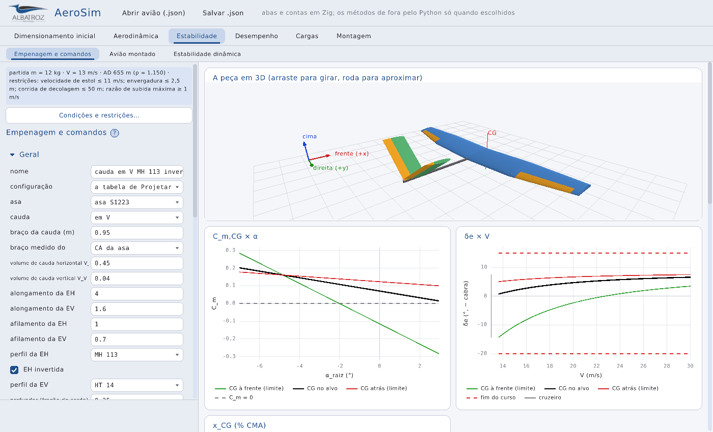

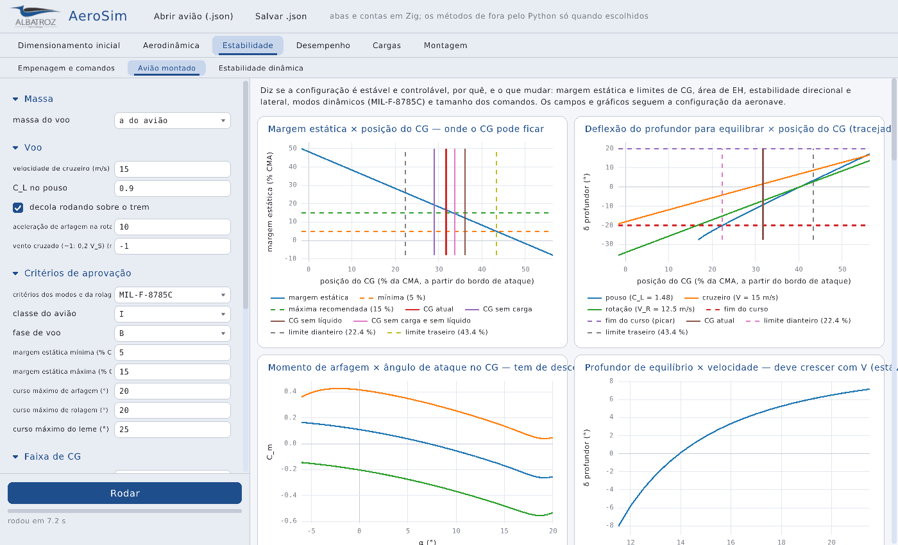

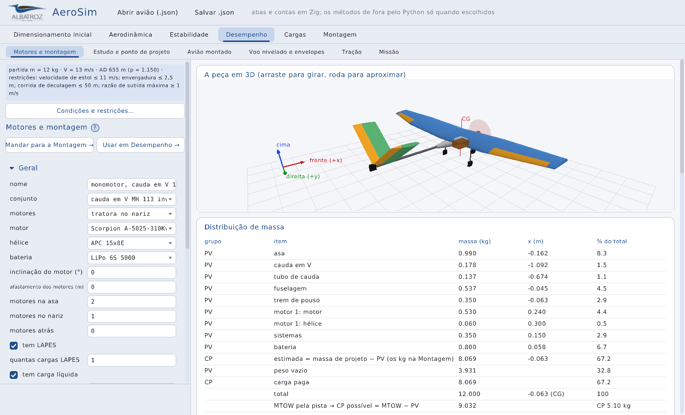

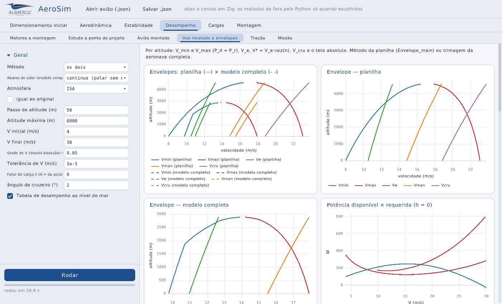

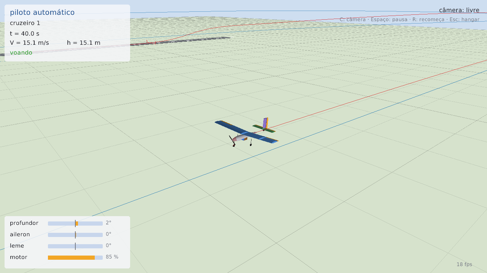

---


O programa é divido em dois modos, o aerodrive e o aerosim, o aerodrive é uma simulação de tempo real que permite controlar a aeronave que você acaba de projetar e o
aerosim é justamente o local onde você irá projetar. A interface em Zig (raylib) faz todas as abas e as contas sem o
Python, das etapas da sprint ao Mini-MDO; o Python fica só com os métodos de fora do núcleo (lltdrek, AeroSandbox,
AVL, NeuralFoil), chamados só quando escolhidos.


## Instalar

Precisa de **Git** e **Python 3.10 ou mais novo** (testado no 3.11). Basta então clonar o repositório e instalar os requerimentos.


```sh
git clone https://github.com/vitordallolivo/AircraftSimulation.git
cd AircraftSimulation

python -m venv .venv
.venv\Scripts\activate                 

pip install -r requirements.txt
pip install -r requirements-aero.txt   # opcional: lltdrek e AeroSandbox (comparação na aba Aerodinâmica)
```

## Rodar

Os programas em Zig compilam e abrem a partir da raiz, cada um pelo nome:

```sh
python -m ziglang build aerodrive          # o simulador
python -m ziglang build aerosim            # a interface do aerosim em Zig
python -m ziglang build aeroopt            # a interface do aeroopt em Zig
python -m ziglang build launcher           # a tela inicial (o menu do site), que abre os outros três
python -m ziglang build                    # compila os quatro
python -m ziglang build test               # testes do núcleo, das interfaces, da tela inicial e do AeroDrive
```

Para instalar sem o repositório, `python tools/package.py` monta o AppImage do Linux e `python tools/package.py
--alvo windows` o instalador `.exe` do Windows (os dois abrem a tela inicial, o mesmo menu do site). O GitHub Actions
monta os dois quando alguém pede (workflow `pacotes`). O pacote leva um Python portátil para os métodos de fora do
núcleo, então não precisa instalar o Python.


O aerosim (`python -m ziglang build aerosim`) volta ao último projeto aberto, ou começa com a Montagem vazia.

- **Projeto da sprint numa pasta** (linha de comando, **Projeto da sprint → Abrir pasta da sprint…** ou
  arrastar a pasta para a janela): um arquivo por asa (a asa + as superfícies feitas para ela + os aviões) e
  o `sprint.json` com o resto. Volta de onde parou — etapas (perfis, asas, conjuntos, aviões,
  estudos), os aviões abertos na Montagem e a aba em que estava; mostra o que está guardado. Sem avião
  guardado no projeto, a **Montagem começa vazia** e o avião aparece no 3D peça por peça
  (**+ Asa, + EH, + EV, + Motor, + Tubo, + Tanque**); a massa vem das peças.
- **Tubos e caudas sem tipo pronto:** quantos tubos quiser, cada um com início (x, y, z), comprimento,
  inclinação e abertura (tubo duplo = dois tubos em y = ±d); cada superfície tem **presa em**: solta, na
  ponta de um tubo ou na ponta de outra superfície (cauda em T, winglet). Cauda em V = EH com diedro.

- **Perfil por seção:** na tabela de seções de cada superfície, a coluna **perfil** ('= superfície', um NACA
  digitado, um perfil já usado no avião ou um `.dat`); entre seções as propriedades do perfil são
  interpoladas e cada faixa vai para o núcleo com as suas.
- **Mistura de comandos:** o tipo do comando é só o nome; o que ele faz é a linha **arfagem, rolagem,
  guinada** (elevon = 1, 1, 0; ruddervator = 1, 0, 1; flaperon = rolagem com deflexão fixa; qualquer
  outra combinação, com ganhos fracionários).
- **Eixo de motor móvel (tilt-rotor):** cada motor tem **eixo móvel: faixa**; a inclinação vai de
  'inclinação' até 'inclinação + faixa' pelo comando de inclinação (0 a 1) do núcleo.

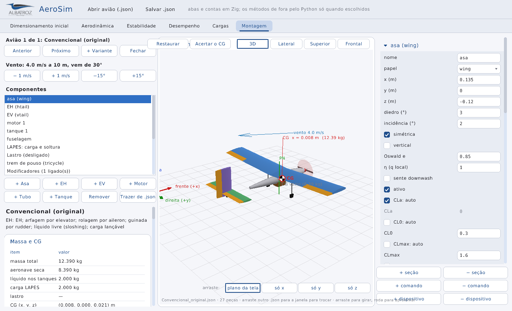
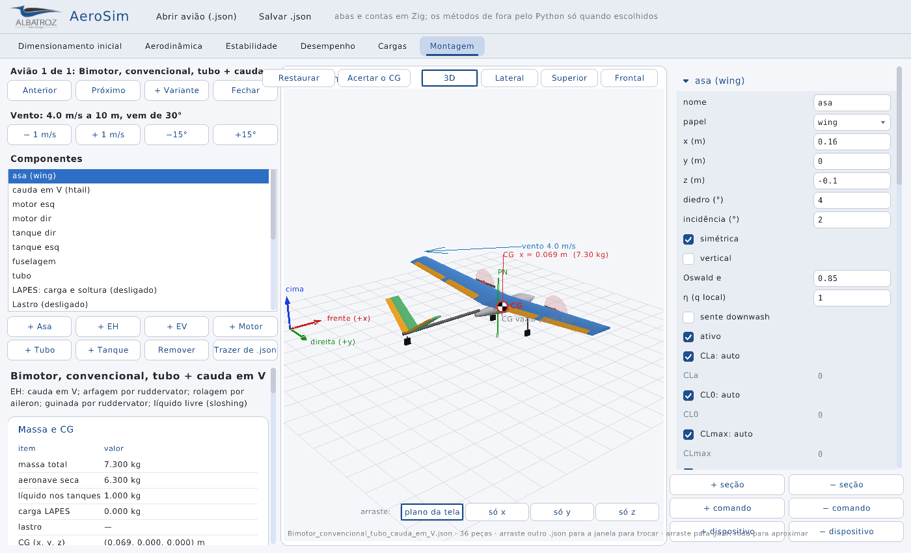

- **💾 Salvar avião / 📂 Meus aviões** guardam seus aviões (pasta `~/aerosim_aeronaves`, ou a variável
  `AEROSIM_PROJETOS`). Exemplos prontos em `data/aircraft/`.
- Em cada aba: preencha os campos (o **ⓘ** explica cada um), clique em **▶ Rodar**; os gráficos
  atualizam enquanto roda; no fim vêm o **diagnóstico** (clique numa linha para ver o porquê e o que
  mudar) e a tabela de resultados; **Exportar** grava `.xlsx` ou `.csv`.
- **Projeto do zero** (subabas de Aerodinâmica, Estabilidade e Desempenho), uma etapa depois da outra:
  - **Perfis**: escolher e comparar os perfis, com as polares do XFLR5 ou do XFOIL em vários Reynolds.
  - **Projetar**: desenhar a asa e ver como ela voa.
  - **Empenagem e comandos**: dimensionar a cauda e ver se o avião fica estável.
  - **Motores e montagem**: escolher motor, hélice e bateria, montar o avião e ver se ele decola.
  - **Estudo e ponto de projeto**: comparar os aviões guardados ou variar uma escolha.
  - **Condições e restrições…** (em toda etapa): de onde o projeto parte e o que ele precisa cumprir.

  Cada etapa guarda as opções com nome; o programa compara, quem projeta escolhe.

  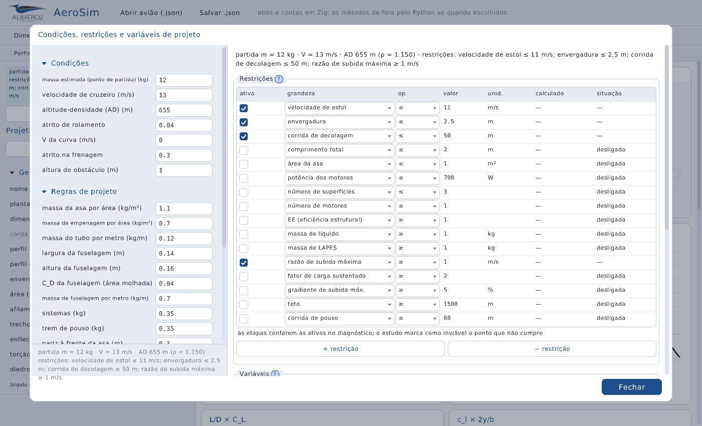
  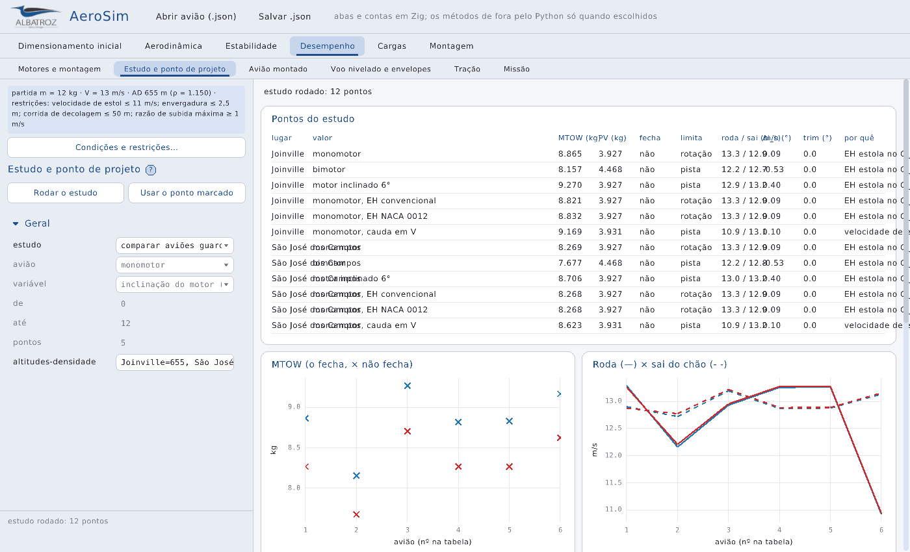

  Detalhes em [aerosim/design](aerosim/design/README.md).

- **Dimensionamento inicial**: O aerosim conta com um módulo capaz de com base nas restrições usar as teorias de `initial sizing` definir
  as dimensões de asa

  Todo e qualquer projeto tem seus limites/restrições para isso temos uma aba somente com a capacidade de escolher as restrições, ligando ou
  as desligando as tabelas de cada área de projeto são atualizados, bem como permite otimizar de uma forma mais consistente a aeronave com base nisso.

  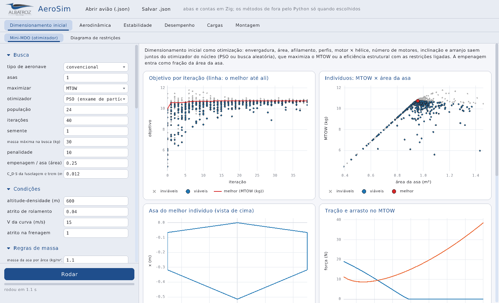
  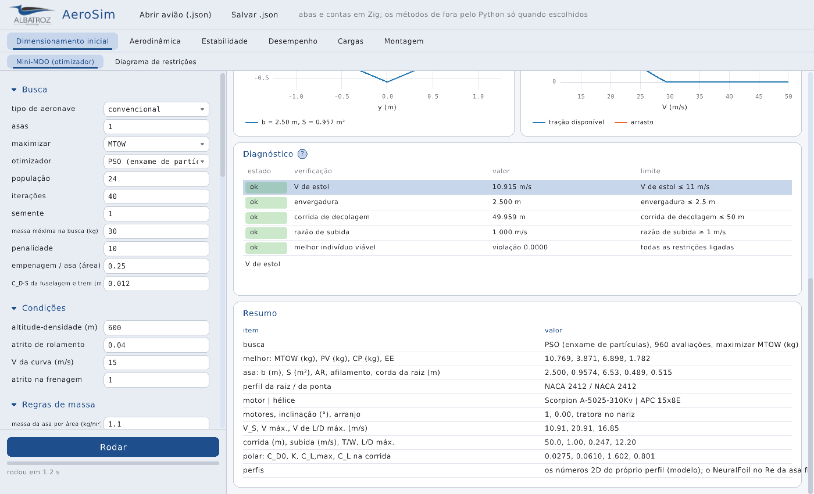
  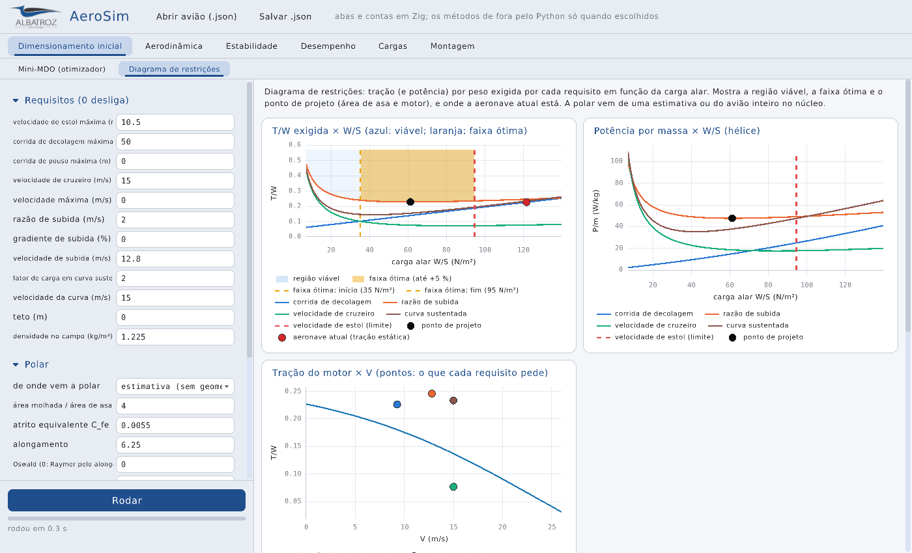
- **Montagem** (última aba): componentes, 3D editável, ambiente (altitude-densidade, vento) e envelope
  de voo (ângulo de cruzeiro, fator de carga). As subabas "Avião montado", Analisar (Aerodinâmica) e a
  Missão (dentro de Desempenho, junto com Tração) mostram o avião atual em 3D acima dos gráficos.
- **Vários aviões:** **Arquivo → Abrir ao lado** ou **＋ variante** abre mais um; ◀ ▶ troca, e todas
  as abas rodam o escolhido.


Instalação e comandos em [aerodrive/README.md](aerodrive/README.md).

### Testes

```sh
(cd core && python -m ziglang build test)        # testes do núcleo em Zig
(cd aerodrive && python -m ziglang build test)   # testes e fuzzing do aerodrive
```


---

## Problemas comuns

| sintoma | solução |
|---|---|
| `ImportError: libEGL.so.1` / `could not load the Qt platform plugin "xcb"` | instale as bibliotecas do passo 1 |
| `ModuleNotFoundError: No module named 'aerosim'` | rode da raiz do repositório (ou `export PYTHONPATH=$PWD`) |
| `FileNotFoundError: zig` | `pip install ziglang==0.16.0` ou ponha o `zig` 0.16 no PATH |
| erro de compilação do Zig | use exatamente o Zig **0.16** |
| tela cortada em notebook / Wayland | as divisórias entre as colunas são largas: arraste para alargar o painel |
| sem 3D numa máquina remota | o 3D precisa de OpenGL; sem tela use `QT_QPA_PLATFORM=offscreen` (as simulações funcionam) |
