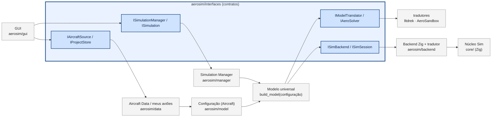

# aerosim — simulador 6GDL de aeronaves em camadas

Simulador de voo de 6 graus de liberdade para aeronaves pequenas (asa, cauda, K motores, trem de
pouso, líquido com sloshing, carga com soltura), com GUI em PyQt6, um orquestrador de simulações em
Python e o núcleo numérico em Zig.



Cada camada só conhece a **interface** (em azul) da camada de baixo. O avião é descrito **uma vez**:
a configuração (`Aircraft`) vira o **modelo universal** (`AircraftModel`), e cada núcleo/solver (Zig,
lltdrek, AeroSandbox...) tem um **tradutor** que leva o modelo ao formato dele e traz o resultado de volta
no formato universal — nenhuma camada conhece o formato de um solver. Trocar o núcleo, a origem dos
dados ou a GUI é trocar o objeto passado — `tests/manager/test_orchestration.py` roda o manager com um
núcleo falso para provar isso.

| pasta | o que é | leia |
|---|---|---|
| `core/` | núcleo em Zig: dinâmica, RK4, trimagem, LUTs, polinômio de tração em comptime | [core/README.md](core/README.md) |
| `aerosim/interfaces/` | contratos entre as camadas | [README](aerosim/interfaces/README.md) |
| `aerosim/model/` | modelo de dados da aeronave, perfis, geometria, massa, missão | [README](aerosim/model/README.md) |
| `aerosim/data/` | leitura/gravação: `.cfg`, `.json`, `.xlsx`, planilha por mapa de células | [README](aerosim/data/README.md) |
| `aerosim/backend/` | ponte Python ↔ núcleo (ctypes, esquema gerado em comptime) | [README](aerosim/backend/README.md) |
| `aerosim/manager/` | Simulation Manager e as simulações | [README](aerosim/manager/README.md) |
| `aerosim/aero/` | aerodinâmica pela geometria: núcleo × lltdrek × AeroSandbox, pontas de asa (Trefftz) | [README](aerosim/aero/README.md) |
| `aerosim/sizing/` | dimensionamento inicial (diagrama de restrições) | [README](aerosim/sizing/README.md) |
| `aerosim/stability/` | estabilidade estática, tesoura, modos (MIL-F-8785C), aileron/profundor/leme | [README](aerosim/stability/README.md) |
| `aerosim/gui/` | interface gráfica | [README](aerosim/gui/README.md) |
| `tests/` | testes por camada | [README](tests/README.md) |
| `data/` | aeronaves, perfis `.dat`, catálogo, mapas de planilha | [README](data/README.md) |
| `legacy/` | simulador original (C + Python), usado como referência nos testes | — |

---

## 1. O que baixar

| item | versão | para quê | como |
|---|---|---|---|
| Git | qualquer | clonar o repositório | <https://git-scm.com> |
| Python | **3.10 ou mais novo** (testado no 3.11) | GUI, manager, dados | <https://www.python.org/downloads/> (no Windows marque "Add python.exe to PATH") |
| Zig | **0.16.0** | compilar o núcleo | já vem pelo `pip` (pacote `ziglang`, no `requirements.txt`); ou baixe de <https://ziglang.org/download/> e deixe `zig` no PATH |
| pacotes Python | ver `requirements.txt` | numpy, openpyxl, PyQt6, pyqtgraph, PyOpenGL, pytest | `pip install -r requirements.txt` |
| AeroSandbox e lltdrek | opcionais | comparação de métodos na aba Aerodinâmica | `pip install -r requirements-aero.txt` (sem eles a aba usa só o núcleo) |
| gcc + make | opcional | só para o teste que compara com o simulador C original | Linux: `sudo apt install build-essential` |

**Linux:** o PyQt6 precisa de algumas bibliotecas de sistema (OpenGL e X11). No Ubuntu/Debian:

```sh
sudo apt install libegl1 libgl1 libxkbcommon-x11-0 libxcb-cursor0 libxcb-icccm4 libxcb-keysyms1 \
                 libxcb-shape0 libxcb-xinerama0 libxcb-randr0 libxcb-render-util0 libxcb-image0 \
                 libfontconfig1 libdbus-1-3
```

Windows e macOS não precisam de nada além do Python.

## 2. Configurar o repositório

```sh
git clone https://github.com/vitordallolivo/AircraftSimulation.git
cd AircraftSimulation

python -m venv .venv                      # ambiente isolado (recomendado)
source .venv/bin/activate                 # Linux/macOS
.venv\Scripts\activate                    # Windows (PowerShell: .venv\Scripts\Activate.ps1)

pip install -r requirements.txt
pip install -r requirements-aero.txt       # opcional: AeroSandbox + lltdrek (aba Aerodinâmica)

cd core
python -m ziglang build --release=fast    # gera core/zig-out/lib/libaerosim.so (.dll no Windows, .dylib no macOS)
cd ..

python -m pytest                          # ~150 testes, ~1 min
```

O passo do `zig build` é opcional: o Python compila o núcleo sozinho na primeira vez que precisar (e
de novo sempre que um `.zig` for mais novo que a biblioteca). Se o `zig` estiver no PATH em vez do
pacote pip, troque `python -m ziglang` por `zig`.

## 3. Rodar

### GUI

```sh
python -m aerosim.gui                               # começa com a aeronave convencional
python -m aerosim.gui data/aircraft/twin_boom.cfg   # abre um arquivo (.cfg, .json ou .xlsx)
```

- **Configuração (três colunas):** à esquerda o vento, a lista de componentes (asa, caudas, motores,
  tanques, fuselagem, tubo, trem, **LAPES**, **pista: chão, mesa e plataforma**, massa, ambiente, decolagem,
  piloto, percurso), os botões de adicionar/remover e as informações (massa, CG, inércias, aerodinâmica,
  W/S, T/W, propulsão, trem, pista, LAPES, percurso e avisos); no meio a aeronave em 3D (clique para
  selecionar, arraste para mover) e **↺ Restaurar**; à direita, largo, o editor do componente escolhido.
  Tudo se muda no editor do componente (ex.: o tipo do trem e ligar a fuselagem/tubo ficam no editor
  deles). Textos longos viram **ⓘ**: passe o mouse para ler.
- **Desfazer/Refazer** (Ctrl+Z / Ctrl+Y ou Ctrl+Shift+Z, menu Editar): vale para a configuração e para
  os formulários e tabelas das abas; mudanças seguidas em menos de 0,6 s viram um passo só.
- **Abas:** Dimensionamento inicial, **Missão** (voo simulado 6GDL), **Desempenho** (contas da planilha,
  sem simulação), Tração, Aerodinâmica (com a polar da aeronave completa) e Estabilidade. Em cada aba: os
  gráficos, o **diagnóstico** (estado, valor, limite; clique para ver o porquê e o que mudar) e, no fim da
  rolagem, a tabela de resultados.
- **Missão**, por etapa do voo (corrida no chão, cada perna, rolagem), com gráficos no estilo do código
  original (cor e fundo por etapa, ★ nos eventos, 3D, planos XY/XZ/ZY, momentos por parcela, comandos,
  trem na decolagem e no pouso, zoom do LAPES). A decolagem só tem os critérios da pista:
  **x_warning** (comprimento de pista: tem de decolar antes dele) e **z_warning** (altura sobre a superfície
  de partida que conta como decolado; ≤ 0 na mesa: quanto pode afundar abaixo dela). O ponto de
  acionamento do profundor (ou do elevon; sem comando de arfagem, nada a otimizar) é otimizado, com a maior
  deflexão que funciona. Modos:
  - *missão*: só três campos — a **trajetória** (tabela: etapa | tipo decolagem/reta/curva/pouso |
    distância | **virar (°)**, + direita e − esquerda, a próxima etapa segue na direção nova | raio, vazio =
    **automático** | altura | velocidade; vazio = mantém), *começar de* e *parar em*. Curva sem raio: do
    checkpoint do início dela, o manager testa raios do φ máx. do piloto para baixo e fica com o menor que
    a aeronave faz. Decolagem sempre otimizada (x/z_warning da Configuração → Pista); sloshing, rajada e
    mira da LAPES vêm da Configuração. O avião é desenhado no 3D a cada 10 m. O circuito padrão pousa
    20 m a leste da pista de decolagem. **Bateria por etapa** (tempo, corrente média, mAh e **SOC**, que
    começa em 100 % e cai, por Coulomb e por Peukert; aviso abaixo de 20 %);
  - *só decolagem*; *curvas: raio mínimo* (só as velocidades; os raios vêm das inclinações 70° a 14°);
  - *MTOW*: uma tabela com mínimo, nominal e máximo de lastro, LAPES, líquido (L) e xCG (só as linhas que
    existem na configuração); as massas vão do mínimo ao máximo juntas e o xCG é testado nos três
    valores; o resultado diz a massa de decolagem e o valor de cada linha no MTOW.
- **Tanques:** o líquido é dado por volume (L) e densidade (água = 1000 kg/m³ por padrão; 2 L).
- **Lastro** (Configuração): massa sólida com posição, para acertar o CG; entra na massa, no CG e nas
  inércias (é uma massa pontual: o peso dela gera momento onde ela estiver).
- **Desempenho:** em ~0,1 s, as contas da planilha (núcleo Zig, `core/src/sim/simple_perf.zig`), com as
  curvas inteiras (também fora do envelope) e a área segura em verde: envelope de voo (V_min e V_max
  fechando no teto, V_e, V*, V de cruzeiro), potências e trações disponível × requerida, subida, planeio
  (tangente de alcance máximo e linha de autonomia máxima), envelope de curvas (V × raio por inclinação),
  V-n e bateria (Peukert).
- **💾 Salvar avião / 📂 Meus aviões** (barra no topo): grava a configuração em JSON, um arquivo por avião
  com o nome que você der, numa pasta sua (padrão `~/aerosim_aeronaves`, ou `AEROSIM_PROJETOS`).
- **Dispositivos de asa:** na Configuração, selecione a asa → *Dispositivos* → *+ adicionar*: winglet,
  winglet para baixo, placa de ponta ou cerca, em qualquer posição da envergadura (η), com altura, cordas,
  enflechamento, cant e toe.
- **Dimensionamento inicial:** diagrama T/W × W/S com os requisitos que você digita, a região viável, a
  faixa ótima, o ponto da aeronave e o ponto de projeto (área de asa e tração). Detalhes em [aerosim/sizing/README.md](aerosim/sizing/README.md).
  Preencha os campos e clique em **▶ Rodar**; os gráficos atualizam em tempo real. **Exportar** grava
  `.xlsx` (uma aba por tabela, como o `Envelope.xlsx` antigo) ou `.csv`.
- **Envelope de voo:** por altitude, V_min e V_max (P_d = P_r), V_e, V* = V_e√n, V_cru e o teto
  absoluto — pelo método da planilha (o `Envelope_main` original, que pode ser reproduzido exatamente)
  e/ou pela trimagem da aeronave completa. Detalhes em [aerosim/manager/README.md](aerosim/manager/README.md).
- **Aerodinâmica:** polares e derivadas (momentos no x_CG escolhido) pelo núcleo Zig, pelo
  [lltdrek](https://github.com/kuodrek/lltdrek) e pelo AeroSandbox (VLM, AeroBuildup, LiftingLine), lado
  a lado; ponto neutro e margem de cada um; carregamento na envergadura; winglet, placa de ponta, asa
  em caixa e asa em C pelo plano de Trefftz. Detalhes em [aerosim/aero/README.md](aerosim/aero/README.md).
- **Estabilidade:** ponto neutro, margem estática e volumes de cauda; gráfico tesoura para dimensionar a
  EH e a faixa de CG; modos dinâmicos × V com a MIL-F-8785C; dimensionamento de aileron, profundor e
  leme. Detalhes em [aerosim/stability/README.md](aerosim/stability/README.md).
- **Arquivo → Importar planilha por mapa de células…:** escolha o `Dados_Desempenho.xlsx` e depois o
  mapa `data/mappings/dados_desempenho.json`. Os conjuntos de tração da aba `Tracao` entram no
  catálogo e o da linha `nhelice` vai para o motor. Detalhes em [aerosim/data/README.md](aerosim/data/README.md).

### Pelo Python (sem GUI)

```python
from aerosim.manager import SimulationManager
from aerosim.data import load_aircraft
from aerosim.data.cellmap import CellMapAircraftSource

m = SimulationManager()
ac = load_aircraft("data/aircraft/conventional.cfg")
# ou a planilha:
# ac = CellMapAircraftSource("data/mappings/dados_desempenho.json").load("Dados_Desempenho.xlsx")

r = m.run("takeoff", ac, {"sweep": True})          # nomes: takeoff, turn, envelope, mission, climb, polar, thrust,
                                                    #        aerodynamics, stability
r = m.run("stability", ac, {"cls": "I", "cat": "B", "SM_min": 5})   # tesoura, modos, comandos
r = m.run("envelope", ac, {"method": "planilha", "faithful": True})   # o Envelope_main original
print(r.summary["[planilha] teto absoluto (m)"], r.series["envelope_planilha"]["Vmax"])
print(r.summary)                                    # números
print(r.series.keys())                              # tabelas (mapa da decolagem, ...)
print(r.log["t"], r.log["h"])                       # registro no tempo (SI, ângulos em rad)

r = m.run("mission", ac, {"until": "B (início da perna 1)"})   # roda até o checkpoint B
r = m.run("mission", ac, {"start": "B"})                        # retoma de B até o fim
```

### Figuras de comparação

```sh
python tools/plot_comparativo.py docs/img/comparativo            # convencional e asa voadora
python tools/plot_comparativo.py saida/ data/aircraft/twin_boom.cfg
```

Para cada aeronave: o diagnóstico e os gráficos de cada aba, iguais aos da GUI (só o que existe
naquela configuração). Precisa de `matplotlib`.

### Fotos de todas as abas

```sh
xvfb-run -a python tools/capturas.py capturas/       # Linux sem tela; com tela: python tools/capturas.py capturas/
```

### Testes e medições

```sh
python -m pytest                    # tudo (menos medições de tempo)
python -m pytest tests/core         # uma camada: core, model, data, manager, gui
python -m pytest -m lut             # só as LUTs e aproximações
python -m pytest -m bench -s        # medições de tempo (LUT x std, custo de f(t,x))

cd core
python -m ziglang build test        # testes do Zig (todos)
python -m ziglang build test-math   # só LUTs, polinômios e vetores (também test-physics, test-control, test-sim)
```

## 4. Problemas comuns

| sintoma | solução |
|---|---|
| `ImportError: libEGL.so.1` / `could not load the Qt platform plugin "xcb"` | instale as bibliotecas de sistema da seção 1 |
| `FileNotFoundError: zig` | `pip install ziglang==0.16.0` ou ponha o `zig` 0.16 no PATH |
| erro de compilação do Zig com outra versão | o código usa a API do Zig **0.16**; use exatamente essa versão |
| GUI sem 3D numa máquina remota | o 3D precisa de OpenGL; sem tela, use `QT_QPA_PLATFORM=offscreen` (as simulações funcionam) |
| núcleo lento num Xeon com AVX-512 | o padrão já é `x86_64_v3`; não compile com `-Dcpu=native` (ver [core/README.md](core/README.md)) |

## 5. Validação e desempenho

- Com a aeronave do código original, a decolagem do núcleo Zig bate com o simulador em C (`legacy/`)
  em todos os dígitos impressos (n_LO = 46,3922 m nos dois): `tests/core/test_legacy.py`.
- Missão completa (165 s simulados, dt = 1 ms): ≈ 1 s, ~170× o tempo real; uma avaliação de
  f(t, x) ≈ 1 µs. Medições e a investigação das LUTs em [core/README.md](core/README.md).
