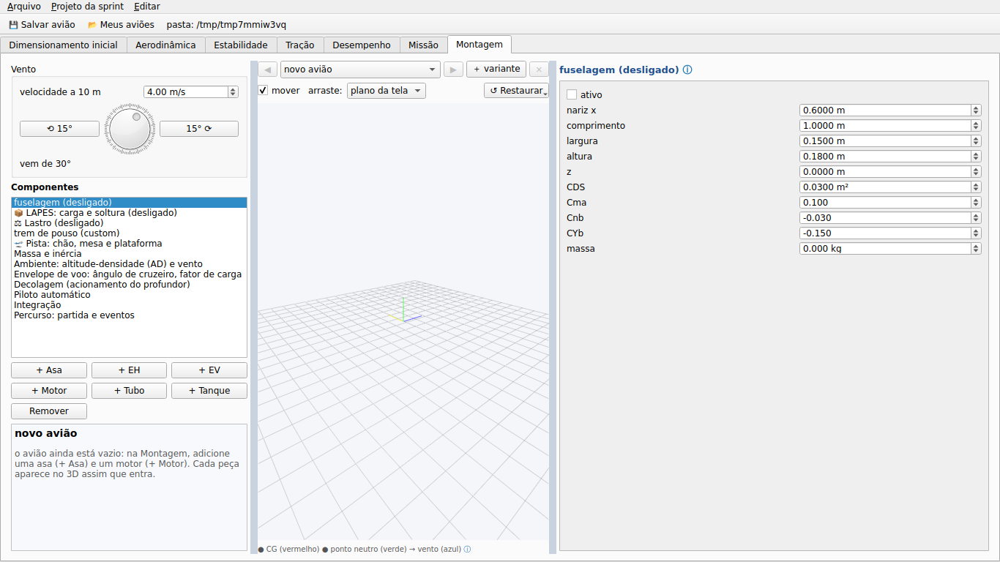
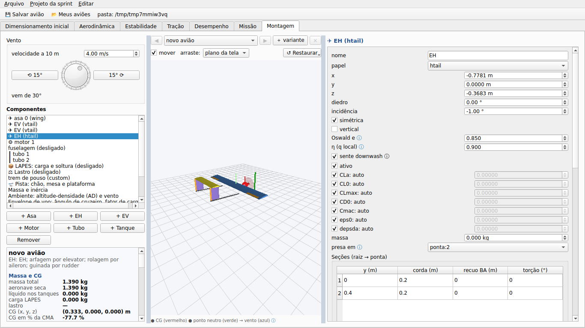
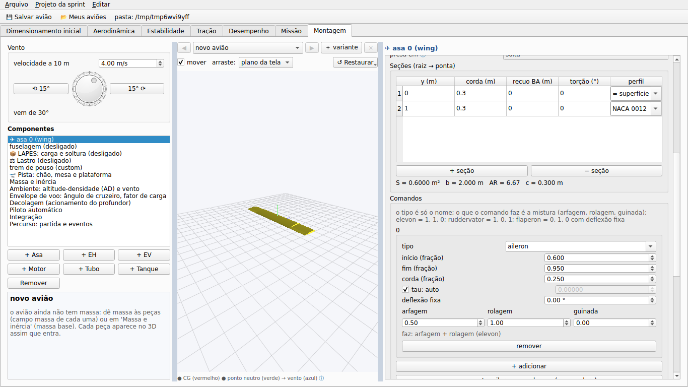
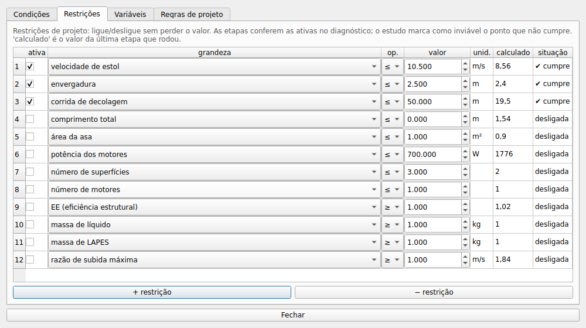
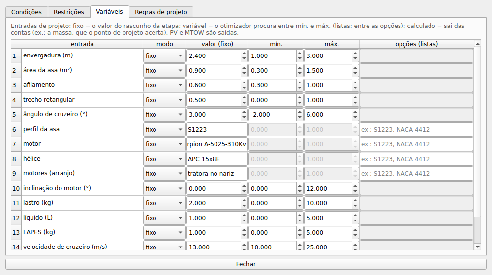
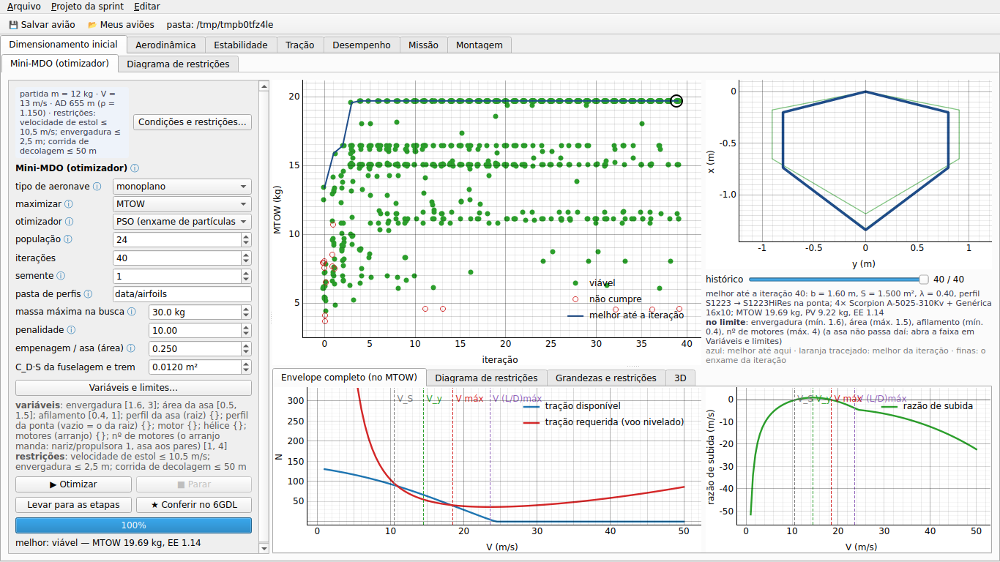
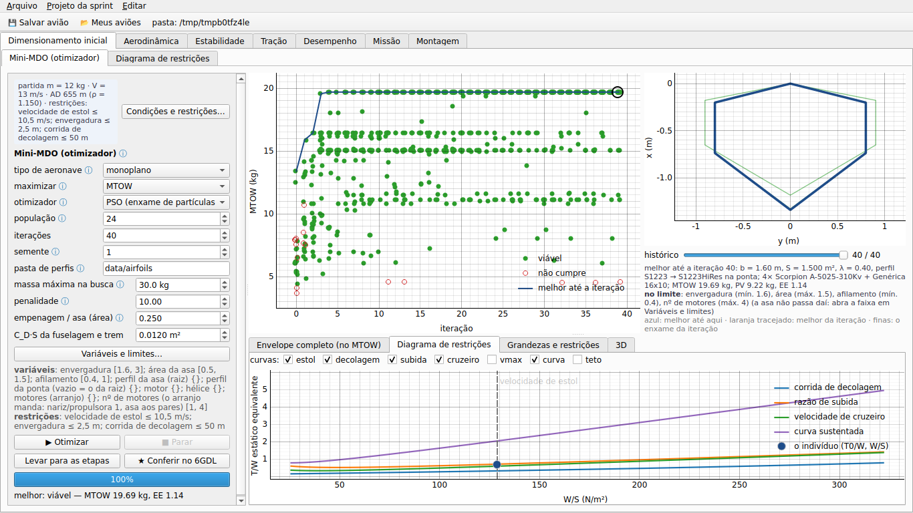
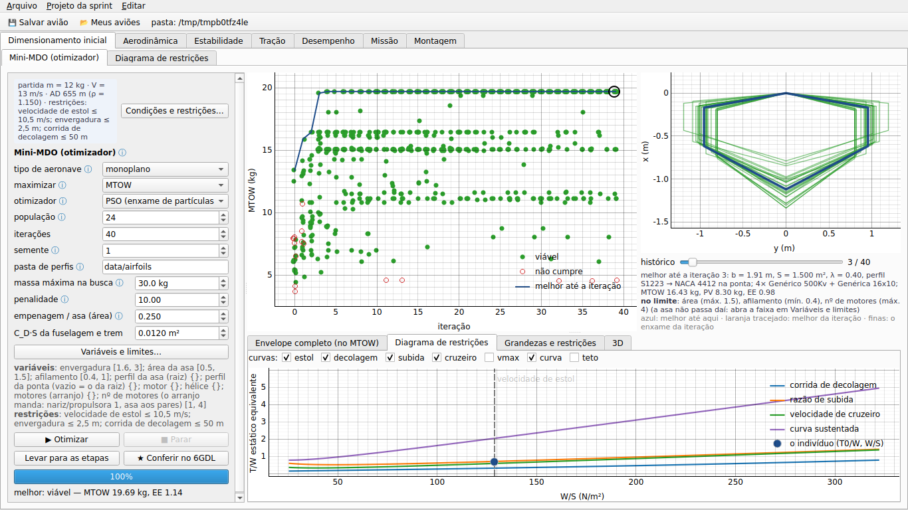
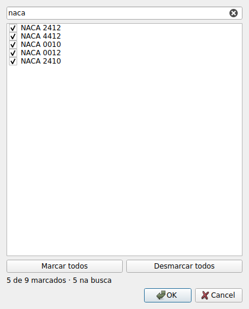

# aerosim

Simulador e ferramenta de projeto para aeronaves pequenas (AeroDesign): você monta o avião (asas,
caudas, motores, trem, tanques com líquido, carga LAPES), e o programa calcula aerodinâmica,
estabilidade, desempenho e simula a missão inteira em 6 graus de liberdade — decolagem do chão ou de
uma mesa, curvas, soltura da carga e pouso numa plataforma — dizendo o que passou, o que falhou e o que
mudar.

- **GUI** (Python + PyQt6): projeto do zero em etapas — perfil → asa → empenagem → motores → avião
  inteiro — e a análise detalhada do avião montado (aerodinâmica, estabilidade, tração, desempenho, missão),
  com diagnóstico em cada aba e Ctrl+Z; a montagem do avião em 3D fica na última aba. Vários aviões (ou
  variantes do mesmo) abertos ao mesmo tempo, trocados com ◀ ▶.
- **Núcleo de física em Zig**: a missão completa (165 s de voo) roda em cerca de 1 s.
- **[AeroDrive](aerodrive/README.md)**: o mesmo avião num simulador em tempo real (raylib), pilotado
  com controle de Xbox ou pelo piloto automático; grava vídeo e dados do voo.


---

## Instalar

Precisa de **Git** e **Python 3.10 ou mais novo** (testado no 3.11). O compilador Zig 0.16 vem pelo
`pip` (pacote `ziglang`).

### 1. Bibliotecas do sistema (só Linux)

A GUI (PyQt6) precisa de OpenGL e X11. Ubuntu / Debian / Mint:

```sh
sudo apt install libegl1 libgl1 libxkbcommon-x11-0 libxcb-cursor0 libxcb-icccm4 libxcb-keysyms1 \
                 libxcb-shape0 libxcb-xinerama0 libxcb-randr0 libxcb-render-util0 libxcb-image0 \
                 libfontconfig1 libdbus-1-3
```

Fedora: `sudo dnf install mesa-libGL mesa-libEGL libxkbcommon-x11 xcb-util-cursor xcb-util-wm xcb-util-keysyms`.
Windows e macOS: nada.

### 2. Repositório e pacotes Python

```sh
git clone https://github.com/vitordallolivo/AircraftSimulation.git
cd AircraftSimulation

python -m venv .venv
source .venv/bin/activate              # Linux/macOS
.venv\Scripts\activate                 # Windows (PowerShell: .venv\Scripts\Activate.ps1)

pip install -r requirements.txt
pip install -r requirements-aero.txt   # opcional: lltdrek e AeroSandbox (comparação na aba Aerodinâmica)
```

### 3. Núcleo em Zig

```sh
cd core
python -m ziglang build --release=fast
cd ..
```

Esse passo é opcional: o Python compila o núcleo sozinho na primeira vez que precisar (e de novo quando
um `.zig` mudar). Com o `zig` 0.16 no PATH, troque `python -m ziglang` por `zig`.

---

## Rodar

### GUI

```sh
python -m aerosim.gui                                              # volta ao último projeto (ou Montagem vazia)
python -m aerosim.gui ~/sprint                                     # abre a pasta da sprint (um arquivo por asa)
python -m aerosim.gui data/sprint/projeto_s1223.json               # projeto antigo: abre e grava em <meus aviões>/sprint/
python -m aerosim.gui data/aircraft/Asa_voadora.json               # abre um avião (.json, .cfg ou .xlsx)
```

- **Projeto da sprint numa pasta** (linha de comando, **Projeto da sprint → Abrir pasta da sprint…** ou
  arrastar a pasta para a janela): um arquivo por asa (a asa + as superfícies feitas para ela + os aviões) e
  o `sprint.json` com o resto. Volta de onde parou — etapas (perfis, asas, conjuntos, aviões,
  estudos), os aviões abertos na Montagem e a aba em que estava; mostra o que está guardado. Sem avião
  guardado no projeto, a **Montagem começa vazia** e o avião aparece no 3D peça por peça
  (**+ Asa, + EH, + EV, + Motor, + Tubo, + Tanque**); a massa vem das peças.
- **Tubos e caudas sem tipo pronto:** quantos tubos quiser, cada um com início (x, y, z), comprimento,
  inclinação e abertura (tubo duplo = dois tubos em y = ±d); cada superfície tem **presa em**: solta, na
  ponta de um tubo ou na ponta de outra superfície (cauda em T, winglet). Cauda em V = EH com diedro.

- **Perfil por seção:** na tabela de seções de cada superfície, a coluna **perfil** ('= superfície', um NACA
  digitado, um perfil já usado no avião ou um `.dat`); entre seções as propriedades do perfil são
  interpoladas e cada faixa vai para o núcleo com as suas.
- **Mistura de comandos:** o tipo do comando é só o nome; o que ele faz é a linha **arfagem, rolagem,
  guinada** (elevon = 1, 1, 0; ruddervator = 1, 0, 1; flaperon = rolagem com deflexão fixa; qualquer
  outra combinação, com ganhos fracionários).
- **Eixo de motor móvel (tilt-rotor):** cada motor tem **eixo móvel: faixa**; a inclinação vai de
  'inclinação' até 'inclinação + faixa' pelo comando de inclinação (0 a 1) do núcleo.





- **💾 Salvar avião / 📂 Meus aviões** guardam seus aviões (pasta `~/aerosim_aeronaves`, ou a variável
  `AEROSIM_PROJETOS`). Exemplos prontos em `data/aircraft/`.
- Em cada aba: preencha os campos (o **ⓘ** explica cada um), clique em **▶ Rodar**; os gráficos
  atualizam enquanto roda; no fim vêm o **diagnóstico** (clique numa linha para ver o porquê e o que
  mudar) e a tabela de resultados; **Exportar** grava `.xlsx` ou `.csv`.
- **Projeto do zero** (subabas de Aerodinâmica, Estabilidade e Desempenho): **Perfil** (candidatos e polar
  2D: NACA, .dat, só parâmetros ou polar do XFLR5) → **Asa** (planta, linha sustentadora, onde estola,
  incidência pelo ângulo de cruzeiro) → **Empenagem e comandos** (cauda por volume, tubo, CG na margem
  pedida, faixa de CG, rotação na decolagem) → **Motores e montagem** (motores, distribuição de massa com PV
  e carga paga só como opções — tem LAPES? quantas; tem líquido? quantos tanques; os kg se decidem na Montagem —, bateria no ponto do CG, trem, desempenho e o MTOW pela pista) →
  **Mandar para a Montagem** ou **Usar em Desempenho** (sem exigir que decole: se não decolar, vai com o aviso); **Estudo e ponto de projeto** (Desempenho) acopla as áreas e varre uma variável (ex.: inclinação do motor) nas altitudes-densidade pedidas (exemplos prontos: `data/aircraft/S1223_*.json` e `data/sprint/projeto_s1223.json`). Cada etapa guarda candidatos com nome; o programa compara,
  não escolhe. **Condições e restrições…** (em toda etapa): condições de partida (massa estimada, velocidade, AD,
  atrito), **restrições** que se ligam e desligam com operador ≤ ≥ = (envergadura, área, estol, corrida — decolar
  em 3 m é só `corrida ≤ 3` —, potência, número de superfícies e de motores, EE, massa de líquido e de LAPES,
  subida...), **variáveis** (fixo, variável com mín./máx. ou lista de opções, calculado) e regras. PV, CP, EE e
  MTOW são saídas.

  
  

  Detalhes em [aerosim/design](aerosim/design/README.md).
- **Projeto novo no padrão SAE AeroDesign**: corrida de decolagem ≤ 6 m (restrição ativa), asa retangular
  (afilamento 1) e a restrição "a asa cabe num retângulo" (envergadura e **corda máxima**, a ligar com os valores do
  regulamento do ano); o avião novo e o montado pelas etapas voam a **missão curta** (decolagem, uma volta,
  passagem LAPES, pouso), com x_warning = 6 m.
- **Dimensionamento inicial → Mini-MDO**: geometria → motorização → envelope de voo → decolagem → MTOW, PV, CP
  e EE, no núcleo Zig, para monoplano, biplano, asa voadora, tailsitter e VTOL. O otimizador (PSO ou busca
  aleatória; a interface aceita outros) avisa a cada iteração: os indivíduos aparecem no gráfico em tempo real, e
  o **histórico das asas** tem um slider (a planta do melhor até cada iteração sobre o enxame dela). A mesma asa
  pode ter perfil diferente na ponta. Clique num indivíduo: envelope, grandezas e restrições, 3D; **Levar para as
  etapas** ou **Conferir no 6GDL**.

  As variáveis e os limites são os de **Condições e restrições → Variáveis** (o botão **Variáveis e limites…** abre
  lá; nada duplicado): fixo, variável (mín. e máx. obrigatórios para grandeza física) ou calculado. Perfil (raiz e
  ponta), motor, hélice e **arranjo dos motores** (nariz, na asa aos pares, propulsora na esteira) são listas: o
  botão abre um seletor com busca e marcar/desmarcar todos; nada marcado = todos. Os perfis vêm da **pasta
  `data/airfoils`** (polar do NeuralFoil) e do projeto. **Limites a partir das restrições** leva envergadura ≤,
  área ≤/≥ e nº de motores para os limites. Do indivíduo clicado: **envelope completo** (tração disponível ×
  requerida e subida na grade inteira, com V_S, V_y, V de L/D máx., V máx.; todas as velocidades na tabela) e o
  **diagrama de restrições** (T/W × W/S com as curvas que você marcar, T/W estático equivalente pela curva da
  hélice dele, e o ponto dele). O histórico mostra o enxame de cada iteração e diz o que está **no limite**.

  
  
  
  
- **Montagem** (última aba): componentes, 3D editável, ambiente (altitude-densidade, vento) e envelope
  de voo (ângulo de cruzeiro, fator de carga). As subabas "Avião montado" e a Missão mostram o avião
  atual em 3D acima dos gráficos.
- **Vários aviões:** **Arquivo → Abrir ao lado** ou **＋ variante** abre mais um; ◀ ▶ troca, e todas
  as abas rodam o escolhido.
- **Ctrl+Z / Ctrl+Y** desfaz e refaz qualquer mudança, na montagem e nas abas.

### Simulador pilotado (AeroDrive)

```sh
cd aerodrive
zig build run -- ../data/aircraft/Convencional_original.json
```

Instalação e comandos em [aerodrive/README.md](aerodrive/README.md).

### Pelo Python (sem GUI)

Rode da raiz do repositório:

```python
from aerosim.manager import SimulationManager
from aerosim.data import load_aircraft

m = SimulationManager()
ac = load_aircraft("data/aircraft/Convencional_original.json")

r = m.run("mission", ac, {"mode": "só decolagem"})   # decolagem otimizada para x_warning e z_warning
print(r.status, r.summary["n_dec"])                  # COMPLETED 51.4

r = m.run("mission", ac)                             # missão inteira, etapa por etapa
print(r.log["t"][-1], r.summary["energia_Wh"])
for c in r.checks:                                   # o diagnóstico
    print(c.status, c.item, c.value)
```

Simulações: `sizing`, `mission`, `performance`, `thrust`, `aerodynamics`, `stability` (mais detalhes em
[aerosim/manager/README.md](aerosim/manager/README.md)).

### Testes

```sh
python -m pytest                       # tudo (~3 min)
python -m pytest tests/manager         # uma parte
(cd core && python -m ziglang build test)        # testes do núcleo em Zig
(cd aerodrive && python -m ziglang build test)   # testes e fuzzing do aerodrive
```

### Fotos das abas (sem tela)

```sh
xvfb-run -a python tools/capturas.py capturas/
```

---

## Problemas comuns

| sintoma | solução |
|---|---|
| `ImportError: libEGL.so.1` / `could not load the Qt platform plugin "xcb"` | instale as bibliotecas do passo 1 |
| `ModuleNotFoundError: No module named 'aerosim'` | rode da raiz do repositório (ou `export PYTHONPATH=$PWD`) |
| `FileNotFoundError: zig` | `pip install ziglang==0.16.0` ou ponha o `zig` 0.16 no PATH |
| erro de compilação do Zig | use exatamente o Zig **0.16** |
| tela cortada em notebook / Wayland | as divisórias entre as colunas são largas: arraste para alargar o painel |
| sem 3D numa máquina remota | o 3D precisa de OpenGL; sem tela use `QT_QPA_PLATFORM=offscreen` (as simulações funcionam) |
