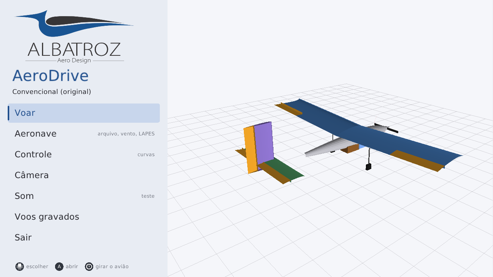
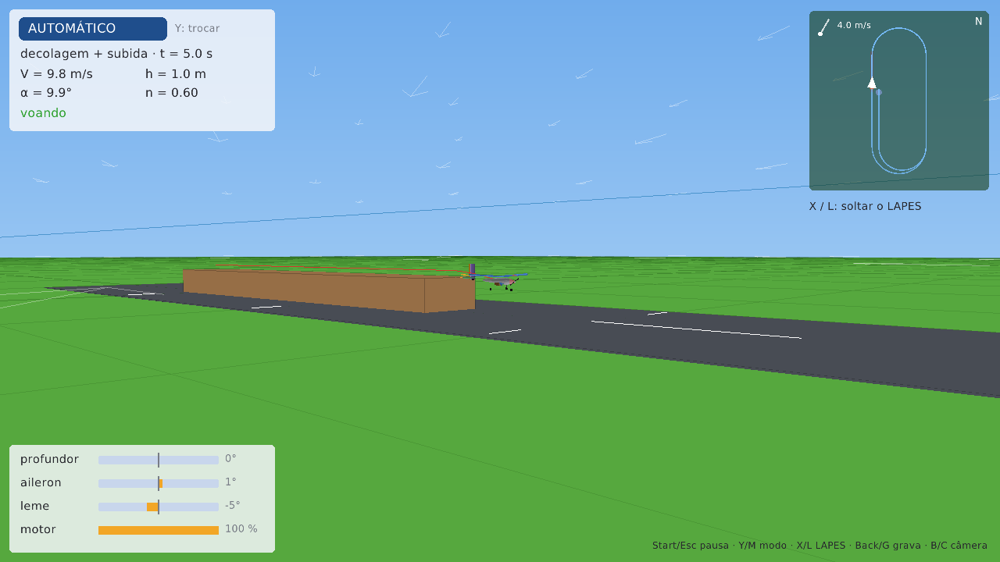
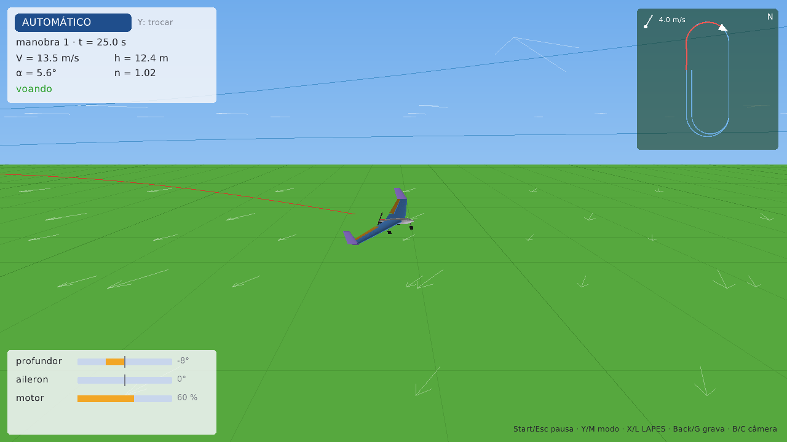
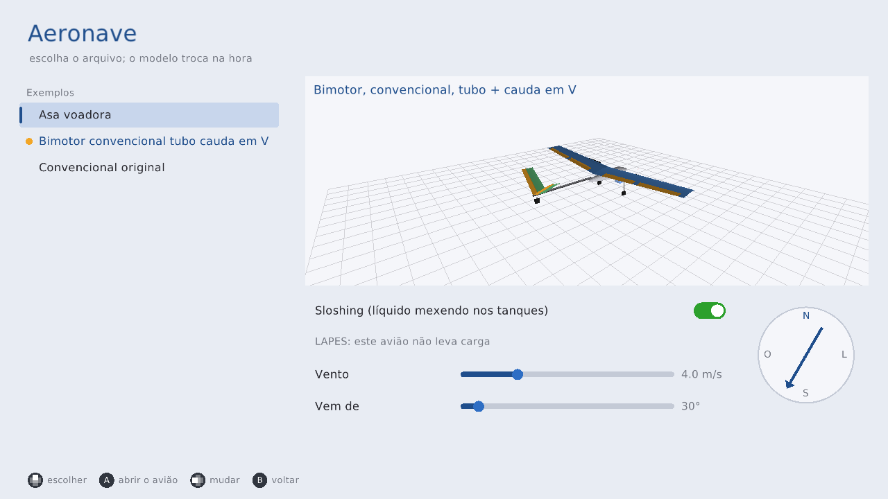
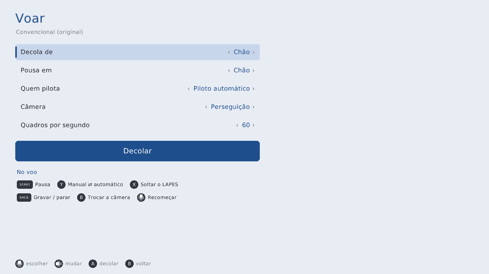
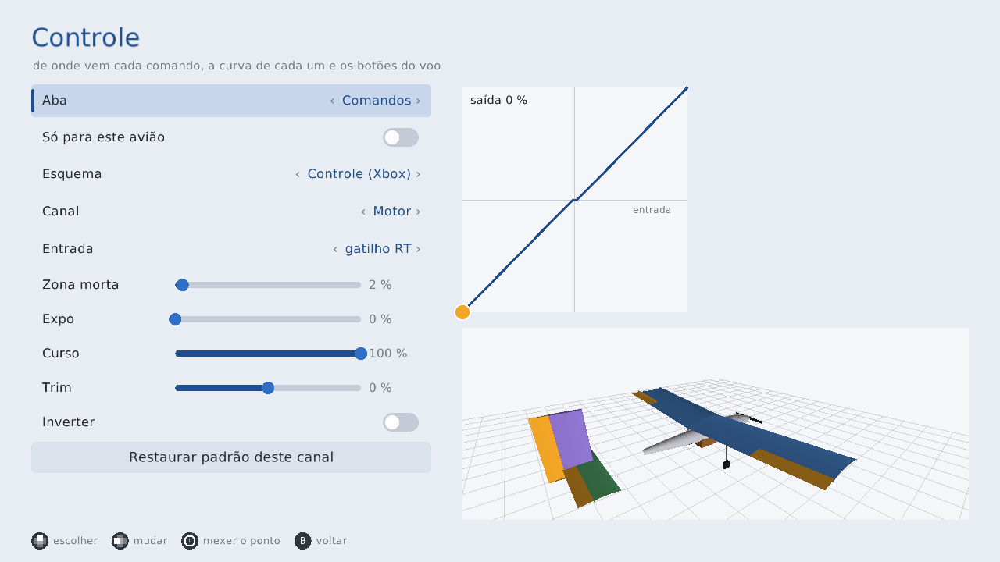
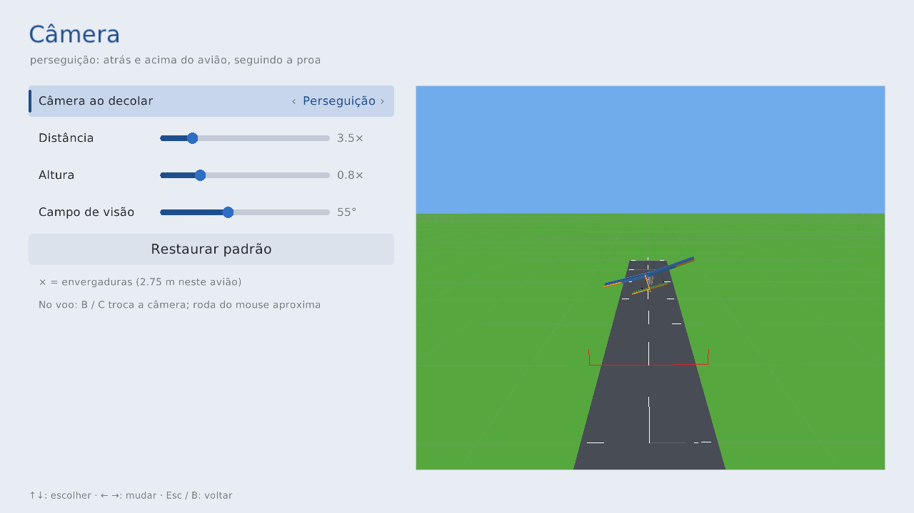
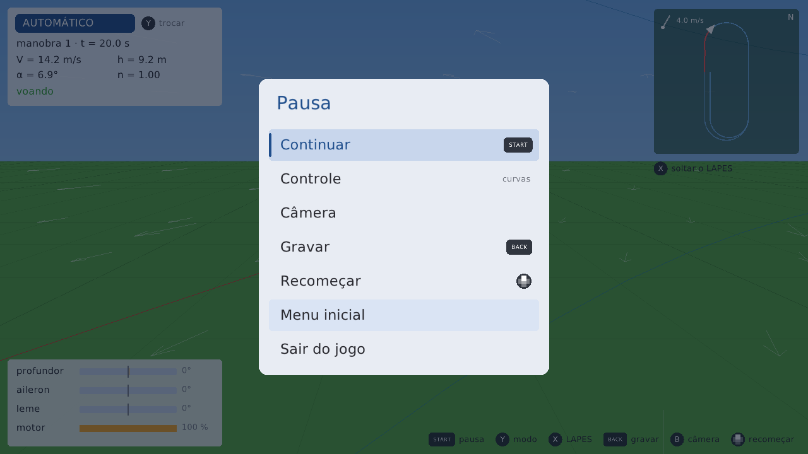
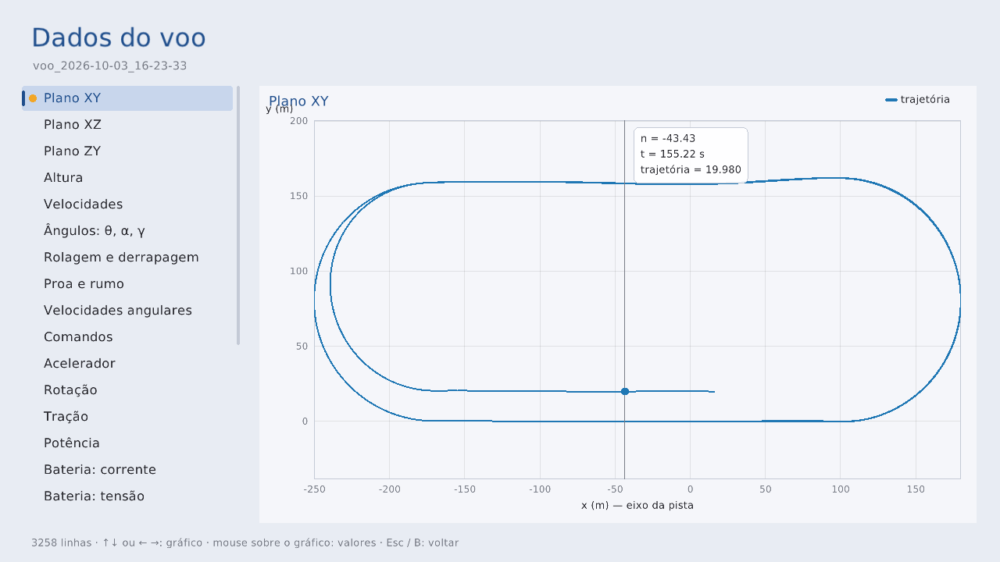
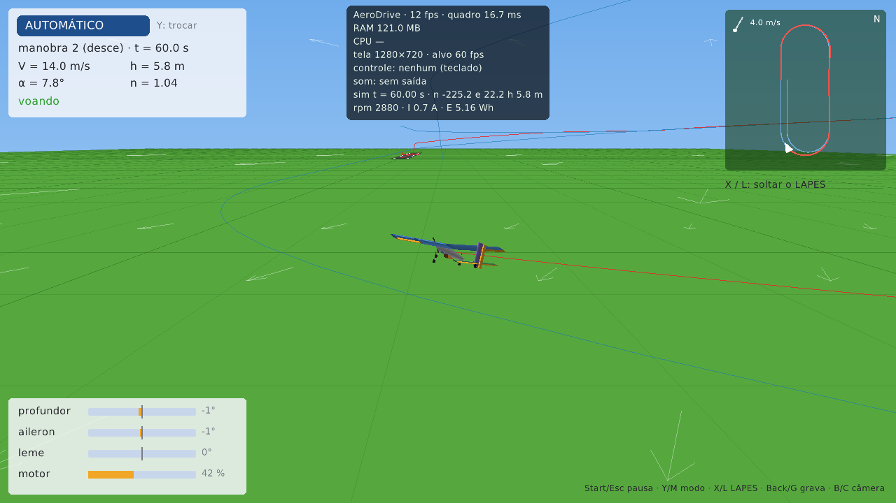

# AeroDrive

Simulador de voo do avião que você monta no aerosim, para pilotar com controle de Xbox (ou rádio em
modo joystick) ou deixar o piloto automático voar o percurso. Abre o mesmo arquivo salvo pela GUI,
desenha a aeronave igual a ela e voa com o mesmo núcleo de física em Zig: decolagem do chão ou da mesa,
LAPES, sloshing nos tanques, vento. Grava vídeo e dados do voo e mostra os mesmos gráficos da aba
Missão. Feito em Zig com [raylib-zig](https://github.com/raylib-zig/raylib-zig).






















---

## Instalar

### 1. Zig 0.16

```sh
pip install ziglang==0.16.0     # vira `python -m ziglang`
```

ou baixe de <https://ziglang.org/download/> e ponha o `zig` no PATH. Abaixo, `zig` = `python -m ziglang`
se você instalou pelo pip.

### 2. Bibliotecas do sistema (só Linux)

| distribuição | comando |
|---|---|
| Ubuntu / Debian / Mint | `sudo apt install libx11-dev libxrandr-dev libxinerama-dev libxi-dev libxcursor-dev libgl-dev` |
| Fedora | `sudo dnf install libX11-devel libXrandr-devel libXinerama-devel libXi-devel libXcursor-devel mesa-libGL-devel` |
| Arch / Manjaro | `sudo pacman -S libx11 libxrandr libxinerama libxi libxcursor mesa` |

Wayland sem XWayland: também `libwayland-dev libxkbcommon-dev` e compile com `-Ddisplay=Wayland`.
Windows e macOS: nada.

Para gravar **vídeo** dos voos: `ffmpeg` no PATH (`sudo apt install ffmpeg`, `winget install ffmpeg`,
`brew install ffmpeg`). Sem ele a gravação guarda só os dados.

### 3. Compilar

```sh
cd aerodrive
zig build
```

A primeira vez baixa e compila o raylib (1 a 2 min); depois usa o cache. Rede com proxy, erros de
compilação e como atualizar o raylib: [docs/raylib.md](docs/raylib.md).

---

## Jogar

```sh
zig build run                                                   # abre o último avião escolhido
zig build run -- ../data/aircraft/Asa_voadora.json              # ou um avião salvo pela GUI
```

No **menu inicial**: Voar, Aeronave (arquivo, sloshing, LAPES, vento), Controle, Câmera, Som (teste),
Voos gravados. Mouse, teclado ou controle: passar o mouse destaca, ↑↓ / direcional escolhe, Enter / A
abre, Esc / B volta, e cada tela mostra os símbolos dos botões do Xbox (ou as teclas, sem controle).
Os menus fazem um clique ao apertar.

**Cada avião lembra o seu jeito**: decola do chão ou da mesa, pousa no chão ou na plataforma, quem
pilota, vento, sloshing, LAPES — e, se você ligar "Só para este avião" nos menus Controle e Câmera,
também as curvas, os botões e a câmera. Ficam em `~/.config/aerodrive/avioes/` (um arquivo por avião);
o geral (último avião, som, fps) em `~/.config/aerodrive/config.json`. O mesmo avião em dois arquivos
que só mudam o campo (ex.: "decola da mesa, pousa na plataforma") aparece uma vez na lista: o campo é
escolha do menu Voar.

**Voo** — começa no **manual**; um botão passa para o piloto automático (e volta) a qualquer momento.
O piloto automático ajusta os próprios ganhos para cada avião (modelo linear do núcleo), e assume do
jeito que o avião estiver: no ar, retoma o percurso pela perna de cruzeiro mais perto.

Comandos (menu Controle → Comandos: escolha o esquema, ou "Personalizado" para pôr cada canal em
qualquer eixo, gatilho ou LB/RB):

| | Controle (Xbox) — padrão | Rádio modo 2 | Rádio modo 1 | teclado |
|---|---|---|---|---|
| aileron | analógico esq. ← → | direito ← → | direito ← → | setas ← → |
| profundor | analógico esq. ↑↓ | direito ↑↓ | esquerdo ↑↓ | setas ↑↓ |
| leme | LB / RB (em rampa) | esquerdo ← → | esquerdo ← → | A / D |
| motor | gatilho RT | esquerdo ↑↓ | direito ↑↓ | W / S |

Botões do voo (menu Controle → Botões: escolha a ação e aperte o botão novo; se ele já era de outra
ação, as duas trocam):

| ação | botão (padrão) | teclado |
|---|---|---|
| pausa (continuar, controle, câmera, gravar, recomeçar, menu) | Start | Esc ou P |
| manual ⇄ automático | Y | M |
| soltar o LAPES | X | L |
| gravar / parar (vídeo + dados) | Back (View) | G |
| trocar a câmera | B | C |
| recomeçar | direcional ↑ | R |
| girar a câmera livre | analógico direito (se livre) | arrastar o mouse |
| painel de desempenho (fps, RAM, CPU) | — | F3 |

Som: a hélice fica mais aguda e mais alta com o motor, e o vento cresce com a velocidade (menu Som
tem os dois testes).

As gravações vão para `~/aerodrive_voos/voo_<data>/` (`video.mp4`, `dados.csv`, `info.json`); a pasta
muda com a variável `AERODRIVE_VOOS`. "Meus aviões" vem de `~/aerosim_aeronaves` (ou
`AEROSIM_PROJETOS`), a mesma pasta da GUI.

### Foto sem abrir janela

```sh
xvfb-run -a zig build shot -- voo.png ../data/aircraft/Convencional_original.json tela=voo voo=40
xvfb-run -a zig build shot -- menu.png tela=controle
```

`tela=` inicio, aeronave, voar, controle, camera, som, voos, dados, voo, pausa · `voo=SEG` voa antes da
foto · `modo=manual|auto` · `cam=seguir|chao|livre` · `mesa` · `f3` · `gravar` · `dados=PASTA` ·
`controle` (mostra os símbolos do Xbox mesmo sem controle ligado).

### Testes

```sh
zig build test                          # testes + fuzzing de todos os módulos (sem janela)
zig build test -Dfuzz=200000 -Dseed=7   # fuzzing mais longo
```

---

Cada módulo e como chamar: [src/README.md](src/README.md). Camadas, interfaces e o que falta:
[docs/projeto.md](docs/projeto.md).
