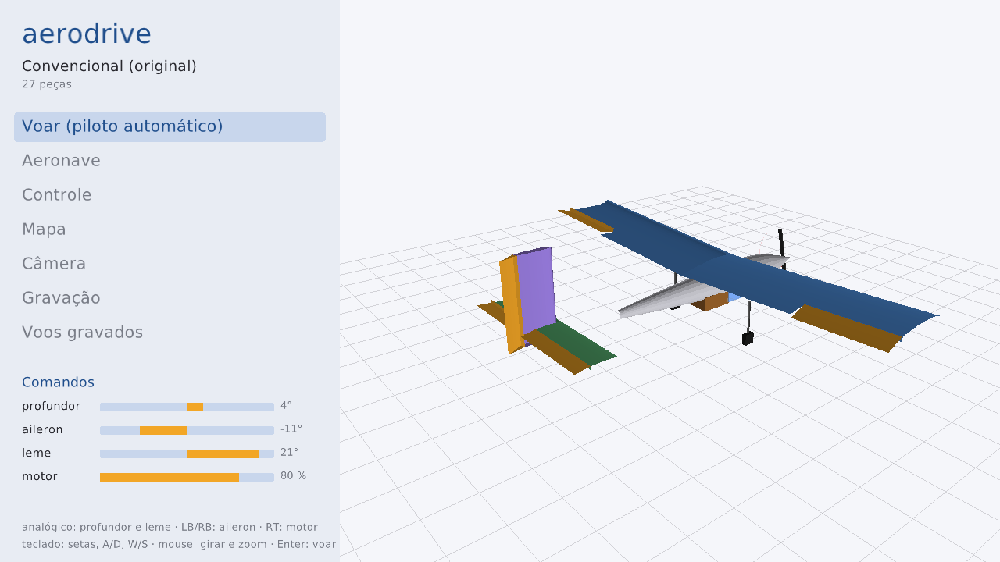
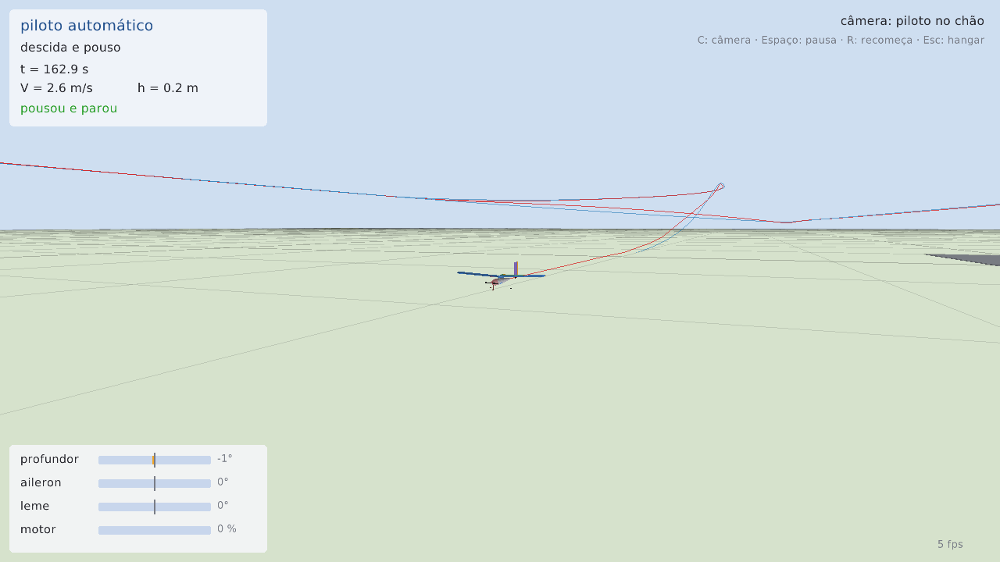

# aerodrive

Simulador em tempo real do avião que você monta no aerosim. Abre o mesmo arquivo salvo pela GUI,
desenha a aeronave igual a ela e voa com o mesmo núcleo de física em Zig: hoje pelo **piloto
automático**, seguindo o percurso do avião (decolagem do chão ou da mesa, circuito, passagem LAPES e
pouso). No hangar, o controle (Xbox ou rádio em modo joystick) mexe nas superfícies ao vivo. Feito em
Zig com [raylib-zig](https://github.com/raylib-zig/raylib-zig); nada de Python.






---

## Instalar

### 1. Zig 0.16

```sh
pip install ziglang==0.16.0     # vira `python -m ziglang`
```

ou baixe de <https://ziglang.org/download/> e ponha o `zig` no PATH. Abaixo, `zig` = `python -m ziglang`
se você instalou pelo pip.

### 2. Bibliotecas do sistema (só Linux)

| distribuição | comando |
|---|---|
| Ubuntu / Debian / Mint | `sudo apt install libx11-dev libxrandr-dev libxinerama-dev libxi-dev libxcursor-dev libgl-dev` |
| Fedora | `sudo dnf install libX11-devel libXrandr-devel libXinerama-devel libXi-devel libXcursor-devel mesa-libGL-devel` |
| Arch / Manjaro | `sudo pacman -S libx11 libxrandr libxinerama libxi libxcursor mesa` |

Wayland sem XWayland: também `libwayland-dev libxkbcommon-dev` e compile com `-Ddisplay=Wayland`.
Windows e macOS: nada.

### 3. Compilar

```sh
cd aerodrive
zig build
```

A primeira vez baixa e compila o raylib (1 a 2 min); depois usa o cache. Rede com proxy, erros de
compilação e como atualizar o raylib: [docs/raylib.md](docs/raylib.md).

---

## Rodar

```sh
zig build run -- ../data/aircraft/Convencional_original.json          # qualquer avião salvo pela GUI
zig build run -- ~/aerosim_aeronaves/meu_aviao.json fps=30            # 30 ou 60 quadros por segundo
```

**Hangar** (tela inicial)

| | controle | teclado / mouse |
|---|---|---|
| profundor e leme | analógico esquerdo | setas ↑↓, A/D |
| aileron | LB / RB | setas ←→ |
| motor | gatilho direito (RT) | W / S |
| girar e aproximar o avião | — | arrastar / roda do mouse |
| **voar (piloto automático)** | Start | Enter, ou clicar em "Voar" |

**Voo**

| tecla | faz |
|---|---|
| C | troca a câmera: piloto no chão (zoom automático), perseguição, livre |
| Espaço | pausa |
| R | recomeça na pista |
| Esc | volta ao hangar |
| roda do mouse / arrastar | zoom / girar (câmera livre) |

Avião com erro no arquivo (seção sem corda, número inválido...): a janela mostra o que está errado e
em qual componente.

### Foto sem abrir janela

```sh
xvfb-run -a zig build shot -- ../data/aircraft/Asa_voadora.json asa.png 1280x720 demo
xvfb-run -a zig build shot -- ../data/aircraft/Convencional_original.json voo.png voo=40 cam=seguir
```

`demo`: superfícies se mexendo no hangar · `vista=az,el,zoom`: ângulo da câmera do hangar ·
`voo=SEG`: voa SEG segundos e fotografa · `cam=chao|seguir|livre`.

### Testes

```sh
zig build test                          # testes + fuzzing de todos os módulos (sem janela)
zig build test -Dfuzz=200000 -Dseed=7   # fuzzing mais longo
```

---

O que cada módulo faz e como chamar: [src/README.md](src/README.md). O plano (o que falta, interfaces):
[docs/projeto.md](docs/projeto.md).
