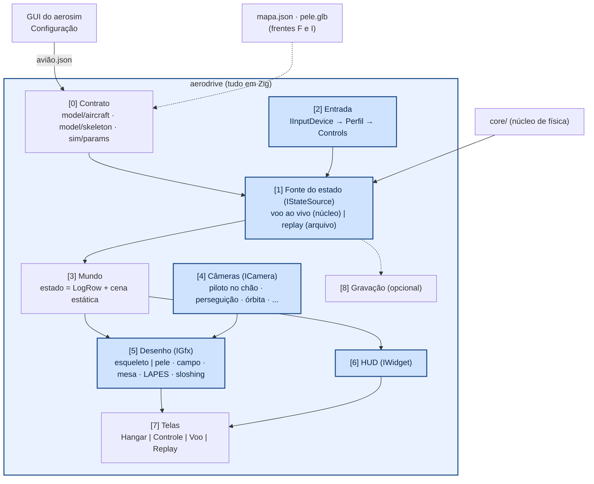

# aerodrive — projeto: camadas, interfaces e frentes

O plano do simulador pilotado: o que já existe, o que falta e as interfaces entre as partes. Como
instalar e rodar: [../README.md](../README.md). O que cada módulo faz e como chamar:
[../src/README.md](../src/README.md).

## Frentes

| frente | o quê | estado |
|---|---|---|
| **A. Contrato** | ler o avião salvo pela GUI (`model/aircraft.zig`) e o perfil (`model/airfoil.zig`), com validação e mensagens | ✅ |
| **B. Desenho da aeronave** | esqueleto (`model/skeleton.zig`), poses (`gfx/pose.zig`), raylib (`gfx/render.zig`), hangar | ✅ |
| C. Núcleo pilotado | `sim/params.zig` monta os parâmetros do núcleo em Zig (iguais aos da GUI até 10⁻⁶, com a calibração); `sim/drive_manager.zig` roda o núcleo e manda os comandos às superfícies (piloto automático). Falta: comandos do controle entrando no núcleo (manual/assistido) | começada |
| D. Controle | perfil em arquivo, tela "Controle" (zoom na peça + curva ao vivo); as contas já estão em `input/channels.zig` | começada |
| E. Câmeras | `camera/camera.zig`: órbita, perseguição e piloto no chão (zoom automático). Falta: cabine, de cima, zoom em peça | começada |
| F. Mapa | `world/field.zig`: chão com grade, pista com marcas a cada 10 m, x_warning, mesa/plataforma (os pads da física), percurso planejado. Falta: mapa por arquivo, objetos | começada |
| G. Voo | `screens/flight.zig`: tempo real 30/60 fps, rastro, HUD mínimo (etapa, V, h, comandos) | começada |
| H. Gravação | `.adr` opcional, replay, "Voos gravados" na GUI | a fazer |
| I. Pele | .glb do Blender/SolidWorks sobre o esqueleto | a fazer |

**Regras de todo módulo Zig:** teste próprio + **fuzzing** (`fz.check`, `src/util/fuzz.zig`):
entradas quaisquer (NaN, ±inf, enormes, listas vazias, bytes aleatórios) só podem dar um **erro
previsto, com mensagem** — nunca travar, vazar memória ou desenhar lixo. `zig build test` roda 2000
casos por módulo; `zig build test -Dfuzz=200000 -Dseed=7` para uma rodada longa.

Princípios:

- **tudo em Zig, sem Python**: o aerodrive lê direto o arquivo do avião que a GUI salva
  (`data/aircraft/*.json`, "meus aviões") e monta a geometria sozinho, com as mesmas contas da GUI
  (portadas para Zig). A configuração continua sendo feita na GUI.
- **física ≠ aparência**: a dinâmica acontece só no modelo do núcleo. O que se vê é um *esqueleto*
  (gerado da mesma geometria da GUI) e, por cima e opcional, uma *pele* (Blender, SolidWorks). A pele
  nunca entra na física.
- **tudo é trocável por interface**: fonte do estado (voo ao vivo ou gravação), dispositivo de entrada,
  câmera, instrumentos do HUD, e o próprio desenho (raylib fica atrás de uma camada fina).
- **menos é mais** na tela, como na GUI: rótulos curtos, explicação no ⓘ.

---

## 1. Camadas



Cada camada só conhece a de baixo pela interface. O desenho ([5]) não sabe se o estado vem do voo ao vivo
ou de uma gravação: o replay é o mesmo desenho alimentado por outra fonte.

---

## 2. [0] Contrato com o aerosim: o arquivo do avião

O aerodrive lê o mesmo `.json` que a GUI grava (`{"aeronave": {...}}`), só os campos que usa
(`model/aircraft.zig`; o resto é ignorado). `validate` confere tudo o que pode quebrar o desenho e
devolve um erro com o componente ("asa: 'chord' tem de ser > 0"). Limites: 16 superfícies, 32 seções,
8 comandos/dispositivos por superfície, 8 motores, 8 tanques, coordenadas até ±50 m.

As contas da geometria são as da GUI, portadas: estações nas quebras (seções + início/fim dos comandos),
cauda presa na ponta do tubo, perfil NACA pelo nome (ou as coordenadas do arquivo, reamostradas para
80 pontos), dispositivos de ponta, trem pelo tipo. Para a física (frente C) os `params` do núcleo
também serão montados em Zig a partir do mesmo arquivo.

### Esqueleto (a aparência obrigatória)

Lista de **peças** (`model/skeleton.zig`). Cada peça tem malha, cor (a paleta da GUI) e um
*driver* que diz como ela se move:

```
Peça {
  id        "asa", "aileron_E", "profundor", "helice_0", "roda_principal_D", "tanque_0", "lapes", ...
  pai       id da peça-mãe (o corpo é a raiz)
  tipo      superficie | comando | fuselagem | tubo | motor | helice | roda | perna | tanque | liquido |
            carga | lastro
  malha     vértices + faces (corpo, metros) — as mesmas de geometry.py
  cor       chave da paleta da GUI (wing, control, motor, liquid...)
  driver    fixo
          | dobradiça { eixo: p0→p1 (linha de articulação), canal: (de, da, dr) · mix, limites }
          | giro      { eixo, canal: rpm[i] }                 (hélice)
          | líquido   { tanque i, canal: slosh_x[i], slosh_y[i] } (inclina a superfície)
          | carga     { canal: pk_n, pk_e, pk_h }             (solta da aeronave após a soltura)
}
```

- O `mix` do comando é o mesmo do tradutor (`_mix`: profundor, aileron com sinal do lado, elevon,
  ruddervator, leme). Assim o aileron desenhado deflete exatamente como o núcleo aplica.
- Hoje `control_meshes` desenha uma placa por cima da superfície. No esqueleto o comando vira **peça
  separada com dobradiça** (e a superfície fica sem aquele pedaço), para poder girar.
- As formas e cores são as de `aerosim/model/geometry.py` e `gui/widgets/view3d.py`; o teste
  "os aviões de exemplo da pasta data/aircraft montam" confere os quatro exemplos.

### Pele (opcional, "maquiagem")

- Arquivo **glTF 2.0 (.glb)**: o Blender exporta direto; do SolidWorks: STL/OBJ → Blender → .glb (ou OBJ,
  que o raylib também lê).
- `pele.json` liga a pele ao esqueleto:
  - alinhamento: escala (mm → m), eixos (glTF é Y para cima; o corpo é x à frente, y à direita, z para
    baixo), origem;
  - nós da pele → peças do esqueleto (`"Aileron.L" → "aileron_E"`). Nó ligado gira com a dobradiça da
    peça; nó sem ligação vai preso ao corpo.
- Tela "Aparência": pele semitransparente sobre o esqueleto para alinhar. Botão alterna esqueleto, pele
  ou os dois.

---

## 3. [1] Fonte do estado — `IStateSource`

```
IStateSource {
  avançar(dt_quadro, controls) -> LogRow     // estado no fim do quadro
  reiniciar(ponto)                           // pista, mesa, ar, checkpoint
  salvar_snapshot() / carregar_snapshot()    // já existe no núcleo
  tempo()
}
```

- **VooAoVivo**: o núcleo. A cada quadro roda até `t + dt_quadro` com o passo interno de sempre (1 ms).
- **Replay**: lê a gravação; `avançar` interpola entre linhas; permite pausar, voltar, ×0,5, ×2.

O que falta no núcleo (pequeno):
- `Controls` externos (δe, δa, δr, acelerador, flap, soltar LAPES) e modo: **manual**, **assistido**
  (estabiliza φ e θ como o modo "ângulo" dos rádios, com os laços do piloto automático) ou **automático**
  (como hoje).
- Atitude da carga depois da soltura (hoje o `LogRow` tem só `pk_n, pk_e, pk_h`).

### Tempo

- Quadro fixo escolhido: **30 ou 60 fps**. Física por acumulador: cada quadro executa `dt_quadro / 1 ms`
  passos (16 a 33). O núcleo faz o percurso inteiro em segundos, então sobra muito tempo.
- Se um quadro atrasar, limita a recuperação (não acumula atraso) e mostra "lento" no HUD.
- Entrada lida uma vez por quadro; comandos mantidos durante o quadro.

---

## 4. [2] Entrada — `IInputDevice` → `Perfil` → `Controls`

```
IInputDevice { eixos[]: -1..1 ou 0..1, botões[] }      gamepad (Xbox), rádio USB, teclado
Perfil (perfil.json) — um item por canal:
  canal     profundor | aileron | leme | motor | flap | soltar_LAPES | reiniciar | câmera | gravar ...
  fonte     eixo k | par de botões (− / +, com rampa) | gatilho | botão
  curva     inverter, zona morta, trim, dual rate, expo   — ou —   curva por pontos (5 a 9 pontos, como nos rádios)
```

- Padrão proposto: **gatilho direito = motor** (0 a 100 %), **botões de ombro (LB/RB) = aileron** (com
  rampa), analógico esquerdo = profundor e leme; o modo 2 dos rádios fica como outro perfil.
- Gravar o perfil é salvar o `perfil.json` (um por controle/piloto).

---

## 5. [3] Mundo e [5] Desenho

**Estado de render = `LogRow` + cena estática.** Tudo o que se move vem do `LogRow` que o núcleo já
gera: posição (n, e, h), atitude (φ, θ, ψ), comandos (de, da, dr), `rpm`, carga (`pk_*`), sloshing
(`slosh_x/y`), vento (`Wn, We, Wd`), altura do chão (`hgnd`).

Mapa (`mapa.json`), só primitivas:
- **chão legível**: grade de 1 m (fraca) e 10 m (forte), pista com eixo central e marcas a cada 10 m,
  **linha do x_warning** e números de distância; cores lisas e claras.
- **mesa e plataforma** saem dos *pads* do próprio `params` (`terrain.zig`): uma fonte só, a física e o
  desenho batem.
- objetos (caixas, cilindros, cones: hangar, árvores, navio, cais), água como plano, heightmap PNG
  opcional; ponto do piloto no chão; biruta pelo vento.
- os objetos também podem ter pele (.glb), com o mesmo mecanismo da aeronave.

Coordenadas: núcleo em NED (n, e, h para cima) e corpo (x à frente, y à direita, z para baixo). **Uma**
função converte para o raylib (Y para cima). Mais nenhuma conversão espalhada.

`IGfx` (camada fina sobre o raylib): enviar malha, desenhar malha com transformação e cor, linhas, texto,
viewport. Trocar o raylib depois = reescrever só ela.

---

## 6. [4] Câmeras — `ICamera`

```
ICamera { atualizar(estado, entrada, dt) -> Vista { posição, alvo, para_cima, fov } }
```

| câmera | uso |
|---|---|
| **piloto no chão** | parada no ponto do piloto; só os "olhos" seguem a aeronave; zoom automático (fov) para ela não sumir — como no SeligSIM/RealFlight |
| perseguição | atrás da aeronave a uma distância fixa, com atraso suave |
| cabine | no corpo, olhando à frente |
| órbita | hangar e telas de configuração (arrastar para girar) |
| de cima | mapa / janela pequena (vista de pássaro) |
| zoom em peça | aproxima uma peça do esqueleto (motor, aileron) na tela de controle |

Uma **viewport** = câmera + retângulo da tela. A tela de voo tem a principal e janelas pequenas opcionais
(de cima, perseguição).

---

## 7. [6] HUD — `IWidget`

```
IWidget { desenhar(retângulo, estado, perfil) }      lista e posições em hud.json
```

Instrumentos (a referência é o RealFlight): velocidade (radar), altura e razão de subida, α / β / G,
**C_L/C_Lmax** (aviso de estol), rpm e acelerador, **SOC**, distância de pouso, cronômetros, **rádio na
tela** (posição dos sticks e gatilhos), mapa com vento, bússola, controles do gravador (◀◀ ◀ ❚❚ ▶ ▶▶).
Cada um liga/desliga; poucos ligados por padrão.

---

## 8. [7] Telas

- **Hangar (menu inicial)**: estilo menu de jogo. À esquerda: Voar, Aeronave, Controle, Mapa, Câmera,
  Gravação, Voos gravados. À direita: a aeronave em órbita, **viva**: mexer no controle deflete as
  superfícies e o gatilho gira a hélice.
- **Controle**: lista de canais à esquerda. Escolher um canal faz a **câmera dar zoom na peça** (motor,
  aileron...) e mostra o editor da curva: o ponto anda na curva conforme o controle é pressionado e a
  peça se move junto. Editar arrastando os pontos ou com expo/rate/trim. Salvar = gravar o perfil.
- **Voo**: viewport principal + HUD. Pausa, reiniciar (pista, mesa, ar), voltar 5 s (snapshot a cada 1 s),
  soltar LAPES, trocar câmera, ligar/desligar gravação.
- **Replay**: a mesma tela de voo com `Replay` como fonte e a barra do gravador.

---

## 9. [8] Gravação (opcional)

Desligada por padrão; liga no Hangar ou durante o voo. Não roda no laço do quadro (buffer + gravação em
segundo plano).

Arquivo `.adr`:
1. cabeçalho: `abi_version`, cópia do `params` usado, snapshot inicial, taxa;
2. `Controls` de cada quadro — refaz o voo exatamente (núcleo determinístico);
3. linhas de `LogRow` na taxa escolhida — lidas pelo aerosim sem código novo (o `abi.py` já monta o dtype
   pelo schema) e mostradas com os gráficos da Missão em "Voos gravados".

---

## 10. Pastas

```
aerodrive/
  build.zig, build.zig.zon     raylib pelo gerenciador de pacotes do Zig
  docs/raylib.md               tutorial
  src/
    main.zig                   argumentos, leitura do avião, janela
    tests.zig                  todos os testes sem janela
    util/fuzz.zig              fuzzing (Smith do Zig ou gerador aleatório)
    math/vec3.zig              vetores, rotações, corpo -> NED
    model/aircraft.zig         [A] arquivo do avião: esquema, leitura, validação
    model/airfoil.zig          [A] perfil NACA / coordenadas, corte do comando
    model/skeleton.zig         [B] peças, malhas e drivers
    gfx/pose.zig               [B] driver + estado -> transformação (sem gráficos)
    gfx/render.zig             [B] raylib-zig: malhas na GPU, sombreamento da GUI, campo, rastro
    camera/camera.zig          [E] interface de câmera: órbita, perseguição, piloto no chão
    sim/mission.zig            [C] percurso -> segmentos, eventos, mesas/plataformas do núcleo
    sim/params.zig             [C] avião -> parâmetros do núcleo + calibração do piloto
    sim/drive_manager.zig      [C] dono da simulação: avança o núcleo e entrega pose e comandos
    world/field.zig            [F] chão, pista, marcas, x_warning, pads, percurso
    screens/flight.zig         [G] tela de voo
    input/channels.zig         [D] curvas dos canais (zona morta, expo, rate, trim)
    ui/theme.zig               cores e fonte com acentos
    screens/hangar.zig         menu inicial com a aeronave viva
```
