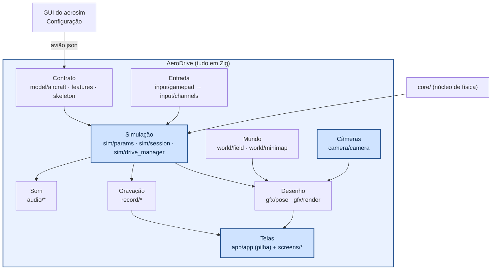
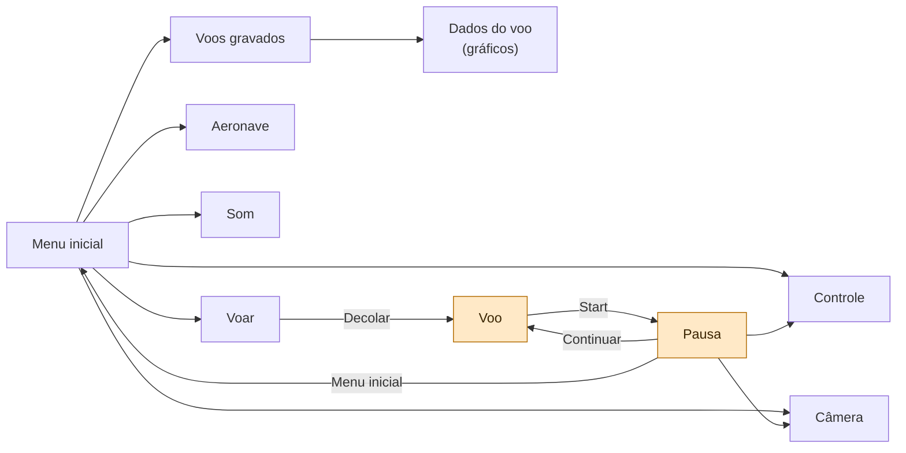
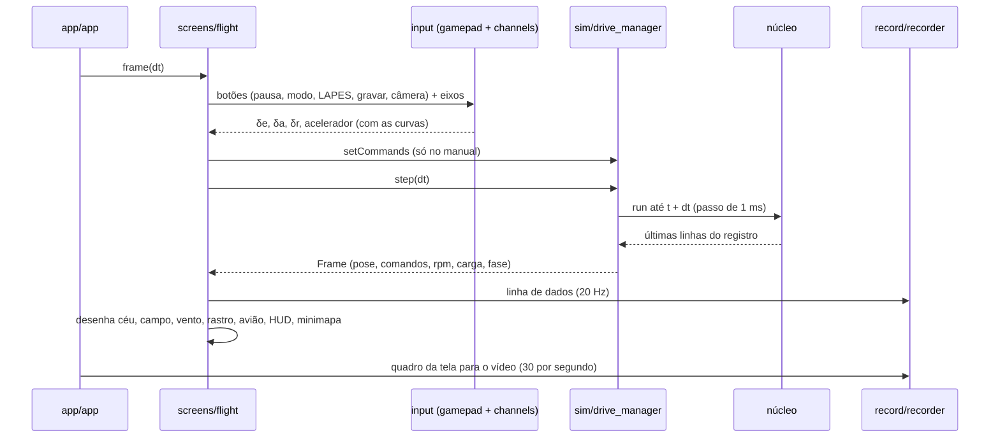

# AeroDrive — projeto: camadas, interfaces e frentes

O que já existe, o que falta e como as partes conversam. Como instalar e jogar:
[../README.md](../README.md). Cada módulo e como chamar: [../src/README.md](../src/README.md).

## Frentes

| frente | o quê | estado |
|---|---|---|
| **A. Contrato** | ler o avião salvo pela GUI (`model/aircraft.zig`, `model/airfoil.zig`) com validação e mensagem; o que o avião tem (`model/features.zig`: canais, LAPES, tanques) | ✅ |
| **B. Desenho** | esqueleto (`model/skeleton.zig`), poses (`gfx/pose.zig`), raylib (`gfx/render.zig`) | ✅ |
| **C. Núcleo pilotado** | parâmetros iguais aos da GUI (`sim/params.zig`); `sim/drive_manager.zig` com **manual** (o controle vai direto ao núcleo) e **automático** (o percurso da GUI), troca no meio do voo sem tranco; soltura do LAPES pelo botão | ✅ |
| **D. Controle** | curvas por canal (`input/channels.zig`), leitura do controle/teclado (`input/gamepad.zig`), menu Controle com o ponto ao vivo e zoom na peça | ✅ |
| **E. Câmeras** | perseguição (distância/altura/fov no menu Câmera, com prévia), piloto no chão (zoom automático), livre | ✅ (falta cabine) |
| **F. Mapa** | chão verde, pista, x_warning, mesa/plataforma, percurso, setas do vento, minimapa XY | ✅ (falta mapa por arquivo) |
| **G. Voo** | tempo real, HUD, minimapa, pausa com opções, painel F3 (fps, RAM, CPU) | ✅ |
| **H. Gravação** | botão no voo: vídeo .mp4 (ffmpeg) + dados .csv; "Voos gravados" abre o vídeo ou todos os gráficos | ✅ |
| **I. Som** | som da hélice: mais motor = mais agudo e mais alto; menu Som com teste | ✅ |
| J. Pele | .glb do Blender/SolidWorks sobre o esqueleto | a fazer |
| K. Modo assistido | estabiliza φ e θ (modo "ângulo" dos rádios) com os laços do piloto automático | a fazer |

**Regra de todo módulo Zig:** teste próprio + **fuzzing** (`fz.check`, `src/util/fuzz.zig`): entradas
quaisquer (NaN, ±inf, enormes, listas vazias, bytes aleatórios) só podem dar um **erro previsto** —
nunca travar nem vazar memória. As contas ficam fora do raylib (testáveis); os arquivos que desenham
(`gfx/render`, `ui/`, `screens/`, `audio/player`, `app/app`) são conferidos pelas fotos do `--shot`.

---

## Camadas

## Telas

Cada menu é um arquivo em `screens/` com o mesmo contrato (`frame(app, dt) → Next`); nenhuma conhece
as outras — pedem `abrir X`, `voltar`, `início` ou `sair` ao gerenciador (`app/app.zig`, uma pilha que
lembra o item em destaque de cada tela).

## Um quadro do voo

## Pastas

| pasta | o que tem |
|---|---|
| `app/` | o jogo (`app.zig`: pilha de telas e o que elas dividem), configurações salvas, caminhos, biblioteca de aviões |
| `screens/` | um arquivo por tela: menu inicial, aeronave, voar, controle, câmera, som, voos gravados, dados do voo, voo, pausa |
| `ui/` | tema, widgets (mouse/teclado/controle), exposição 3D, prévia, gráfico, minimapa, painel F3 |
| `model/` | arquivo do avião, perfil, esqueleto, recursos (canais, LAPES, tanques) |
| `sim/` | parâmetros do núcleo, percurso, sessão (cenário, vento...), drive_manager |
| `input/` | leitura do controle/teclado e curvas dos canais |
| `camera/`, `gfx/`, `world/` | câmeras, desenho, campo e minimapa |
| `record/` | dados (CSV), vídeo (ffmpeg), gravações e páginas de gráficos |
| `audio/` | som do motor (contas) e o tocador |
| `sys/` | memória e CPU do processo (painel F3) |
| `assets/` | logo da Albatroz e o som da hélice (vão dentro do programa) |
