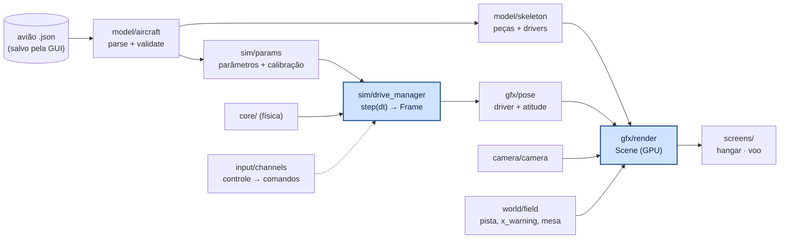

# aerodrive/src — módulos

Cada módulo é um arquivo `.zig` com os próprios testes e um teste de **fuzzing** (`fz.check`): entradas
quaisquer só podem dar um erro previsto com mensagem, nunca travar. Só `gfx/render.zig`, `ui/` e
`screens/` conhecem o raylib; o resto roda (e é testado) sem janela.

Ordem de uma execução:



---

## model/aircraft.zig — ler o avião

Lê o `.json` que a GUI grava (`{"aeronave": {...}}` ou a aeronave direto), só os campos usados, e valida.

```zig
var diag: aircraft.Diag = .{};
var loaded = try aircraft.parse(gpa, bytes, &diag);   // erro: diag.text() = "asa: 'chord' tem de ser > 0 (está -1)"
defer loaded.deinit();
const ac = &loaded.ac;                                // aircraft.Aircraft
```

- `parse` = JSON → `std.json.Value` → `Aircraft` (campos desconhecidos ignorados) → `validate`.
- `validate` confere números finitos, medidas positivas, até ±50 m, frações de comando em 0..1, limites
  (16 superfícies, 32 seções, 8 motores, 8 tanques). Erros: `NotJson`, `NoAircraft`, `BadField`,
  `TooMany`, `NonFinite`, `TooLarge`, `NotPositive`, `TooFewSections`, `BadFraction`.
- Ajudas da geometria da GUI: `semispan`, `sortedSections` + `sectionAt` (interpolação das seções),
  `tailOnBoom` (cauda presa na ponta do tubo).

## model/airfoil.zig — perfil

```zig
var p: airfoil.Profile = .{};
try airfoil.full("NACA 2412", &.{}, &p);              // ou as coordenadas do arquivo
const r = airfoil.thinAirfoil(p.slice());             // .{ α_L0 (graus), C_m,ac } — perfil fino
try airfoil.forDrawing(name, coords, &p);             // ≤ 80 pontos (para desenhar)
const h = airfoil.split(p.slice(), 0.75, &frente, &comando);   // corta na articulação
```

`naca4` com espaçamento cosseno (121 pontos), `helmbold(a0, AR)`, `flapEffectiveness(c_f/c)` — as
mesmas contas de `aerosim/model/airfoil.py` (testado igual até 10⁻⁶).

## model/skeleton.zig — peças desenháveis

```zig
var sk = try skeleton.build(gpa, ac, &diag);
defer sk.deinit();
for (sk.pieces) |p| { p.mesh.v; p.mesh.f; p.color; p.driver; }
```

Mesmas formas e cores da GUI: superfícies pelo perfil (estações nas seções e nas bordas dos comandos),
dispositivos de ponta, fuselagem, tubo, motor, disco e pá da hélice, tanque e líquido, LAPES, lastro,
trem. Cada **comando é uma peça separada** com `driver = .hinge` (ponto e eixo da articulação, `mix`
igual ao do núcleo: δ = mix·(δe, δa, δr), δ > 0 leva o bordo de fuga para o lado oposto à normal). Outros
drivers: `.spin` (pá: gira com o rpm), `.liquid` (inclina com o sloshing), `.payload` (sai na soltura).

## gfx/pose.zig — onde cada peça está

```zig
const st: pose.DriveState = .{ .de = de, .da = da, .dr = dr, .prop_angle = ang };
const r = pose.piece(peca.driver, st).then(pose.body(pos_ned, phi, theta, psi));
const v_mundo = r.apply(v_corpo);
```

Transformação rígida = rotação do driver em torno do eixo + atitude (3-2-1) + posição NED. Comandos
saturam em ±60°; valores não finitos viram 0.

## gfx/render.zig — desenho (raylib)

```zig
var scene = try render.Scene.init(gpa, &sk);     // sobe as malhas para a GPU (uma vez)
rl.beginMode3D(render.camera3d(camera.view()));
render.drawField(&campo);                         // chão, pista, x_warning, mesa
scene.draw(body, drive_state, carga_solta);       // a aeronave
rl.endMode3D();
```

A única conversão de eixos do programa: NED → tela `(e, −d, −n)`. Sombreamento igual ao da GUI (duas
faces, luz presa à câmera). Transparentes (disco da hélice, tanque) depois das opacas.

## camera/camera.zig — câmeras

```zig
var c: camera.Camera = .{ .ground = .{ .eye = .{ 30, 14, -1.7 }, .size = envergadura } };
c.update(.{ .target = pos_ned, .heading = psi, .zoom = roda }, dt);
const v = c.view();                               // eye, target, up, fov (NED)
```

Uma união com a mesma interface: `orbit` (hangar, arrastar e roda), `chase` (atrás, com atraso na proa),
`ground` (piloto parado; o fov fecha com a distância para o avião ocupar uma fração fixa da tela).

## input/channels.zig — controle → comandos

```zig
var st: channels.State = .{};
const cmd = st.step(perfil, .{ .stick_x = x, .stick_y = y, .lb = lb, .rb = rb, .rt = rt }, dt);
// cmd.de, cmd.da, cmd.dr (rad), cmd.thr (0..1)
```

Cada canal tem uma `Curve` (zona morta, expo, rate, trim, inverter). LB/RB fazem o aileron andar em
rampa (`aileron_rate`). Puxar o analógico = cabrar (δe < 0, convenção do núcleo).

## sim/mission.zig — percurso

```zig
const n = try mission.segments(&ac.mission, &params.seg, &diag);
const ne = try mission.events(&ac.mission, &params.event, &diag);
const np = mission.pads(&ac.airfield, params.seg[0..n], &params.pads);
```

Cada perna começa onde a anterior terminou (reta ou arco; raio 0 = automático `V²/(g tan 45°)`).
Mesa na partida; plataforma na última perna de pouso reta.

## sim/params.zig — avião → parâmetros do núcleo

```zig
const inst = try gpa.create(core.runner.Instance);
inst.* = .{};
const info = try params.setup(ac, inst, &diag);   // preenche, configura e calibra
// info.Vs, info.CLmax, info.CL0, info.CLa, info.Dtrim
```

Porta do caminho da GUI (`build_model` → tradutor do núcleo → `calibrate`): cada faixa de cada lado
vira um painel (CA a 25 % da corda média; C_Lα de Helmbold; α_L0 e C_m,ac por perfil fino; τ do
comando), downwash da asa, dispositivos, massa seca (base + itens, Steiner), propulsão, trem, tanques,
carga, ambiente, decolagem, piloto, percurso. Depois a polar do núcleo calibra o modelo do piloto
(C_L0, C_Lα de −2° a 8°) e a trimagem dá o acelerador de equilíbrio. Testado igual à GUI até 10⁻⁶.

## sim/drive_manager.zig — a simulação durante o voo

```zig
var dm = try DriveManager.init(gpa, ac, &diag);   // parâmetros + calibração + pista
defer dm.deinit();
const f = dm.step(1.0 / 60.0);                    // avança um quadro
// f.pos_ned, f.phi/theta/psi, f.Va, f.seg, f.phase, f.drive (comandos das superfícies), f.payload_ned
try dm.restart();
```

Avança o núcleo até o tempo do quadro (passo interno de 1 ms), pega o último estado e monta o `Frame`:
pose, comandos que o piloto automático mandou às superfícies, ângulo das pás (integrado do rpm),
inclinação do líquido, carga solta e a fase (`ground_run`, `flying`, `landed`, `crashed`, `timeout`).
Passos inválidos (NaN, negativos, enormes) viram 0 ou 0,25 s.

## world/field.zig — o campo

```zig
const campo = field.build(ac.airfield.x_warning, segmentos, pads);
for (campo.lineSlice()) |l| { l.a; l.b; l.color; }
for (campo.boxSlice()) |b| { b.n; b.e; b.chi; b.L; b.W; b.h; }
```

Só dados (NED): grade de 10 m e 50 m, pista com eixo e marcas a cada 10 m até depois do x_warning, linha
vermelha do x_warning, mesa e plataforma (os mesmos pads da física) e o percurso planejado.

## screens/ — telas

- `hangar.zig`: `Hangar.init(nome, &sk, &scene, opções)`, `frame(&fontes, dt) → .none | .fly`.
- `flight.zig`: `Flight.init(&dm, &scene, ac, fps, câmera, envergadura)`, `frame(&fontes, dt) → .none | .back`,
  `advance(dt)` (avança sem desenhar).
- `main.zig` alterna entre as duas (como o `basic_screen_manager` do raylib-zig).

## util/fuzz.zig — fuzzing

```zig
fn fuzzX(_: void, src: *fz.Src) anyerror!void {
    const x = src.mostly(0, 1);    // quase sempre em [0, 1]; às vezes NaN/inf/enorme
    _ = src.any(); src.range(a, b); src.int(u8, 0, 4); src.boolean(); src.chance(10);
}
test "fuzz: X" { try fz.check({}, fuzzX, .{}); }
```

`check` roda pelo fuzzer do Zig e mais N entradas aleatórias (`-Dfuzz=N -Dseed=S`, padrão 2000);
`checkScaled(…, k)` para casos caros (N/k).
