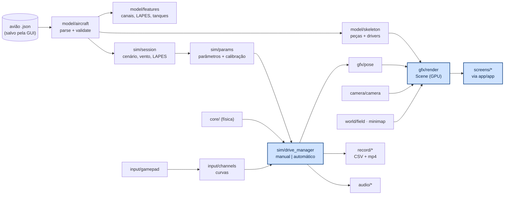

# aerodrive/src — módulos

Cada módulo é um arquivo `.zig` com os próprios testes e um teste de **fuzzing** (`fz.check`): entradas
quaisquer só podem dar um erro previsto, nunca travar. As contas ficam em módulos sem raylib (testados
por `zig build test`); só `gfx/render`, `ui/`, `screens/`, `audio/player`, `input/gamepad` e
`app/app` falam com o raylib.



---

## app/app.zig — o jogo e a pilha de telas

```zig
const app = try App.init(io, gpa, paths);   // fontes, configurações, biblioteca, som, logo
defer app.deinit();                          // grava as configurações
_ = app.loadPlane("../data/aircraft/Asa_voadora.json");   // falhou? app.planeError()
app.run();                                   // laço até fechar
```

Uma tela é um arquivo em `screens/` com `frame(s, app, dt) → Next` e, se quiser, `enter(s, app)`,
`planeChanged(s, app)` e `deinit(s, app)`. `Next` = `.stay`, `.{ .open = .camera }`, `.back`, `.home`,
`.quit`. Tela nova: um arquivo + uma linha em `Id` e `Screens`. O `App` também guarda o voo em
andamento (`startFlight`, `endFlight`), a gravação (`startRecording`, `stopRecording`,
`captureFrame` a 30 quadros por segundo) e recados curtos (`note`).

## app/store.zig — interface de armazenamento

```zig
var fs: FileStore = .{ .io = io, .root = paths.planes };   // ou MemStore (testes), ou outra implementação
const st = fs.store();                                      // Store { ptr, vtable: load/save }
_ = st.saveJson(gpa, chave, valor);
const v = st.loadJson(T, gpa, chave) orelse padrão;          // quebrado/ausente = null
const chave = store.keyFor(&buf, caminho_do_aviao);         // "Asa_voadora-1a2b3c4d"
```

Quem guarda configurações não sabe onde ficam: outro destino (nuvem, banco) é só outro `VTable`.

## app/plane_settings.zig — o que cada avião lembra

```zig
app.plane_cfg = PlaneSettings.load(store, gpa, caminho, .{ .session = ultima_sessao });
_ = app.plane_cfg.save(store, gpa, caminho);
```

Sessão sempre; controle e câmera só com `own_controls` / `own_camera` ("Só para este avião"). As telas
nunca leem os campos direto: usam `app.session()`, `app.profile()` e `app.camera()` (o do avião ou
o geral, conforme a escolha).

## app/settings.zig · app/paths.zig · app/library.zig

```zig
var s = Settings.load(io, gpa, paths.config);    // ausente/quebrado = padrões
s.save(io, gpa, paths.config);
const paths = try paths_mod.resolve(arena, env);  // config, voos, meus aviões, exemplos
var lib = try library.scan(io, gpa, &paths.examples, paths.mine);   // lib.entries: nome, caminho, grupo
```

Configurações gerais = último avião, última sessão (ponto de partida de avião novo), controle e câmera
gerais, volume, fps, F3; valores fora da faixa voltam para dentro (`sanitize`). A biblioteca junta
arquivos que são o mesmo avião (`fingerprint`: o JSON sem nome e sem campo).

## screens/ — um arquivo por tela

| arquivo | tela |
|---|---|
| `main_menu.zig` | logo, "AeroDrive", itens e a aeronave viva (o controle mexe nas superfícies) |
| `aircraft_menu.zig` | lista de arquivos (troca o 3D na hora), sloshing, LAPES, vento com a rosa dos ventos |
| `options_menu.zig` | Controle, Câmera, Som, Voos gravados, tela cheia, painel F3 |
| `video_view.zig` | assistir o vídeo de um voo gravado (pausa, pular 5 s, barra de tempo) |
| `fly_menu.zig` | decola do chão/mesa, pousa no chão/plataforma, quem pilota, câmera, fps, "Decolar" |
| `control_menu.zig` | Comandos: esquema, entrada e curva de cada canal (só os que o avião tem), ponto ao vivo, zoom na peça · Botões: remapear as ações do voo |
| `camera_menu.zig` | distância/altura/fov da perseguição com prévia |
| `sound_menu.zig` | volume e teste do som do motor |
| `recordings_menu.zig` | gravações; assistir aqui, abrir no tocador, dados, pasta, apagar vídeo/gravação |
| `recording_view.zig` | os gráficos disponíveis do voo gravado |
| `flight.zig` | o voo (HUD, minimapa, vento, LAPES, gravação) |
| `pause_menu.zig` | continuar, controle, câmera, som, voos gravados, gravar, recomeçar, tela cheia, menu |

## ui/ — o que as telas usam

```zig
app.ui.begin(dt);                                   // (o App faz) mouse, teclado e controle
if (app.ui.menuItem(rect, "Voar", null)) ...         // destaque ao passar o mouse / ↑↓
_ = app.ui.slider(rect, "Vento", &v, 0, 15, 0.5, "{d:.1} m/s", 1);
_ = app.ui.toggle(rect, "LAPES", &on);
_ = app.ui.choice(rect, "Começar", &idx, &.{ "Chão", "Mesa" });
if (lista.draw(&app.ui, area, 38, n, ctx, linha)) |i| ...   // ScrollList: rolagem + cabeçalhos
```

- `widgets.zig`: menus, botões, deslizadores, opções, liga/desliga e listas; o mesmo menu anda pelo
  mouse, setas/Enter/Esc e direcional/A/B (segurar repete).
- `showcase.zig`: a aeronave girando num retângulo (`frame`, `input`, `focusOn` para o zoom, `draw`).
- `glyphs.zig`: símbolos dos botões do Xbox (branco em fundo escuro) ou teclas, e a linha de dicas
  (`hints`); `widgets.footer` e `menuItemKey` usam.
- `preview.zig`: 3D numa textura (prévia da câmera). `plot.zig`: gráfico com marcas redondas e valores
  sob o mouse. `minimap_view.zig`: plano XY. `dev_overlay.zig`: painel F3. `theme.zig`: cores e fonte.

## model/aircraft.zig — ler o avião

```zig
var diag: aircraft.Diag = .{};
var loaded = try aircraft.parse(gpa, bytes, &diag);   // erro: diag.text() = "asa: 'chord' tem de ser > 0 (está -1)"
defer loaded.deinit();
```

`parse` = JSON → `Aircraft` (campos desconhecidos ignorados) → `validate` (números finitos, medidas
positivas, até ±50 m, limites de quantidade).

## model/features.zig — o que o avião tem

```zig
const f = features.detect(ac);          // f.has(.rudder), f.channels(&buf), f.payload, f.tanks
const z = features.focus(&skel, .aileron);   // ponto e tamanho da peça (zoom do menu Controle)
```

`features.stallLimit(ac, canal)`: deflexão de estol do comando (12° / τ, τ pela corda do comando;
no máximo 30°). O `App.effectiveProfile()` nunca deixa o controle passar dela.

Canais pelos comandos das superfícies: aileron/elevon → rolagem; profundor/elevon/ruddervator →
arfagem; leme/ruddervator → guinada; motor se houver hélice.

## model/airfoil.zig · model/skeleton.zig · gfx/pose.zig · gfx/render.zig

```zig
var sk = try skeleton.build(gpa, ac, &diag);      // peças: malha, cor, driver (hinge, spin, liquid, payload)
var scene = try render.Scene.init(gpa, &sk);       // malhas na GPU (uma vez)
scene.draw(pose.body(pos_ned, phi, theta, psi), drive_state, carga_solta);
render.drawField(&campo);
```

Formas e cores iguais às da GUI; cada comando é uma peça com dobradiça (`mix` igual ao do núcleo). A
única conversão de eixos: NED → tela `(e, −d, −n)`.

## sim/session.zig — escolhas antes de voar

```zig
const voo_ac = app.session().apply(ac);   // cópia com vento, sloshing, LAPES, chão/mesa e pouso
```

Na mesa, a mesa cresce para caber o trem do avião (roda de cauda atrás, bitola) — vale para qualquer
avião.

## sim/drive_manager.zig — a simulação durante o voo

```zig
var dm = try DriveManager.init(gpa, &voo_ac, &diag, .manual);
dm.setCommands(.{ .de = de, .da = da, .dr = dr, .thr = thr });   // só vale no manual
const f = dm.step(dt);           // pose, comandos, rpm, carga, fase, modo
dm.toggleMode();                 // manual ⇄ automático (o núcleo assume sem tranco)
dm.dropPayload();                // LAPES
```

Avança o núcleo até o tempo do quadro (passo de 1 ms). No manual o núcleo usa os comandos do piloto;
no automático, o piloto do núcleo segue o percurso da GUI. `dm.last` é a última linha do registro
(o que a gravação guarda).

## sim/params.zig · sim/mission.zig

Porta do caminho da GUI (avião → parâmetros do núcleo → calibração), testado igual à GUI até 10⁻⁶;
percurso em pernas (reta/arco), mesa e plataforma.

## input/gamepad.zig · input/channels.zig

```zig
const raw = app.reader.raw(dt);                       // eixos, gatilhos, LB/RB + teclado
const acts = app.reader.actions(perfil.buttons);      // pausa, modo, LAPES, gravar, câmera, recomeçar
const cmd = estado.step(perfil, raw, dt);             // δe, δa, δr (rad), acelerador 0..1
perfil.applyScheme(.radio2);                          // esquema pronto (ou .custom)
perfil.buttons.set(.drop, .start);                    // remapear (troca se o botão já era de outra ação)
const b = gamepad.pressedButton();                    // o botão apertado agora (para remapear)
```

Cada canal lê de uma `Source` (eixo, gatilho ou LB/RB em rampa) e tem uma `Curve` (zona morta, expo,
curso, trim, inverter). Esquemas: Xbox (aileron e profundor no analógico esquerdo, leme no LB/RB,
motor no RT), rádio modo 2 e modo 1. O teclado vale em qualquer esquema.

## camera/camera.zig

`orbit` (livre), `chase` (perseguição: `distance`, `height`, `fov_deg`), `ground` (piloto parado; o fov
fecha com a distância). Mesma interface: `update(input, dt)` e `view()`.

## world/field.zig · world/minimap.zig

```zig
const campo = field.build(x_warning, segmentos, pads);   // linhas e caixas em NED
const setas = field.windArrows(n, e, vem_de, v, t, &buf);  // vento: grade de setas andando
const mapa = bounds.map(cx, cy, lado);  mapa.toScreen(n, e);  // minimapa, norte para cima
```

## record/ — gravação e gráficos

```zig
var r = try Recorder.start(io, gpa, pasta, agora_s, w, h, 30);   // cria voo_<data>/ e liga o ffmpeg
r.addRow(&linha);  r.addFrame(io, rgba, w, h);
try r.finish(io, nome_do_aviao);                                   // dados.csv + info.json (+ video.mp4)
var cat = try recorder.list(io, gpa, pasta);                       // gravações, mais novas primeiro
var t = try datalog.Table.parse(gpa, csv);  t.col("h");            // colunas para os gráficos
pages.list(&t, &buf);                                              // páginas disponíveis (as da Missão)
```

`datalog`: todas as grandezas escalares do registro do núcleo a 20 Hz. `video`: quadros RGBA por um cano
para o ffmpeg (H.264); sem ffmpeg → `error.NoFfmpeg`. `pages`: planos XY/XZ/ZY, altura, velocidades,
ângulos, comandos, motor, bateria, coeficientes, trem, momentos, vento, sloshing, massa.

## audio/engine_sound.zig · audio/player.zig

```zig
var som = Player.init();               // hélice, vento e clique vão dentro do programa (assets/)
som.update(acelerador, volume, dt);    // hélice: altura e volume pelo motor, com atraso suave
som.updateWind(V_ar, volume);          // vento: cresce com a velocidade
som.click(volume);                     // menus (o App toca quando `ui.feedback`)
som.silence();
```

## record/video_player.zig — vídeo dentro do jogo

```zig
const info = try video_player.probe(io, gpa, "voo/video.mp4");     // ffprobe: tamanho, fps, duração
var d = try Decoder.start(io, gpa, "voo/video.mp4", info, t0, 1280); // ffmpeg → quadros RGBA por um cano
while (d.next()) rl.updateTexture(tex, d.frame.ptr);
d.stop(io);                                                        // fecha o cano e encerra o ffmpeg
```

## sys/keep_awake.zig — a tela não escurece

`KeepAwake.start(io)` segura um bloqueio de ociosidade (processo `gnome-session-inhibit` ou
`systemd-inhibit` rodando até o jogo fechar); `tick(io, dt)` avisa o protetor de tela a cada 30 s;
`stop(io)` solta.

## sys/stats.zig

`Sampler.update(io, dt)` lê `/proc/self/statm` e `/proc/self/stat` a cada 0,5 s: RAM residente e CPU
do processo (Linux; nos outros, "—").

## util/fuzz.zig — fuzzing

```zig
fn fuzzX(_: void, src: *fz.Src) anyerror!void {
    const x = src.mostly(0, 1);    // quase sempre em [0, 1]; às vezes NaN/inf/enorme
    _ = src.any(); src.range(a, b); src.int(u8, 0, 4); src.boolean(); src.chance(10); src.bytes(&buf);
}
test "fuzz: X" { try fz.check({}, fuzzX, .{}); }
```

`check` roda pelo fuzzer do Zig e mais N entradas aleatórias (`-Dfuzz=N -Dseed=S`, padrão 2000);
`checkScaled(…, k)` para casos caros (N/k).
