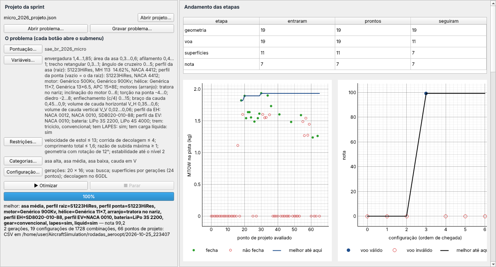
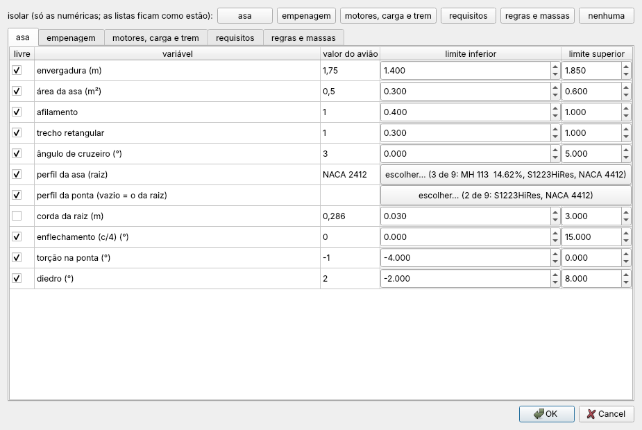
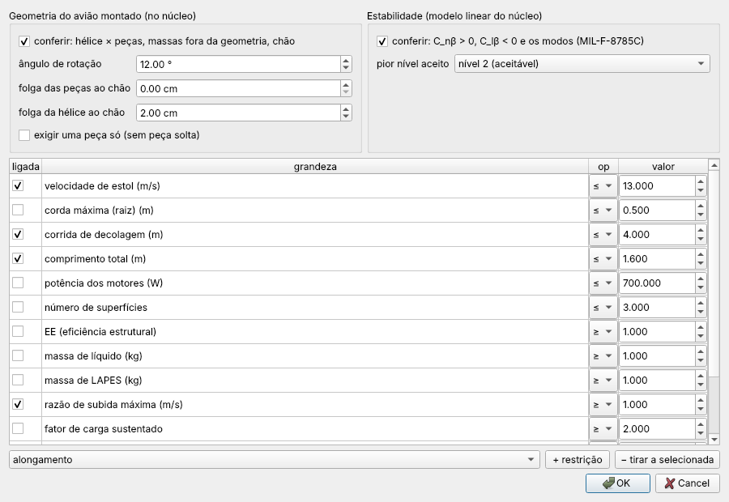
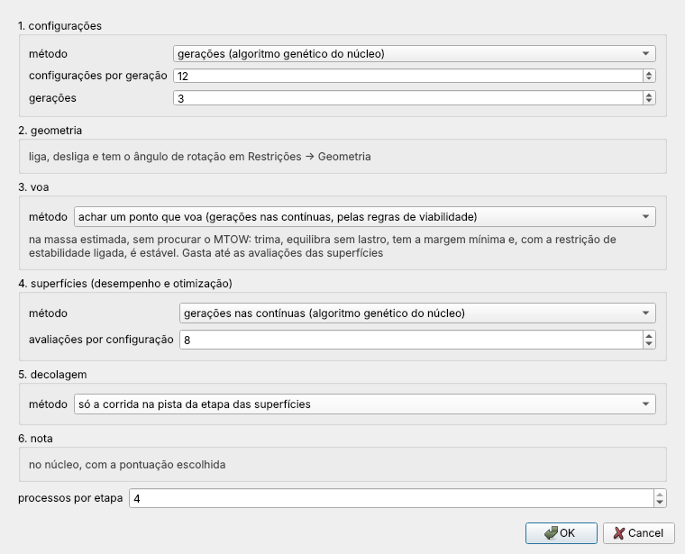
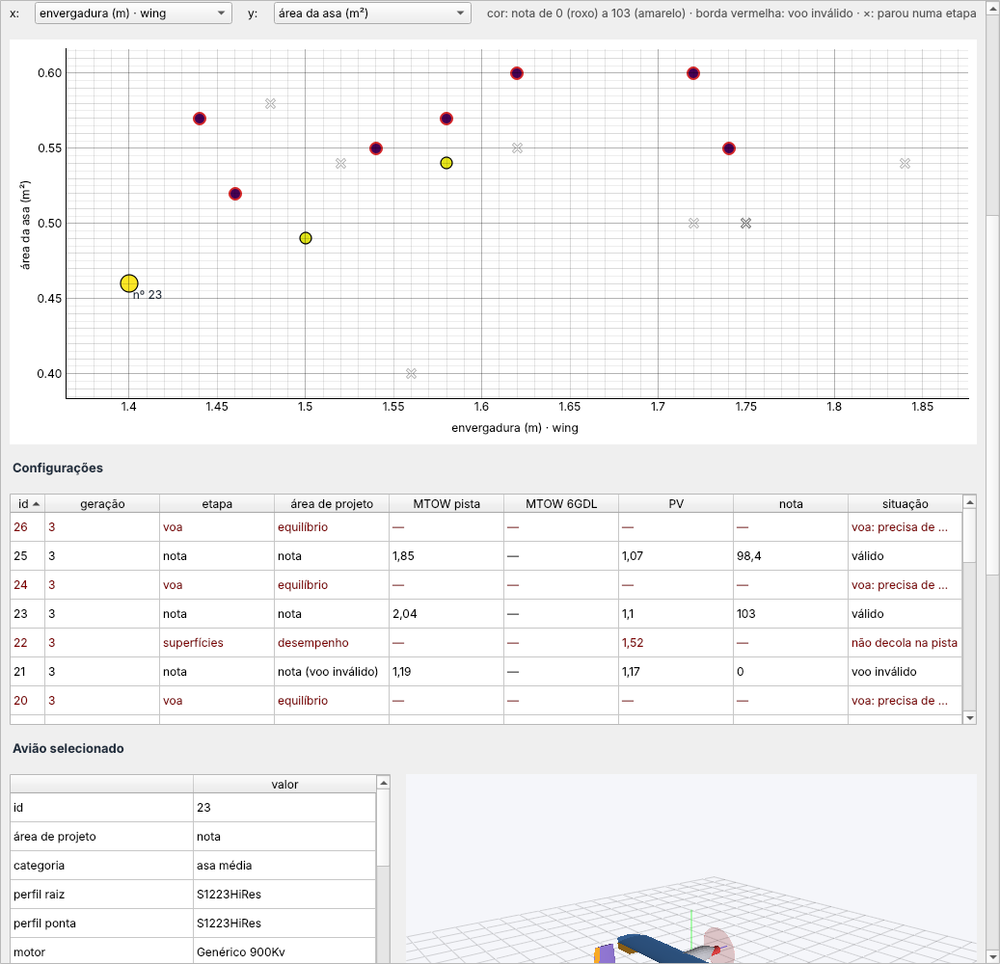
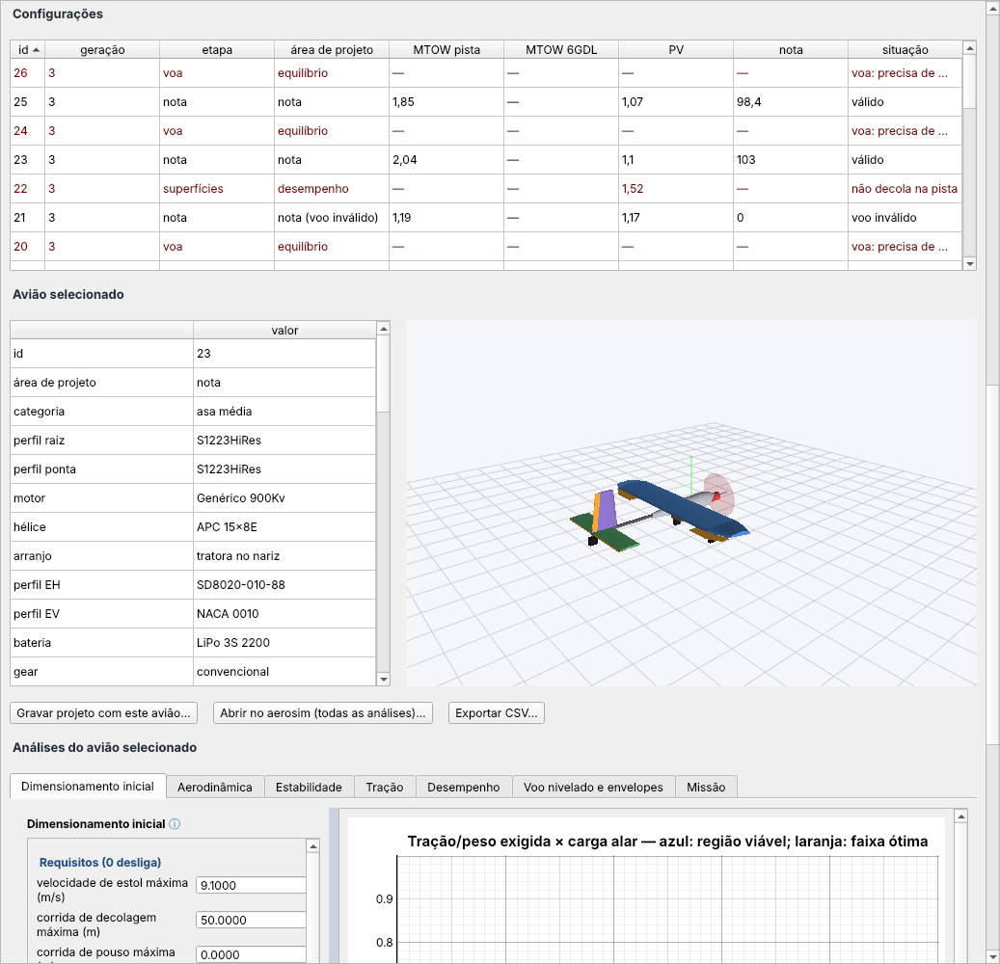
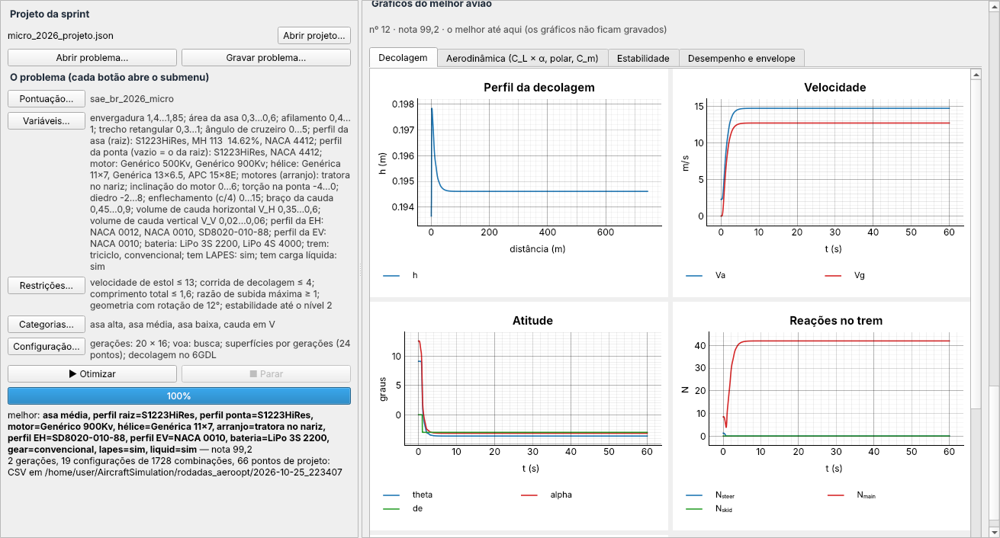
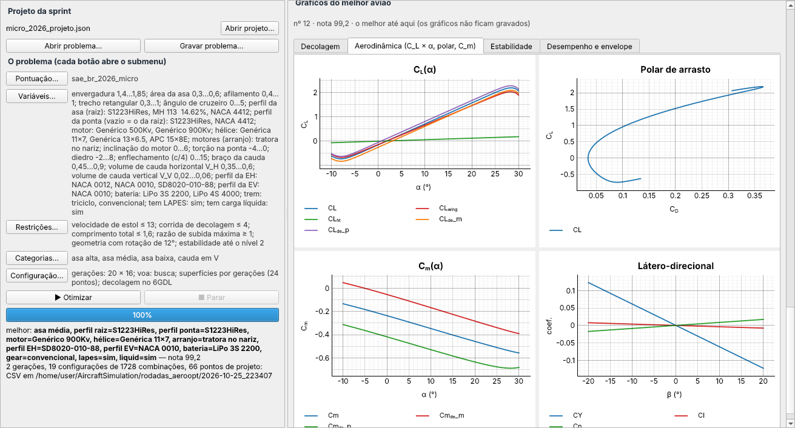

# aeroopt/ — o otimizador do projeto

Este é o terceiro braço do AircraftSimulation. O `aerosim` é onde se projeta um avião e o `aerodrive` é onde se voa
nele. O aeroopt procura, entre muitos aviões possíveis, o que faz mais pontos numa competição. Você diz o que pode
mudar no avião (envergadura, área, perfis, motor, hélice, tipo de avião...), entre que limites e com que restrições, e
escolhe a pontuação do regulamento. Ele monta os aviões, confere se cada um cabe, voa e decola, dá a nota de cada um
e mostra qual ganhou e por quê.

O aeroopt não tem física própria. Cada avião é montado pelas mesmas etapas do aerosim e as contas rodam no núcleo em
Zig (`core/`). Aqui só se organiza a busca e se mostra o resultado.

## Como se divide

Tudo começa no problema (`problem.py`): o que é livre, os limites, as restrições e a pontuação, gravados num arquivo
`.opt.json`. As variáveis possíveis são os campos das etapas do aerosim (`inputs.py`), e os tipos de avião
(monoplano, biplano, tandem e asa voadora) ficam em `categories.py`. A pontuação de cada regulamento é um `.toml` em `pontuacao/`,
traduzido por `scoring.py` para o núcleo calcular. A busca anda em etapas (`stages.py`, com a fila em `pipeline.py`):
cada avião passa pela geometria, depois por "voa?", depois pelo desempenho e, por fim, pela nota. A etapa "voa?" é
a de estabilidade e controle, e é nela que se escolhe a cauda: a cauda não é um tipo de avião, é o que faz uma asa
(ou um par de asas) voar. Com as caudas marcadas na Configuração, ela testa cada uma (convencional, em H, em V e sem
cauda) na asa daquela configuração, fica com a que voa e, entre as que voam, com a que decola na pista levando mais carga paga (só voar não
basta: sem cauda o avião é o mais leve e voa, mas pode não rodar na pista). O avião sai dali com
essa cauda. Custa uma busca a mais por cauda, mas um avião que não voaria com a cauda dos rascunhos ganha outra
chance antes de ser descartado. Com "comandos (E&C)" ligado, a mesma busca mexe também nos comandos (o profundor, ou o trecho e a
corda do elevon, o curso e a inclinação do motor) e exige que o comando rode o avião na pista antes da velocidade de
sair do chão. Essa conferência usa os coeficientes do núcleo, os mesmos da decolagem 6GDL, e não a conta analítica
da sprint, que superestima o elevon da asa voadora. Com os comandos ela escolhe, do mesmo jeito que escolhe a cauda,
onde fica a arfagem do tandem (na asa de trás, na da frente ou nas duas) e confere duas coisas que antes só apareciam
na decolagem 6GDL: o peso que a bequilha leva parado (com pouco, o avião senta para trás na corrida) e a estabilidade
direcional, que um avião sem cauda só tem com a deriva na ponta da asa. A etapa do 6GDL, por sua vez, roda a
decolagem com e sem a proteção de α do piloto e fica com o MTOW maior. Quem escolhe quais
aviões experimentar são as gerações de um algoritmo genético (`generations.py`). A janela fica em `gui.py`, e os CSV
de cada rodada saem de `export.py`. Depois da rodada, `sensitivity.py` diz o quanto a nota do melhor avião depende de
cada variável: se ele está num morro largo ou na beira de um precipício. Para testar a máquina sem esperar as contas do avião, `synthetic.py` traz dados de
teste: as mesmas etapas com funções simples, em que já se sabe onde cada configuração para e qual é a melhor.

| arquivo | o que tem |
|---|---|
| `problem.py` | o problema e o arquivo `.opt.json` |
| `inputs.py` | as variáveis: todo campo das etapas do aerosim, com faixa ou lista |
| `categories.py` | os tipos de avião que a busca pode montar |
| `scoring.py`, `pontuacao/` | a pontuação de cada regulamento (Micro 2026 e Regular 2026), com a fonte |
| `stages.py`, `pipeline.py` | as etapas e a fila que as roda em paralelo |
| `generations.py` | as gerações de configurações (algoritmo genético no núcleo) |
| `gui.py` | a janela |
| `export.py` | os CSV de cada rodada |
| `synthetic.py` | os dados de teste: um avaliador rápido com o resultado sabido de antemão |
| `pcoords.py` | o caminho da busca em coordenadas paralelas, na janela e numa página HTML |
| `sensitivity.py` | a sensibilidade do melhor: inclinação e curvatura da nota em cada contínua livre, pelos pontos que a busca já avaliou |
| `mini_mdo.py` | o mini-MDO do núcleo, a primeira versão, que fica como alternativa |

As contas que rodam no núcleo para o aeroopt (a nota, o algoritmo genético, o CMA-ES e a evolução diferencial) estão explicadas em
[`core/src/optim/README.md`](../core/src/optim/README.md).

## A janela

À esquerda fica o problema, com um botão para cada parte: pontuação, variáveis, restrições e configuração. Cada
botão abre um submenu, e ao lado dele aparece um resumo do que está escolhido. Os tipos de avião que a busca monta
(monoplano, biplano, tandem, asa voadora) e as caudas que a etapa "voa?" testa ficam na Configuração, junto do
método de cada etapa. Cada
opção dos submenus tem um "(?)" que explica o que ela é e no que muda a busca, e os campos de número levam só o
número: a unidade fica no nome do campo. Asa alta, média, baixa e parasol são o mesmo monoplano com a asa em outra
altura; para a busca escolher a altura, solta-se a variável "altura da asa". À direita fica a
rodada: quantos aviões passaram em cada etapa, o MTOW de cada ponto avaliado, a nota de cada configuração, o mapa dos
aviões, a tabela e o avião selecionado em 3D.



Nas variáveis se marca o que é livre e entre que limites. Um campo de escolha, como o perfil ou o motor, abre a lista
para marcar as opções que entram na busca.



Nas restrições ficam as condições que o avião tem de cumprir, a geometria (hélice, peças e chão na rotação) e a
estabilidade. Na configuração se escolhe o método de cada etapa.





No mapa, cada ponto é um avião. Os eixos podem ser qualquer variável do problema ou um resultado, e a cor é a nota.



Embaixo do mapa fica o caminho da busca, em coordenadas paralelas: cada avião é uma linha que passa por um eixo por
variável livre e pelo MTOW, o PV e a nota. Num mapa se veem duas grandezas por vez; aqui aparecem todas, e as linhas
das boas notas que se juntam num trecho de um eixo mostram onde está a região boa. A cor é a geração, e a linha preta
é o melhor até ali, na ordem em que os aviões foram avaliados. "Exportar HTML…" grava a mesma figura numa página que
abre sem internet.

Embaixo da tabela aparecem os gráficos do melhor avião até aqui: a decolagem, a aerodinâmica, a estabilidade e o
desempenho. Eles servem para conferir de relance se o avião que está ganhando faz sentido, e não ficam gravados.

A última aba é a sensibilidade do melhor: o quanto a nota muda se uma contínua livre sai do lugar, para saber se o
avião está no alto de um morro largo ou na beira de uma restrição. Ela olha só esse avião e só o que o problema deixa
mexer, dentro dos limites. Em vez de refazer o avião em vários pontos, ela reaproveita os pontos que a busca das
superfícies já avaliou em volta dele e passa por eles um modelo com a inclinação e a curvatura de cada variável (no
núcleo, `core/src/optim/localfit.zig`). Só a direção que a busca não cobriu ganha pontos novos. Cada barra vai da
nota prevista a 10 % da faixa para um lado à prevista para o outro, e o lado em que o avião deixa de fechar aparece
em vermelho, com o motivo.

No menu Configuração, a caixa da sensibilidade liga a análise e escolhe o método. O modelo local é o padrão e
quase não custa nada. O "um por vez" refaz dois pontos por variável e serve para conferir o modelo. Morris anda em
trajetórias pela região em volta do melhor e mostra se uma variável tem efeito que muda de um lugar para outro
(curvatura ou interação com as outras), ao preço de alguns pontos por variável. A tolerância diz quanto a nota cai
se o avião sair da oficina com aquela diferença em cada medida. Com os limites ligados, a pista e cada restrição
ligada mudam um pouco para cada lado, e a aba mostra quanto a nota do melhor ganha ou perde com isso, no mesmo
gráfico. Embaixo do tornado, um gráfico por variável mostra a nota pelo modelo em volta do melhor, os pontos
avaliados e a faixa da tolerância; um por limite mostra a nota com o limite apertado, como está e folgado. O botão
"Sensibilidade deste avião" roda só a sensibilidade do avião selecionado na tabela, sem rodar o resto.







## Como abrir

```sh
python -m aeroopt --exemplo                            # a janela com um projeto de exemplo
python -m aeroopt meu_projeto.json problema.opt.json   # partindo de um projeto da sprint
python -m aeroopt --exemplo --sintetico                # a janela com os dados de teste: a rodada em segundos
python tools/aeroopt.py problema.opt.json --etapas --projeto meu_projeto.json   # sem janela
python -m pytest -q tests/aeroopt                      # os testes
```

Um regulamento novo é um `.toml` novo em `pontuacao/`, com a fonte e um teste com uma nota calculada à mão.
