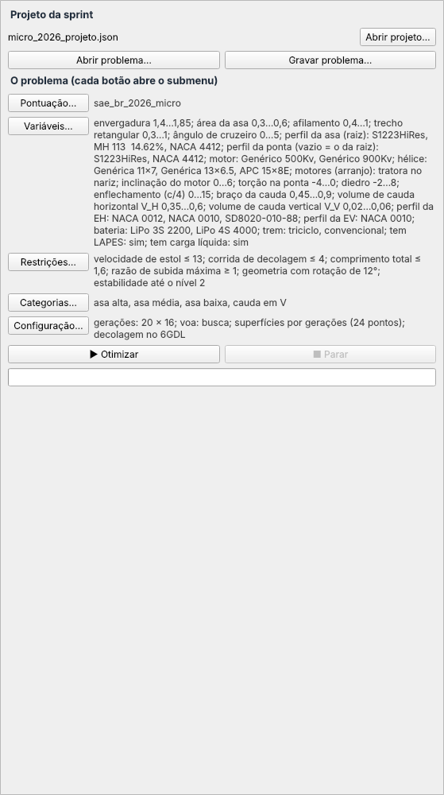
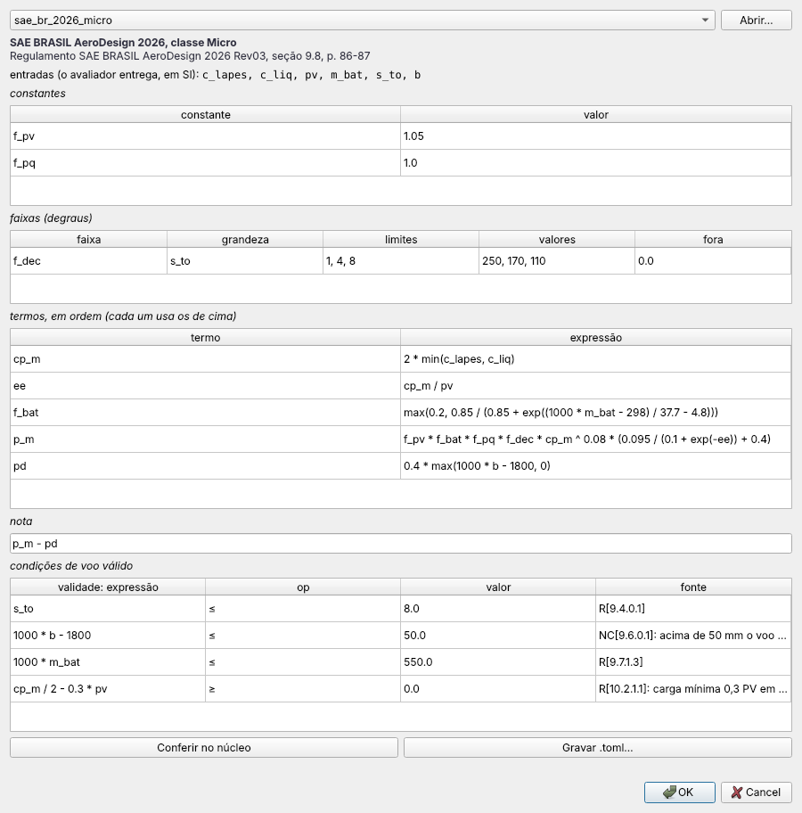
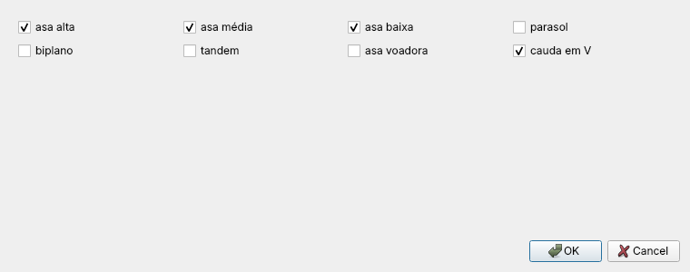
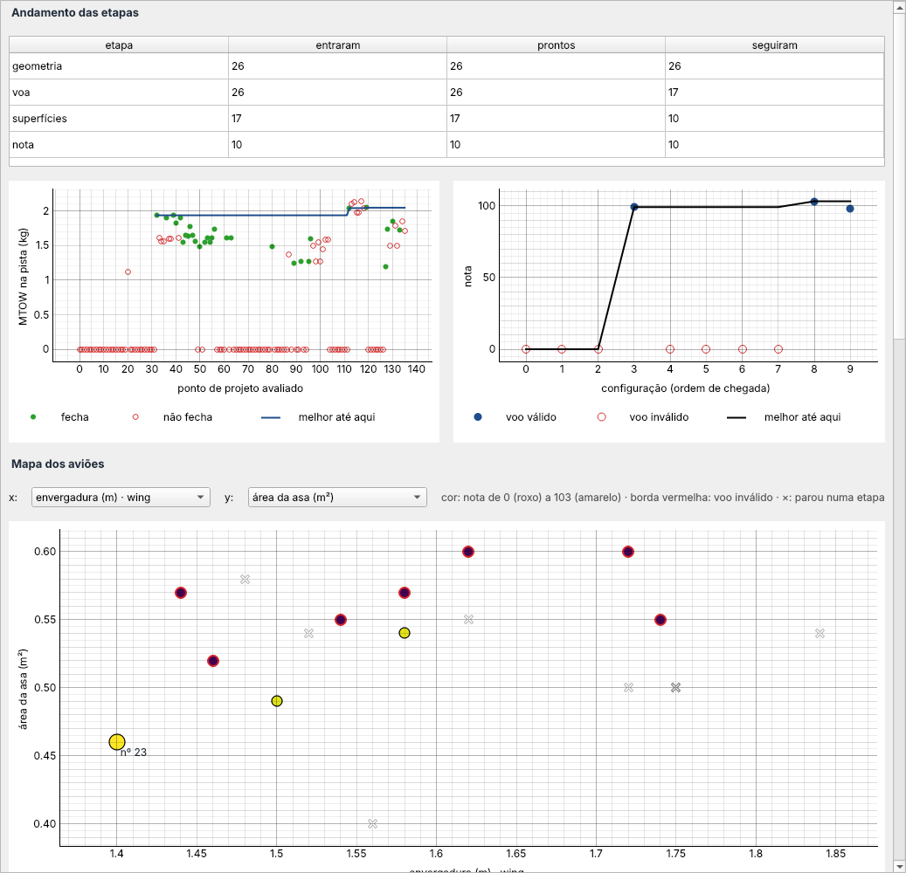
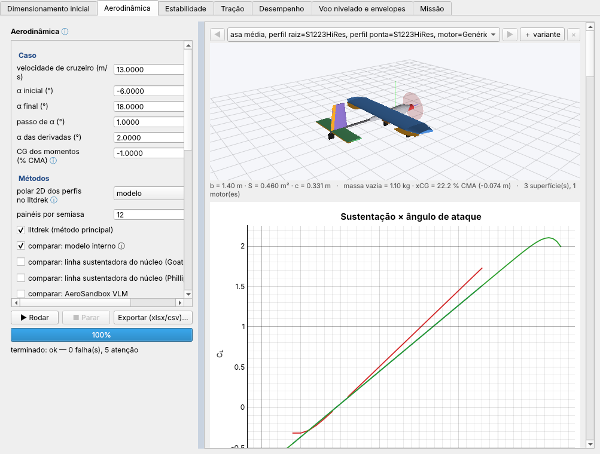

# aeroopt — o otimizador do projeto

Este é o otimizador do AircraftSimulation. O `aerosim` é onde se projeta um avião e o `aerodrive` é onde se voa nele.
O aeroopt procura o melhor avião para uma competição. Você diz o que pode mudar no avião (envergadura, área, perfis,
motor, hélice, categoria...), entre que limites e com que restrições, e escolhe a pontuação do regulamento. Ele monta
centenas de aviões, confere se cada um decola, equilibra e voa, calcula a nota de cada um e mostra qual ganhou e por
quê. As contas de cada avião são as mesmas do aerosim e rodam no núcleo em Zig. Esta pasta organiza a busca e mostra o
resultado.

A janela tem dois lados. À esquerda fica o problema: o projeto de partida e um botão para cada parte do problema, cada
um abrindo o seu submenu. À direita fica a rodada: o andamento, os gráficos, o mapa dos aviões, a tabela, o avião
selecionado e as análises do aerosim sobre ele. As seções abaixo seguem essa ordem, de cima para baixo.


## O problema (lado esquerdo)

Aqui se abre o projeto da sprint do aerosim que serve de ponto de partida, com **Abrir projeto…**. O problema (o que
pode mudar, as restrições, a pontuação e os métodos) se grava e se abre num arquivo `.opt.json` próprio, com **Gravar
problema…** e **Abrir problema…**. Ao lado de cada botão aparece um resumo do que está escolhido nele, para conferir o
problema inteiro sem abrir nada. **▶ Otimizar** começa a rodada e **■ Parar** interrompe na hora, sem esperar a conta
em andamento.



### Pontuação

Aqui se escolhe a nota que a busca tenta maximizar. Cada regulamento é um arquivo `.toml` com a fonte (seção e página
do regulamento) e tudo aparece em campos editáveis: as entradas, as constantes, as faixas em degraus, os termos em
ordem, a nota e as condições de voo válido. O que se muda vale na próxima rodada. **Conferir no núcleo** traduz e
confere a conta, e **Gravar .toml…** guarda uma versão nova. O voo que não cumpre as condições de voo válido fica com
nota 0.



### Variáveis

Aqui se escolhe o que pode mudar no avião. A tabela tem todo campo das etapas do aerosim, com uma aba por grupo (asa,
empenagem, motores, carga e trem, requisitos, regras e massas). A coluna "livre" diz se a variável muda, e os limites
dizem entre onde. Um campo de escolha (perfil, motor, hélice, bateria, tipo de trem, sim ou não) tem o botão
**escolher…**, que abre a lista para marcar as opções que entram na busca. Os botões de cima isolam um grupo: soltam as
variáveis numéricas dele e prendem as outras.


### Restrições

Aqui se diz o que o avião tem de cumprir, como em "Condições e restrições" do aerosim: velocidade de estol, corrida de
decolagem, comprimento total, razão de subida e outras. Cada linha se liga, escolhe o sinal e o valor. No alto ficam
duas restrições que olham o avião montado. A **geometria** confere se a hélice bate em alguma peça, se as massas ficam
dentro do avião e se algo bate no chão na rotação da decolagem. Quando é só o chão, ela desce o trem em vez de
reprovar. A **estabilidade** confere a estabilidade direcional e lateral e os modos de voo contra a MIL-F-8785C, até o
nível escolhido. Ela vem desligada, e é ela que faz o diedro, o enflechamento e a deriva contarem na busca.


### Categorias

Aqui se marcam os tipos de avião que a busca pode montar: asa alta, média ou baixa, parasol, biplano, tandem, asa
voadora, cauda em V. Cada categoria marcada vira mais uma opção para cada configuração.



### Configuração

Aqui se escolhe como a rodada anda. Ela passa por etapas, nesta ordem, e cada etapa só recebe o avião que passou da
anterior:

1. **configurações**: as escolhas discretas (categoria, perfis, motor, hélice...), por gerações de um algoritmo
   genético ou todas as combinações;
2. **geometria**: o avião montado cabe e não bate no chão;
3. **voa**: na massa estimada, ele trima, equilibra sem lastro e tem a margem estática mínima; se não voa, a etapa
   procura nas variáveis contínuas um ponto que voa;
4. **superfícies**: as variáveis contínuas (envergadura, área, diedro...) pelo maior MTOW, por busca por coordenadas,
   gerações ou CMA-ES;
5. **decolagem**: o MTOW na simulação 6GDL ou só na corrida da pista;
6. **nota**: a pontuação escolhida, no núcleo.

Ali também ficam o tamanho e o número de gerações, quantas avaliações cada configuração gasta nas superfícies e
quantos processos rodam cada etapa.


## A rodada (lado direito)

### Andamento e gráficos

A tabela do alto conta quantas configurações entraram, ficaram prontas e seguiram em cada etapa. Com ela se vê onde os
aviões estão parando. O gráfico da esquerda mostra o MTOW de cada ponto de projeto avaliado nas superfícies (cheio
quando fecha, vazio quando não), com a linha do melhor até ali. O da direita mostra a nota de cada configuração na
ordem em que chegou, com a linha da melhor nota.



### Mapa dos aviões

O mapa mostra cada configuração como um ponto. Os eixos x e y podem ser qualquer variável do problema, primeiro as
livres e depois as fixas, ou uma grandeza do resultado (PV, carga paga, MTOW, EE, nota). A cor é a nota, do roxo ao
amarelo. Uma borda vermelha marca um voo inválido, e um × marca uma configuração que parou numa etapa. Quando o eixo é
uma lista (um perfil, um motor), cada opção ganha uma linha com o nome dela. Clicar num ponto seleciona o avião.


### Tabela e avião selecionado

A tabela das configurações tem uma linha por configuração: o número, a geração, a etapa em que está, a área de
projeto em que parou (geometria, equilíbrio, estabilidade, desempenho), os MTOW, o PV, a nota e a situação. O nome
completo aparece ao passar o mouse sobre o número. Ao clicar numa linha, o avião aparece embaixo com cada valor, cada
entrada e cada fator da nota, e o 3D dele ao lado. **Gravar projeto com este avião…** leva os valores para um projeto
novo da sprint, **Abrir no aerosim…** abre o avião numa janela do aerosim e **Exportar CSV…** grava cada avaliação
para abrir numa planilha.


### Análises do avião selecionado

Embaixo ficam as abas de análise do aerosim, sobre o avião selecionado: dimensionamento inicial, aerodinâmica com a
polar, estabilidade, tração, desempenho, voo nivelado e envelopes, e missão com a decolagem 6GDL. Só as cargas ficam
de fora. Cada aba roda no **▶ Rodar** dela, com os mesmos campos e gráficos do aerosim.



## Como abrir

```sh
python -m aeroopt --exemplo                               # a janela, com um projeto de exemplo
python -m aeroopt meu_projeto.json problema.opt.json      # partindo de um projeto da sprint e de um problema
python tools/aeroopt.py problema.opt.json --etapas --projeto meu_projeto.json   # sem janela
```

Como as etapas, as buscas e a pontuação funcionam por dentro, e como chamar cada peça pelo Python, está em
[COMO_FUNCIONA.md](COMO_FUNCIONA.md). As contas do núcleo (a nota, o algoritmo genético e o CMA-ES) estão explicadas
em [`core/src/optim/README.md`](../core/src/optim/README.md). Os testes rodam com `python -m pytest -q tests/aeroopt`.
Um regulamento novo é um `.toml` novo em `pontuacao/`, e uma etapa nova é uma classe que implementa `IStage`.
