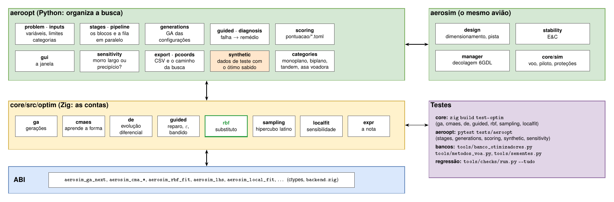
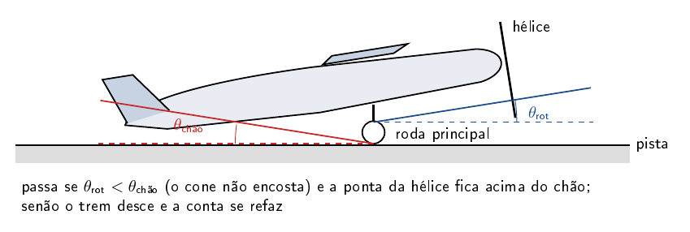
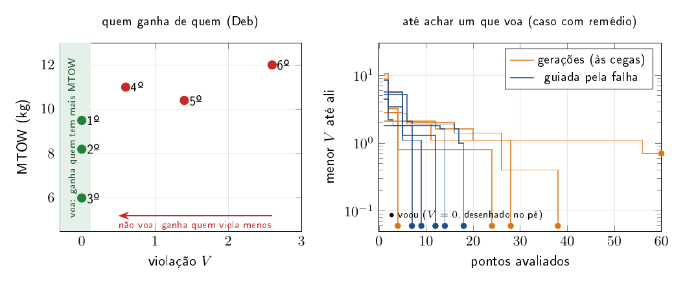
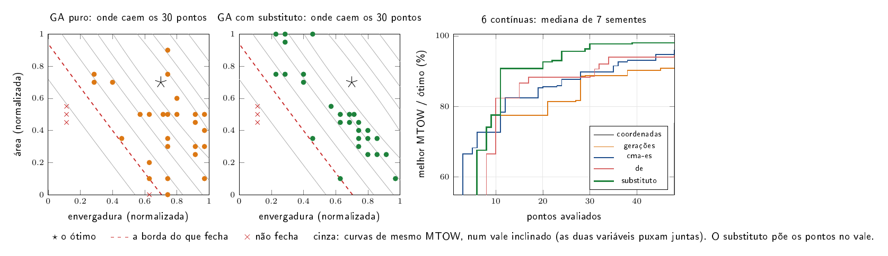
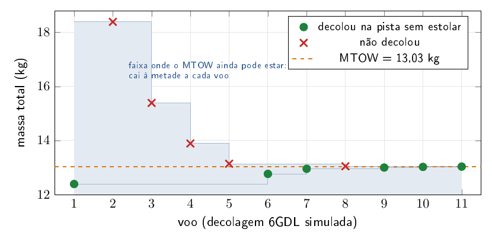
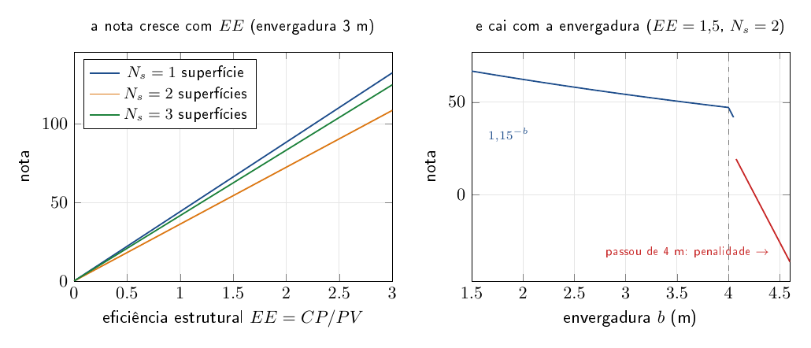
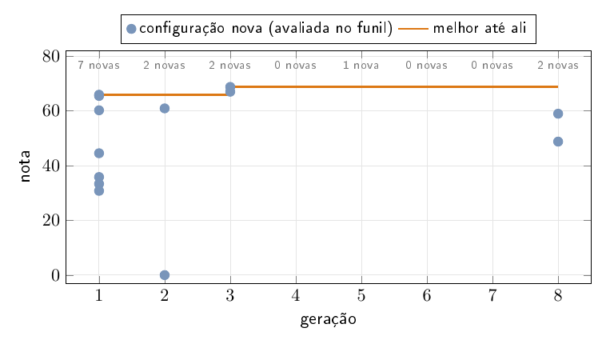

# aeroopt/ — o otimizador do projeto

Este é o terceiro braço do AircraftSimulation. O `aerosim` é onde se projeta um avião e o `aerodrive` é onde se voa
nele. O aeroopt procura, entre muitos aviões possíveis, o que faz mais pontos numa competição. Você diz o que pode
mudar no avião (envergadura, área, perfis, motor, hélice, tipo de avião...), entre que limites e com que restrições, e
escolhe a pontuação do regulamento. Ele monta os aviões, confere se cada um cabe, voa e decola, dá a nota de cada um
e mostra qual ganhou e por quê.

O aeroopt não tem física própria. Cada avião é montado pelas mesmas etapas do aerosim e as contas rodam no núcleo em
Zig (`core/`). Aqui só se organiza a busca e se mostra o resultado.

## A janela

À esquerda fica o problema, com um botão para cada parte: pontuação, variáveis, restrições e configuração. Cada
botão abre um submenu, e ao lado dele aparece um resumo do que está escolhido. Os tipos de avião que a busca monta
(monoplano, biplano, tandem, asa voadora) e as caudas que a etapa "voa?" testa ficam na Configuração, junto do
método de cada etapa. Cada
opção dos submenus tem um "(?)" que explica o que ela é e no que muda a busca, e os campos de número levam só o
número: a unidade fica no nome do campo. Asa alta, média, baixa e parasol são o mesmo monoplano com a asa em outra
altura; para a busca escolher a altura, solta-se a variável "altura da asa". À direita fica a
rodada: quantos aviões passaram em cada etapa, o MTOW de cada ponto avaliado, a nota de cada configuração, o mapa dos
aviões, a tabela e o avião selecionado em 3D.


Nas variáveis se marca o que é livre e entre que limites. Um campo de escolha, como o perfil ou o motor, abre a lista
para marcar as opções que entram na busca.


Nas restrições ficam as condições que o avião tem de cumprir, a geometria (hélice, peças e chão na rotação) e a
estabilidade. Na configuração se escolhe o método de cada etapa.


No mapa, cada ponto é um avião. Os eixos podem ser qualquer variável do problema ou um resultado, e a cor é a nota.


Embaixo do mapa fica o caminho da busca, em coordenadas paralelas: cada avião é uma linha que passa por um eixo por
variável livre e pelo MTOW, o PV e a nota. Num mapa se veem duas grandezas por vez; aqui aparecem todas, e as linhas
das boas notas que se juntam num trecho de um eixo mostram onde está a região boa. A cor é a geração, e a linha preta
é o melhor até ali, na ordem em que os aviões foram avaliados. "Exportar HTML…" grava a mesma figura numa página que
abre sem internet.

Embaixo da tabela aparecem os gráficos do melhor avião até aqui: a decolagem, a aerodinâmica, a estabilidade e o
desempenho. Eles servem para conferir de relance se o avião que está ganhando faz sentido, e não ficam gravados.

A última aba é a sensibilidade do melhor: o quanto a nota muda se uma contínua livre sai do lugar, para saber se o
avião está no alto de um morro largo ou na beira de uma restrição. Ela olha só esse avião e só o que o problema deixa
mexer, dentro dos limites. Em vez de refazer o avião em vários pontos, ela reaproveita os pontos que a busca das
superfícies já avaliou em volta dele e passa por eles um modelo com a inclinação e a curvatura de cada variável (no
núcleo, `core/src/optim/localfit.zig`). Só a direção que a busca não cobriu ganha pontos novos. Cada barra vai da
nota prevista a 10 % da faixa para um lado à prevista para o outro, e o lado em que o avião deixa de fechar aparece
em vermelho, com o motivo.

No menu Configuração, a caixa da sensibilidade liga a análise e escolhe o método. O modelo local é o padrão e
quase não custa nada. O "um por vez" refaz dois pontos por variável e serve para conferir o modelo. Morris anda em
trajetórias pela região em volta do melhor e mostra se uma variável tem efeito que muda de um lugar para outro
(curvatura ou interação com as outras), ao preço de alguns pontos por variável. A tolerância diz quanto a nota cai
se o avião sair da oficina com aquela diferença em cada medida. Com os limites ligados, a pista e cada restrição
ligada mudam um pouco para cada lado, e a aba mostra quanto a nota do melhor ganha ou perde com isso, no mesmo
gráfico. Embaixo do tornado, um gráfico por variável mostra a nota pelo modelo em volta do melhor, os pontos
avaliados e a faixa da tolerância; um por limite mostra a nota com o limite apertado, como está e folgado. O botão
"Sensibilidade deste avião" roda só a sensibilidade do avião selecionado na tabela, sem rodar o resto.


## Como se divide

O aeroopt fica em cima do resto do projeto. Ele organiza a busca, mas não faz conta: quem monta o avião, confere a
estabilidade e voa a decolagem é o aerosim, o mesmo da GUI de projeto. As contas da busca em si (as gerações, o
CMA-ES, a evolução diferencial, a busca guiada pela falha, o substituto, a nota) ficam no núcleo em Zig, em
`core/src/optim`, e o Python chega nelas pela ABI. Os testes cobrem as três camadas.



| arquivo | o que tem |
|---|---|
| `problem.py`, `inputs.py`, `categories.py` | o problema (`.opt.json`): o que é livre, os limites, os tipos de avião |
| `stages.py`, `pipeline.py` | os blocos e a fila que os roda em paralelo |
| `generations.py` | as gerações de configurações |
| `guided.py`, `diagnosis.py` | a busca do bloco "voa?" guiada pela falha |
| `scoring.py`, `pontuacao/` | a pontuação de cada regulamento, com a fonte |
| `gui.py`, `export.py`, `pcoords.py` | a janela, os CSV e o caminho da busca |
| `sensitivity.py` | a sensibilidade do melhor |
| `synthetic.py` | os dados de teste, com o resultado sabido de antemão |
| `mini_mdo.py` | o mini-MDO do núcleo, a primeira versão, que fica como alternativa |

## Como funciona

Cada configuração (o tipo de avião, a cauda, os perfis, o motor, a hélice) passa pelos blocos da esquerda para a
direita. Quem falha num bloco sai ali, com o motivo. Quem chega ao fim ganha uma nota, e as gerações escolhem as
próximas configurações pelas notas. Os blocos vão do mais barato ao mais caro, para que a conta cara só rode para
quem já passou nas baratas. Cada busca que aparece aqui (gerações, CMA-ES, evolução diferencial, substituto, busca
guiada) está desenhada e explicada em [`core/src/optim/README.md`](../core/src/optim/README.md), com o que cada uma
muda na busca.


### Geometria

O avião é montado a partir da configuração e girado em torno da roda principal, como na rotação da decolagem. Ele
passa se o ângulo de rotação fica abaixo do ângulo em que o cone de cauda encosta no chão e se a ponta da hélice
continua acima do chão. Se não passa, o trem desce e a conta se refaz; se nem assim, o avião sai aqui ("bate no
chão"). É a conta mais barata da fila, então vem primeiro.



### Voa?

Aqui se confere a estabilidade e o controle, e se escolhe a cauda. A cauda não é um tipo de avião: é o que faz uma
asa voar. O bloco testa cada cauda marcada (convencional, em H, em V e sem cauda) na asa da configuração e fica com a
que voa e, entre as que voam, com a que decola na pista levando mais carga paga. Com os comandos ligados, ele mexe
também no profundor (ou no elevon) e no motor, e exige que o comando rode o avião na pista antes da velocidade de
sair do chão, que a bequilha leve peso parado e que o avião aponte o nariz para o vento.

Cada coisa que falta vira um termo da violação $V$, e cada termo vale 1 na fronteira de "bem fora". Assim C_nβ,
trim e peso na bequilha, que têm unidades diferentes, somam numa escala só:

$$V(x) = \sum_t v_t(x), \qquad V = 0 \iff \text{voa}$$

Dois pontos se comparam pelas regras de Deb (Computer Methods in Applied Mechanics and Engineering 186, 2000, seção
3, a conferir no PDF): quem voa ganha de quem não voa; entre dois que voam ganha o de maior MTOW; entre dois que não
voam ganha o que viola menos. A busca então anda primeiro para onde o avião passa a voar, e só depois procura MTOW.

$$\text{rank}(x) = \begin{cases} (1,\ \text{MTOW}) & V(x) = 0 \\ (0,\ -V(x)) & V(x) > 0 \end{cases}$$

Cada termo sabe o que falhou (deriva pequena, carga paga fora do lugar, profundor que não trima), e por isso sabe
quais variáveis consertam a falha. A busca guiada pela falha mexe só nelas, e um bandido escolhe, filho a filho, o
operador que mais tem rendido. No gráfico da direita, com doze variáveis em que só duas consertam as duas falhas, a
guiada voa sempre e com poucos pontos; as gerações às cegas variam muito de uma semente para outra, e às vezes nem
chegam a voar.



No tandem o bloco confere mais três coisas: a asa da frente leva de 40 a 60 % da sustentação no cruzeiro, a de trás
fica de 3 a 5 cordas atrás e o desnível fica em até 1 corda. As faixas são do Kryvokhatko e de uma discussão de
fórum, ainda a conferir no PDF.

A busca do bloco parte do avião como está e para no primeiro ponto que voa. Se esse ponto de partida cai numa região
ruim, a rodada fica nela. Para isso há dois ajustes, desligados por padrão: o início por hipercubo latino, que
espalha a população inicial pela faixa toda, e as partidas, que seguem até achar vários pontos que voam, longe uns
dos outros, e ficam com o que decola com mais carga.

### Superfícies

Aqui se acham a envergadura, a área e as outras variáveis contínuas que dão o maior MTOW na pista, com as mesmas
regras de Deb. Cada ponto é um avião inteiro (dimensionamento, pista, estabilidade), então o que importa é chegar
perto do melhor com poucos pontos. Há cinco buscas: coordenadas (um eixo por vez), gerações, CMA-ES, evolução
diferencial e gerações com substituto.

O problema típico é o da figura: envergadura e área puxam juntas, e o MTOW bom fica num vale inclinado. Andar um eixo
por vez ou sortear às cegas gasta pontos fora do vale. O GA com substituto sorteia muitos filhos, passa por todos os
pontos já avaliados uma superfície barata, e só manda para a conta os filhos de melhor palpite: os pontos dele caem
no vale. Na curva da direita, com seis contínuas, ele é o que chega mais perto do ótimo com o mesmo número de
pontos.



### Decolagem 6GDL

Aqui se acha o MTOW que vale: o maior peso que decola na simulação 6GDL dentro da pista sem estolar. A conta da pista
do bloco anterior é aproximada; esta voa o avião com o piloto. A massa sai por bisseção: o primeiro voo é na menor
massa e o segundo na maior, e cada voo seguinte é no meio da faixa que sobrou. Decolou, o MTOW está acima; não
decolou, está abaixo. São nove cortes, e a faixa final é 1/512 da inicial.

$$m_{k+1} = \tfrac12 (m_{lo} + m_{hi}), \qquad \text{decolou: } m_{lo} \leftarrow m_{k+1}, \quad \text{não: } m_{hi} \leftarrow m_{k+1}$$

Cada voo também acha o melhor momento de puxar o profundor na corrida. A decolagem é sempre com a proteção de α do
piloto, que pica o nariz antes do estol, e a que estola é reprovada mesmo passando a pista. Sem isso, quase todos
os tandens estolavam logo depois de sair do chão. Quase todo o tempo vai nas massas que não decolam, e a tolerância (na
Configuração) aceita errar um pouco o momento de puxar e desiste logo da massa que nem com o comando todo cabrando sai
do chão.



### Nota

Aqui a carga paga, o MTOW do 6GDL menos o peso vazio, entra na fórmula do regulamento. Na Regular 2026 a parte
principal é a eficiência estrutural $EE = CP/PV$, corrigida pelo número de superfícies e pela envergadura, com
penalidade depois de 4 m (Regulamento SAE BRASIL AeroDesign 2026, seção 7, eqs. 7.2 a 7.5):

$$N = 1{,}10 \cdot 50\,EE \cdot F_N \cdot 1{,}15^{-b} - P_D$$

É isso que faz a busca não ir só atrás de MTOW: um avião mais pesado com envergadura maior pode valer menos.



### Gerações

Com poucas combinações, a rodada passa todas pela fila. Com muitas (cada perfil, motor, hélice e categoria
multiplicam a conta, e um problema comum passa de um milhão), um algoritmo genético escolhe quais experimentar: cada
configuração é um indivíduo, as melhores notas geram as próximas, e quem parou num bloco fica atrás de quem foi mais
longe. Uma configuração que já apareceu vem da memória, por isso as gerações do fim trazem poucas novas.



### Depois da rodada e para testar

A sensibilidade diz o quanto a nota do melhor avião depende de cada variável: se ele está num morro largo ou na
beira de um precipício (a aba Sensibilidade, acima). Para testar a máquina sem esperar as contas do avião, os dados
de teste trocam as contas por funções simples em que já se sabe a resposta, em três formas: a tigela (fácil), a
acoplada (as variáveis puxam juntas) e a multimodal (com vales falsos). O banco dos otimizadores
(`tools/banco_otimizadores.py`) compara as buscas nelas.

## Como abrir

```sh
python -m aeroopt --exemplo                            # a janela com um projeto de exemplo
python -m aeroopt meu_projeto.json problema.opt.json   # partindo de um projeto da sprint
python -m aeroopt --exemplo --sintetico                # a janela com os dados de teste: a rodada em segundos
python tools/aeroopt.py problema.opt.json --etapas --projeto meu_projeto.json   # sem janela
python -m pytest -q tests/aeroopt                      # os testes
```

Um regulamento novo é um `.toml` novo em `pontuacao/`, com a fonte e um teste com uma nota calculada à mão.
