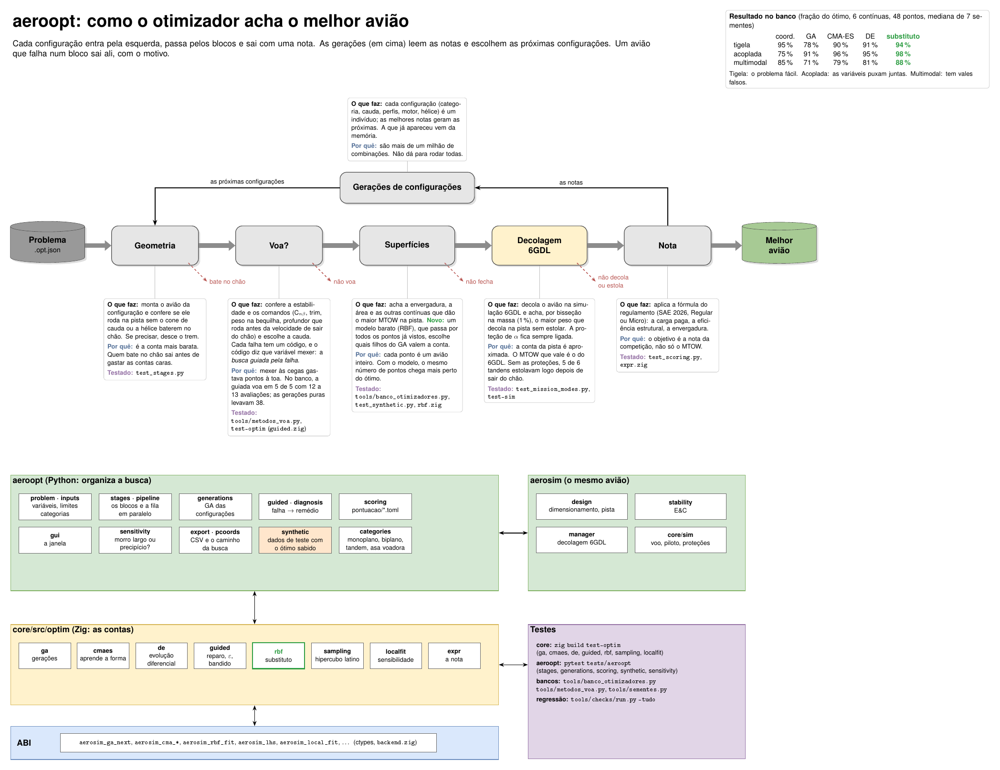

# aeroopt/ — o otimizador do projeto

Este é o terceiro braço do AircraftSimulation. O `aerosim` é onde se projeta um avião e o `aerodrive` é onde se voa
nele. O aeroopt procura, entre muitos aviões possíveis, o que faz mais pontos numa competição. Você diz o que pode
mudar no avião (envergadura, área, perfis, motor, hélice, tipo de avião...), entre que limites e com que restrições, e
escolhe a pontuação do regulamento. Ele monta os aviões, confere se cada um cabe, voa e decola, dá a nota de cada um
e mostra qual ganhou e por quê.

O aeroopt não tem física própria. Cada avião é montado pelas mesmas etapas do aerosim e as contas rodam no núcleo em
Zig (`core/`). Aqui só se organiza a busca e se mostra o resultado.

## A janela

À esquerda fica o problema, com um botão para cada parte: pontuação, variáveis, restrições e configuração. Cada
botão abre um submenu, e ao lado dele aparece um resumo do que está escolhido. Os tipos de avião que a busca monta
(monoplano, biplano, tandem, asa voadora) e as caudas que a etapa "voa?" testa ficam na Configuração, junto do
método de cada etapa. Cada
opção dos submenus tem um "(?)" que explica o que ela é e no que muda a busca, e os campos de número levam só o
número: a unidade fica no nome do campo. Asa alta, média, baixa e parasol são o mesmo monoplano com a asa em outra
altura; para a busca escolher a altura, solta-se a variável "altura da asa". À direita fica a
rodada: quantos aviões passaram em cada etapa, o MTOW de cada ponto avaliado, a nota de cada configuração, o mapa dos
aviões, a tabela e o avião selecionado em 3D.


Nas variáveis se marca o que é livre e entre que limites. Um campo de escolha, como o perfil ou o motor, abre a lista
para marcar as opções que entram na busca.


Nas restrições ficam as condições que o avião tem de cumprir, a geometria (hélice, peças e chão na rotação) e a
estabilidade. Na configuração se escolhe o método de cada etapa.


No mapa, cada ponto é um avião. Os eixos podem ser qualquer variável do problema ou um resultado, e a cor é a nota.


Embaixo do mapa fica o caminho da busca, em coordenadas paralelas: cada avião é uma linha que passa por um eixo por
variável livre e pelo MTOW, o PV e a nota. Num mapa se veem duas grandezas por vez; aqui aparecem todas, e as linhas
das boas notas que se juntam num trecho de um eixo mostram onde está a região boa. A cor é a geração, e a linha preta
é o melhor até ali, na ordem em que os aviões foram avaliados. "Exportar HTML…" grava a mesma figura numa página que
abre sem internet.

Embaixo da tabela aparecem os gráficos do melhor avião até aqui: a decolagem, a aerodinâmica, a estabilidade e o
desempenho. Eles servem para conferir de relance se o avião que está ganhando faz sentido, e não ficam gravados.

A última aba é a sensibilidade do melhor: o quanto a nota muda se uma contínua livre sai do lugar, para saber se o
avião está no alto de um morro largo ou na beira de uma restrição. Ela olha só esse avião e só o que o problema deixa
mexer, dentro dos limites. Em vez de refazer o avião em vários pontos, ela reaproveita os pontos que a busca das
superfícies já avaliou em volta dele e passa por eles um modelo com a inclinação e a curvatura de cada variável (no
núcleo, `core/src/optim/localfit.zig`). Só a direção que a busca não cobriu ganha pontos novos. Cada barra vai da
nota prevista a 10 % da faixa para um lado à prevista para o outro, e o lado em que o avião deixa de fechar aparece
em vermelho, com o motivo.

No menu Configuração, a caixa da sensibilidade liga a análise e escolhe o método. O modelo local é o padrão e
quase não custa nada. O "um por vez" refaz dois pontos por variável e serve para conferir o modelo. Morris anda em
trajetórias pela região em volta do melhor e mostra se uma variável tem efeito que muda de um lugar para outro
(curvatura ou interação com as outras), ao preço de alguns pontos por variável. A tolerância diz quanto a nota cai
se o avião sair da oficina com aquela diferença em cada medida. Com os limites ligados, a pista e cada restrição
ligada mudam um pouco para cada lado, e a aba mostra quanto a nota do melhor ganha ou perde com isso, no mesmo
gráfico. Embaixo do tornado, um gráfico por variável mostra a nota pelo modelo em volta do melhor, os pontos
avaliados e a faixa da tolerância; um por limite mostra a nota com o limite apertado, como está e folgado. O botão
"Sensibilidade deste avião" roda só a sensibilidade do avião selecionado na tabela, sem rodar o resto.


## Como funciona

Cada configuração (o tipo de avião, a cauda, os perfis, o motor, a hélice) passa por uma fila de blocos, como num
diagrama de blocos de um conversor. Cada bloco confere uma coisa e só deixa passar quem cumpre: o que cai sai ali,
com o motivo. Quem chega ao fim ganha uma nota, e as gerações, em cima, leem as notas e escolhem as próximas
configurações. Os blocos vão do mais barato ao mais caro, para que as contas caras só rodem para quem já passou nas
baratas.



## Como se divide

O problema (`problem.py`) diz o que é livre, entre que limites, as restrições e a pontuação, e fica gravado num
arquivo `.opt.json`. As variáveis possíveis são os campos das etapas do aerosim (`inputs.py`), e os tipos de avião
ficam em `categories.py`. Os blocos estão em `stages.py`, e a fila que os roda em paralelo em `pipeline.py`. As
gerações das configurações ficam em `generations.py`, e a pontuação de cada regulamento é um `.toml` em
`pontuacao/`, lido por `scoring.py`. As contas pesadas (a nota, as buscas, o substituto) rodam no núcleo em Zig e
estão explicadas em [`core/src/optim/README.md`](../core/src/optim/README.md). As seções abaixo seguem os blocos, na
ordem do diagrama.

| arquivo | o que tem |
|---|---|
| `problem.py` | o problema e o arquivo `.opt.json` |
| `inputs.py` | as variáveis: todo campo das etapas do aerosim, com faixa ou lista |
| `categories.py` | os tipos de avião que a busca pode montar |
| `scoring.py`, `pontuacao/` | a pontuação de cada regulamento (Micro 2026 e Regular 2026), com a fonte |
| `stages.py`, `pipeline.py` | os blocos e a fila que os roda em paralelo |
| `generations.py` | as gerações de configurações (algoritmo genético no núcleo) |
| `guided.py`, `diagnosis.py` | a busca do bloco "voa?" guiada pela falha e a tabela falha → variáveis do remédio |
| `gui.py` | a janela |
| `export.py` | os CSV de cada rodada |
| `synthetic.py` | os dados de teste: um avaliador rápido com o resultado sabido de antemão |
| `pcoords.py` | o caminho da busca em coordenadas paralelas, na janela e numa página HTML |
| `sensitivity.py` | a sensibilidade do melhor: inclinação e curvatura da nota em cada contínua livre |
| `mini_mdo.py` | o mini-MDO do núcleo, a primeira versão, que fica como alternativa |

### Geometria

Aqui se monta o avião da configuração e se confere se ele roda na pista sem que o cone de cauda ou a hélice batam
no chão. Se precisar, o trem desce até caber. É a conta mais barata da fila, então vem primeiro.

### Voa?

Aqui se confere a estabilidade e o controle e se escolhe a cauda. A cauda não é um tipo de avião: é o que faz uma
asa voar. Com as caudas marcadas na Configuração, o bloco testa cada uma (convencional, em H, em V e sem cauda) e
fica com a que voa e, entre as que voam, com a que decola na pista levando mais carga paga. Com "comandos (E&C)"
ligado, a mesma busca mexe também no profundor (ou no elevon) e no motor, e exige que o comando rode o avião na pista
antes da velocidade de sair do chão, que a bequilha leve peso suficiente parado e que o avião aponte o nariz para o
vento.

Cada coisa que falta vira um termo da violação, com um código: $V(x) = \sum_t v_t(x)$, com cada $v_t$ valendo 1 na
fronteira de "bem fora". Dois pontos se comparam pelas regras de Deb (Computer Methods in Applied Mechanics and
Engineering 186, 2000, seção 3, a conferir no PDF): quem voa ganha de quem não voa; entre dois que voam ganha o de
maior MTOW; entre dois que não voam ganha o que viola menos.

$$\text{rank}(x) = \begin{cases} (1,\ \text{MTOW}) & V(x) = 0 \\ (0,\ -V(x)) & V(x) > 0 \end{cases}$$

O código de cada termo diz quais variáveis consertam aquela falha (`diagnosis.py`), e a busca guiada pela falha
(`guided.py`) muta ou repara só elas. O "diagnóstico" deixa um bandido escolher, filho a filho, entre a evolução
diferencial, a mutação no remédio, o reparo por gradiente, o algoritmo cultural e o LEM, pelo que cada um já rendeu.
Sem isso a busca mexia às cegas e gastava pontos; no caso de teste, a guiada voa com 12 a 13 avaliações, e as
gerações puras precisavam de umas 38 (`tools/metodos_voa.py`).

No tandem o bloco confere mais três coisas (`stages.tandem_terms`): a asa da frente leva de 40 a 60 % da sustentação
no cruzeiro, a de trás fica de 3 a 5 cordas atrás e o desnível fica em até 1 corda. As faixas são do Kryvokhatko e de
uma discussão de fórum, ainda a conferir no PDF.

A busca do bloco parte do avião como está e para no primeiro ponto que voa. Se esse ponto de partida cai numa região
ruim, a rodada fica nela. Para isso há dois ajustes, desligados por padrão: o início por hipercubo latino
(`etapas.inicio = "lhs"`), que espalha a população inicial pela faixa toda, e as partidas (`etapas.partidas = k`),
que seguem até achar k pontos que voam, longe uns dos outros.

### Superfícies

Aqui se acham a envergadura, a área e as outras variáveis contínuas que dão o maior MTOW na pista, com as mesmas
regras de Deb. Há cinco buscas na Configuração: coordenadas (um eixo por vez), gerações (algoritmo genético), CMA-ES,
evolução diferencial e gerações com substituto. Cada ponto aqui é um avião inteiro, por isso importa achar o melhor
com poucos pontos. A busca com substituto ataca exatamente isso: o genético sorteia muitos filhos, um modelo barato
que passa por todos os pontos já avaliados dá o palpite de cada um, e só os de melhor palpite vão para a conta de
verdade. O modelo é uma soma de cúbicas em volta de cada ponto com um plano (Gutmann, J. Global Optimization 19,
2001, a conferir no PDF):

$$s(u) = \sum_{i=1}^{m} \lambda_i \lVert u - u_i \rVert^3 + c_0 + c^{\mathsf T} u$$

### Decolagem 6GDL

Aqui se acha o MTOW que vale: o maior peso que decola na simulação 6GDL dentro da pista sem estolar. A conta da pista
do bloco anterior é aproximada; esta voa o avião de verdade, com o piloto. A massa sai por bisseção, que corta a faixa
ao meio até ela ficar menor que 1 %:

$$m_{k+1} = \tfrac12 (m_{lo} + m_{hi}), \qquad \text{decolou: } m_{lo} \leftarrow m_{k+1}, \quad \text{não: } m_{hi} \leftarrow m_{k+1}$$

A decolagem é sempre com a proteção de α do piloto, que pica o nariz antes do estol, e a que estola é reprovada mesmo
passando a pista. Quase todo o tempo vai nas massas que não decolam. A tolerância (`etapas.tolerancia`, em % do
x_warning) aceita errar um pouco o ponto de acionamento e desiste logo da massa que nem com o comando todo cabrando
sai do chão.

### Nota

Aqui a carga paga ($CP = \text{MTOW}_{6GDL} - PV$) entra na fórmula do regulamento. Na Regular 2026, por exemplo, a
parte principal é a eficiência estrutural $EE = CP/PV$, corrigida pelo número de superfícies e pela envergadura
(Regulamento SAE BRASIL AeroDesign 2026, seção 7, eqs. 7.2 a 7.5). Um regulamento novo é só um `.toml` novo.

### Gerações

Com poucas combinações, a rodada passa todas pela fila. Com muitas (cada perfil, motor, hélice e categoria
multiplicam a conta, e um problema comum passa de um milhão), um algoritmo genético escolhe quais experimentar: cada
configuração é um indivíduo, as melhores notas geram as próximas, e quem parou num bloco fica atrás de quem foi mais
longe. Uma configuração que já apareceu vem da memória.

### Depois da rodada e para testar

`sensitivity.py` diz o quanto a nota do melhor avião depende de cada variável: se ele está num morro largo ou na
beira de um precipício (a aba Sensibilidade, acima). Para testar a máquina sem esperar as contas do avião,
`synthetic.py` troca as contas por funções simples em que já se sabe a resposta, em três formas: a tigela (fácil), a
acoplada (as variáveis puxam juntas) e a multimodal (com vales falsos). `tools/banco_otimizadores.py` compara as
buscas nelas, e `tools/sementes.py` diz se sementes diferentes caem no mesmo avião.

## Como abrir

```sh
python -m aeroopt --exemplo                            # a janela com um projeto de exemplo
python -m aeroopt meu_projeto.json problema.opt.json   # partindo de um projeto da sprint
python -m aeroopt --exemplo --sintetico                # a janela com os dados de teste: a rodada em segundos
python tools/aeroopt.py problema.opt.json --etapas --projeto meu_projeto.json   # sem janela
python -m pytest -q tests/aeroopt                      # os testes
```

Um regulamento novo é um `.toml` novo em `pontuacao/`, com a fonte e um teste com uma nota calculada à mão.
