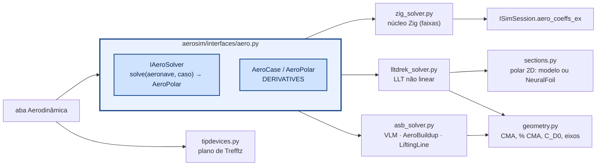
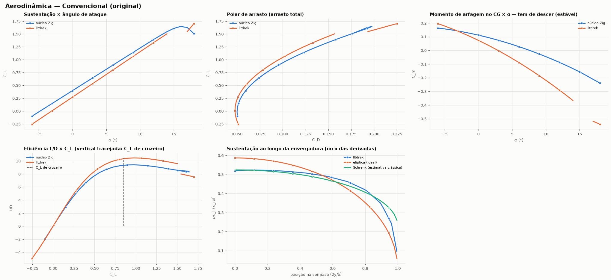
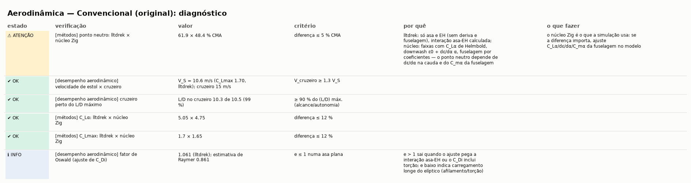
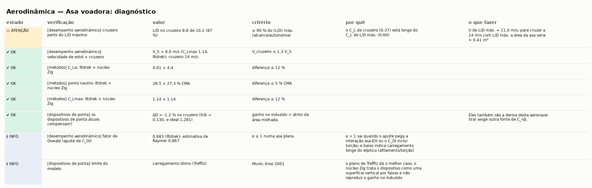
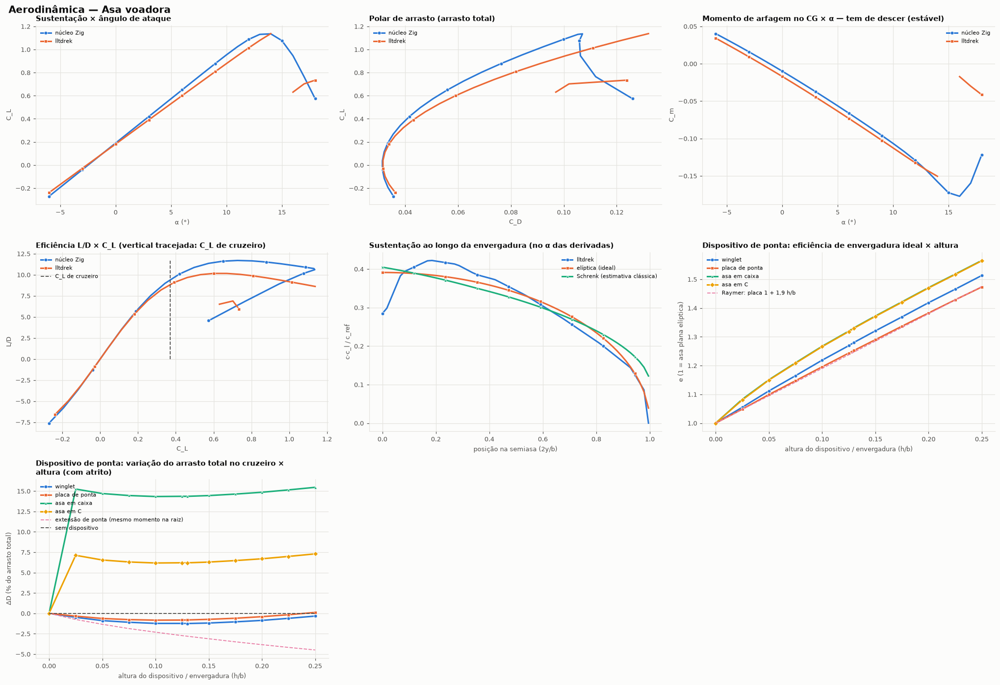

# aerosim/aero — aerodinâmica a partir da geometria

Na aba **Aerodinâmica** o método principal é o **lltdrek**; o núcleo Zig entra para comparar (é o que
a simulação usa) e o AeroSandbox é opcional. O diagnóstico diz se os métodos concordam (e por que não),
se o cruzeiro está perto do L/D máximo, a margem até o estol e — **só se a aeronave tiver dispositivos
de ponta** (superfícies verticais na ponta da asa) — se eles compensam o atrito. Sem dispositivo, o estudo
de pontas só roda se marcado.

Calcula polares e derivadas de estabilidade da aeronave por **vários métodos** sobre a mesma
geometria (o modelo de `aerosim/model`) e estuda **dispositivos de ponta de asa**. É usado pela aba
**Aerodinâmica** (`manager/simulations/aerodynamics.py`) e pode ser chamado direto do Python.



## Métodos comparados

| solver | o que entra | como |
|---|---|---|
| `zig` — núcleo Zig | asa, EH, EV, fuselagem | o mesmo modelo da simulação: faixas por seção/comando, C_Lα de Helmbold, ε = ε0 + dε/dα α, estol de Beard e McLain. Derivadas por diferenças centrais em α, β, p̂, q̂, r̂ e nos comandos (`aerosim_aero_coeffs_ex`) |
| `lltdrek` — [kuodrek/lltdrek](https://github.com/kuodrek/lltdrek) | asa + EH (com interação) | linha sustentadora não linear (Phillips–Snyder) com a polar 2D de cada perfil; sem derrapagem (derivadas em β = NaN), sem EV e sem fuselagem |
| `asb_vlm` — AeroSandbox VLM | asa, EH, EV | malha de vórtices em ferradura; arrasto só induzido (+ C_D0 do modelo) |
| `asb_buildup` — AeroSandbox AeroBuildup | asa, EH, EV, fuselagem | soma por componentes com NeuralFoil; arrasto completo |
| `asb_ll` — AeroSandbox LiftingLine | asa, EH, EV | linha sustentadora com NeuralFoil; só derivadas em α e β |

Todos devolvem nos eixos do simulador (x à frente, z para baixo) com momentos no ponto `ref` do caso
(o x_CG escolhido na aba, em % da CMA, ou o CG do modelo de massa): p̂ = p b/2V, q̂ = q c/2V,
r̂ = r b/2V. Os externos usam x para trás e z para cima (`geometry.to_xz_up`); o lltdrek usa
velocidade livre unitária (ω entra dividido por V) e normaliza C_l e C_n por S c — o adaptador converte.

`polar_metrics` tira de cada polar: C_L0, C_Lα, C_Lmax, α de estol, C_D mín., (L/D) máx., e (ajuste de
C_Di = C_L²/(π AR e)), ponto neutro x_np = x_ref + c C_mα/C_Lα e margem estática.

**Polar 2D (`sections.py`)** — `modelo`: c_l = a0 (α − α_L0) misturado à placa plana pela sigmoide de
Beard e McLain com o pico no c_l,max do perfil (a mesma hipótese do núcleo, em 2D); `neuralfoil`: o
contorno `.dat` real pela rede do NeuralFoil.

Notas sobre o lltdrek 1.2: (1) o corretor de Newton só monta a matriz certa quando todas as
superfícies têm o mesmo número de painéis — o adaptador sempre usa o mesmo N; (2) `np.cross` em
vetores soltos domina o tempo — o adaptador troca por uma versão de 3 componentes (~4× mais rápido).





## Dispositivos de ponta de asa (`tipdevices.py`)

Arrasto induzido mínimo no plano de Trefftz (Munk; Kroo, *Drag due to lift*, Annu. Rev. Fluid Mech.
2001; Kroo, McMasters e Smith, *Highly nonplanar lifting systems*, 1995):

```
L = ρ V ∮ Γ dy        D_i = (ρ/2) ∮ Γ w_n ds        e = L² / (π q b² D_i)
```

O traço é dividido em painéis de Γ constante com vórtices livres nas pontas de cada painel
(espaçamento uniforme — o cosseno não converge nas junções) e o Γ ótimo sai de min D_i com L fixo.
Extrapolação de Richardson em n e 2n. Validação (testes em `tests/aero/test_tipdevices.py`):

| configuração | aqui | referência |
|---|---|---|
| asa plana | 1,000 | 1 (elíptica) |
| caixa h/b = 0,2 | 1,47 | 1,46 (Kroo 2001) |
| placa de ponta h/b = 0,1 / 0,2 | 1,19 / 1,38 | 1 + 1,9 h/b = 1,19 / 1,38 (Raymer) |
| winglet h/b = 0,2 | 1,42 | — |
| momento na raiz, plana | (L/2)(4s/3π) | elíptica |

`device_study` varre h/b e dá, para winglet, placa, caixa e asa em C: o e ótimo e a variação do arrasto
total (D_i + atrito C_f S_molhada do dispositivo) em relação à asa sem nada; e duas referências de
extensão de ponta: com a mesma área molhada e com o mesmo momento fletor na raiz (comparação de
Whitcomb/Jones). Com carregamento ótimo a extensão ganha; o winglet compensa quando o vão é limitado
(regulamento, hangar).



## Uso direto

```python
from aerosim.aero import AeroCase, ZigPanelSolver, LltdrekSolver, AsbVLMSolver, polar_metrics
from aerosim.backend.zig import ZigBackend
case = AeroCase(V=15, alphas=np.arange(-4, 14, 1.0), ref=(0.02, 0, 0.0))
pol = LltdrekSolver().solve(ac, case)
print(pol.derivs, polar_metrics(pol, ac, case))
```

`lltdrek` e `aerosandbox` são opcionais: sem eles o solver aparece como indisponível na aba.

Figuras: `python tools/plot_comparativo.py docs/img/comparativo [conventional|twin_boom|flying_wing|arquivo.cfg]`.
