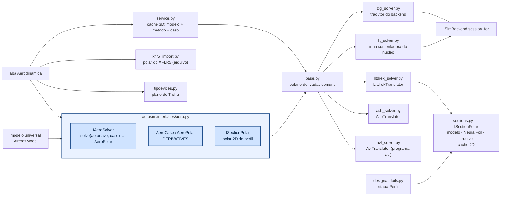

# aerosim/aero — aerodinâmica a partir da geometria

Na aba **Aerodinâmica** o método principal é o **lltdrek**; o núcleo Zig entra para comparar (é o que
a simulação usa) e o AeroSandbox é opcional. O diagnóstico diz se os métodos concordam (e por que não),
se o cruzeiro está perto do L/D máximo, a margem até o estol e — **só se a aeronave tiver dispositivos
de ponta** (superfícies verticais na ponta da asa) — se eles compensam o atrito. Sem dispositivo, o estudo
de pontas só roda se marcado.

Calcula polares e derivadas de estabilidade da aeronave por **vários métodos** sobre a mesma
geometria (o modelo de `aerosim/model`) e estuda **dispositivos de ponta de asa**. É usado pela aba
**Aerodinâmica** (`manager/simulations/aerodynamics.py`) e pode ser chamado direto do Python.

## Como chamar

```python
import numpy as np
from aerosim.aero import AeroCase, ZigPanelSolver, LltdrekSolver, AsbVLMSolver, polar_metrics
from aerosim.backend.zig import ZigBackend
from aerosim.model.templates import conventional
from aerosim.model.universal import build_model

ac = conventional()
model = build_model(ac)
case = AeroCase(V=15, alphas=np.arange(-4, 14, 1.0), ref=(0.02, 0, 0.0))   # ref: ponto dos momentos
pol = ZigPanelSolver(ZigBackend()).solve(model, case)      # ou LltdrekSolver(), AsbVLMSolver() se instalados
pol.CL, pol.CD, pol.derivs                                  # polar e derivadas (C_mα, C_nβ, C_lp, ...)
polar_metrics(pol, model, case)                             # C_Lmax, α de estol, (L/D)máx, ponto neutro...
```

`lltdrek` e `aerosandbox` são opcionais (`pip install -r requirements-aero.txt`).

## Asa por partições (etapa Asa da sprint)

Na etapa **Aerodinâmica → Asa** a asa pode ser um trapézio ou uma **tabela de partições**, como na planilha:
cada linha é uma partição com **envergadura** (o quanto ela soma na envergadura total, metade de cada lado),
**corda** (no começo dela), **afilamento**, **perfil** (no fim dela; ao longo da partição ele passa do da
anterior para este), **recuo** (o bordo de ataque andando para trás: enflechamento) e **θ** (torção no fim, em
relação à raiz; − = washout). A envergadura total é a soma das partições; asa reta é uma linha só. A linha
sustentadora (`aerosim/design/wing.py`) usa o perfil de cada seção no Re da corda dela.

Dois exemplos com perfis NACA gerados (polar pelo NeuralFoil):


Os gráficos da etapa Asa para cada uma (C_L × α, polar com arrasto induzido e de perfil, L/D e c_l ao
longo da semienvergadura no cruzeiro e no estol):


A trapezoidal tem mais alongamento com a mesma envergadura (menos área), e o perfil simétrico na ponta
(com washout) tira arqueamento de onde o estol seria perigoso: C_L0 e C_m,ac menores, estol mais tarde.

## Tabela de voo de qualquer método (`flight_table.py`)

Para voar com um método que não roda no núcleo (lltdrek, ASB, AVL), ele gera uma tabela antes do voo, e o núcleo voa
com ela (`ac.sim.aero_model = "tabela"`, `core/src/physics/aerotable.zig`). A tabela tem:
- C_L, C_D, C_m numa faixa de α, a uma V, com β = 0;
- as derivadas lineares de β, de taxas e de comandos, tomadas num α pequeno.

As equações com que o núcleo voa essa tabela estão em [`core/src/physics/README.md`](../../core/src/physics/README.md).

```python
from aerosim.backend.zig import ZigBackend
from aerosim.model.templates import conventional
backend, ac = ZigBackend(), conventional()
from aerosim.aero import solver_by_name
from aerosim.aero.flight_table import table
from aerosim.model.universal import build_model
model = build_model(ac)
cg = tuple(model.mass["cg"])                        # momentos no CG
t = table(solver_by_name(backend, "avl"), model, V=15.0, rho=1.225, ref=cg, fill=solver_by_name(backend, "zig"))
ac.sim.aero_model, ac.sim.aero_table = "tabela", t        # t["completadas"]: as derivadas que vieram do núcleo
```

- **Derivadas que faltam:** as que o método não dá (NaN) vêm de `fill` (em geral o núcleo), e a tabela guarda quais.
- **Cache:** as polares passam por `service.solve` (memória; disco para os métodos caros, `cost = "caro"`), então a
  mesma tabela não é montada de novo.
- **Fuselagem:** os métodos de fora não a têm (`IAeroSolver.includes_fuselage = False`), e o núcleo soma a dele por
  cima.
- **O que a tabela não tem:** efeito solo, esteira, variação com V e estol nos métodos lineares.

Para comparar os voos com cada modelo: `tools/aero/missao.py`.

## Carga ao longo das superfícies (`span_loads.py`)

É a "análise de cargas" da aerodinâmica num ponto de operação.

- **Padrão: voo nivelado a 12 m/s.** α, profundor e acelerador saem da trimagem do núcleo, então a distribuição é a
  da carga real do avião (as superfícies sustentam o peso).
- **Mudar a velocidade:** `V`.
- **Curva:** `n` > 1 (fator de carga). Se o avião não segura aquele n naquela velocidade, a trimagem avisa em
  `notes`.
- **Impor tudo:** `alpha`, `de` e a **rotação de cada motor** (`rpm`). Para cada superfície (asa, EH, EV, cauda em V,
dispositivos) devolve, ao longo da envergadura em metros:
- sustentação e arrasto por metro (N/m);
- α local, velocidade e pressão dinâmica locais;
- C_l e C_d;
- os **vetores** de cada faixa: centro, força, velocidade relativa e a parte dos modificadores. São o que a vista
  3D vai desenhar.

`tubes()` dá o contorno da esteira de cada motor, também para o 3D.

```python
from aerosim.backend.zig import ZigBackend
from aerosim.model.templates import conventional
backend, ac = ZigBackend(), conventional()
from aerosim.aero.span_loads import LoadCase, compute
r = compute(backend, ac)                                      # nivelado a 12 m/s (trimagem)
r = compute(backend, ac, LoadCase(V=16, n=2))                 # curva com n = 2 a 16 m/s
r = compute(backend, ac, LoadCase(V=8, alpha=2, rpm=6000))     # α e rotação impostos (rpm: um valor ou um por motor)
r.alpha, r.de, r.weight, r.trim                               # o que foi usado
asa = r.by_role("wing")[0]
asa.s, asa.L, asa.alpha, asa.V                                # y (m), N/m, °, m/s
asa.points, asa.force, asa.velocity, asa.induced              # (n, 3), corpo
r.props[0].T, r.props[0].Q, r.props[0].J                      # motor naquela rotação
```

**Método da carga** (`LoadCase(method=...)`):
- `"llt"` (padrão): linha sustentadora do núcleo (`core/src/loads/llt.zig`, Phillips e Snyder 2000). A carga depende
  do alongamento e da forma, cai na ponta, e o downwash da asa na cauda sai das pernas dos vórtices. A superfície é
  refinada com faixas mais estreitas na ponta.
- `"llt_gh"`: a mesma linha sustentadora com as correções de Goates e Hunsaker (AIAA SciTech 2021): junta das
  pernas, linha efetiva por ponto de controle e seção normal à linha. A de Phillips e Snyder não converge com a malha em
  superfície enflechada nem em derrapagem; esta converge e fica perto do MachUpX (`core/src/loads/README.md`). Com o
  cache da geometria (`llt.prepare`), custa da ordem da de Phillips e Snyder.
- `"faixas"`: o C_Lα 3D uniforme de cada superfície, como a simulação usa. A carga sai plana: serve para comparar.
- `"vlm_asb"`: o VLM do AeroSandbox (`asb_solver.AsbVLMLoads`), para a tendência.

Na linha de comando: `--metodo llt|llt_gh|faixas`. O `tools/span_load.py` também aceita `--sem-helice`.

A conta é do núcleo, no mesmo laço da simulação (`aero.computeTrace` via `aerosim_panel_states`), e entra com os
modificadores do avião (efeito solo, esteira). O estado do motor vem de `aerosim_prop_state`: hélice C_T(J), C_P(J)
na rotação pedida, com o ar no eixo do motor.

O módulo só refina a geometria para dar resolução: põe mais seções na mesma superfície (corda, recuo e torção
interpolados, com as seções originais exatas), uma superfície por vez, até o limite de painéis do núcleo. Sem motor,
a sustentação total refinada é a mesma da sem refino (teste). Superfícies com perfil próprio por seção e dispositivos
de ponta saem com as faixas que já têm.

**Entrada padrão, gráficos e 3D.** `to_result(r, backend)` leva o resultado para a entrada padrão
`aerosim.interfaces.loads.LoadResult`:
- distribuições ao longo da envergadura;
- a malha 3D: uma face por faixa, do bordo de ataque ao de fuga, na largura da faixa;
- os campos: carga alar local (N/m²), sustentação por metro, α efetivo, V local / V∞, c_l, c_d, q;
- os vetores (força e velocidade induzida) e os tubos da esteira.

Quem desenha só lê esse formato:
- `load_plots.span_figure` faz os gráficos;
- `gui/widgets/load_view.LoadView` faz o 3D, com mapa de cores do campo escolhido, setas, esteira e o avião em
  transparência.

Por isso outro método (VLM, painéis, CFD) entra montando um `LoadResult`, sem mexer nos gráficos nem no 3D. O teste
`tests/aero/test_load_result.py` faz isso com um "CFD" de mentira em triângulos e com um campo próprio.

A vista 3D pinta o **próprio modelo da GUI** (`aircraft_meshes`): cada vértice de superfície pega o valor da faixa
mais próxima. As setas têm ponta. Camadas de setas:
- **força total** da faixa;
- **sustentação (⟂ ao vento local)**;
- **força normal à superfície**;
- **velocidade induzida**.

As setas de força são **por metro de envergadura (N/m)**, como `L` e `D` da distribuição. O refino deixa faixas
mais estreitas nas quebras de seção; em N por faixa, elas apareciam como uma queda de carga que não existe.

A força total não é perpendicular à superfície. A sustentação é perpendicular ao vento local, e com α grande ela fica
inclinada para a frente em relação à normal da asa. Por isso há as duas camadas separadas.

Escalas do mapa:
- mín–máx (padrão);
- simétrica em 0;
- por superfície: cada superfície com a sua faixa, para ver a variação na EH mesmo com a asa carregando muito mais.

O campo `imersao` mostra quanto de cada faixa está dentro do tubo de alguma hélice.

**Sem hélice:** `LoadCase(props=False)` (ou `--sem-helice`) zera tração e torque. A distribuição sai a do avião
limpo, para comparar ou para cargas sem motor.

```
python tools/load_view.py data/aircraft/Convencional_original.json --com esteira.disco                 # janela 3D
python tools/load_view.py data/aircraft/Convencional_original.json --campo alpha_ef --png vista.png
python tools/load_view.py data/aircraft/Convencional_original.json --com esteira.disco --sem-helice --png limpo.png
```

### Colisão com o tubo da hélice (`collision.py`)

`tube_hits(backend, ac, V=0, thrust=None)` traça, a partir de cada hélice, um tubo ao longo do eixo de tração:
- com `thrust` nulo, um cilindro do raio da hélice;
- com tração, o tubo que contrai.

O que o tubo pega vem como `Hit(prop, component, kind, fraction)`:
- superfícies: fração da área (`aerosim_tube_panel_hits`);
- objetos (fuselagem, trem, carga): fração dos vértices do modelo da GUI (`aerosim_tube_point_hits`).

A geometria é do núcleo (`core/src/collision/`), e é a mesma que a esteira usa.

```python
from aerosim.backend.zig import ZigBackend
from aerosim.model.templates import conventional
backend, ac = ZigBackend(), conventional()
from aerosim.aero.collision import tube_hits
for h in tube_hits(backend, ac):
    print(h.prop, h.component, h.kind, h.fraction)
```

A trimagem ainda não vê a esteira (ela chama a aerodinâmica sem motores). Com a esteira ligada, α e profundor são
os do avião sem esteira e a sobra de sustentação aparece no resultado.

Os testes estão em `tests/aero/test_span_loads.py`. Pela linha de comando:

```
python tools/span_load.py data/aircraft/Convencional_original.json --com esteira.disco --png carga.png   # 12 m/s
python tools/span_load.py data/aircraft/Convencional_original.json --V 15 --n 2 --png curva.png
python tools/span_load.py data/aircraft/Convencional_original.json --V 8 --alpha 2 --rpm 6000 --com esteira.disco
```

## Como funciona



### Métodos comparados

| solver | o que entra | como |
|---|---|---|
| `zig` — núcleo Zig | asa, EH, EV, fuselagem | o mesmo modelo da simulação: faixas por seção/comando, C_Lα de Helmbold, ε = ε0 + dε/dα α, estol de Beard e McLain. Derivadas por diferenças centrais em α, β, p̂, q̂, r̂ e nos comandos (`aerosim_aero_coeffs_ex`) |
| `lltdrek` — [kuodrek/lltdrek](https://github.com/kuodrek/lltdrek) | asa + EH (com interação) | linha sustentadora não linear (Phillips–Snyder) com a polar 2D de cada perfil; sem derrapagem (derivadas em β = NaN), sem EV e sem fuselagem |
| `zig_llt`, `zig_llt_gh` — linha sustentadora do núcleo (`llt_solver.py`) | asa, EH, EV, fuselagem | a conta da simulação com as forças dos painéis pela linha sustentadora (`aerosim_aero_coeffs_llt`), com as superfícies refinadas (`span_loads.refine_all`, `n_span` faixas por lado, mais estreitas na ponta). `zig_llt`: Phillips e Snyder (2000), não converge em β nem com enflechamento; `zig_llt_gh`: Goates e Hunsaker (2021), converge e fica perto do MachUpX (`core/src/loads/README.md`). Sem estol |
| `asb_vlm` — AeroSandbox VLM | asa, EH, EV | malha de vórtices em ferradura; arrasto só induzido (+ C_D0 do modelo) |
| `asb_buildup` — AeroSandbox AeroBuildup | asa, EH, EV, fuselagem | soma por componentes com NeuralFoil; arrasto completo |
| `asb_ll` — AeroSandbox LiftingLine | asa, EH, EV | linha sustentadora com NeuralFoil; só derivadas em α e β |
| `avl` — [AVL](https://web.mit.edu/drela/Public/web/avl/) (Drela e Youngren) | asa, EH, EV, dispositivos, comandos | malha de vórtices; o programa `avl` é externo (PATH ou `AVL_PATH`). O tradutor escreve o `.avl` (NACA pelo código, os outros perfis por AFILE, C_D0 do modelo como CDp, comandos `pitch`/`roll`/`yaw` pelos ganhos da mistura), roda a varredura numa sessão e lê o `ST` de cada ponto |
| `xflr5` — polar importada | o que estava no XFLR5 | lê a polar de avião exportada (Polars → Export, texto ou CSV): α, C_L, C_D, C_Di, C_m (no CG de lá); C_Lα e C_mα pelo ajuste em α; não roda nada |

Cada solver só implementa `evaluate(modelo, caso, pontos)` — pontos de voo universais (α, β, p̂, q̂, r̂,
comandos) → coeficientes universais —, com o seu tradutor fazendo a ida (modelo universal → formato
dele) e a volta (resultado → eixos e adimensionalização universais). A varredura em α e as diferenças
centrais das derivadas são o mesmo código para todos (`base.py`). Todos devolvem nos eixos do simulador (x à frente, z
para baixo), com momentos no ponto `ref` do caso (o x_CG escolhido na aba, em % da CMA, ou o CG do modelo de massa). Os
externos usam x para trás e z para cima (`geometry.to_xz_up`); o lltdrek usa velocidade livre unitária (ω entra
dividido por V) e normaliza C_l e C_n por S c; o adaptador converte. As equações estão na seção abaixo.

**Polar 2D (`sections.py`)** — cada fonte é um `ISectionPolar` (`aerosim/interfaces/aero.py`) e a etapa
Perfil da sprint e o lltdrek pedem pelo mesmo `section_polar(perfil, α, Re, fonte)`:

| fonte | o que é |
|---|---|
| `modelo` | c_l = a0 (α − α_L0) misturado à placa plana pela sigmoide de Beard e McLain, pico no c_l,max do perfil (a hipótese do núcleo, em 2D) |
| `neuralfoil` | o contorno real (.dat ou NACA) pela rede do NeuralFoil; sem contorno, cai no modelo |
| `arquivo` | a polar exportada pelo XFLR5/XFOIL |

**Perfil por seção no lltdrek** — cada estação do modelo universal carrega o perfil dela (asa por
partições com outro perfil na ponta); o tradutor escreve uma polar por perfil diferente e o lltdrek
mistura linearmente entre as estações, como a etapa Asa.

**Cache** — a mesma pergunta não roda de novo:

| | chave | onde |
|---|---|---|
| 2D (`sections.py`) | perfil (nome, contorno, números, invertido) + fonte + arquivo e data + Re (em mil) + α | memória; NeuralFoil também em disco |
| 3D (`service.py`) | configuração inteira + método + versão dele + caso (V, α, ref, ρ, polar 2D, painéis) | memória; métodos caros (lltdrek, AeroSandbox, AVL) também em disco |

O disco é `~/.cache/aerosim` (ou a pasta da variável `AEROSIM_CACHE`), nunca o repositório nem `data/`.
Na aba, o resumo mostra `[método] de onde`: `calculado`, `cache` ou `arquivo …`. Cada `AeroPolar` sai
também com `fidelity` (`modelo` < `llt` < `vlm` < `painel` < `cfd` < `ensaio`), para depois calibrar o
método barato pelo caro.

Notas sobre o lltdrek 1.2: (1) o corretor de Newton só monta a matriz certa quando todas as
superfícies têm o mesmo número de painéis — o adaptador sempre usa o mesmo N; (2) `np.cross` em
vetores soltos domina o tempo — o adaptador troca por uma versão de 3 componentes, bem mais rápida.


### Equações comuns aos métodos

**Taxas adimensionais.** Todos os métodos recebem e devolvem as rotações assim:

$$
\hat p = \frac{p\,b}{2V} \qquad \hat q = \frac{q\,c}{2V} \qquad \hat r = \frac{r\,b}{2V}
$$

**Derivadas** (`base.py`). Diferença central em torno do ponto da derivada ($\alpha_d$, com o resto zero), com o mesmo
passo $h$ para todos os métodos; $x$ é $\alpha$, $\beta$, $\hat p$, $\hat q$, $\hat r$ ou um comando, e $C$ um dos
coeficientes:

$$
C_x = \frac{C(x + h) - C(x - h)}{2h}
$$

**Métricas da polar** (`polar_metrics`). O $C_{L\alpha}$ e o $C_{m\alpha}$ são as inclinações no trecho linear; o ponto
neutro e a margem estática, com $c$ a corda de referência (x à frente):

$$
x_{np} = x_{ref} + c\,\frac{C_{m\alpha}}{C_{L\alpha}}
\qquad
MS = \frac{x_{ref} - x_{np}}{c}
$$

O fator de Oswald sai do ajuste da parte induzida, e a polar parabólica (`parabolic_polar`) do ajuste por mínimos
quadrados no trecho linear:

$$
C_{D_i} = \frac{C_L^2}{\pi\,AR\,e}
\qquad
C_D = C_{D0} + k\,C_L^2
$$

**Polar 2D "modelo"** (`sections.py`). A mesma hipótese do núcleo em 2D: a reta $c_l = a_0\,(\alpha - \alpha_{L0})$
misturada à placa plana pela sigmoide $\sigma$ de Beard e McLain, com o ângulo de estol achado para o pico ser o
$c_{l,max}$ do perfil (a sigmoide está em [`core/src/physics/README.md`](../../core/src/physics/README.md)):

$$
c_l = (1 - \sigma)\,a_0\,(\alpha - \alpha_{L0}) + \sigma\;2\operatorname{sgn}(\alpha)\sin^2\alpha\cos\alpha
\qquad
c_d = c_{d0} + 1{,}2\,\sigma\sin^2\alpha
$$

**Reynolds** (`geometry.py`), com a viscosidade cinemática do ar na densidade dada:

$$
Re = \frac{V\,c}{\nu(\rho)}
$$

### Um exemplo por arquivo

Todos partem do avião de exemplo e do backend do núcleo:

```python
import numpy as np
from aerosim.backend.zig import ZigBackend
from aerosim.model.templates import conventional
from aerosim.model.universal import build_model

be, ac = ZigBackend(), conventional()
model = build_model(ac)

# __init__.py: a lista de métodos, um pelo nome, as métricas e a polar parabólica
from aerosim.aero import AeroCase, all_solvers, solver_by_name, polar_metrics, parabolic_polar
case = AeroCase(V=15.0, alphas=np.arange(-4, 13, 2.0))
print([s.name for s in all_solvers(be)])

# zig_solver.py (o núcleo) e base.py (a varredura e as derivadas, iguais para todos)
pol = solver_by_name(be, "zig").solve(model, case)
print(polar_metrics(pol, model, case)["x_np"], parabolic_polar(pol)["CD0"], pol.derivs["Cma"])

# llt_solver.py: a linha sustentadora do núcleo como método de polar (Goates e Hunsaker)
from aerosim.aero.llt_solver import CoreLLTSolver
print(CoreLLTSolver(be, gh=True).solve(model, case).CL[:3])

# service.py: a mesma pergunta com cache (a segunda vez não roda de novo)
from aerosim.aero import service
pol2 = service.solve(solver_by_name(be, "zig"), model, case)

# sections.py: a polar 2D de um perfil, pela fonte escolhida
from aerosim.aero.sections import section_polar
af = ac.surfaces[0].airfoil
print(section_polar(af, [0, 4, 8], Re=2e5, source="modelo")["cl"])

# geometry.py: Reynolds e eixos dos solvers externos
from aerosim.aero.geometry import reynolds, to_xz_up
print(reynolds(15.0, 0.3, 1.225), to_xz_up([1.0, 0.5, 0.2]))

# tipdevices.py: eficiência do vão no plano de Trefftz e o estudo de dispositivos
from aerosim.aero.tipdevices import span_efficiency, device_study
print(span_efficiency("caixa", h=0.2), device_study(2.0, 0.6, 0.6, 0.2)["h_b"][:3])

# span_loads.py: carga ao longo das superfícies (trimado a 12 m/s) e a entrada padrão dos gráficos
from aerosim.aero.span_loads import LoadCase, compute, to_result
r = compute(be, ac, LoadCase(V=14.0))
res = to_result(r, be)

# load_plots.py: os gráficos ao longo da envergadura a partir do LoadResult
from aerosim.aero.load_plots import span_figure
fig = span_figure([("núcleo", res)])

# load_geometry.py: as setas da vista 3D (linhas e cones)
from aerosim.aero.load_geometry import arrow_meshes
m = arrow_meshes(np.zeros((1, 3)), np.array([[0.0, 0.0, 1.0]]), head=0.1)

# collision.py: o que o tubo de cada hélice pega
from aerosim.aero.collision import tube_hits
print(tube_hits(be, ac)[:2])

# flight_table.py: a tabela de voo de um método, para o núcleo voar com ela
from aerosim.aero.flight_table import table
t = table(solver_by_name(be, "zig"), model, V=15.0, rho=1.225)
```

Os métodos de fora seguem a mesma interface (`solve(model, case)`), cada um com o seu tradutor:

```python
import numpy as np
from aerosim.aero import AeroCase
from aerosim.aero.asb_solver import AsbVLMSolver            # asb_solver.py: VLM, AeroBuildup e LiftingLine do AeroSandbox
from aerosim.aero.avl_solver import AvlSolver, has_optvl    # avl_solver.py: o AVL (programa ou optvl)
from aerosim.aero.lltdrek_solver import LltdrekSolver       # lltdrek_solver.py: linha sustentadora não linear
from aerosim.model.templates import conventional
from aerosim.model.universal import build_model

model = build_model(conventional())
case = AeroCase(V=15.0, alphas=np.arange(0, 9, 4.0))
for s in (AsbVLMSolver(), AvlSolver(), LltdrekSolver()):
    if s.available() is None:                               # None: instalado
        print(s.name, s.solve(model, case).CL)
```

E a polar exportada do XFLR5 (`xflr5_import.py`) entra como mais um método, lida de um arquivo:

```python
# não roda sozinho: precisa de um arquivo exportado do XFLR5
from aerosim.aero.xflr5_import import read_plane_polar, Xflr5PolarFile
d = read_plane_polar("minha_polar.txt")          # alpha, CL, CD, CDi, Cm
metodo = Xflr5PolarFile("minha_polar.txt")
```

### Dispositivos de ponta de asa (`tipdevices.py`)

Arrasto induzido mínimo no plano de Trefftz (Munk, 1921; Kroo, *Drag due to lift*, Annu. Rev. Fluid Mech. 33, 2001;
Kroo, McMasters e Smith, *Highly nonplanar lifting systems*, 1995). O arrasto induzido de qualquer sistema sustentador
depende só do traço da esteira no plano de Trefftz e da circulação $\Gamma(s)$ ao longo dele:

$$
L = \rho\,V\oint\Gamma\,dy
\qquad
D_i = -\frac{\rho}{2}\oint\Gamma\,w_n\,ds
$$

$w_n$ é a velocidade normal ao traço que os vórtices livres ($d\Gamma/ds$) induzem nele. Com o traço dividido em
painéis de $\Gamma$ constante (espaçamento uniforme: o cosseno não converge nas junções), as duas integrais viram
formas em $\Gamma$, e o mínimo de $D_i$ com $L$ fixo é um sistema linear (a condição de Munk, $w_n \propto \cos\theta$):

$$
D_i = \Gamma^T M\,\Gamma \qquad L = b^T\Gamma \qquad M\,\Gamma \propto b
$$

O fator de eficiência do vão compara com a asa plana elíptica ($e = 1$), e a extrapolação de Richardson em $n$ e $2n$
painéis tira o erro da malha:

$$
e = \frac{L^2}{\pi\,q\,b^2\,D_i}
$$

A placa de ponta também é comparada com a correção empírica do Raymer (*Aircraft Design*, eq. 12.48):

$$
AR_{ef} = AR\,\left(1 + 1{,}9\,\frac{h}{b}\right)
$$

Os testes (`tests/aero/test_tipdevices.py`) conferem a asa plana ($e = 1$), a caixa contra Kroo 2001 e a placa contra o
Raymer; os números esperados estão lá.

`device_study` varre $h/b$ e dá, para winglet, placa, caixa e asa em C, o $e$ ótimo e a variação do arrasto total em
relação à asa sem nada; $e_{plan}$ é a perda da asa real em relação ao carregamento ótimo:

$$
\frac{D}{q} = \frac{(C_L S)^2}{\pi\,b^2\,e\,e_{plan}} + C_f\,S_{molhada}
$$

Ele dá também e duas referências de
extensão de ponta: com a mesma área molhada e com o mesmo momento fletor na raiz (comparação de
Whitcomb/Jones). Com carregamento ótimo a extensão ganha; o winglet compensa quando o vão é limitado
(regulamento, hangar).


`lltdrek`, `aerosandbox` e o programa `avl` são opcionais: sem eles o solver aparece como indisponível
na aba, com o motivo.

Figuras: `python tools/plot_comparativo.py docs/img/comparativo [conventional|twin_boom|flying_wing|arquivo.cfg]`.
