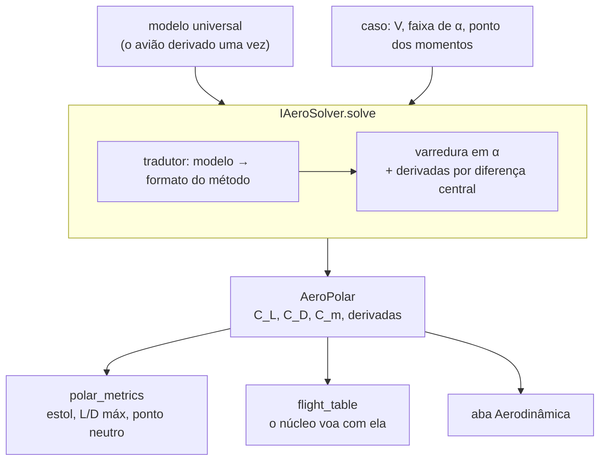
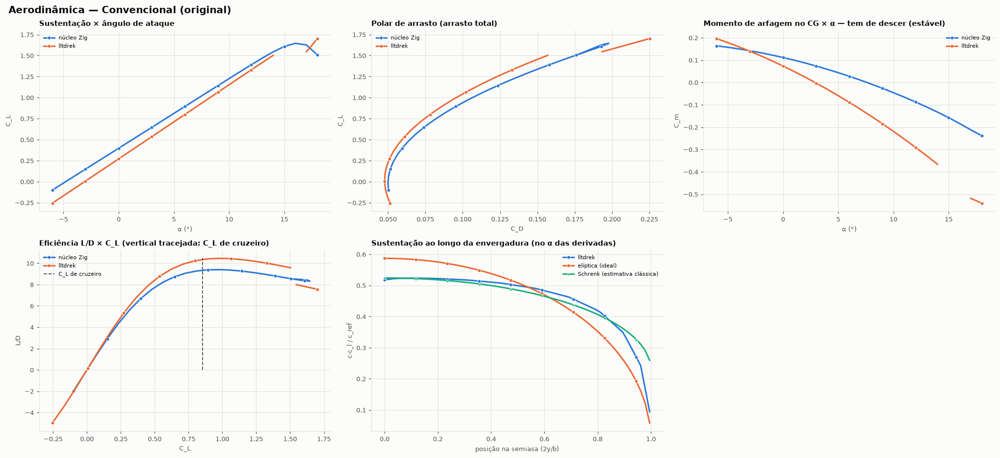

# aerosim/aero — aerodinâmica a partir da geometria

Esta pasta transforma a geometria do avião (superfícies, perfis, fuselagem e comandos) no que ele faz no ar: a polar
($`C_L`$, $`C_D`$ e $`C_m`$ em função de α), as derivadas de estabilidade, o estol, o L/D máximo e o ponto neutro. Com
ela se escolhe a asa (reta ou trapezoidal, com ou sem washout), se confere um método de cálculo contra outro, se gera
a tabela com que a simulação 6GDL pode voar e se tira a carga ao longo da envergadura para a estrutura. Também se vê
quanto um winglet ou uma placa de ponta ganha de arrasto induzido e se isso paga o atrito que ele traz.

Todo método recebe o mesmo modelo universal do avião e devolve a mesma polar. Por isso a aba **Aerodinâmica** compara
os métodos lado a lado sem saber como cada um funciona por dentro, e um método novo é só mais uma classe que
implementa a interface.



| método | o que enxerga | como resolve |
|---|---|---|
| `zig` | asa, EH, EV, fuselagem | faixas, o mesmo modelo da simulação |
| `zig_llt`, `zig_llt_gh` | asa, EH, EV, fuselagem | linha sustentadora do núcleo (Phillips e Snyder; Goates e Hunsaker) |
| `lltdrek` | asa e EH | linha sustentadora não linear com a polar 2D de cada perfil |
| `asb_vlm`, `asb_buildup`, `asb_ll` | asa, EH, EV (e fuselagem no buildup) | AeroSandbox: VLM, soma por componentes ou linha sustentadora |
| `avl` | tudo, com comandos | o AVL de Drela e Youngren |
| `xflr5` | o que estava no XFLR5 | lê a polar exportada, não calcula nada |

O lltdrek, o AeroSandbox e o AVL são opcionais (`pip install -r requirements-aero.txt`); sem eles, o método aparece
indisponível na aba, com o motivo. Uma pergunta repetida não roda de novo, porque as polares ficam em cache
(`~/.cache/aerosim`). A polar do avião de exemplo, pelo núcleo:

```python
import numpy as np
from aerosim.aero import AeroCase, solver_by_name, polar_metrics
from aerosim.backend.zig import ZigBackend
from aerosim.model.templates import conventional
from aerosim.model.universal import build_model

backend = ZigBackend()
model = build_model(conventional())
case = AeroCase(V=15, alphas=np.arange(-4, 21, 2.0))
polar = solver_by_name(backend, "zig").solve(model, case)    # ou "lltdrek", "asb_vlm", "avl"
print("C_L:", np.round(polar.CL, 2))
m = polar_metrics(polar, model, case)
print({k: round(float(m[k]), 3) for k in ("CLmax", "alpha_stall", "LDmax", "SM")})
```

```
C_L: [0.07 0.23 0.4  0.56 0.73 0.89 1.06 1.23 1.39 1.54 1.65 1.51 0.95]
{'CLmax': 1.646, 'alpha_stall': 16.0, 'LDmax': 9.381, 'SM': 14.142}
```

O $`C_L`$ sobe em reta até perto de 14°, estola aos 16° e cai. A margem estática sai em % da CMA. A carga ao longo da
envergadura, no voo nivelado a 12 m/s (a trimagem do núcleo dá α e profundor), sai do mesmo jeito:

```python
from aerosim.aero.span_loads import LoadCase, compute
asa = compute(backend, conventional(), LoadCase(V=12)).by_role("wing")[0]
print("raiz:", round(float(asa.L[np.argmin(np.abs(asa.s))]), 1), "N/m  ponta:", round(float(asa.L[np.argmax(asa.s)]), 1), "N/m")
```

```
raiz: 56.1 N/m  ponta: 9.2 N/m
```

A polar é a base do resto do projeto. O ponto neutro e as derivadas alimentam a Estabilidade, o L/D e o
$`C_{L,max}`$ alimentam o Desempenho e a Missão, e a carga alimenta as Cargas. A comparação dos métodos no avião
convencional, com o núcleo e o lltdrek lado a lado:



As equações dos métodos do núcleo estão em [`core/src/physics/README.md`](../../core/src/physics/README.md) e
[`core/src/loads/README.md`](../../core/src/loads/README.md).
