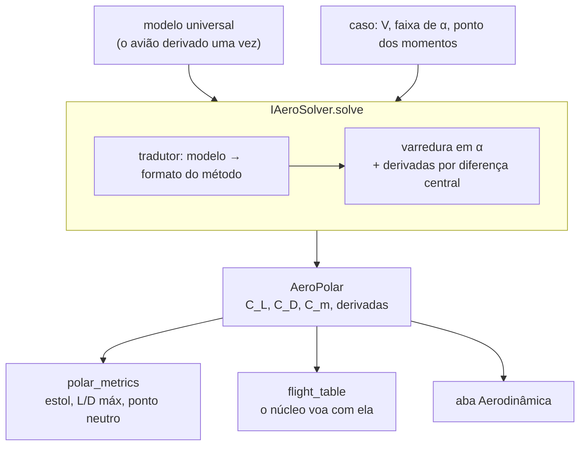
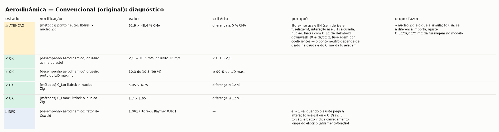
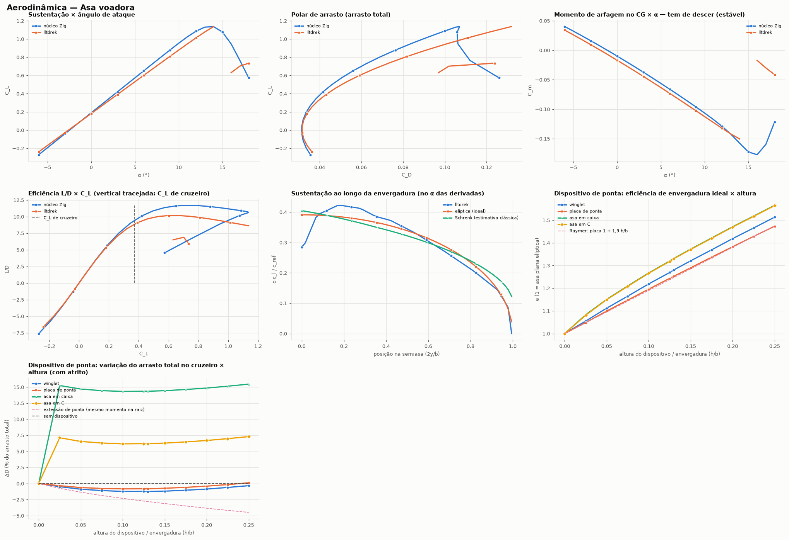

# aerosim/aero — aerodinâmica a partir da geometria

Esta pasta transforma a geometria do avião (superfícies, perfis, fuselagem e comandos) no que ele faz no ar. Saem a
polar ($`C_L`$, $`C_D`$ e $`C_m`$ em função de α), as derivadas de estabilidade, o estol, o L/D máximo e o ponto
neutro. A mesma geometria passa por vários métodos de cálculo, e a aba **Aerodinâmica** mostra os resultados lado a
lado.

## Para que serve

- **Escolher a asa.** Comparar uma asa reta com uma trapezoidal, ou ver o efeito do washout no estol da ponta.
- **Conferir um método com outro.** O núcleo (o modelo com que o avião voa) contra o lltdrek, o AeroSandbox e o AVL.
  O diagnóstico diz se eles concordam e, quando não concordam, por quê.
- **Voar com qualquer método.** Um método gera uma tabela de voo, e a simulação 6GDL voa com ela.
- **Carga ao longo da envergadura.** A sustentação por metro em cada superfície, para a estrutura.
- **Pontas de asa.** Quanto um winglet ou uma placa ganha de arrasto induzido e se isso paga o atrito que ele traz.


## Como funciona

Todo método recebe o mesmo modelo universal do avião e devolve a mesma polar. Por isso a aba compara os métodos sem
saber como cada um funciona por dentro. Um método novo é só mais uma classe que implementa a interface.



Os métodos disponíveis:

| método | o que enxerga | como resolve |
|---|---|---|
| `zig` | asa, EH, EV, fuselagem | faixas, o mesmo modelo da simulação |
| `zig_llt`, `zig_llt_gh` | asa, EH, EV, fuselagem | linha sustentadora do núcleo (Phillips e Snyder; Goates e Hunsaker) |
| `lltdrek` | asa e EH | linha sustentadora não linear com a polar 2D de cada perfil |
| `asb_vlm`, `asb_buildup`, `asb_ll` | asa, EH, EV (e fuselagem no buildup) | AeroSandbox: VLM, soma por componentes ou linha sustentadora |
| `avl` | tudo, com comandos | o AVL de Drela e Youngren |
| `xflr5` | o que estava no XFLR5 | lê a polar exportada, não calcula nada |

O lltdrek, o AeroSandbox e o AVL são opcionais (`pip install -r requirements-aero.txt`). Sem eles, o método aparece
indisponível na aba, com o motivo. Uma pergunta repetida não roda de novo, porque as polares 2D e 3D ficam em cache
(`~/.cache/aerosim`).

## Exemplo

```python
import numpy as np
from aerosim.aero import AeroCase, solver_by_name, polar_metrics
from aerosim.backend.zig import ZigBackend
from aerosim.model.templates import conventional
from aerosim.model.universal import build_model

backend = ZigBackend()
model = build_model(conventional())
case = AeroCase(V=15, alphas=np.arange(-4, 14, 1.0))

polar = solver_by_name(backend, "zig").solve(model, case)    # ou "lltdrek", "asb_vlm", "avl"
print(polar.CL, polar.derivs["Cma"])
print(polar_metrics(polar, model, case))                     # C_Lmax, α de estol, (L/D)máx, ponto neutro
```

A carga ao longo da envergadura, no voo nivelado a 12 m/s (a trimagem do núcleo dá α e profundor):

```python
from aerosim.aero.span_loads import LoadCase, compute
r = compute(backend, conventional(), LoadCase(V=12))
asa = r.by_role("wing")[0]
asa.s, asa.L                                                 # y (m) e sustentação (N/m)
```

Pela linha de comando: `python tools/span_load.py data/aircraft/Convencional_original.json --png carga.png`.

## O que isso influencia

A polar é a base do resto do projeto. O ponto neutro e as derivadas alimentam a **Estabilidade**, o L/D e o
$`C_{L,max}`$ alimentam o **Desempenho** e a **Missão**, e a carga ao longo da envergadura alimenta as **Cargas**.



Nas pontas de asa, o estudo mostra quanto cada forma reduz o arrasto induzido (Kroo, 2001) contra o atrito que
acrescenta:



As equações dos métodos do núcleo estão em [`core/src/physics/README.md`](../../core/src/physics/README.md) e
[`core/src/loads/README.md`](../../core/src/loads/README.md).
