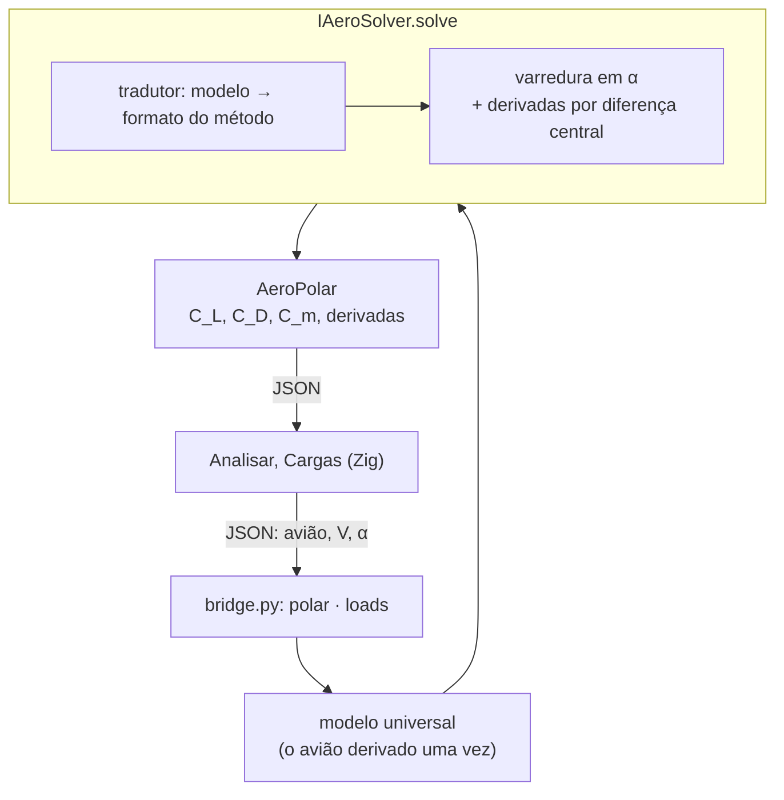
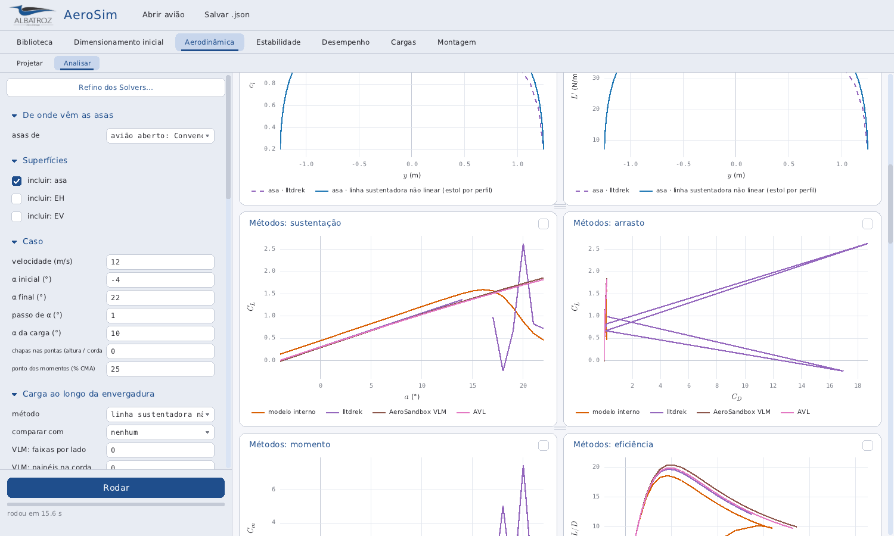

# aerosim/aero — os métodos aerodinâmicos de fora do núcleo

Esta pasta liga ao aerosim os métodos aerodinâmicos que já existem como bibliotecas em Python: a linha sustentadora não
linear do lltdrek (com a polar 2D de cada perfil), o VLM, a soma por componentes e a linha sustentadora do AeroSandbox,
e o AVL de Drela e Youngren. Com eles se confere um método do núcleo contra outro, na aba Analisar, e se tira a carga ao
longo da envergadura pelo VLM, em Cargas. Todo o resto (as faixas, a linha sustentadora e o VLM do núcleo, o estol, o
ponto neutro) é conta do núcleo, em Zig, e não passa por aqui.

A tela manda o avião em JSON ao adaptador (`../bridge.py`), que monta o modelo universal (`../model`), chama o método
pedido pelo tradutor dele e devolve a polar no mesmo formato, então a aba compara os métodos lado a lado sem saber como
cada um funciona por dentro. Um método novo é uma classe que implementa o `IAeroSolver` (`../interfaces/aero.py`) e
uma chave a mais em `bridge.solver`.



| método | o que enxerga | como resolve |
|---|---|---|
| `lltdrek` | asa e EH | linha sustentadora não linear com a polar 2D de cada perfil |
| `asb_vlm`, `asb_buildup`, `asb_ll` | asa, EH, EV (e fuselagem no buildup) | AeroSandbox: VLM, soma por componentes ou linha sustentadora |
| `avl` | tudo, com comandos | o AVL de Drela e Youngren (pelo `optvl`, sem o executável) |

Eles são opcionais (`pip install -r requirements-aero.txt`); sem eles, o método aparece indisponível na tela, com o
motivo, e o resto roda igual. O pacote instalável leva um Python com os três. A polar do avião de exemplo pelos três
métodos, e a carga da asa pelo VLM, rodados da raiz do repositório:

```python
import json
import numpy as np
from aerosim.bridge import answer

aircraft = json.load(open("data/aircraft/Convencional_original.json"))["aeronave"]
for solver in ("lltdrek", "asb_vlm", "avl"):
    reply = answer({"id": 1, "op": "polar", "solver": solver, "aircraft": aircraft, "V": 15, "alphas": [-4, 0, 4, 8, 12]})
    print(f"{solver:8s} C_L:", " ".join("  —  " if cl is None else f"{cl:5.2f}" for cl in reply["CL"]))
reply = answer({"id": 2, "op": "loads", "aircraft": aircraft, "V": 12, "alpha": 4})
wing = reply["surfaces"][0]
s, lift = np.array(wing["s"]), np.array(wing["L"])
print(f"{wing['name']}: raiz {lift[np.argmin(np.abs(s))]:.1f} N/m, ponta {lift[np.argmax(s)]:.1f} N/m")
```

```
lltdrek  C_L: -0.08  0.27  0.62  0.98   —  
asb_vlm  C_L: -0.10  0.24  0.58  0.91  1.24
avl      C_L: -0.07  0.26  0.59  0.92  1.24
asa: raiz 24.4 N/m, ponta 7.3 N/m
```

Os três concordam na inclinação; o lltdrek não convergiu a 12° (o traço é o ponto que ele não entregou), e por isso a
tela mostra só os pontos que cada método deu.

Na tela, a comparação dos métodos no avião convencional, com os do núcleo e os de fora lado a lado:



As equações dos métodos do núcleo estão em [`core/src/physics/README.md`](../../core/src/physics/README.md) e
[`core/src/loads/README.md`](../../core/src/loads/README.md).
