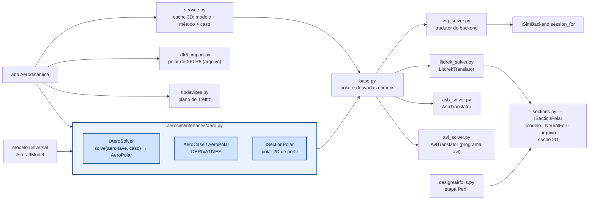

# aerosim/aero — aerodinâmica a partir da geometria

Na aba **Aerodinâmica** o método principal é o **lltdrek**; o núcleo Zig entra para comparar (é o que
a simulação usa) e o AeroSandbox é opcional. O diagnóstico diz se os métodos concordam (e por que não),
se o cruzeiro está perto do L/D máximo, a margem até o estol e — **só se a aeronave tiver dispositivos
de ponta** (superfícies verticais na ponta da asa) — se eles compensam o atrito. Sem dispositivo, o estudo
de pontas só roda se marcado.

Calcula polares e derivadas de estabilidade da aeronave por **vários métodos** sobre a mesma
geometria (o modelo de `aerosim/model`) e estuda **dispositivos de ponta de asa**. É usado pela aba
**Aerodinâmica** (`manager/simulations/aerodynamics.py`) e pode ser chamado direto do Python.

## Como chamar

```python
import numpy as np
from aerosim.aero import AeroCase, ZigPanelSolver, LltdrekSolver, AsbVLMSolver, polar_metrics
from aerosim.backend.zig import ZigBackend
from aerosim.model.universal import build_model

model = build_model(ac)
case = AeroCase(V=15, alphas=np.arange(-4, 14, 1.0), ref=(0.02, 0, 0.0))   # ref: ponto dos momentos
pol = ZigPanelSolver(ZigBackend()).solve(model, case)      # ou LltdrekSolver(), AsbVLMSolver() se instalados
pol.CL, pol.CD, pol.derivs                                  # polar e derivadas (C_mα, C_nβ, C_lp, ...)
polar_metrics(pol, model, case)                             # C_Lmax, α de estol, (L/D)máx, ponto neutro...
```

`lltdrek` e `aerosandbox` são opcionais (`pip install -r requirements-aero.txt`).

## Asa por partições (etapa Asa da sprint)

Na etapa **Aerodinâmica → Asa** a asa pode ser um trapézio ou uma **tabela de partições**, como na planilha:
cada linha é uma partição com **envergadura** (o quanto ela soma na envergadura total, metade de cada lado),
**corda** (no começo dela), **afilamento**, **perfil** (no fim dela; ao longo da partição ele passa do da
anterior para este), **recuo** (o bordo de ataque andando para trás: enflechamento) e **θ** (torção no fim, em
relação à raiz; − = washout). A envergadura total é a soma das partições; asa reta é uma linha só. A linha
sustentadora (`aerosim/design/wing.py`) usa o perfil de cada seção no Re da corda dela.

Dois exemplos com perfis NACA gerados (polar pelo NeuralFoil), V = 15 m/s, altitude-densidade 600 m,
massa 6 kg:


Os gráficos da etapa Asa para cada uma (C_L × α, polar com arrasto induzido e de perfil, L/D e c_l ao
longo da semienvergadura no cruzeiro e no estol):


A trapezoidal tem mais alongamento com a mesma envergadura (menos área), e o perfil simétrico na ponta
(com washout) tira arqueamento de onde o estol seria perigoso: C_L0 e C_m,ac menores, estol mais tarde.

## Como funciona



### Métodos comparados

| solver | o que entra | como |
|---|---|---|
| `zig` — núcleo Zig | asa, EH, EV, fuselagem | o mesmo modelo da simulação: faixas por seção/comando, C_Lα de Helmbold, ε = ε0 + dε/dα α, estol de Beard e McLain. Derivadas por diferenças centrais em α, β, p̂, q̂, r̂ e nos comandos (`aerosim_aero_coeffs_ex`) |
| `lltdrek` — [kuodrek/lltdrek](https://github.com/kuodrek/lltdrek) | asa + EH (com interação) | linha sustentadora não linear (Phillips–Snyder) com a polar 2D de cada perfil; sem derrapagem (derivadas em β = NaN), sem EV e sem fuselagem |
| `asb_vlm` — AeroSandbox VLM | asa, EH, EV | malha de vórtices em ferradura; arrasto só induzido (+ C_D0 do modelo) |
| `asb_buildup` — AeroSandbox AeroBuildup | asa, EH, EV, fuselagem | soma por componentes com NeuralFoil; arrasto completo |
| `asb_ll` — AeroSandbox LiftingLine | asa, EH, EV | linha sustentadora com NeuralFoil; só derivadas em α e β |
| `avl` — [AVL](https://web.mit.edu/drela/Public/web/avl/) (Drela e Youngren) | asa, EH, EV, dispositivos, comandos | malha de vórtices; o programa `avl` é externo (PATH ou `AVL_PATH`). O tradutor escreve o `.avl` (NACA pelo código, os outros perfis por AFILE, C_D0 do modelo como CDp, comandos `pitch`/`roll`/`yaw` pelos ganhos da mistura), roda a varredura numa sessão e lê o `ST` de cada ponto |
| `xflr5` — polar importada | o que estava no XFLR5 | lê a polar de avião exportada (Polars → Export, texto ou CSV): α, C_L, C_D, C_Di, C_m (no CG de lá); C_Lα e C_mα pelo ajuste em α; não roda nada |

Cada solver só implementa `evaluate(modelo, caso, pontos)` — pontos de voo universais (α, β, p̂, q̂, r̂,
comandos) → coeficientes universais —, com o seu tradutor fazendo a ida (modelo universal → formato
dele) e a volta (resultado → eixos e adimensionalização universais). A varredura em α e as diferenças
centrais das derivadas são o mesmo código para todos (`base.py`). Todos devolvem nos eixos do simulador (x à frente, z para baixo) com momentos no ponto `ref` do caso
(o x_CG escolhido na aba, em % da CMA, ou o CG do modelo de massa): p̂ = p b/2V, q̂ = q c/2V,
r̂ = r b/2V. Os externos usam x para trás e z para cima (`geometry.to_xz_up`); o lltdrek usa
velocidade livre unitária (ω entra dividido por V) e normaliza C_l e C_n por S c — o adaptador converte.

`polar_metrics` tira de cada polar: C_L0, C_Lα, C_Lmax, α de estol, C_D mín., (L/D) máx., e (ajuste de
C_Di = C_L²/(π AR e)), ponto neutro x_np = x_ref + c C_mα/C_Lα e margem estática.

**Polar 2D (`sections.py`)** — cada fonte é um `ISectionPolar` (`aerosim/interfaces/aero.py`) e a etapa
Perfil da sprint e o lltdrek pedem pelo mesmo `section_polar(perfil, α, Re, fonte)`:

| fonte | o que é |
|---|---|
| `modelo` | c_l = a0 (α − α_L0) misturado à placa plana pela sigmoide de Beard e McLain, pico no c_l,max do perfil (a hipótese do núcleo, em 2D) |
| `neuralfoil` | o contorno real (.dat ou NACA) pela rede do NeuralFoil; sem contorno, cai no modelo |
| `arquivo` | a polar exportada pelo XFLR5/XFOIL |

**Perfil por seção no lltdrek** — cada estação do modelo universal carrega o perfil dela (asa por
partições com outro perfil na ponta); o tradutor escreve uma polar por perfil diferente e o lltdrek
mistura linearmente entre as estações, como a etapa Asa.

**Cache** — a mesma pergunta não roda de novo:

| | chave | onde |
|---|---|---|
| 2D (`sections.py`) | perfil (nome, contorno, números, invertido) + fonte + arquivo e data + Re (em mil) + α | memória; NeuralFoil também em disco |
| 3D (`service.py`) | configuração inteira + método + versão dele + caso (V, α, ref, ρ, polar 2D, painéis) | memória; métodos caros (lltdrek, AeroSandbox, AVL) também em disco |

O disco é `~/.cache/aerosim` (ou a pasta da variável `AEROSIM_CACHE`), nunca o repositório nem `data/`.
Na aba, o resumo mostra `[método] de onde`: `calculado`, `cache` ou `arquivo …`. Cada `AeroPolar` sai
também com `fidelity` (`modelo` < `llt` < `vlm` < `painel` < `cfd` < `ensaio`), para depois calibrar o
método barato pelo caro.

Notas sobre o lltdrek 1.2: (1) o corretor de Newton só monta a matriz certa quando todas as
superfícies têm o mesmo número de painéis — o adaptador sempre usa o mesmo N; (2) `np.cross` em
vetores soltos domina o tempo — o adaptador troca por uma versão de 3 componentes (~4× mais rápido).


### Dispositivos de ponta de asa (`tipdevices.py`)

Arrasto induzido mínimo no plano de Trefftz (Munk; Kroo, *Drag due to lift*, Annu. Rev. Fluid Mech.
2001; Kroo, McMasters e Smith, *Highly nonplanar lifting systems*, 1995):

```
L = ρ V ∮ Γ dy        D_i = (ρ/2) ∮ Γ w_n ds        e = L² / (π q b² D_i)
```

O traço é dividido em painéis de Γ constante com vórtices livres nas pontas de cada painel
(espaçamento uniforme — o cosseno não converge nas junções) e o Γ ótimo sai de min D_i com L fixo.
Extrapolação de Richardson em n e 2n. Validação (testes em `tests/aero/test_tipdevices.py`):

| configuração | aqui | referência |
|---|---|---|
| asa plana | 1,000 | 1 (elíptica) |
| caixa h/b = 0,2 | 1,47 | 1,46 (Kroo 2001) |
| placa de ponta h/b = 0,1 / 0,2 | 1,19 / 1,38 | 1 + 1,9 h/b = 1,19 / 1,38 (Raymer) |
| winglet h/b = 0,2 | 1,42 | — |
| momento na raiz, plana | (L/2)(4s/3π) | elíptica |

`device_study` varre h/b e dá, para winglet, placa, caixa e asa em C: o e ótimo e a variação do arrasto
total (D_i + atrito C_f S_molhada do dispositivo) em relação à asa sem nada; e duas referências de
extensão de ponta: com a mesma área molhada e com o mesmo momento fletor na raiz (comparação de
Whitcomb/Jones). Com carregamento ótimo a extensão ganha; o winglet compensa quando o vão é limitado
(regulamento, hangar).


`lltdrek`, `aerosandbox` e o programa `avl` são opcionais: sem eles o solver aparece como indisponível
na aba, com o motivo.

Figuras: `python tools/plot_comparativo.py docs/img/comparativo [conventional|twin_boom|flying_wing|arquivo.cfg]`.
