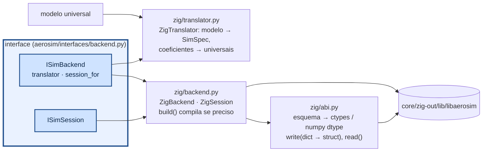

# aerosim/backend — ponte para o núcleo (camada Sim)

`ZigBackend` implementa `ISimBackend`/`ISimSession` sobre `libaerosim` via ctypes. O avião chega como
**modelo universal** (`AircraftModel`) e o `ZigTranslator` (`zig/translator.py`) o traduz para o SimSpec do
núcleo (painéis por faixa entre estações, motores, trem, tanques, piloto, missão); os coeficientes voltam
pelo mesmo tradutor no formato universal. `backend.session_for(modelo)` entrega a sessão já configurada.
Nenhuma struct é copiada à mão: `abi.py` lê o esquema que o núcleo gera em comptime, monta as classes ctypes e confere
tamanho e offset de cada campo.

## Como chamar

```python
import math
from aerosim.backend.zig import ZigBackend
from aerosim.model.universal import build_model

be = ZigBackend()                              # compila core/ se a biblioteca estiver velha
with be.session_for(build_model(ac)) as s:     # sessão já configurada
    s.aero_coeffs(15.0, math.radians(4))       # {"CL": ..., "CD": ..., "Cm": ...}
    s.mass_props()                             # m, cg, I
    s.trim(0, 15.0)                            # TrimKind.LEVEL
    s.reset_ground()
    status, log = s.run(5.0, 10000)            # até t = 5 s, no máximo 10 000 linhas
    log["t"], log["n"], log["h"]               # numpy, uma coluna por canal
    data = s.snapshot(); s.restore(data)       # checkpoint
```

## Como funciona



- `configure(spec)`: zera os parâmetros, escreve o dicionário (chave desconhecida é erro) e chama
  `aerosim_configure`. Erros do núcleo viram `CoreError` com a mensagem.
- `run(t_limit, max_rows)`: devolve `RunStatus` e um `LogChunk` (uma coluna numpy por canal; vetores
  como `rpm` viram `rpm_0`, `rpm_1`…). `max_rows=0` roda sem registro (mais rápido).
- As chamadas ctypes soltam o GIL: sessões diferentes rodam em paralelo em threads (as simulações de
  varredura usam isso).
- Para outro núcleo (outra linguagem, um modelo de teste), implemente `ISimBackend` e passe para
  `SimulationManager(backend)`.
