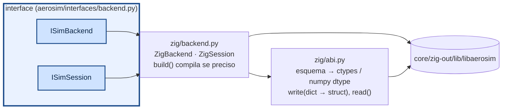

# aerosim/backend — ponte para o núcleo (camada Sim)

`ZigBackend` implementa `ISimBackend`/`ISimSession` sobre `libaerosim` via ctypes. Nenhuma struct é
copiada à mão: `abi.py` lê o esquema que o núcleo gera em comptime, monta as classes ctypes e confere
tamanho e offset de cada campo.

- `configure(spec)`: zera os parâmetros, escreve o dicionário (chave desconhecida é erro) e chama
  `aerosim_configure`. Erros do núcleo viram `CoreError` com a mensagem.
- `run(t_limit, max_rows)`: devolve `RunStatus` e um `LogChunk` (uma coluna numpy por canal; vetores
  como `rpm` viram `rpm_0`, `rpm_1`…). `max_rows=0` roda sem registro (mais rápido).
- As chamadas ctypes soltam o GIL: sessões diferentes rodam em paralelo em threads (as simulações de
  varredura usam isso).
- Para outro núcleo (outra linguagem, um modelo de teste), implemente `ISimBackend` e passe para
  `SimulationManager(backend)`.
