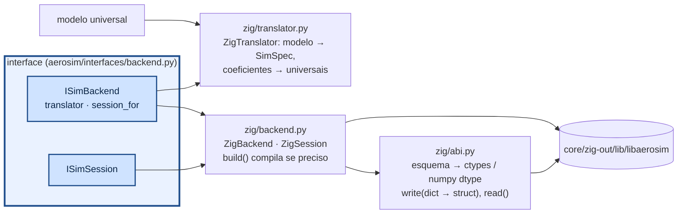
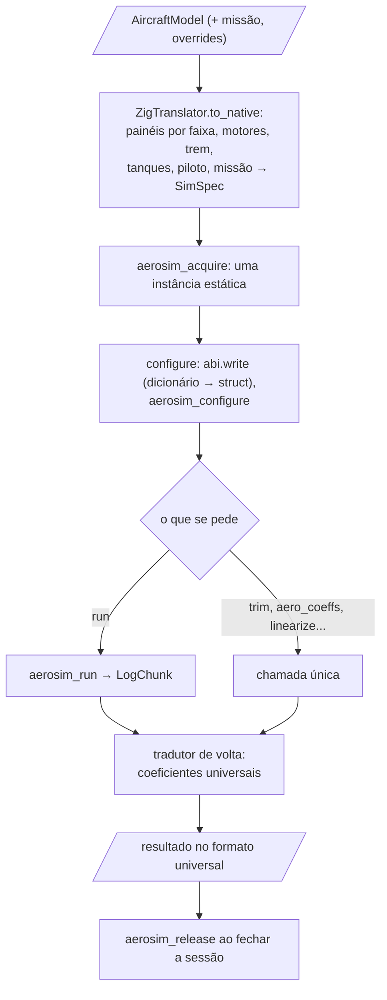

# aerosim/backend — ponte para o núcleo

Esta é a ponte entre o Python e o núcleo em Zig. O resto do projeto pede ao backend uma sessão de simulação para um
avião, e por ela roda corridas, trima, calcula polares e lineariza, sem saber que do outro lado há uma biblioteca
compilada chamada por ctypes.

O `ZigBackend` implementa as interfaces `ISimBackend` e `ISimSession` sobre a `libaerosim`. O avião chega como modelo
universal (`AircraftModel`), e o `ZigTranslator` (`zig/translator.py`) o traduz para o formato do núcleo: painéis por
faixa entre estações, motores, trem, tanques, piloto e missão. Os coeficientes voltam pelo mesmo tradutor, no formato
universal. `backend.session_for(modelo)` entrega a sessão já configurada. Nenhuma struct é copiada à mão: `abi.py` lê
o esquema que o núcleo gera ao compilar, monta as classes ctypes e confere o tamanho e a posição de cada campo, então
um campo novo no núcleo aparece no Python sozinho.

O README mostra primeiro como as peças se ligam, depois as equações do tradutor e a conferência da ABI e, no fim, um
exemplo por arquivo e como chamar.

## Como funciona



Uma sessão começa por `configure(spec)`, que zera os parâmetros, escreve o dicionário (uma chave desconhecida é erro)
e chama `aerosim_configure`; os erros do núcleo viram `CoreError` com a mensagem. Depois, `run(t_limit, max_rows)`
devolve um `RunStatus` e um `LogChunk`, com uma coluna numpy por canal (vetores como `rpm` viram `rpm_0`, `rpm_1`…);
com `max_rows=0` roda sem registro, mais rápido. As chamadas ctypes soltam o GIL, então sessões diferentes rodam em
paralelo em threads, e as simulações de varredura usam isso. Para outro núcleo (outra linguagem, um modelo de teste),
basta implementar `ISimBackend` e passá-lo para `SimulationManager(backend)`.

## Uma sessão, passo a passo

Do modelo universal até os resultados do núcleo:



## Equações do tradutor (`zig/translator.py`)

Cada trecho de superfície entre duas estações $`a`$ e $`b`$ (seções e bordas dos comandos) vira um painel de cada lado,
com área trapezoidal, corda média e centro aerodinâmico a 1/4 da corda média atrás do ponto médio dos bordos de ataque:

```math
S = \tfrac12\,(c_a + c_b)\,\Delta s
\qquad
\bar c = \frac{S}{\Delta s}
\qquad
\vec r = \frac{\vec r_{BA,a} + \vec r_{BA,b}}{2} - \tfrac14\,\bar c\,\hat x
```

$`\Delta s`$ é a largura do trecho ao longo da envergadura. A incidência do painel é a média das torções das duas
estações, mais a deflexão fixa do comando ($`\tau\,\delta_{fixo}`$, flape baixado). Os nós da ferradura da linha
sustentadora ficam a 1/4 da corda nas duas bordas (Phillips e Snyder 2000). Os coeficientes 3D do painel ($`C_{L\alpha}`$
de Helmbold etc.) vêm prontos do modelo universal (equações em [`aerosim/model/README.md`](../model/README.md)).

## Conferência da ABI (`zig/abi.py`)

O núcleo exporta o esquema das structs (nome, tipo, offset de cada campo) e um hash dele, calculado em comptime. O
Python calcula o mesmo hash sobre o texto que leu e recusa a biblioteca se não bater. É o FNV-1a de 64 bits (Fowler,
Noll e Vo; constantes do padrão FNV), aplicado byte a byte $`c_k`$ a partir do valor de base:

```math
h_0 = \mathtt{cbf29ce484222325}_{16}
\qquad
h_{k+1} = \left(h_k \oplus c_k\right)\cdot \mathtt{100000001b3}_{16} \bmod 2^{64}
```

## Um exemplo por arquivo

```python
from aerosim.backend import default_backend                                   # __init__.py
from aerosim.backend.zig.abi import fnv1a64, parse                            # zig/abi.py
from aerosim.backend.zig.backend import ZigBackend, lib_path                  # zig/backend.py
from aerosim.backend.zig.translator import native_spec, panel_owners         # zig/translator.py
from aerosim.model.templates import conventional
from aerosim.model.universal import build_model

be = default_backend()                         # o núcleo Zig (compila se preciso)
print(lib_path(), hex(fnv1a64(b"aerosim")))
sc = be.schema                                 # o esquema lido da biblioteca (structs, campos, limites)
model = build_model(conventional())
spec = native_spec(model)                      # o SimSpec: o dicionário que vai para os Params do núcleo
print(len(spec["surf"]), panel_owners(model)[:3])
```

## Como chamar

```python
import math
from aerosim.backend.zig import ZigBackend
from aerosim.model.templates import conventional
from aerosim.model.universal import build_model

ac = conventional()
be = ZigBackend()                              # compila core/ se a biblioteca estiver velha
with be.session_for(build_model(ac)) as s:     # sessão já configurada
    s.aero_coeffs(15.0, math.radians(4))       # {"CL": ..., "CD": ..., "Cm": ...}
    s.mass_props()                             # m, cg, I
    s.trim(0, 15.0)                            # TrimKind.LEVEL
    s.reset_ground()
    status, log = s.run(5.0, 10000)            # até t = 5 s, no máximo 10 000 linhas
    print(log["t"][-1], log["n"][-1], log["h"][-1])   # numpy, uma coluna por canal
    data = s.snapshot(); s.restore(data)       # checkpoint
```
