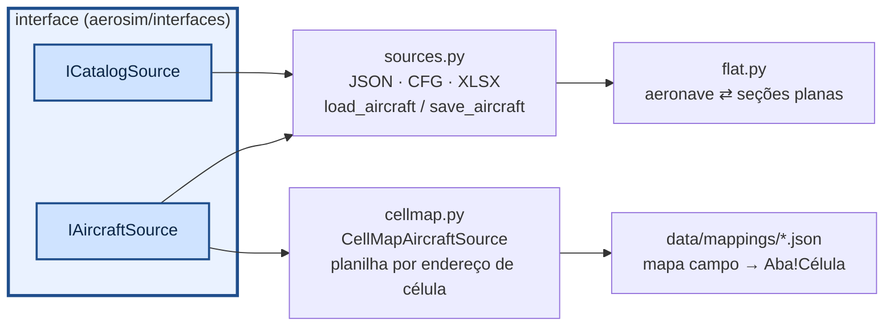

# aerosim/data — Aircraft Data (de onde vêm as aeronaves)

Implementa `IAircraftSource` e `ICatalogSource`. A GUI e os scripts chamam `load_aircraft(path)` /
`save_aircraft(ac, path)` (o formato sai da extensão) ou usam `CellMapAircraftSource` para a planilha.



| formato | aeronave | catálogo |
|---|---|---|
| `.json` | completo | completo |
| `.cfg` | INI: `[aircraft]`, `[surfaces.0]`, `[surfaces.0.sections.1]`, `[propulsion.0]`… listas em `[ ]` | `[motor: nome]`, `[helice: nome]`, `[bateria: nome]`, `[tracao: nome]` |
| `.xlsx` | aba `geral` (seção, chave, valor) + uma aba-tabela por lista | abas `motores`, `helices`, `helices_tabela`, `baterias`, `tracao` |

## Planilha Dados_Desempenho.xlsx (mapa de células)

`CellMapAircraftSource(mapa)` lê e grava as mesmas células. O mapa
`data/mappings/dados_desempenho.json` foi tirado do `AircraftData()` original:

```json
{
  "base": "conventional",
  "set": {"tanks": [], "payload.enabled": false},
  "fields": {
    "mass.base_mass": "Geral!C8",
    "surfaces[wing].CLa": {"cell": "Superficies!C4", "scale": 57.29577951308232, "note": "1/grau na planilha"},
    "@wing.area": "Superficies!C3",
    "@wing.span": "Superficies!C15"
  },
  "thrust_sets": {"sheet": "Tracao", "first_row": 3, "name_col": 1, "coef_first_col": 2,
                  "n_col": 23, "T0_col": 25, "select_cell": "Geral!C28", "row_offset": 2,
                  "x": "V", "y": "none", "gain": "1"}
}
```

- `fields`: caminho no modelo → célula. Caminhos: `a.b`, `surfaces[wing]` (por papel ou nome),
  `propulsion[0]`, `mass.base_cg[0]`; `scale`/`offset` convertem unidades e eixos.
- `@papel.area|span|chord|xac|K`: refaz a geometria da superfície (mantém afilamento e enflechamento);
  `K` (C_Di = K C_L²) vira o Oswald.
- `thrust_sets`: cada linha da aba `Tracao` (colunas B..V = p00..p05) vira um conjunto no catálogo
  (`src.catalog.thrust_sets`); a linha `nhelice + 2` (célula `Geral!C28`) vai para todos os motores
  da aeronave com `thrust_model = "poly"`. `x`/`y` dizem o que são as variáveis do polinômio (padrão:
  x = V, sem y, tração × acelerador); `gain` pode ser `"1"`, `"T0"` ou `"T0*PT0"`; `rho_exp` corrige
  pela densidade. **Ajuste `x`, `y` e `gain` ao que o ajuste da sua planilha realmente usa.**
- O que não tem correspondência (derivadas de estabilidade, polinômios de arrasto) está listado em
  `unmapped` no próprio mapa: o núcleo calcula esses efeitos pelos painéis.
- Eixos do modelo: x para frente, z para baixo. Se a planilha mede x a partir do nariz para trás, use
  `"scale": -1` e `"offset"` = x do nariz.
