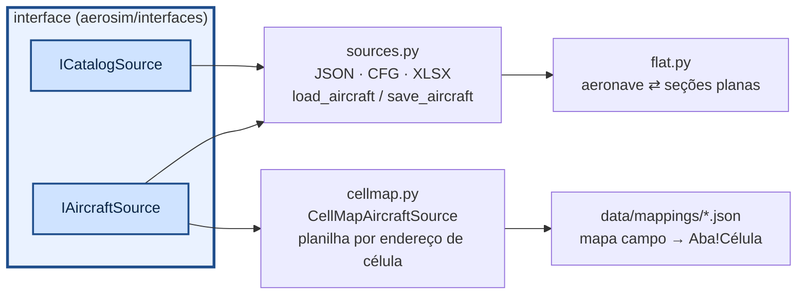

# aerosim/data — Aircraft Data (de onde vêm as aeronaves)

Implementa `IAircraftSource` e `ICatalogSource`. A GUI e os scripts chamam `load_aircraft(path)` /
`save_aircraft(ac, path)` (o formato sai da extensão) ou usam `CellMapAircraftSource` para a planilha.

## Como chamar

```python
from aerosim.data import load_aircraft, save_aircraft, JsonProjectStore
from aerosim.data.cellmap import CellMapAircraftSource

ac = load_aircraft("data/aircraft/Asa_voadora.json")      # .json, .cfg ou .xlsx (pela extensão)
save_aircraft(ac, "meu.cfg")

store = JsonProjectStore()                     # "meus aviões" (~/aerosim_aeronaves ou AEROSIM_PROJETOS)
store.save(ac, "asa nova"); store.list(); store.load("asa nova")

src = CellMapAircraftSource("data/mappings/dados_desempenho.json")
ac = src.load("Dados_Desempenho.xlsx")         # planilha por endereço de célula
src.catalog.thrust_sets                        # conjuntos de tração da aba Tracao
```

## Como funciona



| formato | aeronave | catálogo |
|---|---|---|
| `.json` | completo | completo |
| `.cfg` | INI: `[aircraft]`, `[surfaces.0]`, `[surfaces.0.sections.1]`, `[propulsion.0]`… listas em `[ ]` | `[motor: nome]`, `[helice: nome]`, `[bateria: nome]`, `[tracao: nome]` |
| `.xlsx` | aba `geral` (seção, chave, valor) + uma aba-tabela por lista | abas `motores`, `helices`, `helices_tabela`, `baterias`, `tracao` |

### Planilha Dados_Desempenho.xlsx (mapa de células)

`CellMapAircraftSource(mapa)` lê e grava as mesmas células. O mapa
`data/mappings/dados_desempenho.json` foi tirado do `AircraftData()` original:

```json
{
  "base": "conventional",
  "set": {"tanks": [], "payload.enabled": false},
  "fields": {
    "mass.base_mass": "Geral!C8",
    "surfaces[wing].CLa": {"cell": "Superficies!C4", "scale": 57.29577951308232, "note": "1/grau na planilha"},
    "@wing.area": "Superficies!C3",
    "@wing.span": "Superficies!C15"
  },
  "thrust_sets": {"sheet": "Tracao", "first_row": 3, "name_col": 1, "coef_first_col": 2,
                  "n_col": 23, "T0_col": 25, "select_cell": "Geral!C28", "row_offset": 2,
                  "x": "const", "x_const": "n", "y": "V", "gain": "g", "rho_exp": 1.0,
                  "rho0_cell": "Geral!C18", "p00_from_T0": true}
}
```

- `fields`: caminho no modelo → célula. Caminhos: `a.b`, `surfaces[wing]` (por papel ou nome),
  `propulsion[0]`, `mass.base_cg[0]`; `scale`/`offset` convertem unidades e eixos.
- `@papel.area|span|chord|xac|K`: refaz a geometria da superfície (mantém afilamento e enflechamento);
  `K` (C_Di = K C_L²) vira o Oswald.
- `thrust_sets`: cada linha da aba `Tracao` (colunas B..V = p00..p05) vira um conjunto no catálogo
  (`src.catalog.thrust_sets`); a linha `nhelice + 2` (célula `Geral!C28`) vai para todos os motores
  da aeronave com `thrust_model = "poly"`. A tração fica igual à do `Envelope_main`:
  `T = g·(ρ/ρ0)·(T0 + p10·n + p01·V + p20·n² + p11·n·V + … + p05·V⁵)` — x = n (coluna W, constante
  do conjunto), y = V, T0 (coluna Y) no lugar de p00, ganho g (polinômio em kgf), ρ0 de `Geral!C18`.
  Em voo a tração ainda é multiplicada pelo acelerador. `gain` aceita `"1"`, `"g"`, `"T0"`, `"T0*PT0"`,
  `"g*PT0"` (PT0 em `Geral!C29`) ou um número.
- `performance.*`: dados do envelope — `AnguloCruzeiro` (C14), `n` (C13), `rho0` (C18), C_Dp da asa e
  do EH (G36, G37, J36, J37) e `K` (C17).
- O que não tem correspondência (derivadas de estabilidade, polinômios de arrasto) está listado em
  `unmapped` no próprio mapa: o núcleo calcula esses efeitos pelos painéis.
- Eixos do modelo: x para frente, z para baixo. Se a planilha mede x a partir do nariz para trás, use
  `"scale": -1` e `"offset"` = x do nariz.
