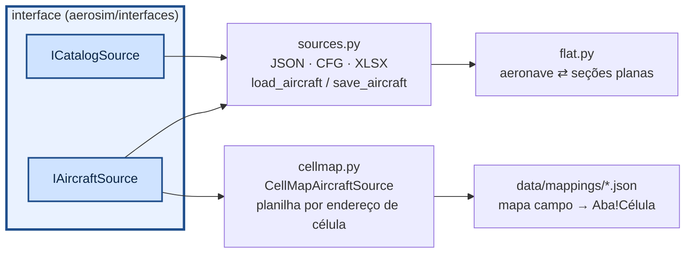
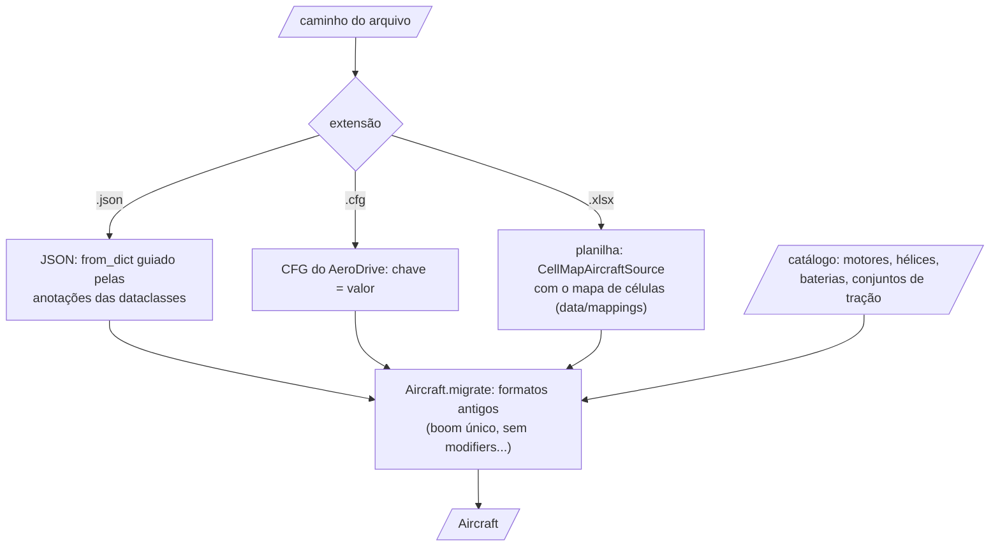

# aerosim/data — de onde vêm as aeronaves

Esta é a parte do projeto que lê e grava aviões e catálogos. Um avião pode estar num `.json` (o formato completo do
projeto), num `.cfg` (o formato de texto do AeroDrive) ou na planilha antiga de desempenho, e o catálogo de motores,
hélices, baterias e conjuntos de tração vem de arquivos próprios. Aqui tudo isso vira a mesma configuração
(`Aircraft`) e o mesmo `Catalog`, e volta para o arquivo.

A GUI e os scripts chamam `load_aircraft(path)` e `save_aircraft(ac, path)`, e o formato sai da extensão. A planilha
usa `CellMapAircraftSource`, que lê as células por um mapa. Por trás estão as interfaces `IAircraftSource` e
`ICatalogSource`, então um formato novo entra como mais uma implementação.

O README mostra primeiro como os formatos se ligam e, em detalhe, como a planilha é lida pelo mapa de células, com as
equações do polinômio de tração e do arrasto. No fim, como chamar.

## Como funciona



| formato | aeronave | catálogo |
|---|---|---|
| `.json` | completo | completo |
| `.cfg` | INI: `[aircraft]`, `[surfaces.0]`, `[surfaces.0.sections.1]`, `[propulsion.0]`… listas em `[ ]` | `[motor: nome]`, `[helice: nome]`, `[bateria: nome]`, `[tracao: nome]` |
| `.xlsx` | aba `geral` (seção, chave, valor) + uma aba-tabela por lista | abas `motores`, `helices`, `helices_tabela`, `baterias`, `tracao` |

### Abrir um arquivo, passo a passo

O que acontece em `load_aircraft(caminho)`:



### Planilha Dados_Desempenho.xlsx (mapa de células)

`CellMapAircraftSource(mapa)` lê e grava as mesmas células. O mapa
`data/mappings/dados_desempenho.json` foi tirado do `AircraftData()` original:

```json
{
  "base": "conventional",
  "set": {"tanks": [], "payload.enabled": false},
  "fields": {
    "mass.base_mass": "Geral!C8",
    "surfaces[wing].CLa": {"cell": "Superficies!C4", "scale": 57.29577951308232, "note": "1/grau na planilha"},
    "@wing.area": "Superficies!C3",
    "@wing.span": "Superficies!C15"
  },
  "thrust_sets": {"sheet": "Tracao", "first_row": 3, "name_col": 1, "coef_first_col": 2,
                  "n_col": 23, "T0_col": 25, "select_cell": "Geral!C28", "row_offset": 2,
                  "x": "const", "x_const": "n", "y": "V", "gain": "g", "rho_exp": 1.0,
                  "rho0_cell": "Geral!C18", "p00_from_T0": true}
}
```

- `fields`: caminho no modelo → célula. Caminhos: `a.b`, `surfaces[wing]` (por papel ou nome),
  `propulsion[0]`, `mass.base_cg[0]`; `scale`/`offset` convertem unidades e eixos.
- `@papel.area|span|chord|xac|K`: refaz a geometria da superfície (mantém afilamento e enflechamento).
- `thrust_sets`: cada linha da aba `Tracao` (colunas B..V = p00..p05) vira um conjunto no catálogo
  (`src.catalog.thrust_sets`); a linha `nhelice + 2` (célula `Geral!C28`) vai para todos os motores
  da aeronave com `thrust_model = "poly"`. A tração fica igual à do `Envelope_main`, com $`x = n`$ (coluna W, constante
  do conjunto), $`y = V`$, $`T_0`$ (coluna Y) no lugar de $`p_{00}`$, ganho $`g`$ (polinômio em kgf) e $`\rho_0`$ de `Geral!C18`:

```math
T = g\,\frac{\rho}{\rho_0}\left(T_0 + p_{10}\,n + p_{01}\,V + p_{20}\,n^2 + p_{11}\,n V + \dots + p_{05}\,V^5\right)
```

  Em voo a tração ainda é multiplicada pelo acelerador. `gain` aceita `"1"`, `"g"`, `"T0"`, `"T0*PT0"`, `"g*PT0"`
  (PT0 em `Geral!C29`) ou um número.
- `@papel.K`: o $`K`$ da polar da planilha ($`C_{D_i} = K\,C_L^2`$) vira o Oswald da superfície, $`e = 1/(\pi\,AR\,K)`$.
- `performance.*`: dados do envelope — `AnguloCruzeiro` (C14), `n` (C13), `rho0` (C18), $`C_{Dp}`$ da asa e
  do EH (G36, G37, J36, J37) e `K` (C17).
- O que não tem correspondência (derivadas de estabilidade, polinômios de arrasto) está listado em
  `unmapped` no próprio mapa: o núcleo calcula esses efeitos pelos painéis.
- Eixos do modelo: x para frente, z para baixo. Se a planilha mede x a partir do nariz para trás, use
  `"scale": -1` e `"offset"` = x do nariz.

## Como chamar

```python
import os, tempfile
from aerosim.data import load_aircraft, save_aircraft, JsonProjectStore              # sources.py, projects.py
from aerosim.data.flat import flatten, unflatten, encode, decode                     # flat.py
from aerosim.data.projects import summary, slug

ac = load_aircraft("data/aircraft/Asa_voadora.json")      # .json, .cfg ou .xlsx (pela extensão)
pasta = tempfile.mkdtemp()
save_aircraft(ac, os.path.join(pasta, "meu.cfg"))        # o mesmo avião em INI
print(load_aircraft(os.path.join(pasta, "meu.cfg")).name, summary(ac), slug("Asa nova!"))

store = JsonProjectStore(pasta)                # "meus aviões" (padrão: ~/aerosim_aeronaves ou AEROSIM_PROJETOS)
store.save(ac, "asa nova")
print([i.name for i in store.list()], store.load("asa nova").name)

secoes = flatten(ac)                           # aeronave → seções planas (o que o .cfg e o .xlsx guardam)
print(list(secoes)[:3], decode(encode([1.0, 2.0])))
```

A planilha por endereço de célula (`cellmap.py`):

```python
# não roda sozinho: precisa da planilha do usuário (fica fora do repositório)
from aerosim.data.cellmap import CellMapAircraftSource
src = CellMapAircraftSource("data/mappings/dados_desempenho.json")
ac = src.load("Dados_Desempenho.xlsx")         # planilha por endereço de célula
src.catalog.thrust_sets                        # conjuntos de tração da aba Tracao
```
