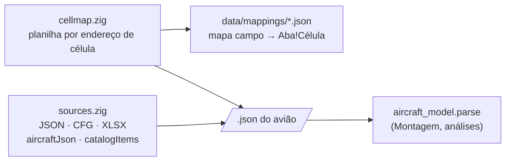
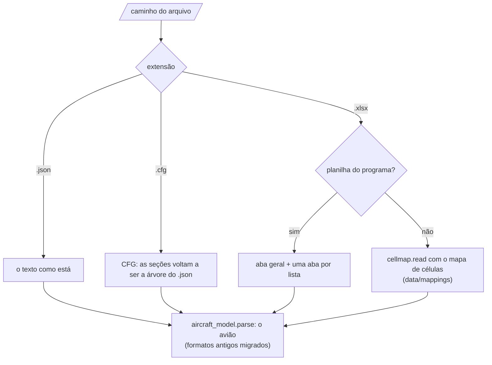

# aerosim/data — de onde vêm as aeronaves

Esta é a parte do projeto que lê e grava aviões e catálogos. Um avião pode estar num `.json` (o formato completo do
projeto), num `.cfg` (o formato de texto do AeroDrive), numa planilha `.xlsx` no formato do programa ou na planilha
antiga de desempenho das equipes, e o catálogo de motores, hélices, baterias e conjuntos de tração vem de arquivos
próprios. Aqui tudo isso vira o mesmo `.json` do avião, que a Montagem e as análises leem.

A tela chama `sources.aircraftJson(memória, caminho, bytes)`, e o formato sai da extensão; o catálogo do usuário vem de
`sources.catalogItems`. A planilha das equipes passa por `cellmap.read`, que lê as células por um mapa. Um formato novo
entra como mais um caso em `sources.zig`, e quem lê o avião não muda.

O README mostra primeiro como os formatos se ligam e, em detalhe, como a planilha é lida pelo mapa de células, com as
equações do polinômio de tração e do arrasto. No fim, como chamar.

## Como funciona



| formato | aeronave | catálogo |
|---|---|---|
| `.json` | completo | completo |
| `.cfg` | INI: `[aircraft]`, `[surfaces.0]`, `[surfaces.0.sections.1]`, `[propulsion.0]`… listas em `[ ]` | `[motor: nome]`, `[helice: nome]`, `[bateria: nome]`, `[tracao: nome]` |
| `.xlsx` | aba `geral` (seção, chave, valor) + uma aba-tabela por lista | abas `motores`, `helices`, `helices_tabela`, `baterias`, `tracao` |

### Abrir um arquivo, passo a passo

O que acontece quando a tela abre um arquivo:



### Planilha Dados_Desempenho.xlsx (mapa de células)

`cellmap.read(mapa, planilha, avião de partida)` lê as células do mapa. O mapa
`data/mappings/dados_desempenho.json` foi tirado do `AircraftData()` original:

```json
{
  "base": "conventional",
  "set": {"tanks": [], "payload.enabled": false},
  "fields": {
    "mass.base_mass": "Geral!C8",
    "surfaces[wing].CLa": {"cell": "Superficies!C4", "scale": 57.29577951308232, "note": "1/grau na planilha"},
    "@wing.area": "Superficies!C3",
    "@wing.span": "Superficies!C15"
  },
  "thrust_sets": {"sheet": "Tracao", "first_row": 3, "name_col": 1, "coef_first_col": 2,
                  "n_col": 23, "T0_col": 25, "select_cell": "Geral!C28", "row_offset": 2,
                  "x": "const", "x_const": "n", "y": "V", "gain": "g", "rho_exp": 1.0,
                  "rho0_cell": "Geral!C18", "p00_from_T0": true}
}
```

- `fields`: caminho no modelo → célula. Caminhos: `a.b`, `surfaces[wing]` (por papel ou nome),
  `propulsion[0]`, `mass.base_cg[0]`; `scale`/`offset` convertem unidades e eixos.
- `@papel.area|span|chord|xac|K`: refaz a geometria da superfície (mantém afilamento e enflechamento).
- `thrust_sets`: cada linha da aba `Tracao` (colunas B..V = p00..p05) vira um conjunto no catálogo; a linha `nhelice + 2` (célula `Geral!C28`) vai para todos os motores
  da aeronave com `thrust_model = "poly"`. A tração fica igual à do `Envelope_main`, com $`x = n`$ (coluna W, constante
  do conjunto), $`y = V`$, $`T_0`$ (coluna Y) no lugar de $`p_{00}`$, ganho $`g`$ (polinômio em kgf) e $`\rho_0`$ de `Geral!C18`:

```math
T = g\,\frac{\rho}{\rho_0}\left(T_0 + p_{10}\,n + p_{01}\,V + p_{20}\,n^2 + p_{11}\,n V + \dots + p_{05}\,V^5\right)
```

  Em voo a tração ainda é multiplicada pelo acelerador. `gain` aceita `"1"`, `"g"`, `"T0"`, `"T0*PT0"`, `"g*PT0"`
  (PT0 em `Geral!C29`) ou um número.
- `@papel.K`: o $`K`$ da polar da planilha ($`C_{D_i} = K\,C_L^2`$) vira o Oswald da superfície, $`e = 1/(\pi\,AR\,K)`$.
- `performance.*`: dados do envelope — `AnguloCruzeiro` (C14), `n` (C13), `rho0` (C18), $`C_{Dp}`$ da asa e
  do EH (G36, G37, J36, J37) e `K` (C17).
- O que não tem correspondência (derivadas de estabilidade, polinômios de arrasto) está listado em
  `unmapped` no próprio mapa: o núcleo calcula esses efeitos pelos painéis.
- Eixos do modelo: x para frente, z para baixo. Se a planilha mede x a partir do nariz para trás, use
  `"scale": -1` e `"offset"` = x do nariz.

## Como chamar

Abrir um avião em `.cfg` e outro na planilha do programa, pelo mesmo caminho da tela (`exemplo.zig`,
`python -m ziglang build exemplo -Dexemplo=data` de dentro de `aerosim/`):

```zig
const std = @import("std");
const aircraft_model = @import("aircraft_model");
const data_sources = @import("data_sources");

pub fn main(init: std.process.Init) !void {
    var arena: std.heap.ArenaAllocator = .init(init.gpa);
    defer arena.deinit();
    const memory = arena.allocator();
    for ([_][]const u8{ "../data/aircraft/flying_wing.cfg", "../data/aircraft/conventional.xlsx" }) |path| {
        const bytes = try std.Io.Dir.cwd().readFileAlloc(init.io, path, memory, .limited(1 << 24));
        const json = try data_sources.aircraftJson(memory, path, bytes); // o formato sai da extensão
        var diagnosis: aircraft_model.aircraft.Diag = .{};
        var loaded = try aircraft_model.aircraft.parse(init.gpa, json, &diagnosis); // o mesmo .json de sempre
        defer loaded.deinit();
        const plane = &loaded.ac;
        std.debug.print("{s}: \"{s}\", {d} superfícies, {d} motor(es), massa base {d:.2} kg\n", .{
            std.fs.path.basename(path), plane.name, plane.surfaces.len, plane.propulsion.len, plane.mass.base_mass,
        });
    }
}
```

```
flying_wing.cfg: "Asa voadora", 3 superfícies, 1 motor(es), massa base 3.00 kg
conventional.xlsx: "Convencional (original)", 3 superfícies, 1 motor(es), massa base 8.39 kg
```

A planilha das equipes precisa do arquivo do usuário, que fica fora do repositório: a tela pede a planilha e o mapa, e
`cellmap.read` devolve o `.json` do avião e os avisos (célula vazia, aba que falta).
