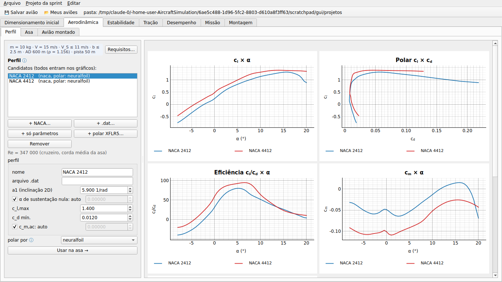
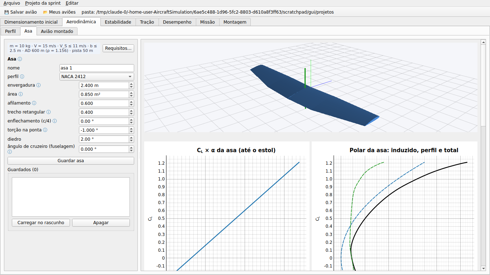
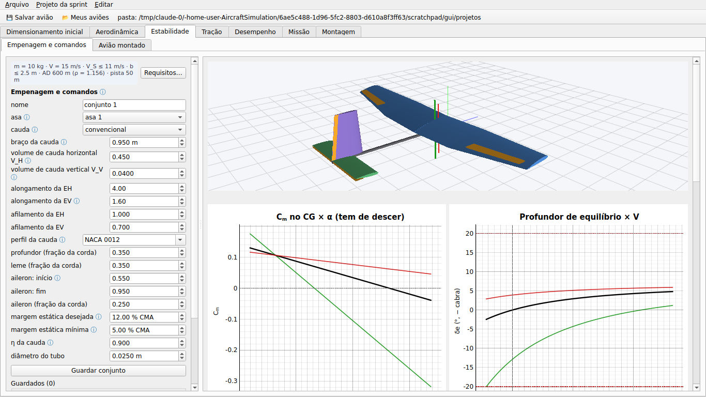
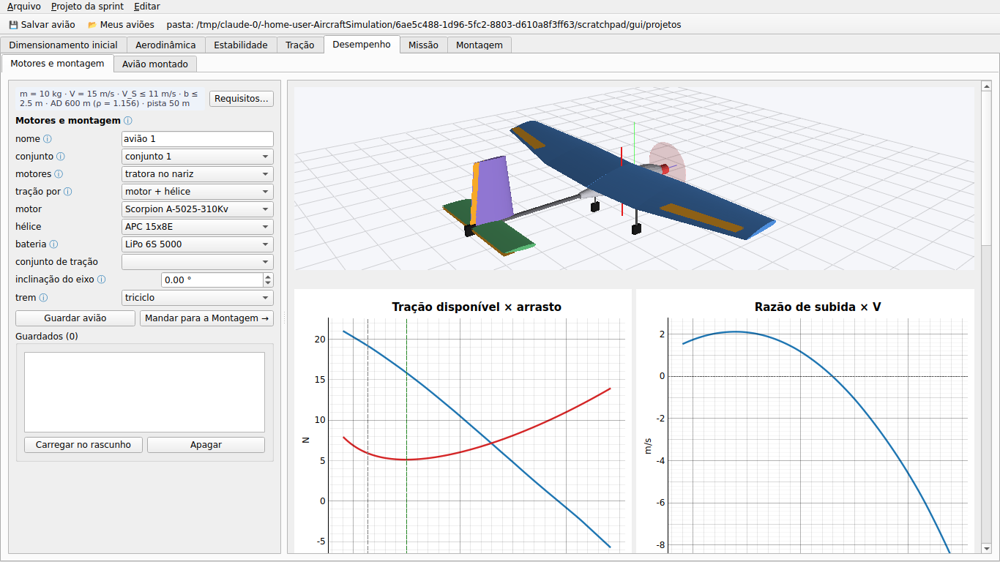

# aerosim/design — projeto do zero, etapa por etapa (sprint)

Cria o avião do zero, e cada etapa parte do que a anterior guardou:

1. **Perfil.** Você escolhe os perfis e vê a polar 2D de cada um.
2. **Asa.** A asa é feita a partir do perfil escolhido.
3. **Empenagem.** Entram as superfícies que acompanham a asa: cauda, tubo e comandos.
4. **Motores.** A etapa decide onde ficam os motores. Com isso saem a bateria, a carga, a fuselagem e o trem.
5. **Montagem.** O avião inteiro vai para a aba Montagem.

O programa não escolhe por você. Ele guarda candidatos com nome, compara esses candidatos e mostra o diagnóstico de cada etapa.









Na GUI, as etapas ficam nas subabas de cada área. A última subaba, **Avião montado**, faz a análise detalhada do avião aberto (lltdrek ou AeroSandbox, núcleo 6GDL).

| área | subabas |
|---|---|
| Aerodinâmica | Perfil, Asa, Avião montado |
| Estabilidade | Empenagem e comandos, Avião montado |
| Desempenho | Motores e montagem, Avião montado |

## Como chamar

```python
from aerosim.design.project import DesignProject
from aerosim.design import results as R

p = DesignProject()                        # requisitos, regras, perfis NACA 2412 e 4412
p.requirements.mass = 9.0                  # massa, V de cruzeiro, V_S máx., AD, envergadura máx., pista
p.wing_draft.area = 1.0                    # rascunho da asa
plots, res, r = R.wing_stage(p.draft_wing(), p.requirements, p.rules)
asa = p.keep_wing()                        # guardada como "asa 1" (o rascunho passa a "asa 2")
p.tail_draft.wing = asa.name
plots, res, r = R.set_stage(p.draft_set(), p.requirements, p.rules, p.airfoil_map())
conj = p.keep_set()
p.power_draft.set = conj.name
plots, res, ac, asm, pf = R.aircraft_stage(p.draft_aircraft(), p.requirements, p.rules)
ac          # Aircraft: o mesmo arquivo da Montagem, do AeroDrive e do núcleo
p.save("sprint.json")
```

Cada `*_stage` devolve gráficos (`PlotSpec`), resultado (`SimResult`: séries, resumo, diagnóstico) e os números da etapa. Você também pode chamar direto:

- `wing.analyze(candidato, requisitos)`
- `tail.analyze(...)`
- `power.assemble(...)`
- `power.performance(...)`
- `airfoils.polar(...)`

## Como funciona


Cada candidato leva uma **cópia** do que veio antes: a asa leva o perfil, o conjunto leva a asa e o avião leva o conjunto. Por isso, mudar ou apagar algo numa etapa anterior não altera o que já foi guardado.

### Perfil (`airfoils.py`)

O perfil pode vir de quatro lugares:

- um código NACA de 4 dígitos;
- um `.dat` (Selig ou Lednicer);
- só parâmetros, sem contorno: a1, α_L0, c_l,max, c_d0 e c_m;
- a polar do XFLR5/XFOIL (texto ou CSV).

A polar sai por uma de três fontes, conforme o que o perfil permite:

| fonte | quando dá | observação |
|---|---|---|
| `modelo` | sempre | a mesma polar do simulador; c_d constante, não serve para comparar c_l/c_d |
| `neuralfoil` | quando há contorno e a rede está instalada | padrão de perfil novo com contorno |
| `arquivo` | quando há uma polar importada | usa o Re do arquivo; avisa se estiver longe do Re de cruzeiro |

`fitted` ajusta a1, α_L0, c_l,max, c_d mín. e c_m na polar escolhida. A asa usa esses números, então a fonte escolhida aqui vale para a etapa seguinte. O Re é o do cruzeiro, com a corda média da asa em rascunho.

### Asa (`wing.py`)

A forma em planta tem trecho retangular, trecho trapezoidal com afilamento, enflechamento de c/4, torção linear até a ponta e diedro.

A análise é a linha sustentadora de Prandtl pela série de Glauert (simétrica, 24 termos ímpares). Para a1 usa a1 · cos Λ:

```
Σ A_n sen(nθ)(sen θ + n μ) = μ (α + ε(y) − α_L0) sen θ,   μ = a1 c / (4 b)
C_L = π AR A_1     C_Di = π AR Σ n A_n²     c_l(y) = (4b/c) Σ A_n sen(nθ)
```

- **Estol:** o C_L,max sai pela seção crítica, isto é, o primeiro ponto da envergadura que chega ao c_l,max do perfil. Esse ponto também diz **onde** o estol começa.
- **Arrasto de perfil:** é o c_d da polar 2D no c_l local, integrado na envergadura.
- **Incidência:** a asa é calada para a fuselagem voar no **ângulo de cruzeiro** pedido, que vai para o envelope de voo do avião montado.

Validação (`tests/design`):

- asa retangular AR 8: C_Lα dentro de 3 % de Helmbold, com estol na raiz;
- afilamento 0,35: estol na metade de fora; com washout, o estol volta para dentro;
- afilamento 0,4: e > 0,97.

### Empenagem e comandos (`tail.py`)

As áreas saem do volume de cauda: S_h = V_H S c̄ / l e S_v = V_V S b / l. O braço l vai do centro aerodinâmico da asa ao da cauda.

| tipo de cauda | superfícies e comandos |
|---|---|
| convencional | EH com profundor e EV com leme |
| cauda em V | a mesma área total S_h + S_v, com diedro atan √(S_v/S_h) e ruddervators |
| sem cauda | elevons na asa |

Em todos os casos o tubo termina no bordo de fuga da cauda, e os ailerons ficam na asa.

A estática longitudinal segue a forma clássica (Etkin; Nelson): h_n = h_ac + η V_H (a_h/a)(1 − dε/dα), com dε/dα = 2a/(πAR). A partir dela:

- O **CG** vai para a margem estática pedida.
- A **incidência da EH** equilibra o cruzeiro com o profundor neutro.
- A **faixa de CG** fica entre dois limites: o dianteiro, onde o profundor deixa de equilibrar o C_L,max no curso máximo, e o traseiro, na margem mínima.
- A **rolagem** é medida por p b/2V com o aileron todo (C_lδa por faixas e C_lp de asa trapezoidal).
- O **direcional** é medido por C_nβ da cauda.

### Motores e montagem (`power.py`)

| motores | onde ficam |
|---|---|
| tratora no nariz | no nariz da fuselagem |
| dois motores na asa | na asa, fora da fuselagem |
| propulsora atrás da asa | atrás da asa; a etapa avisa se a hélice bate no tubo |

O motor, a hélice, a bateria e o conjunto de tração (polinômio) vêm do catálogo.

A montagem segue esta ordem:

1. **Fuselagem (pod).** Vai do nariz até o bordo de fuga da asa, com largura e altura das regras. Ela desestabiliza pelo efeito de Munk, C_mα ≈ 2(k2 − k1) Vol/(S c̄), e por isso o CG é recalculado com ela.
2. **Massas.**
   - A estrutura é estimada por área e por comprimento (regras).
   - A carga paga vai no CG.
   - A bateria vai onde o CG cai no alvo. Se ela não couber na fuselagem, entra **lastro** e o diagnóstico avisa.
3. **Trem.** O principal fica atrás do CG, e a altura dá folga para a hélice.

O desempenho rápido junta duas partes:

- **Arrasto:** o C_D0 das superfícies, da fuselagem e do tubo, mais o C_Di da linha sustentadora.
- **Tração:** a do núcleo, com acelerador cheio. Sem backend, o equilíbrio motor + hélice é feito aqui, com o mesmo resultado (teste a 3 %).

Com isso saem a V máx., a subida, a corrida até 1,1 V_S e a **massa máxima que a pista permite**.

## Requisitos e regras (`spec.py`)

**Requisitos:**

- massa total estimada e carga paga;
- V de cruzeiro e V de estol máxima;
- altitude-densidade (AD);
- envergadura e comprimento máximos;
- pista e atrito de rolamento.

**Regras de projeto:**

- massas por área (asa, empenagem) e por comprimento (tubo, fuselagem);
- tamanho e C_D da fuselagem;
- sistemas e trem;
- nariz à frente da asa e altura da asa;
- folga da hélice, trem atrás do CG e bitola;
- cursos do profundor e do aileron.

Os campos usam `fields.F`, que leva rótulo, unidade, dica e faixa. A GUI (`DataclassForm`) monta o formulário a partir disso.

## Nível

Tudo aqui é **sprint**: contas rápidas, para comparar muitas variantes. O estudo detalhado do avião montado fica nas simulações do manager, que aparecem na subaba "Avião montado" e nas abas Missão e Tração.
