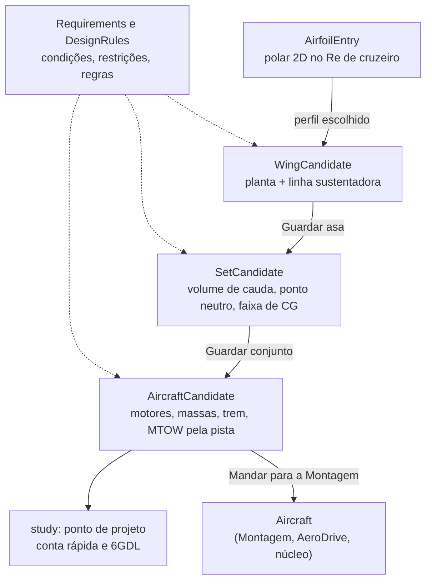
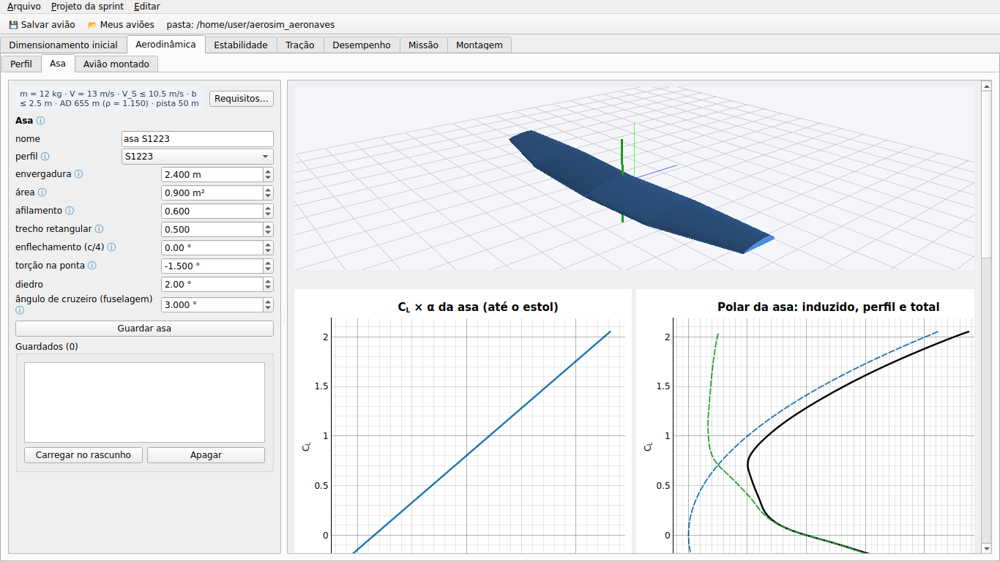
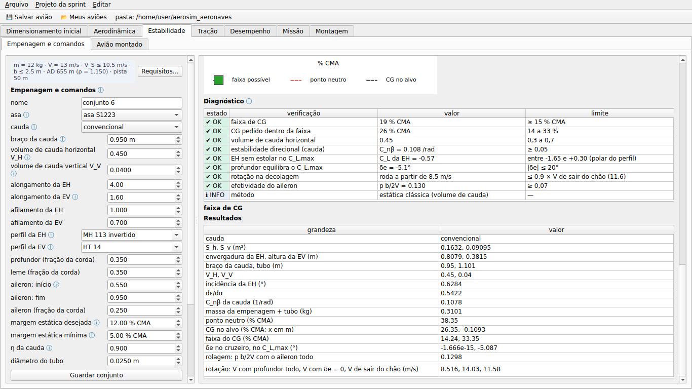
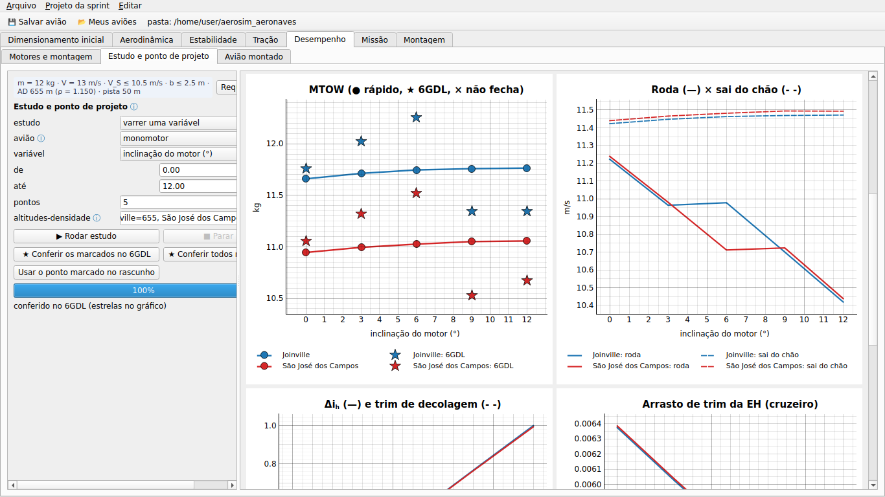
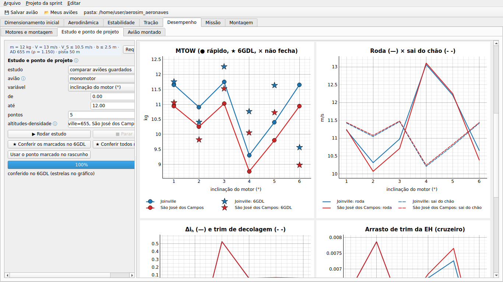

# aerosim/design — projeto do zero, etapa por etapa (sprint)

Aqui o avião nasce. Partindo só dos requisitos (massa estimada, velocidade de cruzeiro, pista e altitude), o projeto
passa por etapas: perfil, asa, empenagem e comandos, motores e montagem, e o estudo do ponto de projeto. Cada etapa
guarda candidatos com nome, e quem projeta escolhe. O que sai é um avião completo, o mesmo arquivo que a Montagem
edita, o AeroDrive pilota e o núcleo simula.

## Para que serve

- **Comparar muitas variantes rápido.** São contas de sprint (linha sustentadora, estática, desempenho por fórmula),
  de segundos.
- **Ver o que limita o projeto.** Cada etapa mostra o diagnóstico e as restrições do regulamento que estão ativas.
- **Achar o ponto de projeto.** O estudo varia uma grandeza (por exemplo a inclinação do motor), confere no voo 6GDL e
  marca o maior MTOW viável.
- **Mandar para a Montagem.** O avião escolhido vira uma configuração completa, pronta para as análises detalhadas.

## Como funciona

Cada etapa parte do candidato que a anterior guardou e leva uma cópia dele. Por isso, mudar algo numa etapa anterior
não altera o que já foi guardado.



Toda etapa segue o mesmo ciclo: rascunho na tela, análise rápida, diagnóstico e, se estiver bom, guardar o
candidato. Na GUI as etapas ficam nas subabas de Aerodinâmica (Perfil, Asa), Estabilidade (Empenagem e comandos) e
Desempenho (Motores e montagem, Estudo e ponto de projeto).

## Exemplo

```python
from aerosim.design.project import DesignProject
from aerosim.design import results as R

p = DesignProject()                        # requisitos, regras, perfis NACA 2412 e 4412
p.requirements.mass = 9.0
p.wing_draft.area = 1.0
plots, res, r = R.wing_stage(p.draft_wing(), p.requirements, p.rules)
asa = p.keep_wing()                        # "asa 1"
p.tail_draft.wing = asa.name
plots, res, r = R.set_stage(p.draft_set(), p.requirements, p.rules, p.airfoil_map())
p.power_draft.set = p.keep_set().name
plots, res, ac, asm, pf = R.aircraft_stage(p.draft_aircraft(), p.requirements, p.rules)
print(type(ac).__name__)                   # Aircraft
# p.save("sprint.json")                    # ou store.save(p, pasta): um arquivo por asa
```

Cada `*_stage` devolve os gráficos, o resultado (séries, resumo, diagnóstico) e os números da etapa. O mini-MDO
(`mdo.run`), que dimensiona a asa sozinho, tem o exemplo em [`core/src/sizing/README.md`](../../core/src/sizing/README.md).

## O que isso influencia

O avião que sai daqui é a entrada de todo o resto: as análises detalhadas do avião montado, a Missão 6GDL, o
AeroDrive e o aeroopt. Um projeto de exemplo, da asa ao ponto de projeto:








