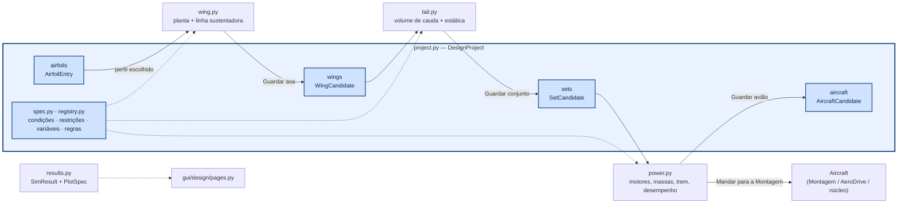
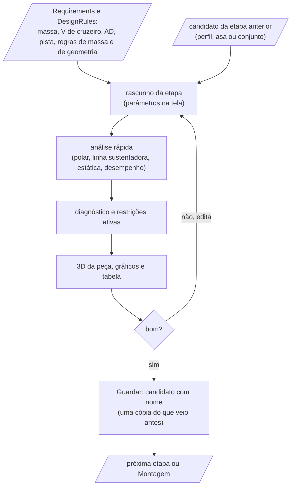
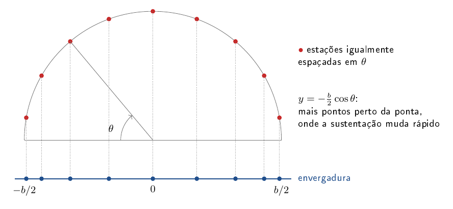
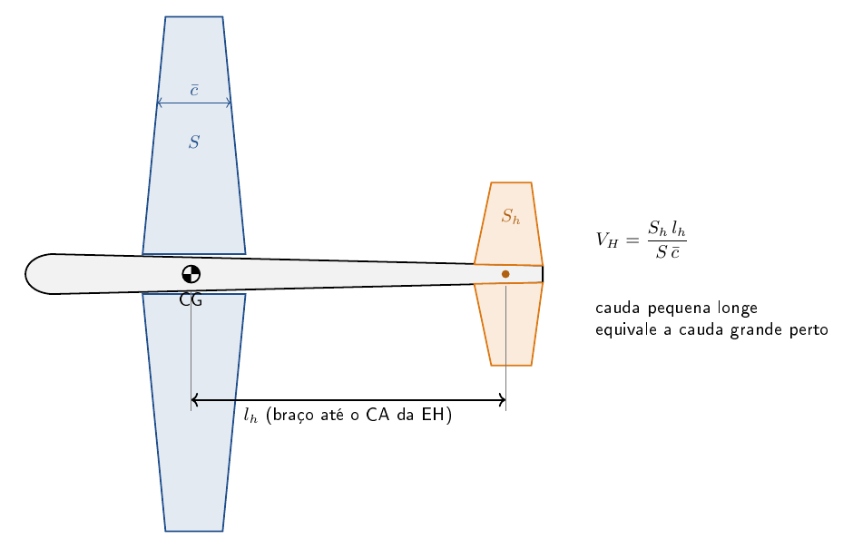
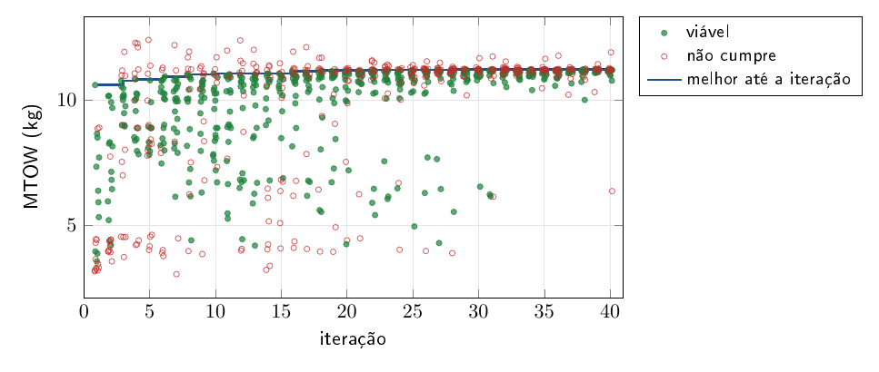
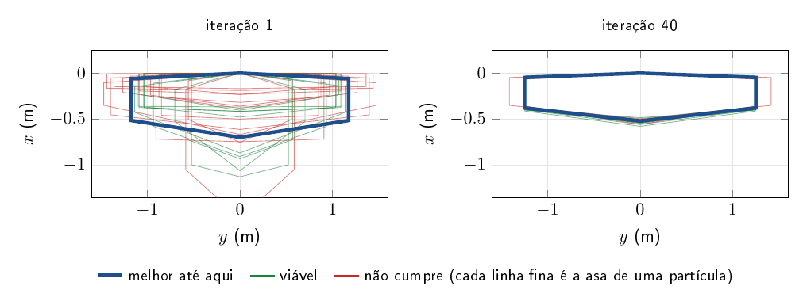
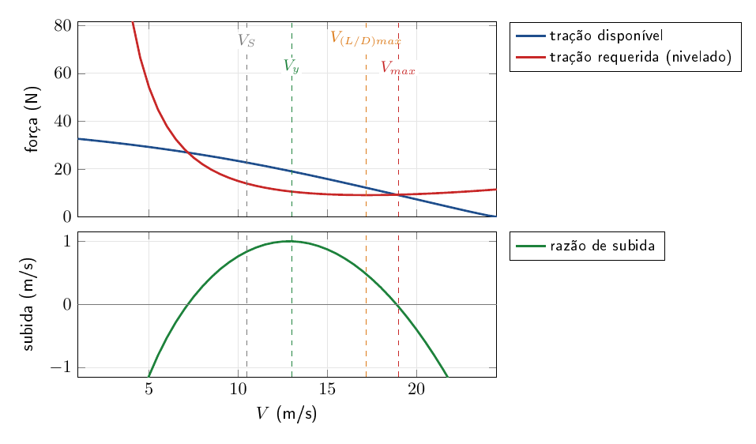
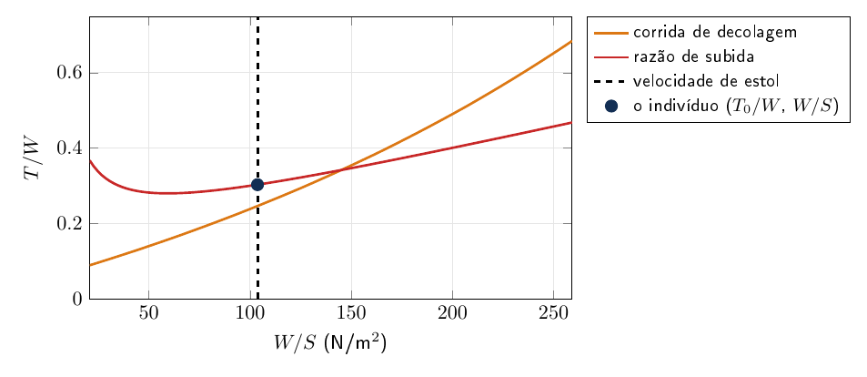

# aerosim/design — projeto do zero, etapa por etapa (sprint)

Esta é a parte do projeto em que o avião nasce. Partindo só dos requisitos (massa estimada, velocidade de cruzeiro,
pista, altitude), ela leva o projeto por etapas, e cada etapa cria uma peça a partir do que a anterior guardou:
primeiro o perfil, depois a asa feita com ele, a empenagem que acompanha a asa, os motores com a montagem do avião
inteiro e, por fim, o estudo que acha o ponto de projeto. O avião que sai daqui é uma configuração completa, a mesma
que a Montagem edita, o AeroDrive pilota e o núcleo simula.

Tudo aqui é *sprint*: contas rápidas, para comparar muitas variantes em pouco tempo. O programa não escolhe por
você. Cada etapa guarda candidatos com nome, compara esses candidatos e mostra o diagnóstico, e a escolha fica com
quem projeta. O estudo detalhado do avião montado fica nas simulações do manager, na subaba "Avião montado" e nas
abas Missão e Tração.

Na GUI, as etapas ficam nas subabas de cada área, e a última subaba de cada área faz a análise detalhada do avião
aberto:

| área | subabas |
|---|---|
| Aerodinâmica | Perfil, Asa, Avião montado |
| Estabilidade | Empenagem e comandos, Avião montado |
| Desempenho | Motores e montagem, Estudo e ponto de projeto, Avião montado |

O README mostra primeiro como as etapas se ligam e depois explica cada uma, na ordem em que aparecem: o perfil, a
asa, a empenagem e os comandos, os motores e a montagem, e o estudo do ponto de projeto, cada etapa com as suas
equações. Em seguida vem um projeto de exemplo, montado na interface, com as imagens de cada etapa. Depois vêm as
partes que servem a todas as etapas: como o projeto é gravado numa pasta, as dimensões medidas a partir do CG, as
condições, restrições e variáveis, e o mini-MDO. No fim, como chamar e um exemplo por arquivo.

## Como funciona



Cada candidato leva uma **cópia** do que veio antes: a asa leva o perfil, o conjunto leva a asa e o avião leva o conjunto. Por isso, mudar ou apagar algo numa etapa anterior não altera o que já foi guardado.

### Uma etapa, passo a passo

Toda etapa segue o mesmo ciclo, e a seguinte parte do que esta guardou:



### Perfil (`airfoils.py`)

Aqui se escolhem os perfis que a asa e a cauda vão usar e se vê a polar 2D de cada um. Um perfil pode vir de um código
NACA de 4 dígitos, de um arquivo `.dat` (Selig ou Lednicer), só de parâmetros, sem contorno ($`a_1`$, a inclinação da
curva de sustentação; $`\alpha_{L0}`$, o ângulo de sustentação nula; $`c_{l,max}`$; $`c_{d0}`$; e $`c_m`$), ou da polar
exportada do XFLR5 ou do XFOIL.

A polar sai por uma de três fontes, conforme o que o perfil permite:

| fonte | quando dá | observação |
|---|---|---|
| `modelo` | sempre | a mesma polar do simulador; $`c_d`$ constante, não serve para comparar $`c_l`$/c_d |
| `neuralfoil` | quando há contorno e a rede está instalada | padrão de perfil novo com contorno |
| `arquivo` | quando há uma polar importada | usa o Re do arquivo; avisa se estiver longe do Re de cruzeiro |

`fitted` ajusta $`a_1`$, $`\alpha_{L0}`$, $`c_{l,max}`$, $`c_{d,min}`$ e $`c_m`$ na polar escolhida: $`a_1`$ e $`\alpha_{L0}`$ pela reta $`c_l = a_1(\alpha - \alpha_{L0})`$ na faixa linear, $`c_{l,max}`$ no pico, $`c_{d,min}`$ no mínimo da polar. A asa usa esses números, então a fonte escolhida aqui vale para a etapa seguinte. O Re é o do cruzeiro, com a corda média da asa em rascunho:

```math
Re = \frac{\rho\,V_{cru}\,\bar c}{\mu}
```

### Asa (`wing.py`)

Aqui se define a forma da asa a partir do perfil escolhido, e saem a curva de sustentação, onde e quando ela estola, a
polar com o arrasto induzido e o de perfil, e a razão L/D. A planta pode ser um trapézio (envergadura, afilamento e
um trecho retangular, dimensionado pela área ou pela corda da raiz, e o outro sai) ou uma tabela de partições, como
na planilha. A tabela não tem limite próprio de linhas: cada partição soma um pedaço à envergadura, tem a sua corda,
afilamento, perfil, recuo (o enflechamento, que move o CA e o CG de projeto) e torção, e uma asa reta é uma linha só.
O botão "do trapézio" monta a tabela a partir do trapézio atual. A forma da asa, com o significado de cada coluna e
dois exemplos, está em [`aerosim/aero/README.md`](../aero/README.md#a-asa-por-partições); a linha sustentadora e o
arrasto de perfil interpolam entre as seções.

Também é aqui, na Aerodinâmica, que se decide quantas asas o avião tem e onde fica cada uma. A tabela "Asas do avião"
(`DesignProject.wing_layout`, uma `WingPlacement` por linha) funciona como a das partições: cada linha escolhe uma
asa guardada e diz onde fica o bordo de ataque da raiz dela em relação ao da primeira linha, a referência, em Δx (+
para trás), Δy (+ para a direita) e Δz (+ para cima), mais a decalagem. Uma linha só é um monoplano; duas, uma acima
da outra, um biplano; uma atrás da outra, um tandem; três, um triplano. A coluna "pontas ligadas" põe uma placa entre
a ponta dela e a da referência, a asa em caixa do "best wing system" de Prandtl (*Induced drag of multiplanes*, NACA
TN 182, 1924): no mesmo vão, o sistema fechado tem menos arrasto induzido que duas asas soltas (Kroo, *Annu. Rev.
Fluid Mech.* 33, 2001, fig. 7: $`e \approx 1{,}46`$ com $`h/b = 0{,}2`$).

O que a Aerodinâmica entrega à Estabilidade é uma configuração, não uma asa. "Guardar configuração" grava a tabela
com um nome (`WingConfig`, em `DesignProject.configs`), e a Empenagem escolhe no campo "configuração" uma das
guardadas ou a tabela como está agora. Assim dá para guardar um tandem e um biplano e comparar os dois na Empenagem,
sem refazer a tabela a cada vez. A Empenagem não tem mais campos de segunda asa: `apply_wing_layout` leva a primeira e
a segunda asa da configuração para o rascunho dela, e `draft_set` leva as outras no conjunto
(`SetCandidate.more_wings`). `layout_surfaces` monta as asas no lugar delas para a vista 3D e para Analisar. Uma
sprint de antes, com a segunda asa nos campos da Empenagem, abre com essa segunda asa virada numa configuração de
duas asas (`adopt_second_wing`) e dá o mesmo conjunto. A exceção é a segunda asa escalada (área, envergadura,
enflechamento ou perfil próprios), que só o aeroopt usa: ela não é uma asa guardada e continua montada como antes.
Como chegar no CG de projeto (tubos, lastro) é da Montagem, não destas etapas.

A análise é a linha sustentadora de Prandtl pela série de Glauert, simétrica (só os termos ímpares; Anderson,
*Fundamentals of Aerodynamics*, §5.3, a conferir no PDF). A circulação na envergadura é escrita em
$`y = -\tfrac b2\cos\theta`$, e cada estação $`\theta`$ dá uma equação para os coeficientes $`A_n`$. O enflechamento entra
pela inclinação do perfil projetada, $`a_1\cos\Lambda_{c/4}`$:

```math
\sum_{n\ \text{ímpar}} A_n \sin(n\theta)\,(\sin\theta + n\mu) = \mu\,\big(\alpha + \varepsilon(y) - \alpha_{L0}(y)\big)\sin\theta
\qquad
\mu = \frac{a_1\,c(y)}{4b}
```

Aqui $`\varepsilon(y)`$ é a torção local e $`\alpha_{L0}(y)`$ o ângulo de sustentação nula do perfil local (interpolado
entre as seções). Com os $`A_n`$, os coeficientes da asa e a distribuição de sustentação ficam:

```math
C_L = \pi\,AR\,A_1
\qquad
C_{Di} = \pi\,AR \sum n\,A_n^2
\qquad
c_l(y) = \frac{4b}{c(y)} \sum A_n \sin(n\theta)
```

Como o sistema é linear em $`\alpha`$, ele é resolvido duas vezes (para $`\alpha`$ e para a torção) e
$`c_l(y) = \alpha\,g(y) + h(y)`$ vale para qualquer ângulo.



- **Estol:** o $`C_{L,max}`$ sai pela seção crítica, isto é, o primeiro ponto da envergadura que chega ao $`c_{l,max}`$ do
  perfil. Esse ponto também diz **onde** o estol começa.
- **Arrasto de perfil:** é o $`c_d`$ da polar 2D no $`c_l`$ local, integrado na envergadura:
  $`C_{D0} = \frac1S\int c_d\big(c_l(y)\big)\,c(y)\,dy`$.
- **Incidência:** a asa é calada para a fuselagem voar no **ângulo de cruzeiro** pedido, que vai para o envelope de voo
  do avião montado.

A validação (asa retangular contra Helmbold, onde o estol começa com e sem washout, o fator de Oswald da asa
afilada) está em `tests/design`, com o número esperado em cada teste.

### Empenagem e comandos (`tail.py`)

As áreas saem do volume de cauda (Raymer, *Aircraft Design: A Conceptual Approach*, §6.4, a conferir no PDF). O
braço $`l`$ vai do centro aerodinâmico da asa ao da cauda:

```math
S_h = \frac{V_H\,S\,\bar c}{l_h}
\qquad
S_v = \frac{V_V\,S\,b}{l_v}
```



| tipo de cauda | superfícies e comandos |
|---|---|
| convencional | EH com profundor e EV com leme |
| cauda em V | a mesma área total $`S_h + S_v`$, com diedro $`\Gamma = \arctan\sqrt{S_v/S_h}`$ e ruddervators |
| sem cauda | elevons na asa |
| sem cauda, com a segunda asa (tandem) | aileron na asa da frente e profundor na de trás, que faz o papel da EH |
| deriva na ponta (sem cauda) | uma superfície vertical com leme em cada ponta da asa, que também é winglet |
| cauda em H | a EH da convencional e a EV repartida em duas iguais ($`S_v/2`$ cada, o mesmo alongamento), uma em cada ponta da EH |

Na cauda em H a estática é a da convencional, porque a área vertical é a mesma; o ganho de placa de ponta que as
duas EV dão à EH fica de fora, do lado conservador (Raymer, "Aircraft Design: A Conceptual Approach", cap. 4 e 16, a
conferir no PDF). Em todos os casos o tubo termina no bordo de fuga da cauda, e os ailerons ficam na asa. EH e EV têm perfis
separados. A EH aceita perfil arqueado, inclusive **invertido** (o $`\alpha_{L0}`$ dele entra na incidência); a EV deve ser
simétrica. O perfil da cauda é ajustado na polar dele, no Re da cauda, e o $`C_L`$ da EH fica limitado pelos **dois
lados** da polar, com o ganho de $`c_{l,max}`$ do profundor defletido (flape simples, Raymer cap. 12).

A estática longitudinal segue a forma clássica (Etkin e Reid, *Dynamics of Flight*, cap. 2; Nelson, *Flight
Stability and Automatic Control*, cap. 2, a conferir no PDF). O ponto neutro, em frações da CMA, soma ao centro
aerodinâmico da asa a contribuição da EH, reduzida pelo downwash; o momento em torno do CG $`h`$ inclui o profundor
pela efetividade $`\tau`$:

```math
h_n = h_{ac} + \eta\,V_H\,\frac{a_h}{a}\left(1 - \frac{d\varepsilon}{d\alpha}\right)
\qquad
\frac{d\varepsilon}{d\alpha} = \frac{2a}{\pi\,AR}
```

```math
C_m = C_{m,ac} + C_L\,(h - h_{ac}) - \eta\,V_H\,a_h\,(\alpha_h + \tau\,\delta_e)
\qquad
\alpha_h = \alpha_w - \varepsilon + i_h
```

No tandem as duas asas têm tamanhos parecidos, e a forma acima, que despreza a sustentação da cauda no total, deixa
de servir: com ela o ponto neutro ficava no da asa da frente, o CG ia para perto dela e o avião não trimava. O ponto
neutro passa a ser a média dos centros aerodinâmicos, cada um pesado pelo quanto a asa ganha de sustentação com
$`\alpha`$; a de trás com $`\eta`$ e o downwash da da frente (Etkin e Reid, *Dynamics of Flight*, seção 2.3, a
conferir no PDF):

```math
x_n = \frac{a\,S\,x_{ac,1} + \eta\,a_2\,S_2\left(1 - \frac{d\varepsilon}{d\alpha}\right)x_{ac,2}}
           {a\,S + \eta\,a_2\,S_2\left(1 - \frac{d\varepsilon}{d\alpha}\right)}
```

Quem trima o tandem é a decalagem, a incidência da asa de trás menos a da da frente (`wing2_di`, negativa: a de trás
sustenta menos por área). A etapa não liga as asas com tubo: o que une as duas é da Montagem. O
comando de arfagem (`tandem_pitch`) pode ficar na asa de trás, e aí ele é um profundor comum, na da frente, e aí ele
desce para cabrar porque está à frente do CG, como um canard, ou nas duas.

As duas asas de um tandem não devem ser iguais. A de trás trabalha no downwash da da frente e, para dividir a
sustentação, precisa de mais área: com as duas iguais, o CG que dá a margem estática fica perto da asa da frente e
ela leva quase tudo, enquanto a de trás vira uma empenagem grande que só pesa e arrasta (Kryvokhatko, capítulo
"Tandem wing" na IntechOpen, a conferir no PDF). A razão de áreas (`wing2_area`, a área da de trás sobre a da
frente) multiplica as cordas da segunda asa com a mesma envergadura, porque a envergadura é a do limite do
regulamento, e o $`a_2`$ do ponto neutro sai da linha sustentadora dessa asa já com as cordas novas. O perfil dela
pode ser outro (`wing2_airfoil`). Isso pesa mais do que parece: o $`C_m`$ picador de um perfil de alta sustentação
como o S1223 é um momento que a asa de trás só equilibra empurrando para baixo, e com ele nas duas asas a da frente
passa de 100 % da sustentação no cruzeiro, seja qual for a área. Um perfil de pouco momento atrás (o tandem do
aeroopt parte do NACA 0012) tira a maior parte desse efeito.

Nenhum avião sem cauda tem estabilidade direcional: não há nada atrás que aponte o nariz no vento. A deriva na ponta
(`tip_fin`, a altura em metros; 0 = nenhuma) resolve isso sem tubo nem empenagem, e de quebra trabalha como placa de
ponta; o ganho de alongamento efetivo dela fica de fora, do lado conservador. O $`C_{n\beta}`$ sai do volume de cauda
vertical das duas, com o braço do CG ao centro aerodinâmico delas:

```math
C_{n\beta} = \frac{S_v\,(x_{CG} - x_{ac,v})}{S\,b}\,a_v
```

No tandem a ponta da asa da frente fica quase sobre o CG, sem braço nenhum, então as derivas vão na asa de trás
(`tip_fin_where`).

A partir dela:

- O **CG** vai para a margem estática pedida.
- A **incidência da EH** equilibra o cruzeiro com o profundor neutro.
- A **faixa de CG** fica entre dois limites: o dianteiro, onde o profundor deixa de equilibrar o $`C_{L,max}`$ no curso máximo, e o traseiro, na margem mínima.
- A **rolagem** é medida por $`pb/2V`$ com o aileron todo. $`C_{l\delta a}`$ vem por faixas, sobre o trecho do aileron, e
  $`C_{lp}`$ é o da asa trapezoidal de afilamento $`\lambda`$ (Nelson, cap. 5, a conferir no PDF); o aileron diferencial
  entra pela média dos dois cursos:

```math
C_{l\delta a} = \frac{2\,a\,\tau_a}{S\,b}\int_{y_1}^{y_2} c(y)\,y\,dy
\qquad
C_{lp} = -\frac{a}{12}\,\frac{1 + 3\lambda}{1 + \lambda}
\qquad
\frac{pb}{2V} = -\frac{C_{l\delta a}}{C_{lp}}\,\delta_a
```
- O **direcional** é medido por $`C_{n\beta} = \eta\,V_V\,a_v`$ da cauda.
- A **rotação na decolagem** é a velocidade a partir da qual o profundor todo levanta o nariz em torno do trem
  principal. Os momentos cabradores no ponto de contato $`x_{tp}`$ ($`C_{m,ac}`$ da asa, sustentação da asa na incidência,
  cauda) têm de vencer o do peso:

```math
q\,S\,\bar c\left[C_{m,ac} + C_{L,asa}\,\frac{x_{ca} - x_{tp}}{\bar c} + C_{m,cauda}(\delta_e)\right] \ge W\,(x_{CG} - x_{tp})
\quad\Rightarrow\quad
V_{rot} = \sqrt{\frac{2\,W\,(x_{CG} - x_{tp})}{\rho\,S\,\bar c\,C_{m,tp}}}
```

  A EH com sustentação para baixo cabra, e o perfil invertido tem $`c_l`$ negativo maior. Por isso o avião com EH
  invertida roda mais cedo que com uma EH simétrica.

### Motores e montagem (`power.py`)

| motores | onde ficam |
|---|---|
| tratora no nariz | no nariz da fuselagem |
| dois motores na asa | na asa, fora da fuselagem |
| propulsora atrás da asa | atrás da asa; a etapa avisa se a hélice bate no tubo |

O motor, a hélice, a bateria e o conjunto de tração (polinômio) vêm do catálogo.

A montagem segue esta ordem:

1. **Fuselagem (pod).** Vai do nariz até o bordo de fuga da asa, com largura e altura das regras. Ela desestabiliza
   pelo efeito de Munk (Munk, *The aerodynamic forces on airship hulls*, NACA Report 184, 1924, a conferir no PDF),
   com $`k_2 - k_1`$ o fator de massa aparente de um corpo alongado e $`\mathcal V`$ o volume, e por isso o CG é
   recalculado com ela:

```math
C_{m\alpha,fus} \approx \frac{2\,(k_2 - k_1)\,\mathcal V}{S\,\bar c}
\qquad
C_{n\beta,fus} \approx -\frac{2\,(k_2 - k_1)\,\mathcal V}{S\,b}
```
2. **Massas.** A **tabela de distribuição de massa** mostra cada item com x e % do total.
   - **PV** (peso vazio): a estrutura (estimada por área e por comprimento, das regras), os motores, as hélices,
     a bateria e os sistemas.
   - **CP** (carga paga): aqui só se marca **se tem LAPES** (e quantas cargas) e **se tem líquido** (e quantos
     tanques). As contas da sprint usam a massa de projeto (Condições: massa estimada), e a CP estimada é a
     diferença para o PV, no CG. O avião vai para a Montagem com a LAPES e os tanques no CG **sem kg**: o
     Desempenho (Missão, modo MTOW) varre só a **massa total**, e na Montagem se decide quanto é lastro, LAPES e
     líquido. Ao salvar, a **lista de verificação** (`checklist.py`) mostra o que falta definir — e também os
     requisitos e as restrições ativas do projeto — e pergunta se quer salvar mesmo assim.
   - A bateria vai onde o CG cai no alvo. Se ela não couber na fuselagem, entra **lastro de equilíbrio**, que
     conta no PV, e o diagnóstico avisa.
   - Com o MTOW pela pista, a **CP possível** é $`CP = MTOW - PV`$, e a eficiência estrutural $`EE = CP/PV`$.
3. **Trem.** O principal fica atrás do CG, e a altura dá folga para a hélice.

O desempenho rápido junta duas partes:

- **Arrasto:** o $`C_{D0}`$ das superfícies, da fuselagem e do tubo, mais o $`C_{Di}`$ da linha sustentadora, na forma $`C_D = C_{D0} + K\,C_L^2`$.
- **Tração:** a do núcleo, com acelerador cheio. Sem backend, o equilíbrio motor + hélice é feito aqui, e um teste confere que dá o mesmo resultado.

**Superfícies já trimadas para o motor.** O eixo do motor dá momento de arfagem: pela inclinação e pela altura
em relação ao CG. No cruzeiro (tração = arrasto) a etapa recalcula a **incidência da EH** para o avião voar com o
profundor neutro (Δi_h no diagnóstico). Na corrida, com os momentos no apoio do trem principal, ela calcula o
**trim de decolagem**: quanto o profundor fica picando para o avião não sair do chão antes da velocidade de voo.
Esse trim vai para `takeoff.de0` do avião montado. Ela também diz a partir de que velocidade o profundor todo
consegue rodar com a tração. A tração acima do apoio pica o nariz, e é aí que a EH invertida ajuda.

**Cursos assimétricos** ficam nas regras:

- profundor: curso para cabrar ≠ curso para picar;
- aileron diferencial: sobe mais do que desce, o que dá menos guinada adversa. A rolagem usa a média dos dois.

O otimizador da decolagem da Missão (6GDL) também tenta segurar o profundor picando na corrida quando, com ele
neutro, nenhuma posição de acionamento funciona: é o caso do motor muito inclinado, em que o avião sai do chão antes
do comando e afunda.

**Corrida e MTOW pela pista.** A corrida é integrada no tempo com a tração $`T(V)`$ inclinada de $`\theta_T`$; a parte
vertical da tração alivia o peso nas rodas (Raymer, §17.8, a conferir no PDF):

```math
m\,\frac{dV}{dt} = T\cos\theta_T - qS\,(C_{D0} + K C_{L,g}^2) - \mu\,\max\big(mg - qS\,C_{L,g} - T\sin\theta_T,\ 0\big)
```

O avião sai do chão quando passa de $`V_{rot}`$ e a asa sustenta o peso com folga, $`qS\,C_{L,max} \ge 1{,}1^2\,(mg - T\sin\theta_T)`$
(o mesmo que $`V \ge 1{,}1\,V_S`$). A massa máxima que a pista permite é achada por bisseção na massa: a maior em que a
corrida cabe na pista.

**Atitude no chão e asa voadora.** No triciclo, a atitude no chão (`ground_pitch`, graus) alonga a bequilha. Com
isso o avião fica parado com o nariz para cima e a asa corre nesse ângulo, com $`C_{L,g}`$ somado de
$`C_{L\alpha}\,\theta`$. Ele sai do chão sem rodar quando a sustentação vence o peso. O peso passa a ter o braço
horizontal $`d\cos\theta - h\sin\theta`$ no trem principal, em que $`h`$ é a altura do CG acima da roda. Se o
braço fica negativo, o avião senta para trás. A decolagem 6GDL começa parada nessa atitude.

Antes disso, o avião senta para trás por outro motivo: pouco peso na bequilha. O que ela leva parado é o braço do CG
sobre a distância entre as rodas, $`(x_{CG} - x_{mg})/(x_{nw} - x_{mg})`$, e com pouco peso ali o primeiro empurrão
levanta o nariz (o tandem, com o trem a 3 cm do CG, sentava no tubo no 6GDL). A E&C com os comandos exige o mínimo
usual de 8 % (Raymer, "Aircraft Design: A Conceptual Approach", §11.2, a conferir no PDF).

Na asa voadora com o momento próprio dos comandos ligado (`tail.flap_moment`), o C_L que vale na pista é o maior C_L
trimado pelo núcleo (`trimmed_clmax`), e não o C_L,max da asa. Na asa voadora o elevon que trima também tira
sustentação, e um perfil de alta sustentação como o S1223 só trima com o elevon bem para cima.

Com isso saem a V máx., a subida, a corrida e a **massa máxima que a pista permite**.

O MTOW detalhado é o da aba **Missão**, modo MTOW: a decolagem simulada no núcleo 6GDL, com o acionamento do
profundor otimizado. A página **Estudo e ponto de projeto** confere os pontos no 6GDL.

### Estudo e ponto de projeto (`study.py`, `power.design_point`)

As áreas se retroalimentam, sem seguir uma ordem fixa. É assim que desempenho e estabilidade chegam juntos a um
ponto de projeto. Cada ponto é **acoplado**:

1. Começa com uma massa de projeto.
2. A asa é calada para o cruzeiro nessa massa.
3. A EH é retrimada com o momento da tração.
4. A bateria põe o CG na margem, e a carga paga é completada até essa massa.
5. O desempenho dá o MTOW. O arrasto de trim da EH entra aqui, então a estabilidade custa desempenho.
6. O MTOW vira a nova massa de projeto, e o laço repete até convergir.

No ponto convergido o estudo verifica a estabilidade nessa massa:

- o profundor consegue rodar o avião (com a tração);
- o trim de decolagem cabe no curso de picar;
- a EH não estola no $`C_{L,max}`$;
- a bateria alcança o CG.

Ele também diz **o que limita** o MTOW: a pista ou a rotação. Se o avião só roda depois de poder sair do chão,
a corrida espera.

A página tem dois modos:

- **varrer uma variável** (inclinação do motor, margem estática, $`V_H`$, braço da cauda, área, envergadura, ângulo de
  cruzeiro) nas altitudes-densidade pedidas (uma lista `lugar=AD`, separada por vírgulas);
- **comparar os aviões guardados**.

Ela marca o maior MTOW viável de cada altitude, confere os pontos no 6GDL (Desempenho → Missão, modo MTOW) e leva o ponto
marcado para o rascunho da etapa certa. Ela indica, não escolhe. **Mandar o ponto selecionado para a Montagem** abre
o avião daquela linha no ponto de projeto, como mais um avião aberto. Antes, a decolagem 6GDL (`flight.py`)
acha o acionamento e a deflexão do profundor (e o trim de corrida, se precisar) e grava no avião, que é com o
que a Missão e o AeroDrive decolam. Se não decolar, o avião vai assim mesmo (com o profundor de antes) e o
aviso fica na mensagem da etapa: decolar não é requisito para ir para a Montagem. Os exemplos
`data/aircraft/S1223_*.json` foram feitos assim. Cada estudo rodado (com o 6GDL) fica **guardado no projeto**
como dado de simulação: volta ao abrir o projeto, e a linha refaz o avião só quando precisa (3D, Montagem, 6GDL).
Também dá para exportar em xlsx/csv.

O laço do ponto de projeto é uma iteração de ponto fixo na massa, $`m_{k+1} = MTOW(m_k)`$, que para quando a variação
relativa fica abaixo da tolerância. O arrasto de trim da EH entra na polar como um $`C_{D}`$ a mais, do $`C_{L,h}`$ que
equilibra o cruzeiro:

```math
\Delta C_{D,trim} = \frac{S_h}{S}\,\frac{C_{L,h}^2}{\pi\,AR_h\,e_h}
```

(forma do induzido da EH, a conferir no PDF de Raymer, §12.7.)

O que se aprendeu com os estudos:

- **Inclinação do motor.** Há um ótimo intermediário: até ali a parte vertical da tração e o momento cabrador ajudam a
  rodar e a sair do chão, e o arrasto de trim cai; depois, o 6GDL mostra a decolagem piorando. A conta rápida não vê
  essa queda (só cresce), por isso a conferência 6GDL faz parte do estudo.
- **Empenagem.** A EH invertida deixa a pista limitar o MTOW; as simétricas só rodam depois de poder sair do chão, e a
  rotação passa a limitar. A cauda em V e o bimotor (mais PV) ficam abaixo.
- **Perfil arqueado na EH sem inverter:** o profundor não consegue rodar o avião.

As altitudes-densidade vêm de uma tarde quente típica (elevação, temperatura e umidade de cada lugar) e podem ser
trocadas na página.

## Um projeto de exemplo

As imagens abaixo são de um projeto montado na interface, etapa por etapa, com a asa S1223 e três empenagens
diferentes (EH MH 113 invertida, EH simétrica e cauda em V), estudado em duas altitudes-densidade.


## Projeto numa pasta, um arquivo por asa (`store.py`)

O projeto da sprint fica numa pasta que o usuário escolhe (**Projeto da sprint → Novo projeto numa pasta…**,
**Abrir pasta da sprint…**, **Gravar em outra pasta…**). Cada asa é um arquivo, com o nome da asa: a asa é o
projeto de sprint, e as superfícies (empenagem e comandos) são as opções dela.

```text
<pasta>/
  sprint.json          requisitos, regras, perfis, rascunhos, estudos, mini-MDO, Montagem, aba em que estava
  asa S1223.json       {asa, superficies: [cauda em V, convencional, ...], avioes: [...]}
  asa SD8020.json
```

- Uma superfície guardada leva uma cópia da asa. Se a asa mudar depois, a cópia antiga vai para
  `asa S1223 (2).json` e nada se perde. O avião que leva uma cópia antiga da superfície guarda essa cópia
  (`superficie_copia`).
- Um arquivo de asa copiado de outro projeto para a pasta entra no projeto ao abrir.
- Ao gravar, os arquivos de asa que o projeto não usa mais são apagados (só os que têm a marca
  `"format": "aerosim-sprint-asa"`).
- O projeto antigo (um `.json` só, como `data/sprint/projeto_s1223.json`) continua abrindo, e o arquivo dele não
  é alterado: a gravação vai para uma pasta com o nome dele, ao lado (os exemplos de `data/` gravam em
  `<meus aviões>/sprint/<nome>/`, nunca dentro de `data/`). Uma pasta antiga com `projeto.json` abre e
  passa a gravar no formato novo, na mesma pasta.

Exemplo (converte o projeto S1223 da equipe e mostra o que foi para cada arquivo; não grava em `data/`):

```sh
python tools/sprint_pasta.py                                         # → ./sprint_s1223/
python tools/sprint_pasta.py data/sprint/projeto_s1223.json ~/sprint # origem e destino
```

Outro exemplo: a mesma asa S1223 com três opções de superfícies num arquivo só: convencional (EH + EV + aileron,
tubo de cauda inclinado 6° para cima), cauda em V (+ aileron) e sem cauda (elevon), com um avião para cada:

```sh
python tools/sprint_tres_caudas.py ~/sprint_tres_caudas
```

A **inclinação do tubo** (`TailParams.boom_pitch`, + ponta de trás para cima) sobe a cauda junto com a ponta do
tubo (e a sapata de cauda); o braço da cauda continua medido na horizontal, então o tubo inclinado fica mais
comprido.

**Motores e montagem → Usar em Desempenho** abre o avião (rascunho ou guardado selecionado) e vai direto para as
análises de Desempenho, sem passar pela Montagem.

## Dimensões a partir do CG de projeto (`dims.py`)

Tudo se mede do **CG de projeto** (o da margem estática pedida; a etapa Motores grava em `Aircraft.design_cg`):
Δx + à frente, Δy + à direita, Δz + para baixo, e o valor "de planilha" de cada item — **$`x_{TDP}`$** (do CG ao trem
principal, + atrás), **$`x_{TDN}`$** (do CG à bequilha, + à frente), altura do CG ao chão, ângulo de tombamento, braços
da EH e da EV (do CG ao CA), alturas ao chão, cubo de cada hélice (e a folga dela ao chão), tubo, tanques, LAPES,
lastro e bateria. A tabela aparece em **Empenagem e comandos** (o conjunto, sem trem: sem as alturas),
**Motores e montagem** e no painel da **Montagem** (com o desvio do CG atual para o de projeto).

Entradas medidas do CG: **$`x_{TDP}`$** e **$`x_{TDN}`$** em Motores e montagem (0 = regra/automático) e o **braço da cauda**
medido do CA da asa (clássico) ou do **CG de projeto** (como $`l_h`$ na planilha antiga). Medido do CG, a cauda é
reposicionada num ponto fixo até a distância do CG ao CA dela ser o braço dado, e os volumes de cauda usam esse
braço.

## Condições, restrições e variáveis (`spec.py`, `registry.py`)

**Condições** (`Requirements`): o ponto de partida.

- massa estimada (o ponto de projeto acerta a massa; o MTOW é saída);
- V de cruzeiro;
- altitude-densidade (AD);
- atrito de rolamento.

**Restrições** (`registry.Constraint`, lista `Requirements.constraints`): grandeza, operador (≤, ≥, =), valor e
se está ativa. Desligar não perde o valor. As grandezas estão em `registry.QUANTITIES`:

- da asa: área, envergadura, alongamento, V de estol;
- da montagem: número de superfícies e de motores, comprimento, potência dos motores, margem estática, massas de
  líquido, LAPES e lastro;
- do desempenho: corrida de decolagem, V máx., subida, T/W;
- saídas: massa montada, PV, CP, EE = CP/PV, MTOW.

As etapas devolvem as grandezas (`registry.wing_values`, `registry.aircraft_values`); `results.constraint_checks`
põe uma linha por restrição ativa no diagnóstico, e o estudo marca o ponto como inviável quando uma falha.
`span_max`, `V_stall_max`, `length_max` e `takeoff_run` continuam como leitura das restrições (desligada = sem
limite). Projetos antigos (esses quatro como campos) viram restrições ao abrir.

```python
# não roda sozinho: req, ac, asm, pf, params vêm das etapas (ver o exemplo por arquivo no fim)
from aerosim.design import registry as rg
req.constraints.append(rg.Constraint("s_to", "≤", 3.0))     # decolar em 3 m
rg.checks(req.constraints, rg.aircraft_values(ac, asm, pf, params))   # [(restrição, cumpre, texto)]
```

**Variáveis** (`registry.Variable`, lista `DesignProject.variables`): cada entrada de `registry.INPUTS` (um campo dos
rascunhos: envergadura, área, perfil, motor, hélice, inclinação, cargas, V de cruzeiro, massa estimada) fica
**fixa** (vale o rascunho), **variável** (mín./máx. ou lista de opções: é o que o otimizador da etapa 3 mexe) ou
**calculada**. `registry.get_input` / `set_input` leem e escrevem no projeto.

**Regras de projeto:**

- massas por área (asa, empenagem) e por comprimento (tubo, fuselagem);
- tamanho e $`C_D`$ da fuselagem;
- sistemas e trem;
- nariz à frente da asa e altura da asa;
- folga da hélice, trem atrás do CG e bitola;
- cursos do profundor e do aileron.

Os campos usam `fields.F`, que leva rótulo, unidade, dica e faixa. A GUI (`DataclassForm`) monta o formulário a partir disso.

## Dimensionamento inicial — mini-MDO (`mdo.py`)

O mini-MDO procura sozinho uma asa e um conjunto motopropulsor bons antes das etapas. Cada variável de projeto
(envergadura, área, afilamento, perfis, motor, hélice, inclinação) recebe uma faixa ou uma lista, o otimizador do
núcleo avalia milhares de combinações com contas rápidas, e o melhor indivíduo vira o rascunho da Asa e de Motores e
montagem. As contas e o otimizador estão no núcleo (`core/src/sizing`); aqui se monta a configuração a partir do
projeto e se leem os resultados.

As variáveis vêm de Condições e restrições → Variáveis: envergadura, área, afilamento, perfil da raiz e da ponta,
motor e hélice (os conjuntos são motor × hélice com a bateria do rascunho) e inclinação; o número de motores e o tipo
de aeronave ficam em `MdoParams`, e uma variável fixa vale o rascunho. Nas listas (perfis, motor, hélice, arranjo),
`available(projeto, chave)` diz tudo o que existe (os perfis do projeto mais os `.dat` de `MdoParams.airfoil_dir`,
`data/airfoils` por padrão), e uma lista sem nada marcado quer dizer todos. O arranjo dos motores também é variável
(`LAYOUT_DATA`): quantos motores cada posição aceita (nariz e propulsora, um; asa, aos pares), a perda da propulsora
na esteira, o arrasto das naceles e o suporte por motor. A empenagem não é dimensionada: entra como fração da área da
asa na massa e no arrasto.

As restrições que valem são as ativas que o núcleo calcula (área, envergadura, velocidade de estol, potência, número
de motores, corrida, $`V_{max}`$, subida, T/W, PV, CP, EE, MTOW); as outras, como comprimento e margem estática, ficam para
as etapas e aparecem listadas. `registry.check_bounds` recusa uma variável física sem mínimo menor que o máximo (ou
uma lista sem opções), e `registry.bounds_from_constraints` leva as restrições ativas para os limites das variáveis.
Para o indivíduo escolhido, `full_envelope` dá o desempenho do núcleo em todas as velocidades, e `constraint_diagram`
desenha o diagrama de restrições (`aerosim.sizing.constraints`) com a polar e as velocidades dele.









```python
# não roda sozinho: p, catalog, backend e manager vêm de fora (exemplo que roda em core/src/sizing/README.md)
from aerosim.design import mdo
p.mdo.kind, p.mdo.objective = "biplano", "EE"          # MdoParams: tipo, objetivo, otimizador, população...
rows, best, names = mdo.run(p, catalog, backend, progress=lambda it, rows: ...)   # tempo real
hist = mdo.history(rows)                                 # o melhor até cada iteração (o slider)
ev = mdo.evaluate(p, rows[k])                            # grandezas, curva T × D no MTOW
mdo.apply(p, rows[k])                                    # vira o rascunho da Asa e de Motores e montagem
mdo.check_6dof(p, rows[k], catalog, manager)             # guarda asa/conjunto/avião, ponto de projeto, MTOW 6GDL
```


## Como chamar

```python
from aerosim.design.project import DesignProject
from aerosim.design import results as R

p = DesignProject()                        # requisitos, regras, perfis NACA 2412 e 4412
p.requirements.mass = 9.0                  # massa, V de cruzeiro, V_S máx., AD, envergadura máx., pista
p.wing_draft.area = 1.0                    # rascunho da asa
plots, res, r = R.wing_stage(p.draft_wing(), p.requirements, p.rules)
asa = p.keep_wing()                        # guardada como "asa 1" (o rascunho passa a "asa 2")
p.tail_draft.wing = asa.name
plots, res, r = R.set_stage(p.draft_set(), p.requirements, p.rules, p.airfoil_map())
conj = p.keep_set()
p.power_draft.set = conj.name
plots, res, ac, asm, pf = R.aircraft_stage(p.draft_aircraft(), p.requirements, p.rules)
print(type(ac).__name__)   # Aircraft: o mesmo arquivo da Montagem, do AeroDrive e do núcleo
# p.save("sprint.json")    # grava o projeto (ou store.save(p, pasta), um arquivo por asa)
```

Cada `*_stage` devolve gráficos (`PlotSpec`), resultado (`SimResult`: séries, resumo, diagnóstico) e os números da etapa. Você também pode chamar direto:

- `wing.analyze(candidato, requisitos)`
- `tail.analyze(...)`
- `power.assemble(...)`
- `power.performance(...)`
- `airfoils.polar(...)`

## Um exemplo por arquivo

```python
import tempfile
from aerosim.backend.zig import ZigBackend
from aerosim.design import (airfoils, balance, checklist, dims, power, registry, spec, store, tail, wing,
                            results as R)
from aerosim.design.project import DesignProject

be = ZigBackend()
p = DesignProject()                                   # spec.Requirements, spec.DesignRules, perfis NACA
req, rules = p.requirements, p.rules

# airfoils.py: polar 2D no Re de cruzeiro e os números que a asa usa
e = p.airfoils[0]
pol = airfoils.polar(e, req.reynolds(0.3))
print(e.name, {k: round(v, 3) for k, v in airfoils.metrics(pol).items() if isinstance(v, float)})

# wing.py: linha sustentadora da asa em rascunho
wr = wing.analyze(p.draft_wing(), req, rules)
print(round(wr["CLa"], 2), round(wr["CLmax"], 2), round(wr["V_stall"], 1))

# spec.py: C_L de cruzeiro e V_S pela área
print(round(spec.cruise_CL(req, wr["S"]), 3), round(spec.stall_speed(req, wr["S"], wr["CLmax"]), 1))

# tail.py: volume de cauda, ponto neutro, faixa de CG, rolagem
p.keep_wing()
tr = tail.analyze(p.draft_set(), req, rules, p.airfoil_map())
print(round(tr["x_np"], 3), round(tr["pb2V"], 3))

# power.py: monta o avião e o desempenho rápido (MTOW pela pista)
p.keep_set()
ac, asm = power.assemble(p.draft_aircraft(), req, rules)
pf = power.performance(ac, asm, req, be)
print(round(asm["empty"], 2), round(pf["mtow_runway"], 2))

# results.py: a mesma etapa como gráficos + SimResult
plots, res, *_ = R.aircraft_stage(p.draft_aircraft(), req, rules, backend=be)
print(len(plots), list(res.summary)[:3])

# registry.py: restrições ativas contra os valores do avião
vals = registry.aircraft_values(ac, asm, pf)
print([(c.key, ok) for c, ok, _ in registry.checks(req.constraints, vals)][:3])

# dims.py e balance.py: medidas a partir do CG de projeto, CG com a carga
print(dims.dimensions(ac)[1][:2], balance.full_cg(ac)[1])

# checklist.py: o que falta definir antes de salvar
print([c.item for c in checklist.pending(checklist.aircraft_checklist(ac, p))][:2])

# store.py: o projeto numa pasta, um arquivo por asa
with tempfile.TemporaryDirectory() as pasta:
    print(store.save(p, pasta))
    print(len(store.load(pasta).wings))
```

`flight.tune_takeoff(ac, backend)` acha a decolagem 6GDL do avião (o otimizador da Missão), `study.run(projeto,
study.StudyParams(...))` faz o estudo do ponto de projeto, `mdo.run` o mini-MDO, e `fields.F` descreve um campo para a
GUI; os três primeiros levam de segundos a minutos.
