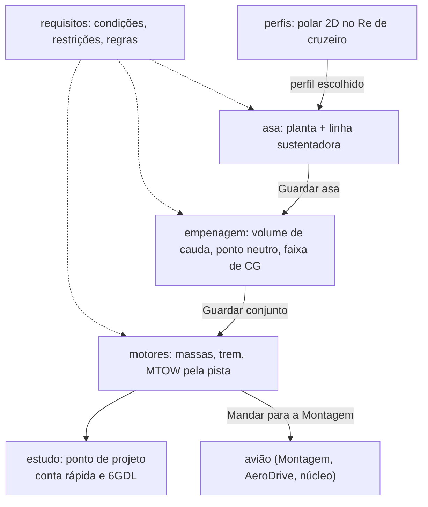

# aerosim/design — projeto do zero, etapa por etapa (sprint)

Aqui o avião nasce. Partindo só dos requisitos (massa estimada, velocidade de cruzeiro, pista e altitude), o projeto
passa por etapas: perfil, asa, empenagem e comandos, motores e montagem, e o estudo do ponto de projeto. As contas são
de sprint (linha sustentadora, estática, desempenho por fórmula), de segundos, para comparar muitas variantes. Cada
etapa guarda candidatos com nome, mostra o diagnóstico e as restrições do regulamento que estão ativas, e quem projeta
escolhe. O que sai é um avião completo, o mesmo arquivo que a Montagem edita, o AeroDrive pilota e o núcleo simula.

Cada etapa parte do candidato que a anterior guardou e leva uma cópia dele, então mudar algo numa etapa anterior não
altera o que já foi guardado. Na tela as etapas ficam nas subabas de Aerodinâmica (Perfis, Projetar), Estabilidade
(Empenagem e comandos) e Desempenho (Motores e montagem, Estudo e ponto de projeto). Cada etapa é um `stage_*.zig`,
registrada em `stages.zig`, que recebe o pedido da tela e devolve a página inteira, e as contas vêm do núcleo
([`core/src/sizing`](../../core/src/sizing/README.md)); a polar do NeuralFoil, um método de fora, passa pelo
adaptador. Em Perfis, as
polares do XFLR5 ou do XFOIL entram uma por Reynolds ("+ polar (arquivo)…"), e o perfil selecionado aparece em cada
Reynolds da lista "Reynolds dos gráficos", interpolado entre os arquivos (o núcleo lê e interpola:
[`core/src/physics`](../../core/src/physics/README.md)). O refino das etapas (pontos da corrida, bisseções, voltas da
massa) é regra do projeto, em "Condições e restrições".



O projeto de exemplo da sprint (`data/sprint/projeto_s1223.json`), da asa ao avião montado, pelos mesmos pedidos da
tela (`exemplo.zig`, `python -m ziglang build exemplo -Dexemplo=design` de dentro de `aerosim/`):

```zig
const std = @import("std");
const design = @import("design");

pub fn main(init: std.process.Init) !void {
    var project = try design.store.open(std.heap.page_allocator, init.io, "../data/sprint/projeto_s1223.json");
    project.folder = ".zig-cache/exemplo_sprint"; // o que mudar é gravado aqui, nunca em data/
    design.stages.use(project, init.io);
    var arena: std.heap.ArenaAllocator = .init(init.gpa);
    defer arena.deinit();
    const wanted = [_]struct { stage: []const u8, keys: []const []const u8 }{
        .{ .stage = "asa", .keys = &.{ "b, S, AR", "C_L,max, α de estol (°)", "V de estol (massa estimada)" } },
        .{ .stage = "empenagem", .keys = &.{ "ponto neutro (% CMA)", "faixa do CG (% CMA)" } },
        .{ .stage = "motores", .keys = &.{ "PV (vazio), CP (carga paga), total (kg)", "corrida de decolagem (m)", "MTOW pela pista (kg); CP possível = MTOW − PV (kg)" } },
    };
    for (wanted) |item| {
        const request = try std.fmt.allocPrint(arena.allocator(), "\"name\": \"{s}\", \"do\": \"show\"", .{item.stage});
        const page = try design.stages.handle(arena.allocator(), init.io, request); // o mesmo pedido da tela
        const summary = page.object.get("summary").?.object;
        std.debug.print("{s}\n", .{item.stage});
        for (item.keys) |key| std.debug.print("  {s}: {s}\n", .{ key, summary.get(key).?.string });
    }
}
```

```
asa
  b, S, AR: 2.400, 0.9000, 6.40
  C_L,max, α de estol (°): 1.2214, 2.96
  V de estol (massa estimada): 13.646
empenagem
  ponto neutro (% CMA): 26.8
  faixa do CG (% CMA): -9.7 a 21.8
motores
  PV (vazio), CP (carga paga), total (kg): 3.931, 8.069, 12.000
  corrida de decolagem (m): 109.97
  MTOW pela pista (kg); CP possível = MTOW − PV (kg): 9.032; 5.101
```

Com 12 kg o avião precisa de 110 m de corrida, mais que a pista do projeto, e o MTOW pela pista cai para 9 kg. É o tipo
de resposta que a sprint dá em segundos: troca o motor ou a asa e roda de novo. Cada pedido devolve a página inteira
(campos, guardados, tabelas, resumo e diagnóstico), e o projeto é gravado na pasta dele a cada mudança. O mini-MDO, que
dimensiona a asa sozinho, tem o exemplo em [`core/src/sizing/README.md`](../../core/src/sizing/README.md).

O avião que sai daqui é a entrada de todo o resto: as análises do avião montado, a Missão 6GDL, o AeroDrive e o
aeroopt. No estudo do ponto de projeto, o MTOW em função da inclinação do motor, pela conta rápida e conferido no
6GDL; na tela, os aviões guardados comparados nas altitudes pedidas:


