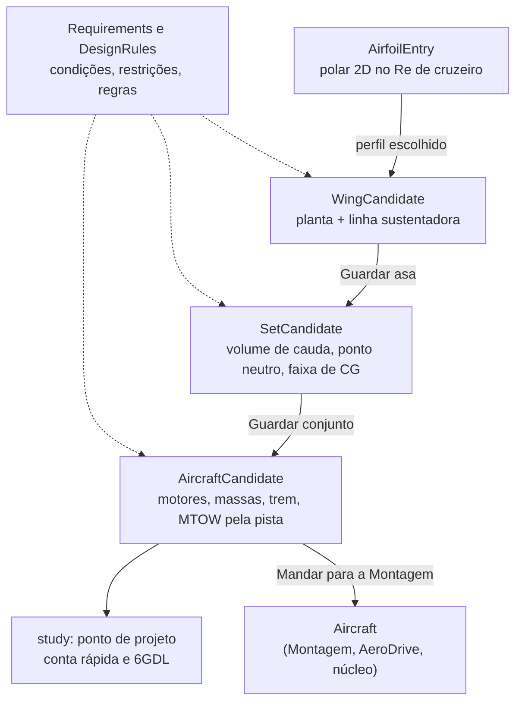

# aerosim/design — projeto do zero, etapa por etapa (sprint)

Aqui o avião nasce. Partindo só dos requisitos (massa estimada, velocidade de cruzeiro, pista e altitude), o projeto
passa por etapas: perfil, asa, empenagem e comandos, motores e montagem, e o estudo do ponto de projeto. As contas são
de sprint (linha sustentadora, estática, desempenho por fórmula), de segundos, para comparar muitas variantes. Cada
etapa guarda candidatos com nome, mostra o diagnóstico e as restrições do regulamento que estão ativas, e quem projeta
escolhe. O que sai é um avião completo, o mesmo arquivo que a Montagem edita, o AeroDrive pilota e o núcleo simula.

Cada etapa parte do candidato que a anterior guardou e leva uma cópia dele, então mudar algo numa etapa anterior não
altera o que já foi guardado. Na GUI as etapas ficam nas subabas de Aerodinâmica (Perfil, Asa), Estabilidade
(Empenagem e comandos) e Desempenho (Motores e montagem, Estudo e ponto de projeto). Na interface em Zig cada etapa
é um `stage_*.zig` ao lado do `.py` dela, com a mesma página e o mesmo arquivo de projeto, e as contas vêm do núcleo
([`core/src/sizing`](../../core/src/sizing/README.md)); a polar do NeuralFoil e a de arquivo seguem pelo Python.



Um projeto de 9 kg com 1 m² de asa, da asa ao avião montado:

```python
from aerosim.backend.zig import ZigBackend
from aerosim.design.project import DesignProject
from aerosim.design import results as R

p = DesignProject()                        # requisitos, regras, perfis NACA 2412 e 4412
p.requirements.mass = 9.0
p.wing_draft.area = 1.0
plots, res, r = R.wing_stage(p.draft_wing(), p.requirements, p.rules)
print("asa:", {k: round(float(r[k]), 2) for k in ("CLa", "CLmax", "V_stall")})
p.tail_draft.wing = p.keep_wing().name
plots, res, r = R.set_stage(p.draft_set(), p.requirements, p.rules, p.airfoil_map())
print("ponto neutro:", round(float(r["x_np"]), 3), "m")
p.power_draft.set = p.keep_set().name
plots, res, ac, asm, pf = R.aircraft_stage(p.draft_aircraft(), p.requirements, p.rules, backend=ZigBackend())
print("vazio:", round(asm["empty"], 2), "kg  corrida:", round(pf["s_to"], 1), "m  pista:", p.requirements.takeoff_run, "m")
```

```
asa: {'CLa': 4.28, 'CLmax': 1.2, 'V_stall': 11.26}
ponto neutro: -0.182 m
vazio: 4.07 kg  corrida: 42.7 m  pista: 6.0 m
```

Com o motor padrão, esse avião precisa de 42,7 m de corrida e a pista tem 6 m, então o MTOW pela pista sai NaN
(nenhuma massa decola) e o diagnóstico da etapa aponta isso. É o tipo de resposta que a sprint dá em segundos: troca o
motor ou a asa e roda de novo. Cada `*_stage` devolve os gráficos, o resultado (séries, resumo, diagnóstico) e os
números da etapa, e `p.save("sprint.json")` grava o projeto. O mini-MDO (`mdo.run`), que dimensiona a asa sozinho,
tem o exemplo em [`core/src/sizing/README.md`](../../core/src/sizing/README.md).

O avião que sai daqui é a entrada de todo o resto: as análises do avião montado, a Missão 6GDL, o AeroDrive e o
aeroopt. No estudo do ponto de projeto, o MTOW em função da inclinação do motor, pela conta rápida e conferido no
6GDL; na tela, os aviões guardados comparados nas altitudes pedidas:


