# aerosim/design — projeto do zero, etapa por etapa (sprint)

Cria o avião do zero, e cada etapa parte do que a anterior guardou:

1. **Perfil.** Você escolhe os perfis e vê a polar 2D de cada um.
2. **Asa.** A asa é feita a partir do perfil escolhido.
3. **Empenagem.** Entram as superfícies que acompanham a asa: cauda, tubo e comandos.
4. **Motores.** A etapa decide onde ficam os motores. Com isso saem a bateria, a carga, a fuselagem e o trem.
5. **Montagem.** O avião inteiro vai para a aba Montagem.

O programa não escolhe por você. Ele guarda candidatos com nome, compara esses candidatos e mostra o diagnóstico de cada etapa.

Exemplo montado na interface (asa S1223; EH MH 113 invertida, EH simétrica e cauda em V; Joinville e São José
dos Campos):


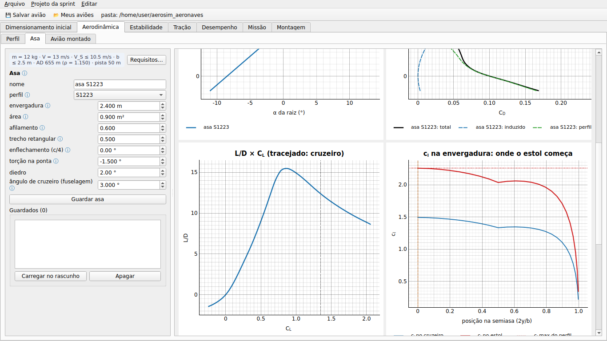


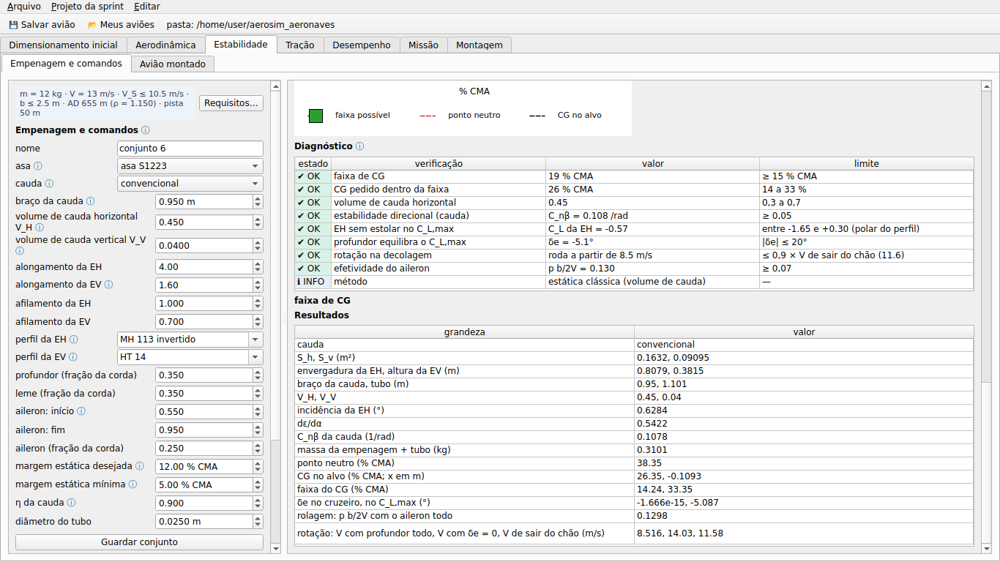

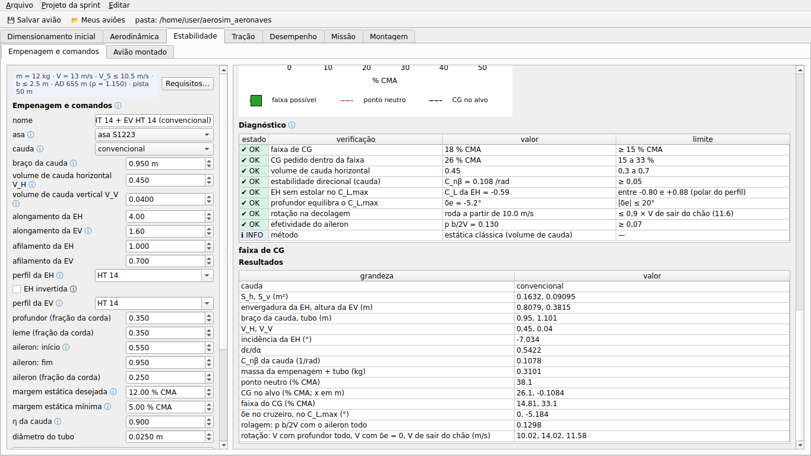


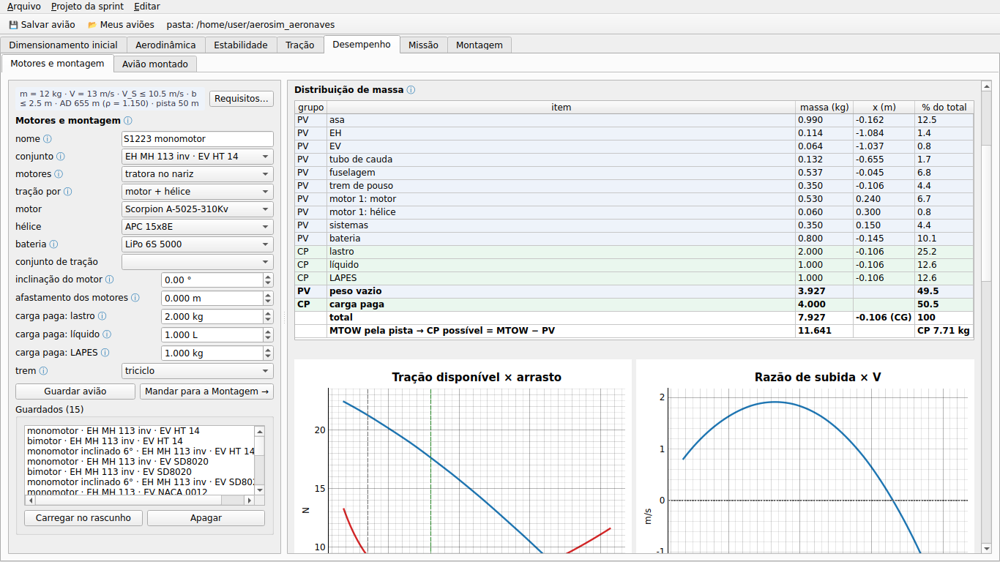

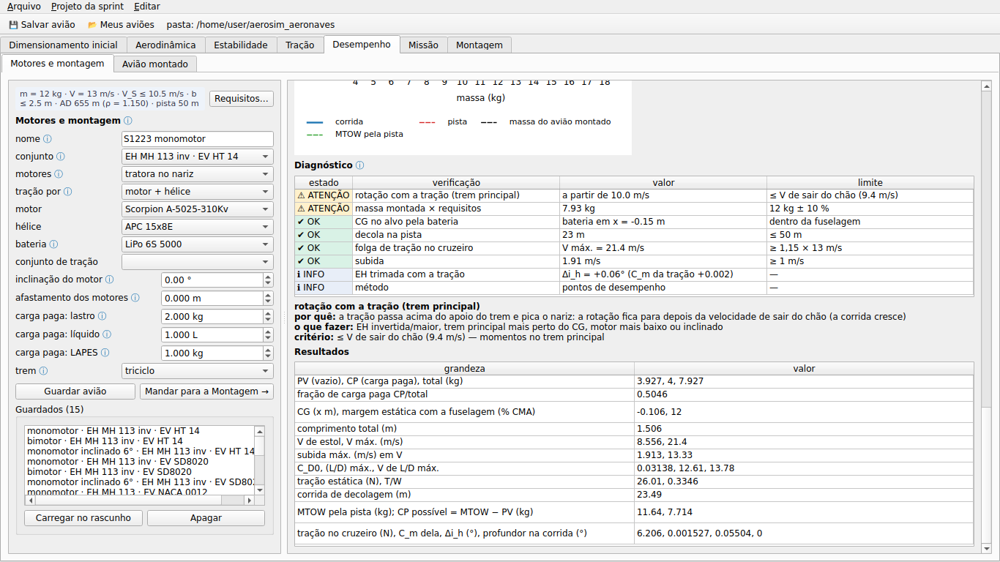

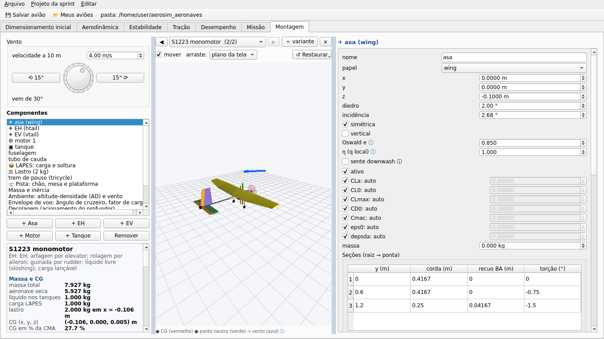

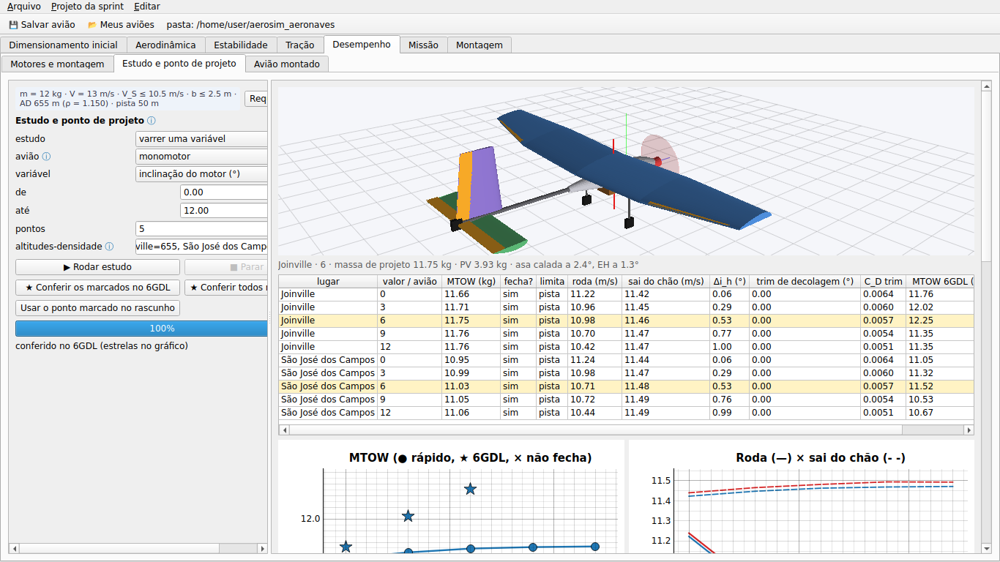


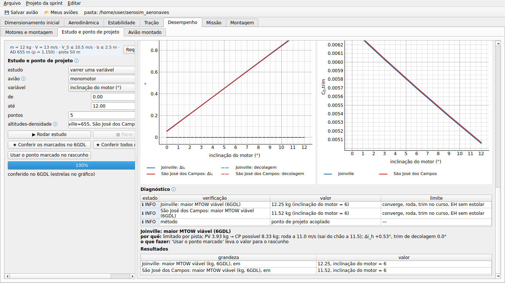

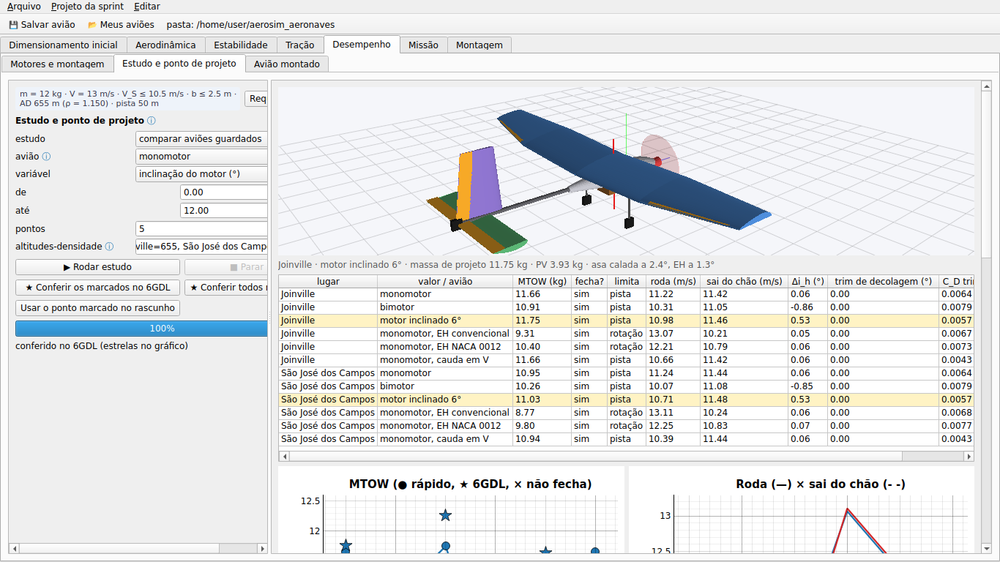

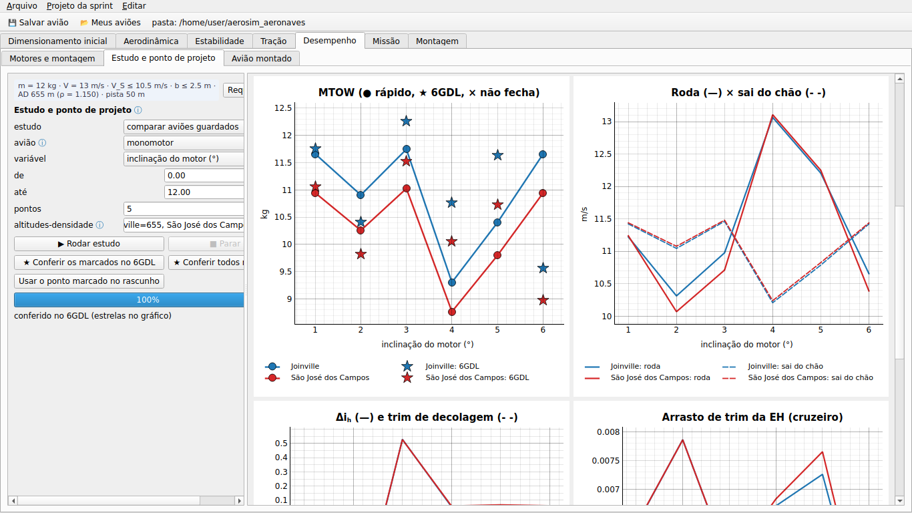

Na GUI, as etapas ficam nas subabas de cada área. A última subaba, **Avião montado**, faz a análise detalhada do avião aberto (lltdrek ou AeroSandbox, núcleo 6GDL).

| área | subabas |
|---|---|
| Aerodinâmica | Perfil, Asa, Avião montado |
| Estabilidade | Empenagem e comandos, Avião montado |
| Desempenho | Motores e montagem, Estudo e ponto de projeto, Avião montado |

## Como chamar

```python
from aerosim.design.project import DesignProject
from aerosim.design import results as R

p = DesignProject()                        # requisitos, regras, perfis NACA 2412 e 4412
p.requirements.mass = 9.0                  # massa, V de cruzeiro, V_S máx., AD, envergadura máx., pista
p.wing_draft.area = 1.0                    # rascunho da asa
plots, res, r = R.wing_stage(p.draft_wing(), p.requirements, p.rules)
asa = p.keep_wing()                        # guardada como "asa 1" (o rascunho passa a "asa 2")
p.tail_draft.wing = asa.name
plots, res, r = R.set_stage(p.draft_set(), p.requirements, p.rules, p.airfoil_map())
conj = p.keep_set()
p.power_draft.set = conj.name
plots, res, ac, asm, pf = R.aircraft_stage(p.draft_aircraft(), p.requirements, p.rules)
ac          # Aircraft: o mesmo arquivo da Montagem, do AeroDrive e do núcleo
p.save("sprint.json")
```

Cada `*_stage` devolve gráficos (`PlotSpec`), resultado (`SimResult`: séries, resumo, diagnóstico) e os números da etapa. Você também pode chamar direto:

- `wing.analyze(candidato, requisitos)`
- `tail.analyze(...)`
- `power.assemble(...)`
- `power.performance(...)`
- `airfoils.polar(...)`

## Como funciona

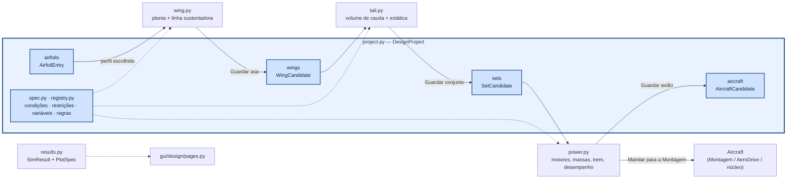

Cada candidato leva uma **cópia** do que veio antes: a asa leva o perfil, o conjunto leva a asa e o avião leva o conjunto. Por isso, mudar ou apagar algo numa etapa anterior não altera o que já foi guardado.

### Perfil (`airfoils.py`)

O perfil pode vir de quatro lugares:

- um código NACA de 4 dígitos;
- um `.dat` (Selig ou Lednicer);
- só parâmetros, sem contorno: a1, α_L0, c_l,max, c_d0 e c_m;
- a polar do XFLR5/XFOIL (texto ou CSV).

A polar sai por uma de três fontes, conforme o que o perfil permite:

| fonte | quando dá | observação |
|---|---|---|
| `modelo` | sempre | a mesma polar do simulador; c_d constante, não serve para comparar c_l/c_d |
| `neuralfoil` | quando há contorno e a rede está instalada | padrão de perfil novo com contorno |
| `arquivo` | quando há uma polar importada | usa o Re do arquivo; avisa se estiver longe do Re de cruzeiro |

`fitted` ajusta a1, α_L0, c_l,max, c_d mín. e c_m na polar escolhida. A asa usa esses números, então a fonte escolhida aqui vale para a etapa seguinte. O Re é o do cruzeiro, com a corda média da asa em rascunho.

### Asa (`wing.py`)

A forma em planta tem trecho retangular, trecho trapezoidal com afilamento, enflechamento de c/4, torção linear até a ponta e diedro.

A análise é a linha sustentadora de Prandtl pela série de Glauert (simétrica, 24 termos ímpares). Para a1 usa a1 · cos Λ:

```
Σ A_n sen(nθ)(sen θ + n μ) = μ (α + ε(y) − α_L0) sen θ,   μ = a1 c / (4 b)
C_L = π AR A_1     C_Di = π AR Σ n A_n²     c_l(y) = (4b/c) Σ A_n sen(nθ)
```

- **Estol:** o C_L,max sai pela seção crítica, isto é, o primeiro ponto da envergadura que chega ao c_l,max do perfil. Esse ponto também diz **onde** o estol começa.
- **Arrasto de perfil:** é o c_d da polar 2D no c_l local, integrado na envergadura.
- **Incidência:** a asa é calada para a fuselagem voar no **ângulo de cruzeiro** pedido, que vai para o envelope de voo do avião montado.

Validação (`tests/design`):

- asa retangular AR 8: C_Lα dentro de 3 % de Helmbold, com estol na raiz;
- afilamento 0,35: estol na metade de fora; com washout, o estol volta para dentro;
- afilamento 0,4: e > 0,97.

### Empenagem e comandos (`tail.py`)

As áreas saem do volume de cauda: S_h = V_H S c̄ / l e S_v = V_V S b / l. O braço l vai do centro aerodinâmico da asa ao da cauda.

| tipo de cauda | superfícies e comandos |
|---|---|
| convencional | EH com profundor e EV com leme |
| cauda em V | a mesma área total S_h + S_v, com diedro atan √(S_v/S_h) e ruddervators |
| sem cauda | elevons na asa |

Em todos os casos o tubo termina no bordo de fuga da cauda, e os ailerons ficam na asa. EH e EV têm perfis
separados. A EH aceita perfil arqueado, inclusive **invertido** (o α_L0 dele entra na incidência); a EV deve ser
simétrica. O perfil da cauda é ajustado na polar dele, no Re da cauda, e o C_L da EH fica limitado pelos **dois
lados** da polar, com o ganho de c_l,max do profundor defletido (flape simples, Raymer cap. 12).

A estática longitudinal segue a forma clássica (Etkin; Nelson): h_n = h_ac + η V_H (a_h/a)(1 − dε/dα), com dε/dα = 2a/(πAR). A partir dela:

- O **CG** vai para a margem estática pedida.
- A **incidência da EH** equilibra o cruzeiro com o profundor neutro.
- A **faixa de CG** fica entre dois limites: o dianteiro, onde o profundor deixa de equilibrar o C_L,max no curso máximo, e o traseiro, na margem mínima.
- A **rolagem** é medida por p b/2V com o aileron todo (C_lδa por faixas e C_lp de asa trapezoidal).
- O **direcional** é medido por C_nβ da cauda.
- A **rotação na decolagem** é a velocidade a partir da qual o profundor todo levanta o nariz em torno do trem
  principal. Ela entra nos momentos no ponto de contato: C_m,ac da asa, sustentação da asa na incidência, peso
  e cauda. A EH com sustentação para baixo cabra, e o perfil invertido tem c_l negativo maior. Por isso roda mais
  cedo: com a asa S1223 (sem a tração), roda a 8,5 m/s com MH 113 invertido contra 9,4 m/s com NACA 0012 e
  10,0 m/s com HT 14.

### Motores e montagem (`power.py`)

| motores | onde ficam |
|---|---|
| tratora no nariz | no nariz da fuselagem |
| dois motores na asa | na asa, fora da fuselagem |
| propulsora atrás da asa | atrás da asa; a etapa avisa se a hélice bate no tubo |

O motor, a hélice, a bateria e o conjunto de tração (polinômio) vêm do catálogo.

A montagem segue esta ordem:

1. **Fuselagem (pod).** Vai do nariz até o bordo de fuga da asa, com largura e altura das regras. Ela desestabiliza pelo efeito de Munk, C_mα ≈ 2(k2 − k1) Vol/(S c̄), e por isso o CG é recalculado com ela.
2. **Massas.** A **tabela de distribuição de massa** mostra cada item com x e % do total.
   - **PV** (peso vazio): a estrutura (estimada por área e por comprimento, das regras), os motores, as hélices,
     a bateria e os sistemas.
   - **CP** (carga paga) = lastro + líquido + LAPES. Você digita quanto de cada, e tudo vai no CG. No avião
     montado vira o lastro, o tanque (com sloshing) e a carga LAPES, os mesmos que o MTOW da aba Missão varia.
   - A bateria vai onde o CG cai no alvo. Se ela não couber na fuselagem, entra **lastro de equilíbrio**, que
     conta no PV, e o diagnóstico avisa.
   - Com o MTOW pela pista, a **CP possível = MTOW − PV**.
3. **Trem.** O principal fica atrás do CG, e a altura dá folga para a hélice.

O desempenho rápido junta duas partes:

- **Arrasto:** o C_D0 das superfícies, da fuselagem e do tubo, mais o C_Di da linha sustentadora.
- **Tração:** a do núcleo, com acelerador cheio. Sem backend, o equilíbrio motor + hélice é feito aqui, com o mesmo resultado (teste a 3 %).

**Superfícies já trimadas para o motor.** O eixo do motor dá momento de arfagem: pela inclinação e pela altura
em relação ao CG. No cruzeiro (tração = arrasto) a etapa recalcula a **incidência da EH** para o avião voar com o
profundor neutro (Δi_h no diagnóstico). Na corrida, com os momentos no apoio do trem principal, ela calcula o
**trim de decolagem**: quanto o profundor fica picando para o avião não sair do chão antes da velocidade de voo.
Esse trim vai para `takeoff.de0` do avião montado. Ela também diz a partir de que velocidade o profundor todo
consegue rodar com a tração. A tração acima do apoio pica o nariz, e é aí que a EH invertida ajuda.

**Cursos assimétricos** ficam nas regras:

- profundor: curso para cabrar ≠ curso para picar;
- aileron diferencial: sobe mais do que desce, o que dá menos guinada adversa. A rolagem usa a média dos dois.

O otimizador da decolagem da Missão (6GDL) também tenta segurar o profundor picando na corrida quando, com ele
neutro, nenhuma posição de acionamento funciona. Com o motor inclinado 6° o avião saía do chão a 9,9 m/s antes
do comando e afundava. Com +5° na corrida decola aos 29 m.

Com isso saem a V máx., a subida, a corrida até 1,1 V_S e a **massa máxima que a pista permite**. Com o motor
inclinado, a parte vertical da tração alivia o peso na corrida, e o avião sai do chão mais devagar.

O MTOW detalhado é o da aba **Missão**, modo MTOW: a decolagem simulada no núcleo 6GDL, com o acionamento do
profundor otimizado. A página **Estudo e ponto de projeto** confere os pontos no 6GDL.

### Estudo e ponto de projeto (`study.py`, `power.design_point`)

As áreas se retroalimentam, sem seguir uma ordem fixa. É assim que desempenho e estabilidade chegam juntos a um
ponto de projeto. Cada ponto é **acoplado**:

1. Começa com uma massa de projeto.
2. A asa é calada para o cruzeiro nessa massa.
3. A EH é retrimada com o momento da tração.
4. A bateria põe o CG na margem, e a carga paga é completada até essa massa.
5. O desempenho dá o MTOW. O arrasto de trim da EH entra aqui, então a estabilidade custa desempenho.
6. O MTOW vira a nova massa de projeto, e o laço repete até convergir.

No ponto convergido o estudo verifica a estabilidade nessa massa:

- o profundor consegue rodar o avião (com a tração);
- o trim de decolagem cabe no curso de picar;
- a EH não estola no C_L,max;
- a bateria alcança o CG.

Ele também diz **o que limita** o MTOW: a pista ou a rotação. Se o avião só roda depois de poder sair do chão,
a corrida espera.

A página tem dois modos:

- **varrer uma variável** (inclinação do motor, margem estática, V_H, braço da cauda, área, envergadura, ângulo de
  cruzeiro) nas altitudes-densidade pedidas (`Joinville=655, São José dos Campos=1320`);
- **comparar os aviões guardados**.

Ela marca o maior MTOW viável de cada altitude, confere os pontos no 6GDL (aba Missão, modo MTOW) e leva o ponto
marcado para o rascunho da etapa certa. Ela indica, não escolhe. **Mandar o ponto selecionado para a Montagem** abre
o avião daquela linha no ponto de projeto, como mais um avião aberto. Antes, a decolagem 6GDL (`flight.py`)
acha o acionamento e a deflexão do profundor (e o trim de corrida, se precisar) e grava no avião, que é com o
que a Missão e o AeroDrive decolam. Se não decolar, o avião não é salvo nem aberto. Os exemplos
`data/aircraft/S1223_*.json` foram feitos assim. Cada estudo rodado (com o 6GDL) fica **guardado no projeto**
como dado de simulação: volta ao abrir o projeto, e a linha refaz o avião só quando precisa (3D, Montagem, 6GDL).
Também dá para exportar em xlsx/csv.

Com a asa S1223 (MTOW em kg, conta rápida / 6GDL):

| inclinação do motor | Joinville (AD 655 m) | São José dos Campos (AD 1320 m) |
|---|---|---|
| 0° | 11,66 / 11,76 | 10,95 / 11,05 |
| 3° | 11,71 / 12,02 | 10,99 / 11,32 |
| **6°** | 11,75 / **12,25** | 11,03 / **11,52** |
| 9° | 11,76 / 11,35 | 11,05 / 10,53 |
| 12° | 11,76 / 11,35 | 11,06 / 10,67 |

- **Inclinação do motor.** O ótimo fica perto de **6°** nos dois lugares. Até ali, a parte vertical da tração e
  o momento cabrador ajudam a rodar e a sair do chão, e o arrasto de trim cai. Depois, o 6GDL mostra a
  decolagem piorando. A conta rápida não vê essa queda (só cresce), por isso a conferência 6GDL faz parte do
  estudo.
- **Empenagem** (monomotor, 6GDL, Joinville / São José dos Campos):

  | empenagem | MTOW 6GDL (kg) | o que limita |
  |---|---|---|
  | EH MH 113 invertida | 11,76 / 11,05 | a pista |
  | EH NACA 0012 | 11,64 / 10,73 | a rotação |
  | EH convencional HT 14 (simétrica) com EV | 10,76 / 10,06 | a rotação |
  | cauda em V MH 113 invertida | 9,56 / 8,98 | — |

  As simétricas só rodam depois de poder sair do chão.
- **Bimotor:** 10,41 / 9,83 kg. É mais pesado no PV, e a tração de dois motores menores não compensa.
- **MH 113 sem inverter:** o profundor não consegue rodar o avião.

As altitudes-densidade vêm de uma tarde quente típica, que eu assumi; você pode trocar na página:

| lugar | elevação | temperatura | umidade | AD |
|---|---|---|---|---|
| Joinville | 4 m | 30 °C | 75 % | 655 m |
| São José dos Campos | 646 m | 28 °C | 60 % | 1320 m |

## Condições, restrições e variáveis (`spec.py`, `registry.py`)

**Condições** (`Requirements`): o ponto de partida.

- massa estimada (o ponto de projeto acerta a massa; o MTOW é saída);
- V de cruzeiro;
- altitude-densidade (AD);
- atrito de rolamento.

**Restrições** (`registry.Constraint`, lista `Requirements.constraints`): grandeza, operador (≤, ≥, =), valor e
se está ativa. Desligar não perde o valor. As grandezas estão em `registry.QUANTITIES`:

- da asa: área, envergadura, alongamento, V de estol;
- da montagem: número de superfícies e de motores, comprimento, potência dos motores, margem estática, massas de
  líquido, LAPES e lastro;
- do desempenho: corrida de decolagem, V máx., subida, T/W;
- saídas: massa montada, PV, CP, EE = CP/PV, MTOW.

As etapas devolvem as grandezas (`registry.wing_values`, `registry.aircraft_values`); `results.constraint_checks`
põe uma linha por restrição ativa no diagnóstico, e o estudo marca o ponto como inviável quando uma falha.
`span_max`, `V_stall_max`, `length_max` e `takeoff_run` continuam como leitura das restrições (desligada = sem
limite). Projetos antigos (esses quatro como campos) viram restrições ao abrir.

```python
from aerosim.design import registry as rg
req.constraints.append(rg.Constraint("s_to", "≤", 3.0))     # decolar em 3 m
rg.checks(req.constraints, rg.aircraft_values(ac, asm, pf, params))   # [(restrição, cumpre, texto)]
```

**Variáveis** (`registry.Variable`, lista `DesignProject.variables`): cada entrada de `registry.INPUTS` (um campo dos
rascunhos: envergadura, área, perfil, motor, hélice, inclinação, cargas, V de cruzeiro, massa estimada) fica
**fixa** (vale o rascunho), **variável** (mín./máx. ou lista de opções: é o que o otimizador da etapa 3 mexe) ou
**calculada**. `registry.get_input` / `set_input` leem e escrevem no projeto.

**Regras de projeto:**

- massas por área (asa, empenagem) e por comprimento (tubo, fuselagem);
- tamanho e C_D da fuselagem;
- sistemas e trem;
- nariz à frente da asa e altura da asa;
- folga da hélice, trem atrás do CG e bitola;
- cursos do profundor e do aileron.

Os campos usam `fields.F`, que leva rótulo, unidade, dica e faixa. A GUI (`DataclassForm`) monta o formulário a partir disso.

## Dimensionamento inicial — mini-MDO (`mdo.py`)

As contas e o otimizador estão no núcleo (`core/src/sizing`); aqui se monta a configuração a partir do projeto
e se leem os resultados.

```python
from aerosim.design import mdo
p.mdo.kind, p.mdo.objective = "biplano", "EE"          # MdoParams: tipo, objetivo, otimizador, população...
rows, best, names = mdo.run(p, catalog, backend, progress=lambda it, rows: ...)   # tempo real
hist = mdo.history(rows)                                 # o melhor até cada iteração (o slider)
ev = mdo.evaluate(p, rows[k])                            # grandezas, curva T × D no MTOW
mdo.apply(p, rows[k])                                    # vira o rascunho da Asa e de Motores e montagem
mdo.check_6dof(p, rows[k], catalog, manager)             # guarda asa/conjunto/avião, ponto de projeto, MTOW 6GDL
```

- **Variáveis** (Condições e restrições → Variáveis): envergadura, área, afilamento, perfil da raiz e da ponta
  (listas), motor e hélice (listas: os conjuntos são motor × hélice com a bateria do rascunho), inclinação; o
  número de motores e o tipo de aeronave ficam em `MdoParams`. Fixo = o valor do rascunho.
- **Restrições**: as ativas que o núcleo calcula (S, b, V_S, potência, nº de motores, corrida, V_max, subida,
  T/W, PV, CP, EE, MTOW); as outras (comprimento, margem estática...) ficam para as etapas e aparecem listadas.
- **Limites**: `registry.check_bounds` recusa variável física sem mín. < máx. (ou lista sem opções);
  `registry.bounds_from_constraints` leva as restrições ativas para os limites (b → envergadura, S → área,
  n_motor → motores mín./máx.).
- **Arranjo dos motores** é variável (`LAYOUT_DATA`): motores aceitos (nariz e propulsora: 1; asa: aos pares),
  instalação (propulsora na esteira: 0,9 da tração), arrasto das naceles e suporte por motor.
- **Listas** (perfil da raiz e da ponta, motor, hélice, arranjo): `available(projeto, chave)` diz tudo o que existe
  (perfis do projeto + `.dat` de `MdoParams.airfoil_dir`, padrão `data/airfoils`); variável sem nada marcado = todos.
- **Envelope completo e diagrama do indivíduo**: `full_envelope` (o desempenho do núcleo, `simple_perf`, com a polar
  e a curva de tração dele: todas as velocidades) e `constraint_diagram` (curvas de `aerosim.sizing.constraints`
  com a polar e as velocidades dele; T/W estático equivalente pela queda da tração da hélice).
- **Empenagem** não é dimensionada: entra como fração da área da asa na massa e no arrasto.
- **Perfil da ponta** também na etapa Asa (`WingParams.airfoil_tip`): a linha sustentadora usa a1(y) e α_L0(y)
  interpolados da raiz (e do trecho retangular) à ponta; o estol, o c_l,max local; o arrasto, o c_d local.

## Nível

Tudo aqui é **sprint**: contas rápidas, para comparar muitas variantes. O estudo detalhado do avião montado fica nas simulações do manager, que aparecem na subaba "Avião montado" e nas abas Missão e Tração.
