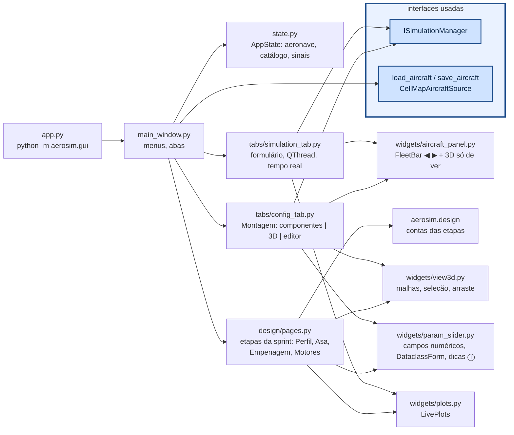

# aerosim/gui — interface gráfica (PyQt6 + pyqtgraph)

Só conhece `ISimulationManager` (para rodar) e as fontes de dados (para abrir/salvar). Cada aba de
simulação é gerada pelo que a simulação declara em `parameters()` e `plots()`.

## Como chamar

```sh
python -m aerosim.gui                          # último projeto (sem avião guardado: Montagem vazia)
python -m aerosim.gui ~/sprint                 # abre a pasta da sprint e volta de onde parou
python -m aerosim.gui projeto.json             # projeto antigo (um .json só): grava numa pasta ao lado
python -m aerosim.gui data/aircraft/twin_boom.cfg
QT_QPA_PLATFORM=offscreen python -m pytest tests/gui   # sem tela
xvfb-run -a python tools/capturas.py capturas/         # foto de cada aba
```

Por código (ex.: num script de teste):

```python
from PyQt6 import QtWidgets
from aerosim.gui.main_window import MainWindow
from aerosim.gui.state import AppState
from aerosim.manager import SimulationManager
from aerosim.model.templates import conventional

app = QtWidgets.QApplication([])
st = AppState(SimulationManager(), conventional())
w = MainWindow(st)
w.show()                                       # app.exec() abre a janela de verdade
st.notify("geometry"); st.undo(); st.redo()    # toda mudança passa por AppState (Ctrl+Z)
```

## Como funciona



- **Montagem (última aba, três colunas):** à esquerda a lista de componentes e as informações (massa, CG,
  inércias, aerodinâmica, pista...); no meio `AircraftView`, que desenha as malhas de
  `model/geometry.py` (eixos do corpo → tela: `(x, −y, −z)`), escolhe o componente mais perto do clique
  e move no plano da câmera (ou travado em x, y, z); à direita o editor do componente, um `DataclassForm`
  (um campo por número da dataclass; rótulos curtos com a explicação no ⓘ). As informações são
  recalculadas logo depois da última edição (um temporizador junta as edições seguidas). Vazio (`templates.empty()`), o resumo diz o que falta
  (`templates.not_ready`). Tubos são uma lista (`ac.booms`, chave `boom:i` no 3D); o campo **presa em** de
  cada superfície (`mount`: `tubo:i` ou `ponta:j`) é resolvido por `Aircraft.apply_constraints`.
- **Projeto inteiro num `.json`:** `state.save_design()` grava as etapas, `fleet` (os aviões abertos), `current`
  e `ui` (aba e subaba, de `MainWindow.ui_state`); `MainWindow.open_path(caminho)` descobre se é projeto
  (`design.project.is_project_file`) ou avião e chama `state.open_design(projeto)` ou `set_aircraft`.
- **Mini-MDO** (`design/mdo_page.py`, Dimensionamento inicial): o otimizador do núcleo roda numa `QThread`; o
  aviso por iteração (`progress`) redesenha os indivíduos (`pg.ScatterPlotItem` clicável) e o histórico das asas
  (slider sobre `mdo.history`). O clique refaz o indivíduo (`mdo.evaluate`) para o envelope, a tabela e o 3D.
- **Etapas da sprint (projeto do zero):** Aerodinâmica, Estabilidade e Desempenho são subabas — primeiro
  as etapas que criam o avião (`design/pages.py`: **Perfil → Asa** em Aerodinâmica, **Empenagem e comandos**
  em Estabilidade, **Motores e montagem** em Desempenho), por último **Avião montado** (a simulação de
  sempre, sobre o avião aberto). Cada etapa edita um rascunho e mostra na hora o que vai ser feito: a peça
  em 3D (asa sozinha; asa + cauda + tubo com CG e ponto neutro; o avião inteiro), gráficos e diagnóstico;
  "Guardar" cria um candidato com nome que a etapa seguinte escolhe. "Mandar para a Montagem" abre o avião
  como mais um avião aberto e o salva em "meus aviões"; "Usar em Desempenho" faz o mesmo e vai para as análises
  de Desempenho. Não decolar não impede: o avião vai com o aviso. Requisitos e regras ficam no botão
  **Condições e restrições…** de cada etapa (`ConstraintsTable`, `VariablesTable`; os valores "calculado" vêm de
  `state.design_values`, gravado pela última etapa que rodou). O projeto (`state.design`) se grava sozinho na pasta
  `state.design_dir` (padrão `<meus aviões>/sprint/`; a escolhida fica lembrada), **um arquivo por asa**
  (`aerosim/design/store.py`); menu **Projeto da sprint** para novo numa pasta, abrir pasta, abrir projeto antigo
  ou arquivo de asa, gravar em outra pasta e mostrar a pasta.
  Em Motores e montagem, embaixo do 3D, a **distribuição de massa**: cada item com x e % do total, PV (vazio)
  e CP estimada (massa de projeto − PV; aqui só se marca se tem LAPES e líquido, e quantos — os kg vão na
  Montagem), e a CP possível pelo MTOW da pista.
  **Estudo e ponto de projeto** (Desempenho): roda o estudo numa `QThread` (ponto de projeto acoplado por valor ×
  altitude), mostra a tabela, os gráficos e o 3D do ponto selecionado, confere no 6GDL e leva o ponto marcado para
  o rascunho.
  As contas estão em [`aerosim/design`](../design/README.md).
- **Formulários com metadados:** `DataclassForm` usa rótulo, unidade, dica, opções e faixa dos metadados do
  campo (`aerosim.design.fields.F`); `choices` e `editable` por campo para listas que dependem do projeto.
- **Vários aviões abertos:** `AppState.fleet` guarda os aviões abertos e `current` o escolhido;
  `FleetBar` (◀ nome ▶, ＋ variante, ×) troca entre eles e todas as abas acompanham. "Abrir ao lado"
  (menu Arquivo) abre mais um arquivo sem fechar o atual; "＋ variante" abre uma cópia para variar.
  O título mostra "(i/n aviões abertos)".
- **3D nas análises do avião montado:** as simulações com `show_aircraft = True` (subabas "Avião montado"
  e a Missão) mostram no topo da coluna de gráficos um `AircraftPanel` — o avião atual em 3D,
  só para ver, com massa, envergadura e área; os gráficos ficam embaixo, rolando.
- **Ambiente e envelope na Montagem:** a altitude-densidade (AD) define ρ pela ISA
  (`model/atmosphere.py`, ρ aparece ao lado só para leitura); "Envelope de voo" edita o ângulo de
  cruzeiro, o fator de carga e o teto mínimo. Desempenho usa a AD e uma AD mais alta como altitudes padrão.
- **Tela:** tudo projetado para caber num notebook comum (a janela abre nesse tamanho ou no da tela, o menor).
- **Desfazer:** `AppState` guarda o estado de antes de cada mudança (`notify`/`touch`) — a aeronave e os
  valores das abas registradas (`register`); Ctrl+Z/Ctrl+Y em `main_window.py`.
- **Desempenho agrupa Tração e Missão:** as subabas são Motores e montagem, Estudo e ponto de projeto, Avião
  montado, Tração e Missão (`INSIDE` em `main_window.py`); `show_area("missao")` vai direto para a Missão.
- **Perfis desde o início:** os `.dat` de `data/airfoils` (biblioteca, `design.airfoils.library`) aparecem nas
  listas de perfil da Asa e da Empenagem sem passar pela etapa Perfil.
- **xCG em % da CMA** na tela (tabela do MTOW, linha de informações do avião); por dentro tudo é em metros.
- **Rotação do motor:** na Montagem, cada motor tem o botão "⟲⟳ Inverter rotação".
- **Tração:** em cada motor, "motor + hélice" (catálogo) ou "polinômio de tração" (conjuntos do
  catálogo, vindos da aba `Tracao`); os coeficientes do polinômio são editáveis numa tabela.
- **Simulações:** `SimulationTab` roda `manager.run` numa `QThread`; cada fatia do registro chega por
  sinal e é desenhada em intervalos fixos (não a cada fatia); ao terminar mostra o resumo e as séries; "Exportar CSV" grava tudo.
- Sem tela (servidor, CI): `QT_QPA_PLATFORM=offscreen` (o 3D não desenha, o resto funciona).

## As poucas contas da GUI

A GUI não calcula nada do avião (regra 2 do `CLAUDE.md`): ela só converte o que o manager e o modelo já entregam
para a tela.

**Eixos do corpo para o OpenGL** (`widgets/view3d.py`, `to_gl`). O modelo usa os eixos do corpo da mecânica de voo
($x$ para a frente, $y$ para a direita, $z$ para baixo); a vista 3D usa $z$ para cima, então dois eixos trocam de
sinal:

$$
\begin{pmatrix} x \\ y \\ z \end{pmatrix}_{GL} = \begin{pmatrix} x \\ -y \\ -z \end{pmatrix}_{corpo}
$$

**Cores das cargas** (`widgets/load_view.py`, `normalize`). Cada valor vira uma posição $t \in [0, 1]$ no mapa de
cores. Na escala mín–máx, e na simétrica em zero (mapa divergente, para valores com sinal):

$$
t = \frac{v - v_{min}}{v_{max} - v_{min}}
\qquad
t = \frac{v + M}{2M}, \quad M = \max |v|
$$

Na escala "por superfície", $v_{min}$ e $v_{max}$ são os de cada superfície.

**Rótulos** (`widgets/plots.py`, `tex`). Os títulos dos gráficos aceitam uma notação LaTeX simples ($...$, letras
gregas como `\delta`, índices `C_L` e expoentes `x^2`), convertida para o HTML do Qt.

## Um exemplo por arquivo

```python
from PyQt6 import QtWidgets
from aerosim.design.project import DesignProject
from aerosim.gui.main_window import MainWindow
from aerosim.gui.state import AppState
from aerosim.gui.widgets import load_view, plots, view3d
from aerosim.gui.widgets.dims_table import DimsTable
from aerosim.gui.widgets.param_slider import DataclassForm, ParamSlider
from aerosim.interfaces.simulation import PlotSpec
from aerosim.manager import SimulationManager
from aerosim.model.templates import conventional

app = QtWidgets.QApplication([])
ac = conventional()

# state.py + main_window.py: o estado compartilhado e a janela
st = AppState(SimulationManager(), ac)
w = MainWindow(st)
print(w.windowTitle())

# widgets/param_slider.py: um formulário gerado da dataclass (rótulo, unidade e dica dos metadados)
form = DataclassForm(DesignProject().requirements)
sl = ParamSlider("V", 14.0, 8.0, 25.0, 0.5)
print(type(form).__name__, sl.value())

# widgets/plots.py: gráficos montados das PlotSpec; tex() converte os rótulos
lp = plots.LivePlots([PlotSpec("h", "Altura", "t", ("h",), "t (s)", "m")])
print(plots.tex("$C_L$ × $\\alpha$"))

# widgets/view3d.py e load_view.py: eixos do corpo -> OpenGL e cores das cargas
print(view3d.to_gl([1.0, 2.0, 3.0]))
print(load_view.normalize([-2.0, 0.0, 4.0], "simétrica em 0")[0])

# widgets/dims_table.py: medidas a partir do CG de projeto
dt = DimsTable()
dt.show_aircraft(ac)
print(dt.table.rowCount(), dt.rows[0][:2])
```

As abas (`tabs/config_tab.py`, `tabs/simulation_tab.py`), as etapas da sprint (`design/pages.py`,
`design/mdo_page.py`) e os diálogos (`widgets/save_check.py`) são montados pela `MainWindow`; os testes em `tests/gui`
mostram como abrir cada um sem tela.
