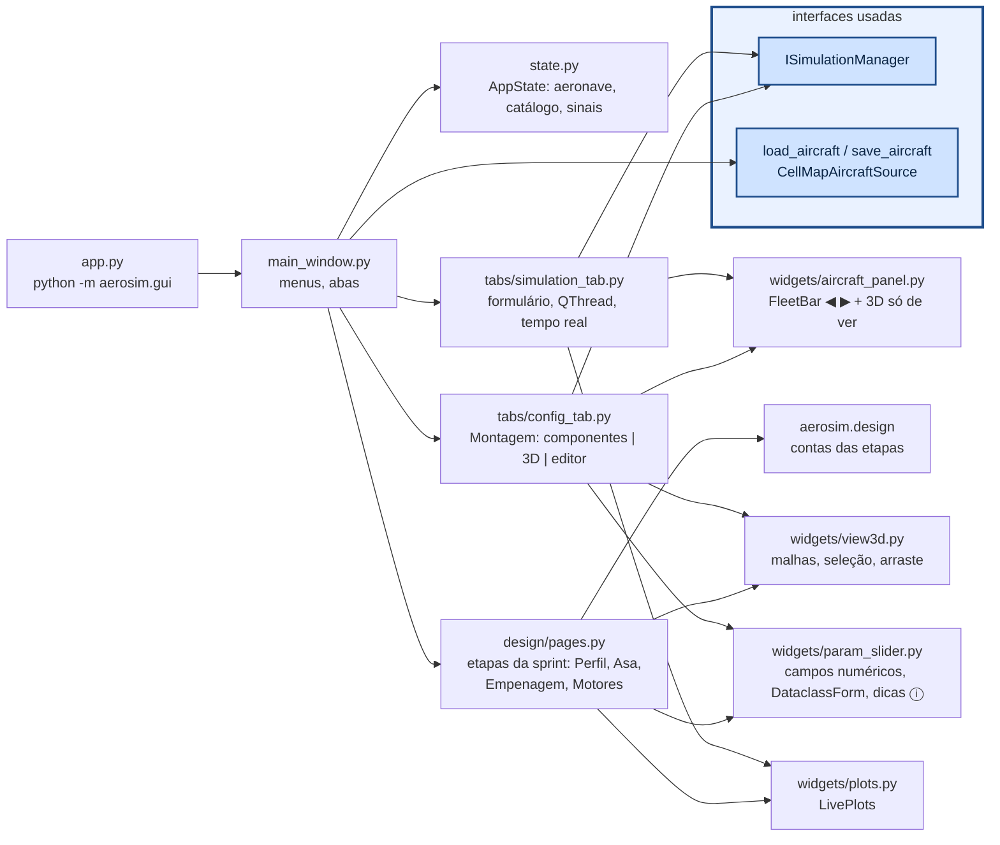

# aerosim/gui — interface gráfica (PyQt6 + pyqtgraph)

Só conhece `ISimulationManager` (para rodar) e as fontes de dados (para abrir/salvar). Cada aba de
simulação é gerada pelo que a simulação declara em `parameters()` e `plots()`.

## Como chamar

```sh
python -m aerosim.gui                          # último projeto (sem avião guardado: Montagem vazia)
python -m aerosim.gui projeto.json             # abre o projeto e volta de onde parou
python -m aerosim.gui data/aircraft/twin_boom.cfg
QT_QPA_PLATFORM=offscreen python -m pytest tests/gui   # sem tela
xvfb-run -a python tools/capturas.py capturas/         # foto de cada aba
```

Por código (ex.: num script de teste):

```python
from aerosim.gui.state import AppState
from aerosim.gui.main_window import MainWindow
st = AppState(manager, aeronave)
w = MainWindow(st); w.show()
st.notify("geometry"); st.undo(); st.redo()    # toda mudança passa por AppState (Ctrl+Z)
```

## Como funciona



- **Montagem (última aba, três colunas):** à esquerda a lista de componentes e as informações (massa, CG,
  inércias, aerodinâmica, pista...); no meio `AircraftView`, que desenha as malhas de
  `model/geometry.py` (eixos do corpo → tela: `(x, −y, −z)`), escolhe o componente mais perto do clique
  e move no plano da câmera (ou travado em x, y, z); à direita o editor do componente, um `DataclassForm`
  (um campo por número da dataclass; rótulos curtos com a explicação no ⓘ). As informações são
  recalculadas 300 ms depois da última edição. Vazio (`templates.empty()`), o resumo diz o que falta
  (`templates.not_ready`). Tubos são uma lista (`ac.booms`, chave `boom:i` no 3D); o campo **presa em** de
  cada superfície (`mount`: `tubo:i` ou `ponta:j`) é resolvido por `Aircraft.apply_constraints`.
- **Projeto inteiro num `.json`:** `state.save_design()` grava as etapas, `fleet` (os aviões abertos), `current`
  e `ui` (aba e subaba, de `MainWindow.ui_state`); `MainWindow.open_path(caminho)` descobre se é projeto
  (`design.project.is_project_file`) ou avião e chama `state.open_design(projeto)` ou `set_aircraft`.
- **Etapas da sprint (projeto do zero):** Aerodinâmica, Estabilidade e Desempenho são subabas — primeiro
  as etapas que criam o avião (`design/pages.py`: **Perfil → Asa** em Aerodinâmica, **Empenagem e comandos**
  em Estabilidade, **Motores e montagem** em Desempenho), por último **Avião montado** (a simulação de
  sempre, sobre o avião aberto). Cada etapa edita um rascunho e mostra na hora o que vai ser feito: a peça
  em 3D (asa sozinha; asa + cauda + tubo com CG e ponto neutro; o avião inteiro), gráficos e diagnóstico;
  "Guardar" cria um candidato com nome que a etapa seguinte escolhe. "Mandar para a Montagem" abre o avião
  como mais um avião aberto e o salva em "meus aviões". Requisitos e regras ficam no botão
  **Requisitos…** de cada etapa. O projeto (`state.design`) se grava sozinho em
  `<meus aviões>/sprint/projeto.json`; menu **Projeto da sprint** para novo, abrir e salvar como.
  Em Motores e montagem, embaixo do 3D, a **distribuição de massa**: cada item com x e % do total, PV (vazio)
  e CP (carga paga = lastro + líquido + LAPES, digitados), e a CP possível pelo MTOW da pista.
  **Estudo e ponto de projeto** (Desempenho): roda o estudo numa `QThread` (ponto de projeto acoplado por valor ×
  altitude), mostra a tabela, os gráficos e o 3D do ponto selecionado, confere no 6GDL e leva o ponto marcado para
  o rascunho.
  As contas estão em [`aerosim/design`](../design/README.md).
- **Formulários com metadados:** `DataclassForm` usa rótulo, unidade, dica, opções e faixa dos metadados do
  campo (`aerosim.design.fields.F`); `choices` e `editable` por campo para listas que dependem do projeto.
- **Vários aviões abertos:** `AppState.fleet` guarda os aviões abertos e `current` o escolhido;
  `FleetBar` (◀ nome ▶, ＋ variante, ×) troca entre eles e todas as abas acompanham. "Abrir ao lado"
  (menu Arquivo) abre mais um arquivo sem fechar o atual; "＋ variante" abre uma cópia para variar.
  O título mostra "(i/n aviões abertos)".
- **3D nas análises do avião montado:** as simulações com `show_aircraft = True` (subabas "Avião montado"
  e a Missão) mostram no topo da coluna de gráficos um `AircraftPanel` — o avião atual em 3D,
  só para ver, com massa, envergadura e área; os gráficos ficam embaixo, rolando.
- **Ambiente e envelope na Montagem:** a altitude-densidade (AD) define ρ pela ISA
  (`model/atmosphere.py`, ρ aparece ao lado só para leitura); "Envelope de voo" edita o ângulo de
  cruzeiro, o fator de carga e o teto mínimo. Desempenho usa "AD, AD+900" como altitudes padrão.
- **Tela:** tudo projetado para 1366×768 (a janela abre nesse tamanho ou no da tela, o menor).
- **Desfazer:** `AppState` guarda o estado de antes de cada mudança (`notify`/`touch`) — a aeronave e os
  valores das abas registradas (`register`); Ctrl+Z/Ctrl+Y em `main_window.py`.
- **Tração:** em cada motor, "motor + hélice" (catálogo) ou "polinômio de tração" (conjuntos do
  catálogo, vindos da aba `Tracao`); os 21 coeficientes são editáveis numa tabela.
- **Simulações:** `SimulationTab` roda `manager.run` numa `QThread`; cada fatia do registro chega por
  sinal e é desenhada a ~15 Hz; ao terminar mostra o resumo e as séries; "Exportar CSV" grava tudo.
- Sem tela (servidor, CI): `QT_QPA_PLATFORM=offscreen` (o 3D não desenha, o resto funciona).
