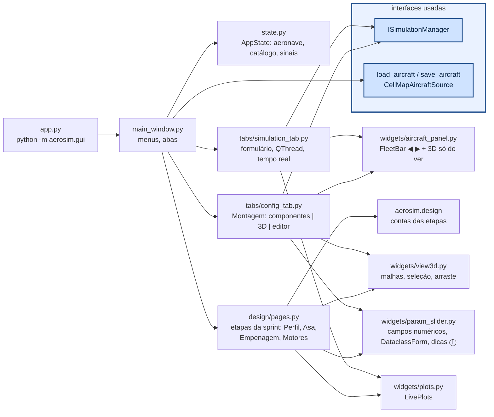

# aerosim/gui — interface gráfica (PyQt6 + pyqtgraph)

Esta é a janela do programa, onde se projeta o avião e se veem as análises. Nela se monta o avião em 3D, componente
por componente, se percorrem as etapas do projeto do zero e se roda cada análise (missão, desempenho, aerodinâmica,
estabilidade, cargas) com os gráficos aparecendo enquanto a conta anda.

A GUI não faz conta do avião. Ela só conhece o `ISimulationManager`, para rodar as análises, e as fontes de dados,
para abrir e salvar, e cada aba de simulação é gerada sozinha a partir do que a simulação declara em `parameters()` e
`plots()`. Todo o estado (o avião em edição, os aviões abertos, o catálogo, o projeto) fica num objeto só,
`AppState`, e toda mudança passa por ele, o que dá o desfazer (Ctrl+Z) de graça.

O README mostra primeiro como as peças da janela se ligam e depois cada parte dela: a Montagem, as etapas da sprint,
o mini-MDO, os formulários, os vários aviões abertos e as abas de simulação. Em seguida vêm as poucas contas que a
GUI faz, só de tela, e, no fim, um exemplo por arquivo e como chamar.

## Como funciona



### Montagem

A Montagem é a última aba e é onde o avião é editado peça por peça, em três colunas. À esquerda ficam a lista de
componentes e as informações do avião (massa, CG, inércias, aerodinâmica, pista). No meio, a `AircraftView` desenha as
malhas de `model/geometry.py`; um clique escolhe o componente mais perto, e arrastar o move no plano da câmera ou
travado num eixo. À direita fica o editor do componente, um `DataclassForm` com um campo por número da dataclass,
rótulos curtos e a explicação no ⓘ. As informações são recalculadas logo depois da última edição, com um temporizador
que junta as edições seguidas. Com o avião vazio (`templates.empty()`), o resumo diz o que falta
(`templates.not_ready`). Os tubos de cauda são uma lista (`ac.booms`, chave `boom:i` no 3D), e o campo **presa em** de
cada superfície (`tubo:i` ou `ponta:j`, para uma cauda em T) é resolvido por `Aircraft.apply_constraints`. Na mesma
aba, a altitude-densidade define a densidade do ar pela ISA (`model/atmosphere.py`), "Envelope de voo" edita o ângulo
de cruzeiro, o fator de carga e o teto mínimo, cada motor tem o botão "⟲⟳ Inverter rotação", e a tração de cada um é
"motor + hélice" (do catálogo) ou "polinômio de tração", com os coeficientes editáveis numa tabela.

### Etapas da sprint

As etapas do projeto do zero (`design/pages.py`) ficam como subabas das áreas, antes da análise do avião montado: Perfil
e Asa em Aerodinâmica, Empenagem e comandos em Estabilidade, Motores e montagem e o Estudo e ponto de projeto em
Desempenho. Cada etapa edita um rascunho e mostra na hora o que vai sair, com a peça em 3D (a asa sozinha; asa, cauda
e tubo com o CG e o ponto neutro; o avião inteiro), os gráficos e o diagnóstico. "Guardar" cria um candidato com nome,
que a etapa seguinte escolhe. "Mandar para a Montagem" abre o avião como mais um avião aberto e o salva em "meus
aviões", e "Usar em Desempenho" faz o mesmo e vai direto para as análises de Desempenho; um avião que não decola vai
assim mesmo, com o aviso. Os requisitos e as regras ficam no botão **Condições e restrições…** de cada etapa
(`ConstraintsTable`, `VariablesTable`), e os valores "calculado" vêm de `state.design_values`, gravado pela última etapa
que rodou. Em Motores e montagem, embaixo do 3D, fica a distribuição de massa, com cada item, o PV (peso vazio), a CP
(carga paga) estimada e a CP possível pelo MTOW da pista. O Estudo e ponto de projeto roda numa `QThread`, mostra a
tabela, os gráficos e o 3D do ponto selecionado, confere no 6GDL e leva o ponto marcado para o rascunho. As contas de
todas as etapas estão em [`aerosim/design`](../design/README.md).

O projeto (`state.design`) se grava sozinho na pasta `state.design_dir` (por padrão `<meus aviões>/sprint/`, e a
escolhida fica lembrada), com um arquivo por asa (`aerosim/design/store.py`). O menu **Projeto da sprint** cria um
projeto numa pasta, abre uma pasta, um projeto antigo ou um arquivo de asa, grava em outra pasta e mostra a pasta.
`state.save_design()` grava também os aviões abertos (`fleet`, `current`) e a aba em que se estava (`ui`, de
`MainWindow.ui_state`), e `MainWindow.open_path(caminho)` descobre se o arquivo é um projeto ou um avião.

### Mini-MDO

A página do Dimensionamento inicial (`design/mdo_page.py`) roda o otimizador do núcleo numa `QThread`. A cada
iteração, o aviso de progresso redesenha os indivíduos, num gráfico de pontos clicáveis, e o histórico das asas, com
um slider sobre `mdo.history`. Clicar num indivíduo o refaz (`mdo.evaluate`) para mostrar o envelope, a tabela e o 3D.

### Formulários

`DataclassForm` monta um formulário a partir de uma dataclass, usando o rótulo, a unidade, a dica, as opções e a faixa
dos metadados de cada campo (`aerosim.design.fields.F`). `choices` e `editable` mudam um campo para listas que
dependem do projeto, como os perfis disponíveis. Os `.dat` de `data/airfoils` aparecem nas listas de perfil da Asa e da
Empenagem desde o início, sem passar pela etapa Perfil. Na tela, a posição do CG aparece em % da CMA, e por dentro
tudo é em metros.

### Vários aviões abertos

`AppState.fleet` guarda os aviões abertos e `current` o escolhido. A `FleetBar` (◀ nome ▶, ＋ variante, ×) troca entre
eles, e todas as abas acompanham. "Abrir ao lado" (menu Arquivo) abre mais um arquivo sem fechar o atual, "＋ variante"
abre uma cópia para variar, e o título mostra quantos aviões estão abertos. As análises do avião montado com
`show_aircraft = True` (as subabas "Avião montado" e a Missão) mostram no topo um `AircraftPanel`, com o avião atual em
3D, só para ver, e os gráficos embaixo.

### Abas de simulação

`SimulationTab` roda `manager.run` numa `QThread`. Cada fatia do registro chega por sinal e é desenhada em intervalos
fixos, não a cada fatia; ao terminar, a aba mostra o resumo e as séries, e "Exportar CSV" grava tudo. Desempenho junta
as subabas Motores e montagem, Estudo e ponto de projeto, Avião montado, Tração e Missão (`INSIDE` em
`main_window.py`), e `show_area("missao")` vai direto para a Missão. O desfazer guarda o estado de antes de cada
mudança (`notify`, `touch`), a aeronave e os valores das abas registradas (`register`), com Ctrl+Z e Ctrl+Y em
`main_window.py`. A janela abre num tamanho que cabe num notebook comum, ou no da tela, o menor. Sem tela (servidor,
CI), use `QT_QPA_PLATFORM=offscreen`: o 3D não desenha, e o resto funciona.

## As poucas contas da GUI

A GUI não calcula nada do avião (regra 2 do `CLAUDE.md`): ela só converte o que o manager e o modelo já entregam
para a tela.

**Eixos do corpo para o OpenGL** (`widgets/view3d.py`, `to_gl`). O modelo usa os eixos do corpo da mecânica de voo
($`x`$ para a frente, $`y`$ para a direita, $`z`$ para baixo); a vista 3D usa $`z`$ para cima, então dois eixos trocam de
sinal:

```math
\begin{pmatrix} x \\ y \\ z \end{pmatrix}_{GL} = \begin{pmatrix} x \\ -y \\ -z \end{pmatrix}_{corpo}
```

**Cores das cargas** (`widgets/load_view.py`, `normalize`). Cada valor vira uma posição $`t \in [0, 1]`$ no mapa de
cores. Na escala mín–máx, e na simétrica em zero (mapa divergente, para valores com sinal):

```math
t = \frac{v - v_{min}}{v_{max} - v_{min}}
\qquad
t = \frac{v + M}{2M}, \quad M = \max |v|
```

Na escala "por superfície", $`v_{min}`$ e $`v_{max}`$ são os de cada superfície.

**Rótulos** (`widgets/plots.py`, `tex`). Os títulos dos gráficos aceitam uma notação LaTeX simples (`$...$`, letras
gregas como `\delta`, índices `C_L` e expoentes `x^2`), convertida para o HTML do Qt.

## Um exemplo por arquivo

```python
from PyQt6 import QtWidgets
from aerosim.design.project import DesignProject
from aerosim.gui.main_window import MainWindow
from aerosim.gui.state import AppState
from aerosim.gui.widgets import load_view, plots, view3d
from aerosim.gui.widgets.dims_table import DimsTable
from aerosim.gui.widgets.param_slider import DataclassForm, ParamSlider
from aerosim.interfaces.simulation import PlotSpec
from aerosim.manager import SimulationManager
from aerosim.model.templates import conventional

app = QtWidgets.QApplication([])
ac = conventional()

# state.py + main_window.py: o estado compartilhado e a janela
st = AppState(SimulationManager(), ac)
w = MainWindow(st)
print(w.windowTitle())

# widgets/param_slider.py: um formulário gerado da dataclass (rótulo, unidade e dica dos metadados)
form = DataclassForm(DesignProject().requirements)
sl = ParamSlider("V", 14.0, 8.0, 25.0, 0.5)
print(type(form).__name__, sl.value())

# widgets/plots.py: gráficos montados das PlotSpec; tex() converte os rótulos
lp = plots.LivePlots([PlotSpec("h", "Altura", "t", ("h",), "t (s)", "m")])
print(plots.tex("$C_L$ × $\\alpha$"))

# widgets/view3d.py e load_view.py: eixos do corpo -> OpenGL e cores das cargas
print(view3d.to_gl([1.0, 2.0, 3.0]))
print(load_view.normalize([-2.0, 0.0, 4.0], "simétrica em 0")[0])

# widgets/dims_table.py: medidas a partir do CG de projeto
dt = DimsTable()
dt.show_aircraft(ac)
print(dt.table.rowCount(), dt.rows[0][:2])
```

As abas (`tabs/config_tab.py`, `tabs/simulation_tab.py`), as etapas da sprint (`design/pages.py`,
`design/mdo_page.py`) e os diálogos (`widgets/save_check.py`) são montados pela `MainWindow`; os testes em `tests/gui`
mostram como abrir cada um sem tela.

## Como chamar

```sh
python -m aerosim.gui                          # último projeto (sem avião guardado: Montagem vazia)
python -m aerosim.gui ~/sprint                 # abre a pasta da sprint e volta de onde parou
python -m aerosim.gui projeto.json             # projeto antigo (um .json só): grava numa pasta ao lado
python -m aerosim.gui data/aircraft/twin_boom.cfg
QT_QPA_PLATFORM=offscreen python -m pytest tests/gui   # sem tela
xvfb-run -a python tools/capturas.py capturas/         # foto de cada aba
```

Por código (ex.: num script de teste):

```python
from PyQt6 import QtWidgets
from aerosim.gui.main_window import MainWindow
from aerosim.gui.state import AppState
from aerosim.manager import SimulationManager
from aerosim.model.templates import conventional

app = QtWidgets.QApplication([])
st = AppState(SimulationManager(), conventional())
w = MainWindow(st)
w.show()                                       # app.exec() abre a janela de verdade
st.notify("geometry"); st.undo(); st.redo()    # toda mudança passa por AppState (Ctrl+Z)
```
