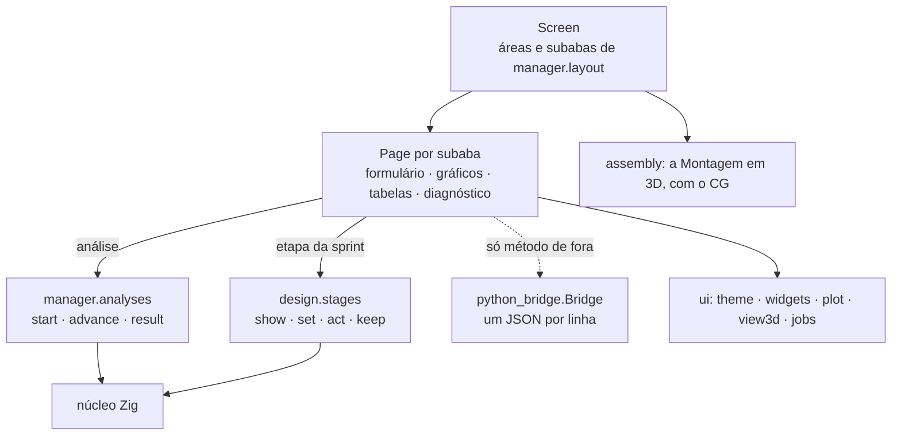
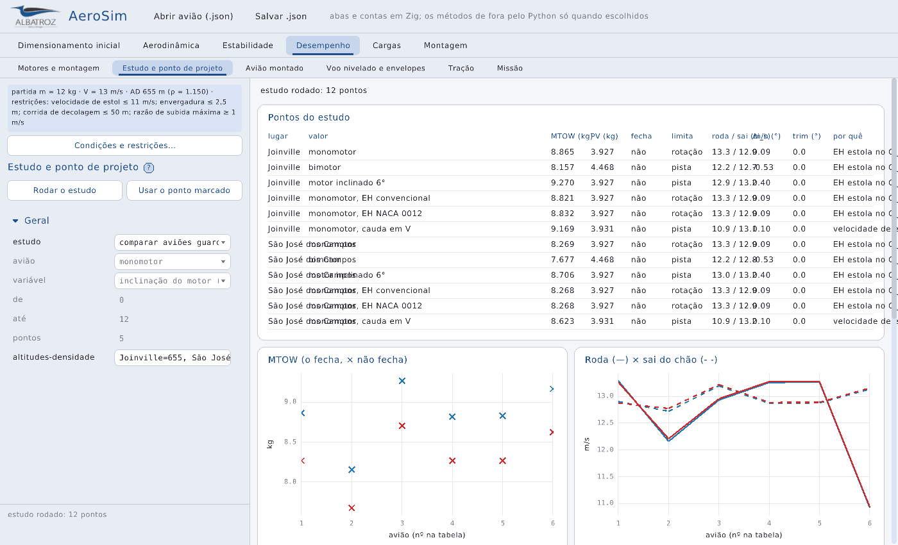
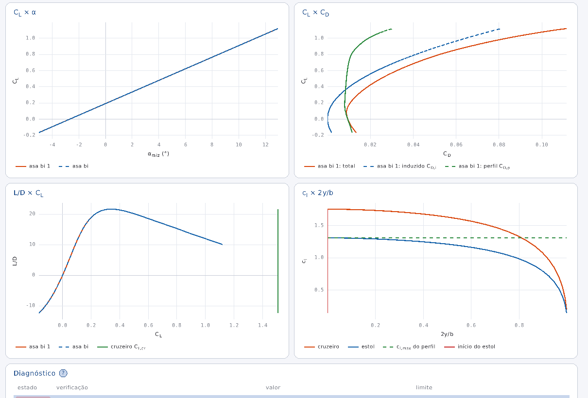

# A interface do aerosim em Zig

Esta é a interface do aerosim escrita em Zig, com raylib e raygui, no visual do AeroDrive: fundo claro, cantos
arredondados, azul nos títulos e a logo do albatroz. É a cópia da GUI em PyQt numa tela que também roda no navegador,
com as mesmas áreas e subabas, os mesmos campos, gráficos e diagnósticos, e a Montagem feita aqui mesmo (o avião
aberto em 3D, com o CG). A tela não faz conta: as abas vêm do registro em Zig (`manager.layout`), cada análise
chama o núcleo direto e as etapas da sprint (Perfis, Projetar, Empenagem e comandos, Motores e montagem, Estudo e
ponto de projeto) e o Mini-MDO também rodam em Zig, então a janela abre e trabalha sem o Python. O Python só entra
quando se marca um método de fora do núcleo (lltdrek, AeroSandbox, AVL, NeuralFoil): aí a página manda aquela
rodada pela ponte, e no site o pacote dele só é baixado nessa hora. As peças comuns (`ui/`: cores, widgets,
formulário, gráfico com títulos em TeX, vista 3D) são as mesmas do aeroopt.



Cada subaba é uma etapa da sprint (`stage`) ou uma análise (`sim`), e a tela desenha cada uma a partir do que ela
descreve: campos, botões, gráficos, tabelas e diagnóstico. Da raiz, `python -m ziglang build aerosim` compila e abre
(precisa do Zig 0.16 e das mesmas dependências do AeroDrive); dentro de `aerosim/`, `python -m ziglang build test`
roda os testes sem janela. O print sem tela abre o avião, vai à aba e, se pedido, roda a análise ou aperta um botão
da etapa antes de gravar a imagem:

```sh
xvfb-run -a ./aerosim/zig-out/bin/aerosim --shot estudo.png data/aircraft/Convencional_original.json 1400x850 aba=9 acao=etapa:run
```



A janela abre vazia: nenhum avião e um projeto da sprint novo, numa pasta própria, gravado na primeira mudança;
"Abrir" traz um avião ou um projeto que já existe. O Ctrl+Z desfaz a última mudança do que está na tela: na Montagem,
o avião volta ao texto de antes (`ui/undo.zig`); numa etapa, o projeto volta ao de antes do último pedido; numa
análise, o formulário volta aos valores de antes. Quando uma rodada sai do que o método calcula bem (a linha
sustentadora numa asa de alongamento menor que 4, `aerosim/manager/alerts.zig`), um aviso aparece por cima da janela
(`ui/toast.zig`) e a conta roda igual. Em Projetar, a linha da tabela "Asas do avião" com o nome do rascunho mostra a
asa que se está criando, ao vivo, e a vista aproxima do dispositivo de ponta que se cria ou edita.

Para o navegador, `python -m ziglang build -Dtarget=wasm32-emscripten --release=safe` e `python tools/web_build.py`
montam o site, onde os arquivos ficam na memória da página e o que se salva é baixado. Uma análise nova é um `.zig`
ao lado da análise em Python, posto no registro de `aerosim/manager/manager.zig`, e aparece na área dela.

Os gráficos da subaba Projetar, com os títulos em TeX desenhados pela própria tela:


