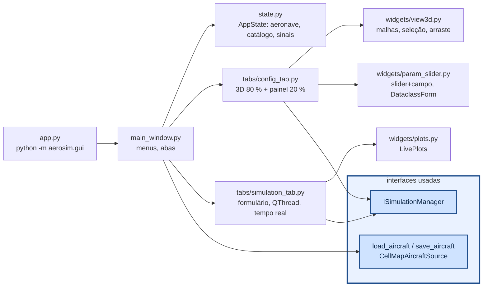

# aerosim/gui — interface gráfica (PyQt6 + pyqtgraph)

Só conhece `ISimulationManager` (para rodar) e as fontes de dados (para abrir/salvar). Cada aba de
simulação é gerada pelo que a simulação declara em `parameters()` e `plots()`.

- **Configuração:** `AircraftView` desenha as malhas de `model/geometry.py` (eixos do corpo → tela:
  `(x, −y, −z)`), projeta a âncora de cada componente para escolher o mais próximo do clique e move no
  plano da câmera (ou travado em x, y, z). O painel usa `DataclassForm`, que gera slider + campo para
  cada número de uma dataclass (faixas em `RANGES`). O resumo (massa, CG, ponto neutro, margem) é
  recalculado 300 ms depois da última edição.
- **Tração:** em cada motor, "motor + hélice" (catálogo) ou "polinômio de tração" (conjuntos do
  catálogo, vindos da aba `Tracao`); os 21 coeficientes são editáveis numa tabela.
- **Simulações:** `SimulationTab` roda `manager.run` numa `QThread`; cada fatia do registro chega por
  sinal e é desenhada a ~15 Hz; ao terminar mostra o resumo e as séries; "Exportar CSV" grava tudo.
- Sem tela (servidor, CI): `QT_QPA_PLATFORM=offscreen` (o 3D não desenha, o resto funciona).
