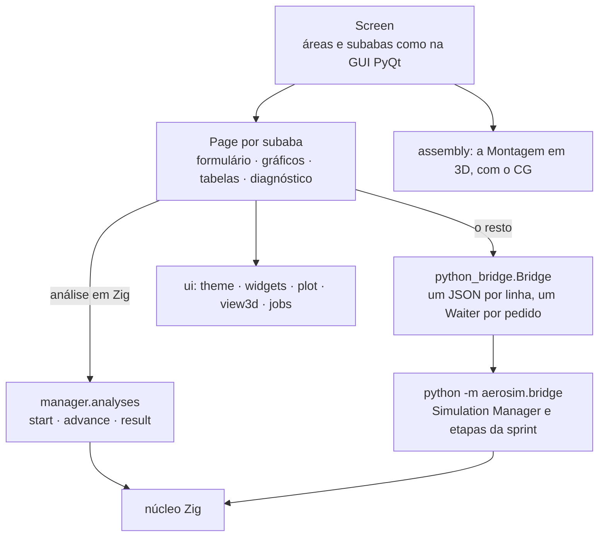
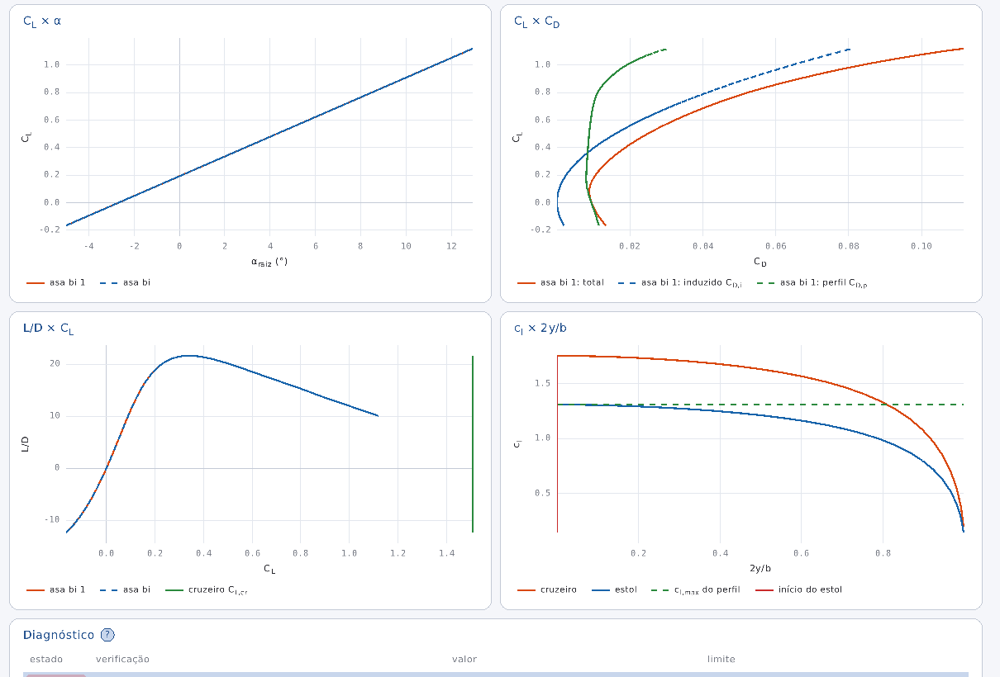

# A interface do aerosim em Zig

Esta é a interface do aerosim escrita em Zig, com raylib e raygui, no visual do AeroDrive: fundo claro, cantos
arredondados, azul nos títulos e a logo do albatroz. É a cópia da GUI em PyQt numa tela que também roda no navegador,
com as mesmas áreas e subabas, os mesmos campos, gráficos e diagnósticos, e a Montagem feita aqui mesmo (o avião
aberto em 3D, com o CG). A tela não faz conta: hoje ela pede aos managers em Python, que chamam o núcleo, e as
análises já passadas para Zig ela chama direto. O caminho é trocar o Python aos poucos até ficar raylib → interface
em Zig → núcleo em Zig. As peças comuns (`ui/`: cores, widgets, formulário, gráfico com títulos em TeX, vista 3D) são
as mesmas do aeroopt.



A ponte é um processo filho: a tela manda um pedido JSON por linha e recebe a resposta pela saída padrão, cada pedido
com um número, para que uma rodada longa numa aba não segure as outras. As abas que a tela monta vêm do primeiro
pedido:

```sh
echo '{"id": 1, "op": "layout"}' | python -m aerosim.bridge
```

```
{"id": 0, "ok": true, "ready": true}
{"id": 1, "ok": true, "areas": [{"title": "Dimensionamento inicial", "single": false, "tabs": [{"title": "Mini-MDO (otimizador)", "kind": "todo", "name": ""}, {"title": "Diagrama de restrições", "kind": "sim", "name": "sizing"}]}, {"title": "Aerodinâmica", "single": false, "tabs": [{"title": "Perfis", "kind": "stage", "name": "perfis"}, {"title": "Projetar", "kind": "stage", "name": "asa"}, {"title": "Analisar", "kind": "sim", "name": "wings"}]}, ...
```

Cada subaba é uma etapa da sprint (`stage`), uma análise (`sim`) ou ainda por fazer (`todo`), e a tela desenha cada
uma a partir do que o Python descreve. Da raiz, `python -m ziglang build aerosim` compila e abre (precisa do Zig 0.16
e das mesmas dependências do AeroDrive); dentro de `aerosim/`, `python -m ziglang build test` roda os testes sem
janela e `xvfb-run -a python -m ziglang build shot -- aerosim.png aba=2` tira um print sem tela. Para o navegador,
`python -m ziglang build -Dtarget=wasm32-emscripten --release=safe` e `python tools/web_build.py` montam o site, onde
os arquivos ficam na memória da página e o que se salva é baixado. Uma análise nova não pede nada aqui: basta a
`ISimulation` em Python, e ela aparece na área dela.

Os gráficos da subaba Projetar, com os títulos em TeX desenhados pela própria tela:


