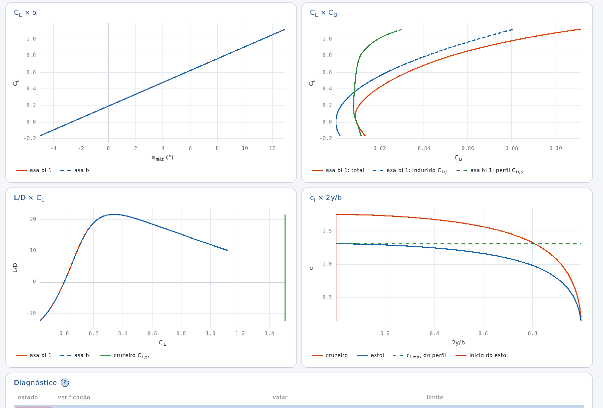
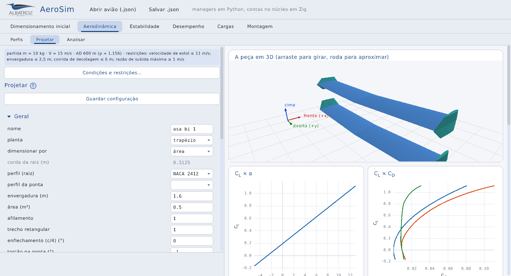
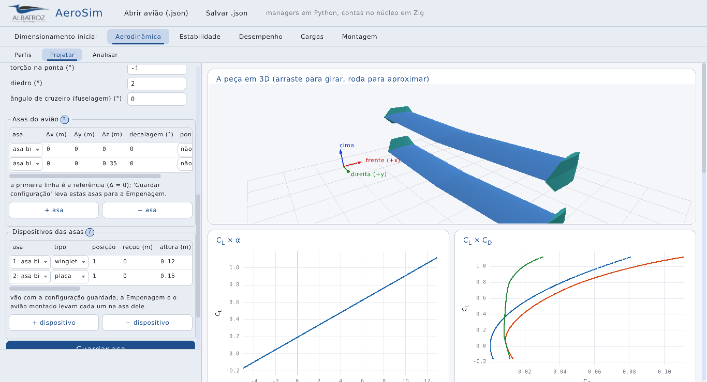
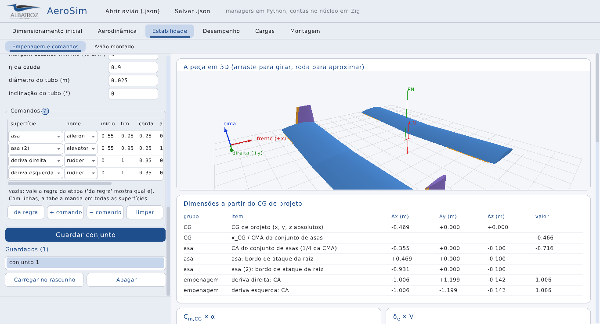

# A interface do aerosim em Zig

Esta é a interface do aerosim escrita em Zig, com raylib e raygui, no visual do AeroDrive: fundo claro, cantos
arredondados, azul nos títulos e a logo do albatroz. Ela é a cópia da GUI em PyQt numa tela que também roda no
navegador: as mesmas áreas e subabas, os mesmos campos, gráficos e diagnósticos. A tela não faz conta nenhuma. Quem
calcula são os managers em Python que a GUI PyQt já usa (o Simulation Manager, as etapas da sprint, o lltdrek, o
AeroSandbox), e eles chamam o núcleo em Zig. É o caminho escolhido para a interface: hoje raylib → managers em Python
→ núcleo Zig; depois, raylib → interface em Zig → núcleo Zig, trocando o Python aos poucos. A interface do aeroopt
fica em `aeroopt/` (junto do Python dele) e usa as peças comuns daqui.

A pasta se divide em quatro partes. Em `ui/` ficam as peças de qualquer tela, as mesmas do aerosim e do aeroopt: as
cores e as fontes, os widgets, o formulário lateral, o gráfico, a vista 3D e o laço do programa. A ponte com o Python
fica em `python_bridge.zig`, e do outro lado dela está `aerosim/bridge.py`. Cada subaba é uma página
(`page.zig`), desenhada a partir do que o Python descreve. A tela (`screen.zig`) monta as áreas e as subabas na
arrumação da GUI PyQt e guarda a Montagem, que é feita aqui mesmo (`assembly.zig`): o avião aberto em 3D, com o CG.
Os arquivos Zig ficam junto dos arquivos Python da interface em PyQt, e o build é o `aerosim/build.zig`.

## As peças (`ui/`)

Aqui se define a aparência e o comportamento comum. `theme.zig` guarda as cores, cada uma com um papel (fundo,
painel, cartão, borda, texto, o azul dos títulos e a paleta de dez cores das curvas), as mesmas do AeroDrive. Lá
também ficam as três fontes (texto, títulos e números, procuradas no sistema) e a logo. Os widgets
(`widgets.zig`) são os do AeroDrive em versão de tela grande: a aba ativa em azul claro com um traço embaixo, o
botão azul, o cartão branco de cantos arredondados e a barra de progresso.

O formulário (`form.zig`) recebe uma lista de campos, cada um com rótulo, unidade, grupo, tipo (número, marcador ou
escolha) e limites, que é o equivalente do `ParamSpec` do aerosim em Python. O mesmo código desenha o formulário de
qualquer tela, com os grupos que abrem e fecham no clique e a rolagem pela roda do mouse. A edição dos números e a
lista aberta das escolhas são do raygui, com o estilo ajustado às cores do tema.

O gráfico (`plot.zig`) faz curvas e nuvens de pontos dentro de um cartão, com marcas de eixo "redondas" (passos de
1, 2 ou 5 vezes uma potência de dez), grade, a legenda embaixo e a barra de cores na nuvem. As contas dos eixos e
dos números ficam em `numbers.zig`, que não abre janela e por isso tem teste.

Todo gráfico de linhas se comporta igual, em qualquer tela, sem que a aba precise fazer nada. Um clique num nome
da legenda liga ou desliga aquela curva: a desligada fica riscada na legenda e sai dos eixos. O botão direito no
cartão abre um menu com as curvas para marcar e três saídas: a imagem em PNG, a mesma imagem num PDF de uma página
(as duas desenhadas de novo em escala 2, para sair nítidas impressas) e os dados das curvas marcadas em CSV. O CSV
é o padrão, com vírgula entre colunas, ponto decimal, uma linha de cabeçalho com o nome da curva e do eixo e os
números com todas as casas, então abre direto numa planilha ou no pandas. As tabelas de números (`plot.table`)
têm o mesmo menu: o botão direito grava a tabela em CSV, com uma grandeza por linha e o número inteiro, não o
arredondado da tela. A gravação (CSV, PDF com a imagem comprimida) fica em `export.zig`, que tem teste.

Os textos dos gráficos (título, eixos e legenda) aceitam um pedaço de TeX, desenhado por `tex.zig`: o que fica
entre `$...$` vira matemática, com índice (`C_L`, `C_{m,CG}`), expoente, letras gregas e operadores com espaço dos
dois lados (`\times`, `=`). Sem isso, um título precisava de uma frase inteira para dizer o que se plota, e a frase
não cabia no cartão. Com o TeX, o título diz só a grandeza ($C_L \times \alpha$) e a legenda explica cada curva
(cruzeiro, estol, fim do curso). As retas de referência que o Python manda (`_vline`, `_hline`) também entram na
legenda com o nome delas. Não é o TeX inteiro, só o que um rótulo precisa.



Abrir e salvar arquivo usam a janela do próprio sistema (`native_dialog.zig`): o `zenity` ou o `kdialog` no Linux,
o PowerShell no Windows, o `osascript` no macOS. Ela já conhece os favoritos, as pastas recentes e os discos, e o
programa não liga em nenhuma biblioteca a mais, porque só chama o que o sistema tem. A janela roda numa thread, e a
tela fica escurecida enquanto ela está aberta. Sem nenhum desses programas, no navegador ou no print, entra o
seletor desenhado aqui.

As janelas por cima da tela ficam em `dialogs.zig`: o seletor de arquivo, que navega pelas pastas e mostra só as
extensões pedidas (a pasta se digita no campo de cima, com `~` para a pessoal, ou se escolhe pelos atalhos
Exemplos, Pasta pessoal, Pasta atual e Raiz), para abrir (um clique no arquivo) ou para salvar (com o nome digitado), e a pergunta de um texto
curto. Enquanto uma delas está aberta, a tela de baixo não recebe o clique nem a roda. "Abrir avião" e "Salvar
.json" do cabeçalho, os botões de Perfis e os menus que vierem usam as mesmas; salvar, por enquanto, grava o avião
como foi lido, porque a edição ainda não existe.

Tudo o que pode passar da altura da janela rola pela área de `scroll.zig`: a roda do mouse ou a barra fina da
direita, que dá para arrastar. Ela abre um recorte (`Ui.pushClip`), e o que ficou fora dele nem aparece nem recebe o
clique; sem isso, um campo que rolou para baixo das abas pegava o clique dela. Uma área dentro de outra (a lista de
candidatos dentro da barra lateral de Perfis) rola primeiro, e a de fora fica com a roda que sobrou. A barra lateral
inteira rola junto e só o rodapé ("Rodar" e a mensagem) fica parado. As caixas de marcar e as setas
são desenhadas com linhas e triângulos, sem depender de a fonte do sistema ter o "✓" ou o "▸", e o Esc fecha a
janela de cima (seletor, pergunta) em vez de fechar o programa.

A divisa entre o formulário e os resultados se arrasta (`widgets.Splitter`), e a largura vale para todas as abas.
Ao entrar num campo de número, o valor fica todo marcado e a primeira tecla troca ele inteiro
(`widgets.replaceOnType`): sem isso, digitar 0.2 num campo com −1 dava −10.2. Nenhum texto fica escondido sob outro.
O rótulo de um campo que não cabe diminui a letra um pouco e, se nem assim couber, mostra o texto inteiro na dica.
Numa tabela, cada coluna fica no mínimo do tamanho do título, do maior número e da opção escolhida, e quando não
cabem todas a tabela rola para o lado, com Shift e a roda ou arrastando a barra embaixo dela.





A tela não faz conta: o que demora (os pedidos ao Python, a leitura do `.json` e a montagem das peças) roda
numa thread pela `Job` de `jobs.zig`, e a tela continua desenhando e respondendo ao mouse enquanto isso, com a
mensagem "pedindo ao Python..." no lugar do resultado. Quando a thread acaba, a tela pega o resultado no quadro
seguinte e troca de uma vez; a resposta chega numa memória nova, e a antiga só se solta depois da troca, para que
uma nunca seja lida enquanto a outra é escrita. No print (`--shot`) e na web as contas rodam na hora, sem
thread, para a foto já sair com o resultado.

As peças de escolha que as abas repetem ficam em `menus.zig`: a lista de itens com um selecionado (`ItemList`), a
grade de botões de ação embaixo dela (`buttonGrid`) e o menu de marcar (`CheckMenu`), um botão que abre caixas de
marcar para escolher um ou mais itens, como os métodos de polar de Perfis. O menu funciona em dois tempos porque
cobre o que está embaixo dele: `update` antes dos widgets de baixo fica com o clique, e `draw` depois deles desenha.

A vista 3D (`view3d.zig`) segue as ideias da vista do aerosim em Python, mas desenhada aqui, com o raylib: cada
peça na cor do tipo dela (asa azul, profundor verde, leme roxo, comando laranja), sombreada dos dois lados por uma
luz fixa, as arestas das faixas, o chão quadriculado, os eixos do corpo (frente em vermelho, direita em verde, cima
em azul) e os vetores de carga, com a maior seta valendo 18 % do tamanho do avião, como na vista de cargas em
Python. O 3D é desenhado numa textura do tamanho do cartão; arrastar gira e a roda aproxima.

## A ponte com o Python (`python_bridge.zig`)

Aqui se conversa com os managers. A tela abre `python -m aerosim.bridge` como processo filho, na pasta do
repositório, e manda uma mensagem JSON por linha na entrada dele; as respostas voltam pela saída padrão, também uma
por linha. Os pedidos estão descritos no começo de `aerosim/bridge.py`: as abas ("layout"), os campos e os gráficos
de uma análise ("specs"), rodar e parar ("run", "cancel"), e as etapas da sprint ("stage").

Um processo só serve todas as abas. O problema que isso traz é que uma rodada longa (a Missão, por exemplo) não pode
segurar a tela de outra aba que pediu só os campos. Por isso cada pedido leva um número, o Python responde cada um
na sua thread, e uma thread daqui lê as respostas e entrega cada uma a quem pediu (o `Waiter` daquela página). Quem
pede está numa `Job` de `ui/jobs.zig`, fora do laço da tela, e espera ali. As linhas de progresso que chegam antes
da resposta vão para o mesmo `Waiter`, e a barra da página mostra.

No navegador ainda não há ponte: lá ela vai ser o Pyodide num web worker, com as mesmas mensagens. Até lá, a versão
web abre só a Montagem.

## As páginas (`page.zig`)

Aqui se desenha qualquer subaba, sem conhecer a análise. Uma página é de um destes tipos, os mesmos da GUI PyQt:

- análise: uma `ISimulation` do manager, como a `SimulationTab`. O formulário sai dos `ParamSpec`; mudar um campo
  que refaz o formulário (como "asas de" em Analisar) pede os campos de novo, guardando os valores que já existiam.
  Rodar manda os valores, e a resposta traz o resumo, o diagnóstico e as curvas já separadas por gráfico;
- etapa: uma etapa da sprint, como a `StagePage` (Perfis, Projetar, Empenagem e comandos, Motores e montagem). O
  rascunho vira formulário pelos mesmos metadados que o `DataclassForm` lê (`aerosim/manager/forms.py`). Cada
  mudança refaz a conta depois que a digitação para, como na GUI PyQt, e embaixo ficam Guardar e a lista dos
  guardados (em Perfis, a dos candidatos). Os botões da etapa ("+ NACA…", "+ .dat…", "Mandar para a Montagem")
  pedem o texto ou o arquivo antes, quando precisam. "Condições e restrições…" abre a etapa das condições e das
  regras numa janela por cima; ao fechar, as etapas refazem a conta;
- ainda sem ponte: o Mini-MDO e o Estudo e ponto de projeto, que só mostram o lugar deles.

A página desenha campos de número, marcador, escolha, texto, arquivo (abre o seletor) e lista de números, gráficos
2D, tabelas de texto (as massas e as dimensões de Motores, por exemplo) e tabelas editáveis, como as partições da
asa: cada célula editada, linha nova ou apagada vira um pedido de etapa "grid", e o Python devolve a tabela refeita.
Em Projetar, a tabela "Asas do avião" diz onde fica cada asa em relação à primeira, e "Guardar configuração"
leva essa tabela com um nome para a Empenagem. Logo abaixo, a tabela "Dispositivos das asas" prende cada
dispositivo (winglet, placa, cerca) a uma asa. Na Empenagem, a tabela "Comandos" diz qual superfície de qual asa
comanda arfagem, rolagem e guinada, e "da regra" escreve ali a regra da etapa. Assim nenhuma configuração ganha
campos só dela.



Uma etapa que traz a peça (Projetar, Empenagem, Motores) mostra a vista 3D em cima, com as malhas de
`aerosim.model.geometry` e os marcadores do ponto neutro e do CG. Uma análise de carga (`loads3d`) mostra a malha do
método com o mapa de cores por face, as setas e a escala, que se trocam por botões, como na `LoadView` da GUI PyQt.
Os gráficos de trajetória em 3D e as tabelas de entrada da Missão ainda ficam só na GUI PyQt, e a página diz quantos
ficaram de fora. Trocar de página pede ela de novo, porque outra página pode ter mudado o
projeto (uma asa guardada aparece na Empenagem).

## A tela (`screen.zig`)

O cabeçalho tem os botões de abrir e salvar o avião. Embaixo vêm as áreas e as subabas, que chegam do Python na
mesma ordem da GUI PyQt (`aerosim/gui/main_window.py`): Dimensionamento inicial, Aerodinâmica (Perfis, Projetar,
Analisar), Estabilidade, Desempenho (com Tração e Missão dentro), Cargas e, no fim, a Montagem. Enquanto o Python não
responde, a tela mostra o aviso e a Montagem já funciona.

A Montagem mostra o avião inteiro em 3D: abre sozinha o avião de exemplo de `data/aircraft`, e outro `.json` entra
pela linha de comando, pelo botão do cabeçalho ou arrastado para a janela. A leitura e as peças são as do AeroDrive
(`aerodrive/src/model`, pelo `aerodrive/src/aircraft_model.zig`), as mesmas formas e cores da GUI em Python; o
`assembly.zig` só completa os perfis que o arquivo aponta num `.dat` e passa cada triângulo para a vista 3D. A
Montagem marca também o CG, numa cruz vermelha com a posição em x e a massa: é a soma das massas do arquivo pela
mesma função do AeroDrive (`params.dryMass`), mais a carga como massa pontual; quando a carga muda o CG, o CG vazio
aparece em cinza. A posição das peças ainda não se edita aqui. O avião aberto vai também para o Python, que abre o
mesmo arquivo antes do próximo pedido; um `.dat` ou uma polar arrastados vão para a etapa Perfis.

## Como chamar

Precisa do Zig 0.16 (`pip install ziglang`) e, no Linux, dos cabeçalhos do sistema de janelas listados no
`CLAUDE.md` para o AeroDrive. O raylib-zig é o mesmo do AeroDrive. Sem acesso ao `zig fetch`, dá para copiar a
pasta `aerodrive/zig-pkg` para cá.

Da raiz do repositório, `python -m ziglang build aerosim` compila e abre (e `aeroopt`, `aerodrive` fazem o mesmo
com os outros programas; `build test` roda todos os testes). Dentro da pasta:

```sh
cd aerosim
python -m ziglang build test                                  # testes sem janela
python -m ziglang build run                                   # abre o aerosim
xvfb-run -a python -m ziglang build shot -- aerosim.png       # print sem tela
xvfb-run -a python -m ziglang build shot -- perfis.png aba=2   # print de outra subaba (contadas em ordem; a Montagem é a última)
xvfb-run -a python -m ziglang build shot -- analisar.png ../data/aircraft/Asa_voadora.json aba=4 acao=rodar   # rodada
xvfb-run -a python -m ziglang build shot -- condicoes.png aba=3 acao=condicoes   # a janela "Condições e restrições…"
python -m ziglang build run -- ../data/aircraft/Asa_voadora.json   # abre um avião
```

### No navegador

O mesmo programa compila para a web com o emscripten, como o AeroDrive. `python -m ziglang build
-Dtarget=wasm32-emscripten --release=safe` (aqui ou em `aeroopt/`) gera `zig-out/web/<programa>.html`, `.js`,
`.wasm` e `.data`, e `python tools/web_build.py` junta os três programas com a tela inicial em `zig-out/site`
(`python -m http.server -d zig-out/site 8000` e abrir `http://localhost:8000`).

O que muda fica em `ui/system.zig`. No navegador não há pastas do disco nem threads. Os arquivos ficam na memória da
página: o `.data` leva as fontes e as pastas `data/aircraft` e `data/airfoils` (só lidas), o botão "abrir do
computador" (ou arrastar o arquivo para a página) põe o arquivo em `/entrada` e a tela abre como abriria pela linha
de comando, e o que se salva a página baixa. A `Io` dos arquivos é a de `ui/browser_io.zig`, porque a do Zig não
compila para emscripten. As contas longas rodam na hora, no mesmo quadro, e a tela fica parada até acabar. A página
é `web/shell.html`, a mesma para o aerosim e o aeroopt.

O projeto da sprint fica na mesma pasta da GUI PyQt (`~/aerosim_aeronaves/sprint`, ou a de `AEROSIM_SPRINT`), então
as duas interfaces enxergam as mesmas asas e conjuntos guardados.

Uma análise nova não pede nada aqui: basta a `ISimulation` em Python, e ela aparece na área dela. Uma etapa nova é uma
classe em `aerosim/manager/stages.py` (o rascunho, as escolhas, a conta e o guardar), com o lugar dela em `PLACES`.
Um tipo de campo ou de gráfico novo é que pede código em `page.zig`.
