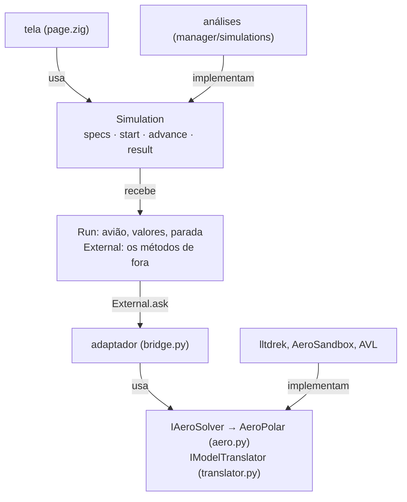

# aerosim/interfaces — contratos entre as camadas

Esta pasta guarda os contratos entre as partes do aerosim. O principal é o das análises (`simulation.zig`): o que a
tela pode pedir a uma análise (os campos e os gráficos para um avião, começar, avançar um pedaço, o resultado em JSON)
e o que uma análise recebe (o avião, os valores do formulário e, quando precisa, os métodos de fora do núcleo). A tela
fala só com esse contrato, nunca com o núcleo, e uma análise nova entra implementando-o, sem a tela mudar. Os outros
dois arquivos, em Python, são os contratos do adaptador dos métodos de fora (`../bridge.py`): o que um método
aerodinâmico de fora devolve (`aero.py`, a polar e as derivadas) e como o avião é traduzido para o formato dele
(`translator.py`).



Todas as camadas seguem as mesmas convenções: SI e radianos no código, eixos do corpo com x à frente e z para baixo,
$`C_l`$ e $`C_n`$ por $`S\,b`$, $`C_m`$ por $`S\,c`$, e as taxas adimensionais $`\hat p, \hat q, \hat r`$. Quem
implementa cada contrato hoje:

```zig
const std = @import("std");
const manager = @import("manager");

pub fn main() !void {
    for (&manager.all) |*analysis| { // cada uma é um `simulation.Simulation`, montado por `simulation.register`
        std.debug.print("{s}: {s} → {s}\n", .{ analysis.name, analysis.area, analysis.title });
    }
}
```

```
mdo: Dimensionamento inicial → Mini-MDO (otimizador)
sizing: Dimensionamento inicial → Diagrama de restrições
wings: Aerodinâmica → Analisar
loads: Cargas → Cargas
stability: Estabilidade → Estabilidade
estabilidade_dinamica: Estabilidade → Estabilidade dinâmica
thrust: Desempenho → Tração
envelope: Desempenho → Voo nivelado e envelopes
mission: Desempenho → Missão
```

São as nove análises da tela, cada uma na aba dela (`exemplo.zig`, `python -m ziglang build exemplo
-Dexemplo=interfaces` de dentro de `aerosim/`). `simulation.register` confere em comptime que a análise tem tudo o que
o contrato pede. Um método de fora pedido numa máquina sem a biblioteca dele volta como indisponível, com o motivo, e o
resto da rodada segue igual.

É por isso que a mesma aba compara os métodos do núcleo com os de fora, e que um método novo entra sem a tela perceber.
