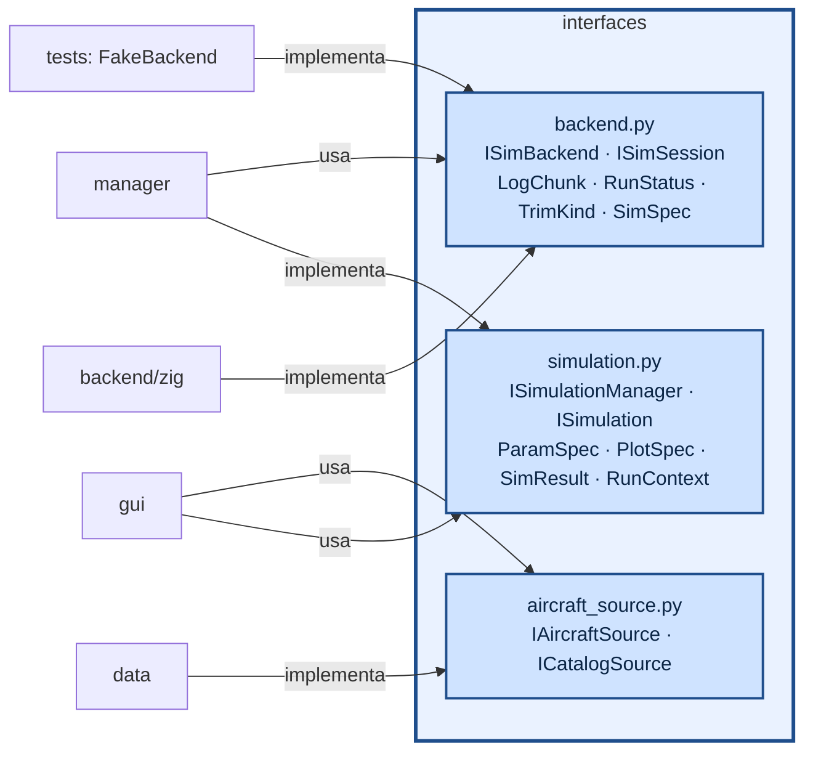

# aerosim/interfaces — contratos entre as camadas

Só classes abstratas e tipos de dados; nenhuma implementação. Quem usa uma camada depende daqui, nunca
do módulo concreto.

| interface | métodos principais |
|---|---|
| `ISimBackend` | `open_session()`, `limits()`, `log_channels()` |
| `ISimSession` | `configure(spec)`, `reset_ground()`, `reset_air(seg)`, `run(t_limit, max_rows)`, `events()`, `snapshot()`/`restore()`, `trim()`, `performance()`, `aero_coeffs()`, `aero_coeffs_ex()` (rotação e ponto de referência), `linearize(V)` (A, B), `prop_point()`, `mass_props()` |
| `IModelTranslator` (`translator.py`) | `to_native(modelo universal)` → formato do solver; `from_native(resultado)` → coeficientes universais (eixos do corpo, C_l/C_n por S b, C_m por S c, taxas p̂ q̂ r̂) |
| `ISimBackend.translator`, `session_for(modelo)` | todo núcleo tem um tradutor; a sessão já vem configurada a partir do modelo universal |
| `IAeroSolver` (`aero.py`) | `available()`, `evaluate(modelo, caso, [FlightPoint])` → coeficientes universais; `solve(modelo, caso)` → `AeroPolar` (polar e derivadas pelo código comum `aero/base.py`) |
| `ISimulation` | `parameters_for(aeronave)` → campos da aba, `plots_for(aeronave)` → gráficos (dependem da configuração; a GUI refaz a aba quando ela muda), `run(ctx)` → `SimResult` (registro, tabelas, resumo e `checks`: diagnóstico com estado, valor, critério, causa e correção) |
| `ISimulationManager` | `simulations()`, `get(nome)`, `run(nome, aeronave, params, on_chunk, on_progress, cancel)` |
| `IAircraftSource` / `ICatalogSource` | `load(path)` / `save(obj, path)` |

`SimSpec` é um dicionário aninhado em SI/radianos com os nomes dos campos do núcleo; quem o monta é
`aerosim/backend/zig/translator.py` (o tradutor do núcleo Zig, a partir do modelo universal).
