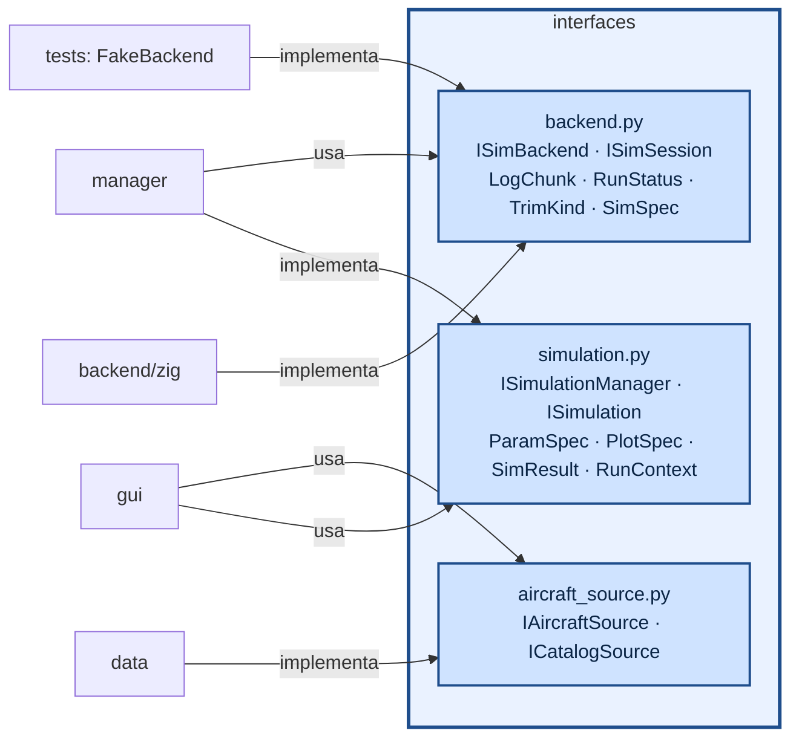

# aerosim/interfaces — contratos entre as camadas

Só classes abstratas e tipos de dados; nenhuma implementação. Quem usa uma camada depende daqui, nunca
do módulo concreto.

| interface | métodos principais |
|---|---|
| `ISimBackend` | `open_session()`, `limits()`, `log_channels()` |
| `ISimSession` | `configure(spec)`, `reset_ground()`, `reset_air(seg)`, `run(t_limit, max_rows)`, `events()`, `snapshot()`/`restore()`, `trim()`, `performance()`, `aero_coeffs()`, `prop_point()`, `mass_props()` |
| `ISimulation` | `parameters()` → campos da aba, `plots()` → gráficos, `run(ctx)` → `SimResult` |
| `ISimulationManager` | `simulations()`, `get(nome)`, `run(nome, aeronave, params, on_chunk, on_progress, cancel)` |
| `IAircraftSource` / `ICatalogSource` | `load(path)` / `save(obj, path)` |

`SimSpec` é um dicionário aninhado em SI/radianos com os nomes dos campos do núcleo; quem o monta é
`aerosim/model/compile.py`.
