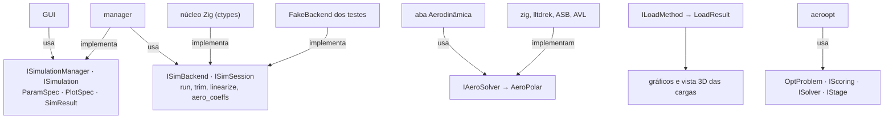

# aerosim/interfaces — contratos entre as camadas

Esta pasta guarda os contratos entre as partes do projeto: o que a GUI pode pedir ao gerenciador de simulações, o que
o gerenciador pode pedir ao núcleo, o que um método aerodinâmico tem de devolver, como uma análise de cargas entrega o
resultado e o que o aeroopt espera de uma nota ou de um solver. São só classes abstratas e tipos de dados, sem
implementação. Cada camada depende de um contrato, e não de um módulo concreto: a GUI fala com o
`ISimulationManager`, nunca com o núcleo; o gerenciador fala com o `ISimBackend`, nunca com o ctypes; a aba
Aerodinâmica fala com o `IAeroSolver`, sem saber se por trás está o lltdrek ou o AVL. Um método novo entra
implementando o contrato, e quem consome não muda. O mesmo contrato das análises existe em Zig (`simulation.zig`),
para a tela em Zig chamar as análises sem Python.



Todas as camadas seguem as mesmas convenções: SI e radianos no código, eixos do corpo com x à frente e z para baixo,
$`C_l`$ e $`C_n`$ por $`S\,b`$, $`C_m`$ por $`S\,c`$, e as taxas adimensionais $`\hat p, \hat q, \hat r`$. Quem
implementa cada contrato hoje:

```python
from aerosim.interfaces.simulation import ISimulationManager
from aerosim.interfaces.aero import IAeroSolver
from aerosim.manager import SimulationManager
from aerosim.aero import all_solvers
from aerosim.backend.zig import ZigBackend

m: ISimulationManager = SimulationManager()
print([s.name for s in m.simulations()])
print([(s.name, s.available() is None) for s in all_solvers(ZigBackend()) if isinstance(s, IAeroSolver)])
```

```
['sizing', 'mission', 'performance', 'thrust', 'wings', 'stability', 'loads', 'envelope']
[('zig', True), ('lltdrek', False), ('asb_vlm', False), ('asb_buildup', False), ('asb_ll', False), ('avl', True), ('zig_llt', True), ('zig_llt_gh', True)]
```

As oito análises registradas são as abas da GUI, e os métodos com `False` estão registrados mas não instalados nesta
máquina (o lltdrek e o AeroSandbox são opcionais). A aba mostra esses como indisponíveis, com o motivo, e o resto roda
igual. Um núcleo novo implementa `ISimBackend` e `ISimSession`; um método aerodinâmico novo implementa `evaluate` do
`IAeroSolver`; um método de carga novo devolve um `LoadResult`. Os gráficos e a vista 3D leem esse resultado sem saber
quem o produziu.

É por isso que dá para trocar o núcleo nos testes por um falso, comparar sete métodos na mesma aba e começar a passar
as análises para Zig uma a uma sem a GUI perceber. `tests/test_architecture.py` confere que ninguém pula um contrato.
