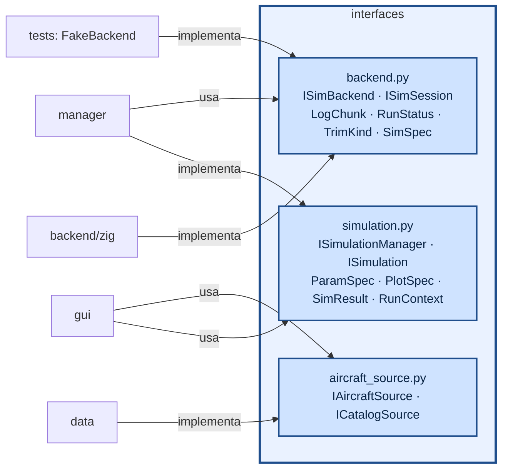

# aerosim/interfaces — contratos entre as camadas

Esta pasta guarda os contratos entre as partes do projeto: o que a GUI pode pedir ao gerenciador de simulações, o que
o gerenciador pode pedir ao núcleo, o que um método aerodinâmico tem de devolver, como uma análise de cargas entrega o
resultado. São só classes abstratas e tipos de dados, sem nenhuma implementação.

Ela existe para que cada camada dependa de um contrato, e não de um módulo concreto. A GUI fala com o
`ISimulationManager`, nunca com o núcleo; o gerenciador fala com o `ISimBackend`, nunca com o ctypes; a aba
Aerodinâmica fala com o `IAeroSolver`, sem saber se por trás está o lltdrek ou o AVL. Um método novo entra
implementando o contrato, e quem consome não muda.

O README mostra primeiro como os contratos se ligam e o que cada arquivo define. Depois vêm as convenções que todas
as camadas seguem (eixos, unidades, coeficientes) e, no fim, um exemplo por arquivo e como chamar.

## Como funciona



| interface | métodos principais |
|---|---|
| `ISimBackend` | `open_session()`, `limits()`, `log_channels()`; contas rápidas da sprint sem sessão: `simple_performance(cfg)`, `motor_prop_thrust(spec, V, rho)` (tração motor + hélice com acelerador cheio) |
| `ISimSession` | `configure(spec)`, `reset_ground()`, `reset_air(seg)`, `run(t_limit, max_rows)`, `events()`, `snapshot()`/`restore()`, `trim()`, `performance()`, `aero_coeffs()`, `aero_coeffs_ex()` (rotação e ponto de referência), `linearize(V)` (A, B), `prop_point()`, `mass_props()` |
| `IModelTranslator` (`translator.py`) | `to_native(modelo universal)` → formato do solver; `from_native(resultado)` → coeficientes universais (eixos do corpo, $`C_l`$/C_n por S b, $`C_m`$ por S c, taxas p̂ q̂ r̂) |
| `ISimBackend.translator`, `session_for(modelo)` | todo núcleo tem um tradutor; a sessão já vem configurada a partir do modelo universal |
| `IAeroSolver` (`aero.py`) | `available()`, `evaluate(modelo, caso, [FlightPoint])` → coeficientes universais; `solve(modelo, caso)` → `AeroPolar` (polar e derivadas pelo código comum `aero/base.py`) |
| `LoadResult` (`loads.py`) | entrada padrão das análises de carga: `SpanDistribution` por superfície (valores ao longo da envergadura em metros: carga alar local, sustentação por metro, α efetivo, V local...) para os gráficos (`aero/load_plots.py`), e `SurfaceField` (malha 3D com valores por face, camadas de vetores, tubos da esteira) para a vista 3D (`gui/widgets/load_view.py`). Hoje quem produz é o núcleo por faixas (`aero/span_loads.py`, `to_result`); VLM, painéis ou CFD entram montando o mesmo `LoadResult`. `WingSweep` (mesmo arquivo) é a varredura das asas em α que `ILoadMethod.sweep` entrega (sustentação por superfície, c_l por painel); o padrão faz um `compute` por α, e o núcleo faz tudo numa chamada (`core/src/loads/sweep.zig`). O resumo dela (C_L, C_L máximo, início do estol) é `ISimBackend.wing_sweep_summary` |
| `ISimulation` | `parameters_for(aeronave)` → campos da aba, `plots_for(aeronave)` → gráficos (dependem da configuração; a GUI refaz a aba quando ela muda), `run(ctx)` → `SimResult` (registro, tabelas, resumo e `checks`: diagnóstico com estado, valor, critério, causa e correção) |
| `ISimulationManager` | `simulations()`, `get(nome)`, `run(nome, aeronave, params, on_chunk, on_progress, cancel)` |

| `IAircraftSource` / `ICatalogSource` | `load(path)` / `save(obj, path)` |
| `IProjectStore` (`project_store.py`) | a biblioteca de aviões do usuário: listar, abrir, salvar com um nome |
| `result_io.py` | `SimResult` ⇄ dicionário de JSON (para guardar no projeto o que já rodou) |
| `OptProblem`, `IScoring`, `IEvaluator`, `ISolver`, `IStage`, `IFailureDiagnosis` (`optim.py`) | o aeroopt: o problema (variáveis com `free` para isolar, restrições, nota, solver), a nota com a fonte, o candidato → grandezas no núcleo, quem propõe os candidatos (`run` → `OptResult`) e uma etapa do processo em etapas (`one` por candidato ou `run` no lote, `select` depois da barreira); e o diagnóstico da falha (os códigos dos termos violados → as variáveis que os consertam) |
| `IExecutor`, `Outcome` (`executor.py`) | rodar uma função em muitos itens independentes: `map(fn, itens, cancel, on_done)` → um `Outcome` por item, na ordem (valor, erro ou cancelado); `close()`. Em série, threads ou processos que duram a rodada (`aerosim/parallel`) |

Cada análise diz a área do projeto (`ISimulation.area`, uma de `AREAS`) e o nível: `level = "sprint"`
(conta rápida, para comparar muitas variantes) ou `"detalhado"`; dentro de uma análise sprint,
`detailed` lista os parâmetros que só valem no detalhado (`level_of(p)` responde; `ParamSpec.level`
força um parâmetro). `IAeroSolver.level` faz o mesmo para os métodos de aerodinâmica (AeroSandbox é
detalhado). É só para o código (filtros, otimização, testes) — a GUI não escreve isso.

`SimSpec` é um dicionário aninhado em SI/radianos com os nomes dos campos do núcleo; quem o monta é
`aerosim/backend/zig/translator.py` (o tradutor do núcleo Zig, a partir do modelo universal).

## Convenções que todas as camadas seguem

Todo tradutor devolve os coeficientes no formato universal: eixos do corpo (x à frente, z para baixo), forças por
$`qS`$, momentos de rolamento e guinada por $`qSb`$, de arfagem por $`qSc`$, e as rotações adimensionais. Com
$`q = \tfrac12\rho V^2`$:

```math
C_L = \frac{L}{qS} \qquad C_D = \frac{D}{qS} \qquad C_Y = \frac{Y}{qS}
\qquad
C_l = \frac{\mathcal L}{qSb} \qquad C_m = \frac{M}{qSc} \qquad C_n = \frac{N}{qSb}
```

```math
\hat p = \frac{p\,b}{2V} \qquad \hat q = \frac{q\,c}{2V} \qquad \hat r = \frac{r\,b}{2V}
```

As derivadas (`DERIVATIVES`) são as parciais desses coeficientes: $`C_{L\alpha} = \partial C_L/\partial\alpha`$,
$`C_{mq} = \partial C_m/\partial\hat q`$ e assim por diante. Na carga ao longo da envergadura, a integral de um campo é a
soma ponto a ponto vezes a largura de cada faixa (`SpanDistribution.integral`):

```math
\int f\,ds \approx \sum_k f_k\,\Delta s_k
```

## Um exemplo por arquivo

```python
import numpy as np
from aerosim.interfaces.aero import AeroCase, FlightPoint, DERIVATIVES           # aero.py
from aerosim.interfaces.backend import RunStatus, TrimKind, LogChunk              # backend.py
from aerosim.interfaces.loads import LoadResult, SpanDistribution                 # loads.py
from aerosim.interfaces.simulation import ParamSpec, PlotSpec, Check, SimResult   # simulation.py
from aerosim.interfaces.result_io import result_to_dict, result_from_dict         # result_io.py
from aerosim.interfaces.translator import IModelTranslator, COEFFS                # translator.py
from aerosim.interfaces.aircraft_source import IAircraftSource                    # aircraft_source.py
from aerosim.interfaces.project_store import IProjectStore, ProjectInfo           # project_store.py

caso = AeroCase(V=15.0, alphas=np.arange(0, 10, 2.0))
ponto = FlightPoint(alpha=0.05, q=0.01)
print(RunStatus.CHUNK.can_continue, TrimKind.LEVEL, len(DERIVATIVES), COEFFS)

log = LogChunk({"t": np.linspace(0, 1, 5), "h": np.zeros(5)})
d = SpanDistribution("asa", "wing", False, s=np.linspace(-1, 1, 5), width=np.full(5, 0.4),
                     fields={"L": np.full(5, 10.0)})
print(len(log), d.integral("L"), LoadResult([d]).by_role("wing")[0].surface)

campo = ParamSpec("V", "velocidade", 14.0, unit="m/s", minimum=5, maximum=40)
grafico = PlotSpec("h", "altura", "t", ("h",))
res = SimResult(log=log, summary={"h máx.": 0.0}, checks=[Check("ok", "altura", "0 m", "> 0")])
print(result_from_dict(result_to_dict(res)).summary)

class FonteDeTeste(IAircraftSource):                       # uma fonte nova implementa a interface
    def load(self, path):
        from aerosim.model.templates import conventional
        return conventional()
    def save(self, obj, path):
        pass
print(FonteDeTeste().load("qualquer").name)
```

## Como chamar

Ninguém instancia estas classes: elas dizem o que cada camada precisa ter. Trocar uma camada é
passar outro objeto que cumpra a interface — por exemplo um núcleo falso nos testes:

```python
# não roda sozinho: o esqueleto de um núcleo novo (os "..." são os métodos dele)
from aerosim.interfaces import ISimBackend
from aerosim.manager import SimulationManager

class MeuNucleo(ISimBackend):
    ...                                        # open_session, limits, log_channels, translator
m = SimulationManager(MeuNucleo())             # o manager e a GUI funcionam iguais
```

`tests/manager/test_orchestration.py` faz isso com um `FakeBackend`.
