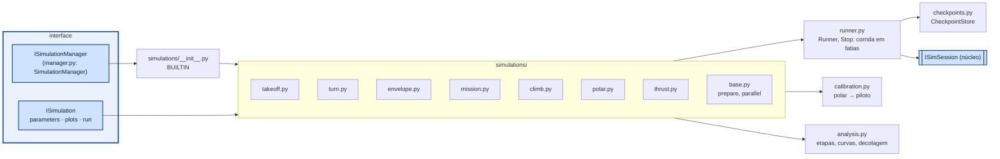

# aerosim/manager — Simulation Manager

Escolhe qual simulação roda, com que parâmetros, até onde, de onde retoma e o que itera. Fala com o
núcleo só pela `ISimSession`; a GUI fala com ele só pela `ISimulationManager`.



| simulação | orientação |
|---|---|
| `takeoff` | uma corrida até `h_end` (tempo real); opcional: varredura s_R × δe1 em paralelo |
| `turn` | por V: reta até o início da curva → **checkpoint**; para cada raio troca só a curva e retoma |
| `envelope` | só equilíbrios (sem integrar no tempo): nivelado, subida, planeio, raios, V-n |
| `mission` | checkpoints A (piloto liga), B (perna 1), C (perna da soltura); começa do chão ou de um checkpoint, para onde pedir; bisseção do ponto de soltura a partir de C |
| `climb` | por V: nivela → checkpoint; gradientes crescentes a partir dele |
| `polar` | coeficientes estáticos, margem estática |
| `thrust` | tração/potência/corrente × V de cada motor (motor+hélice ou polinômio) |

`Runner` é a ferramenta comum: `start_ground()`, `start_air(seg)`, `start_from(checkpoint)`,
`run(Stop(t=…, segment=…, autopilot=…, takeoff=…), chunk=…)`, `checkpoint(nome)`,
`reconfigure(missão nova)`. Os checkpoints guardam só o estado; os parâmetros vêm da configuração atual.

## Nova simulação

```python
from aerosim.interfaces.simulation import ParamSpec, PlotSpec, SimResult
from aerosim.manager.simulations.base import SimulationBase
from aerosim.manager.runner import Runner, Stop

class Planeio(SimulationBase):
    name, title, description = "glide", "Planeio", "motor cortado a partir de voo nivelado"
    def parameters(self): return [ParamSpec("V", "Velocidade", 14.0, unit="m/s")]
    def plots(self): return [PlotSpec("h", "Altura", "t", ("h",), "t (s)", "m")]
    def run(self, ctx):
        ac, info = self.prepare(ctx)                  # cópia calibrada da aeronave
        with Runner(ctx.backend, ac, overrides={"ap": {"Dtrim": 0.0, "KV": 0.0, "KIV": 0.0, "KHT": 0.0}}, ctx=ctx) as r:
            r.start_air(1)
            out = r.run(Stop(t=30.0))
        return SimResult(log=out.log, summary={"perda_h": float(out.log["h"][0] - out.log["h"][-1])})
```

Coloque a classe em `BUILTIN` (`simulations/__init__.py`) ou chame `manager.register(Planeio())`;
a GUI cria a aba sozinha.
