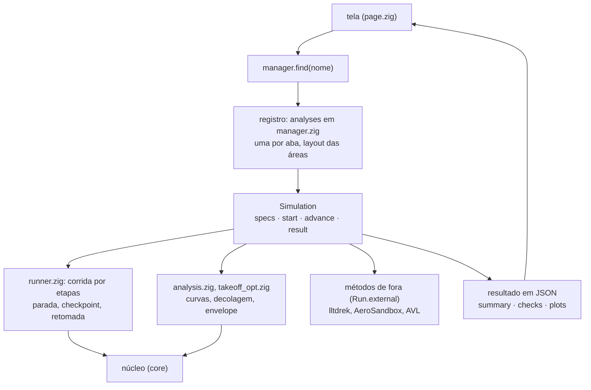

# aerosim/manager — gerenciador de simulações

Aqui ficam as análises. Cada aba da tela que roda alguma coisa (missão, desempenho, tração, aerodinâmica,
estabilidade, cargas, dimensionamento) é uma simulação registrada aqui. Com ela se roda uma análise pelo nome e se
recebe séries, resumo e diagnóstico; se voa uma missão por etapas (decolagem, subida, curvas, cruzeiro), parando no
fim de uma etapa, guardando o estado inteiro (o checkpoint) e retomando dali; e se otimiza a decolagem, o raio mínimo
de curva, o envelope e o MTOW. Uma análise declara os campos que pede, os gráficos que entrega e o que faz, e a tela
monta a aba sozinha, então nem a tela conhece o núcleo, nem o núcleo conhece as abas.



Cada análise é um `.zig` em `simulations/`, posto na lista `analyses` de `manager.zig`; o contrato dela fica em
`../interfaces/simulation.zig`. A tela pede pelo nome, chama `start`, depois `advance` fora do laço do desenho até a
conta acabar (a missão anda um pedaço por vez e mostra o progresso), e lê o `result`. O envelope de voo do avião de
exemplo, pedido assim (`exemplo.zig`, `python -m ziglang build exemplo -Dexemplo=manager` de dentro de `aerosim/`):

```zig
const std = @import("std");
const aircraft_model = @import("aircraft_model");
const manager = @import("manager");
const simulation = @import("simulation");

pub fn main(init: std.process.Init) !void {
    const gpa = init.gpa;
    const bytes = try std.Io.Dir.cwd().readFileAlloc(init.io, "../data/aircraft/Convencional_original.json", gpa, .limited(1 << 24));
    defer gpa.free(bytes);
    var diagnosis: aircraft_model.aircraft.Diag = .{};
    var loaded = try aircraft_model.aircraft.parse(gpa, bytes, &diagnosis);
    defer loaded.deinit();

    const envelope = manager.find("envelope").?; // a análise "Voo nivelado e envelopes"
    var run: simulation.Run = .{ .arena = .init(gpa), .aircraft = &loaded.ac, .io = init.io };
    defer run.arena.deinit();
    try envelope.start(&run, simulation.Values.fromRequest(run.memory(), "\"values\": {\"h_step\": 500}"));
    while (!try envelope.advance(&run)) {} // a tela chama advance fora do laço do desenho, um pedaço por vez
    var written: std.Io.Writer.Allocating = .init(gpa);
    defer written.deinit();
    try envelope.result(&run, &written.writer); // o resultado em JSON: resumo, verificações e gráficos

    const outcome = try std.json.parseFromSlice(std.json.Value, gpa, written.written(), .{});
    defer outcome.deinit();
    const summary = outcome.value.object.get("summary").?.object;
    for ([_][]const u8{ "V_min_nivelado", "V_max_nivelado", "roc_max", "massa", "margem_estatica" }) |key| {
        std.debug.print("{s} = {s}\n", .{ key, summary.get(key).?.string });
    }
    std.debug.print("{d} gráficos, {d} verificações\n", .{ outcome.value.object.get("plots").?.array.items.len, outcome.value.object.get("checks").?.array.items.len });
}
```

```
V_min_nivelado = 11.000
V_max_nivelado = 17.500
roc_max = 0.6090
massa = 12.390
margem_estatica = 0.1770
16 gráficos, 7 verificações
```

Uma análise nova é um `struct` com os campos, os gráficos, `start`, `advance` e `result`, posto em `analyses`; a
interface é conferida em comptime (`simulation.register`) e a aba aparece sozinha.

Tudo o que a tela mostra sai daqui, e o diagnóstico de cada aba (`checks`) é o que diz se o avião passa. A decolagem
da Missão, por exemplo, é julgada pela distância em que o avião sai do chão ($`x_{warning}`$) e pela altura que conta como
decolado ($`z_{warning}`$):


