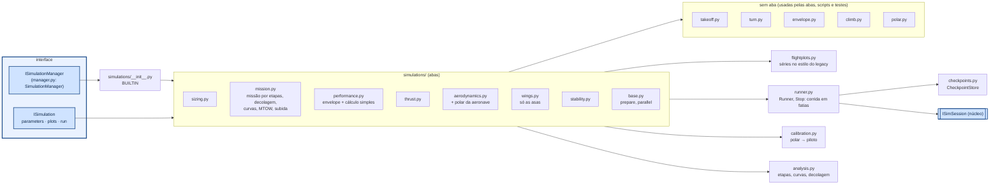
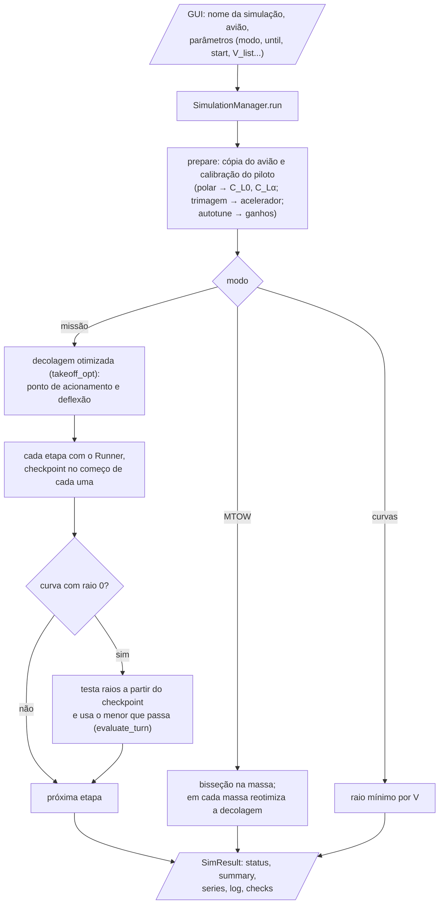
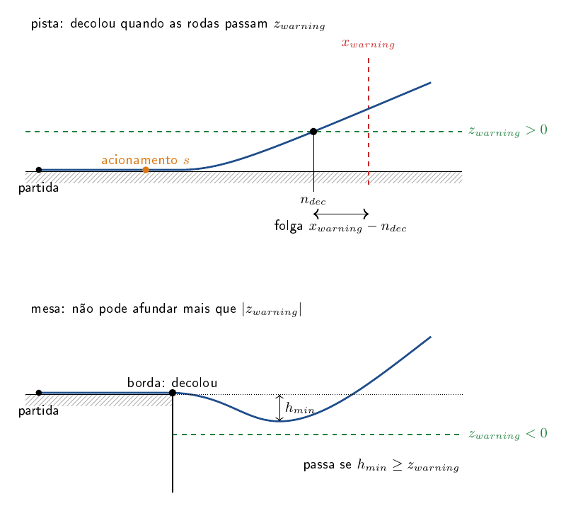

# aerosim/manager — gerenciador de simulações

Esta é a parte do projeto que organiza as análises. Cada aba da GUI que roda alguma coisa (a missão, o desempenho, a
tração, a aerodinâmica, a estabilidade, as cargas, o dimensionamento) é uma simulação registrada aqui. O gerenciador
escolhe qual roda, com que parâmetros, até onde vai, de onde retoma e o que varre. Ele fala com o núcleo só pela
`ISimSession` e é chamado pela GUI só pela `ISimulationManager`, então nem a GUI conhece o núcleo, nem o núcleo
conhece as abas.

Uma simulação declara os campos que pede (`parameters`), os gráficos que entrega (`plots`) e o que faz (`run`), e a
GUI monta a aba sozinha a partir disso. Para rodar no tempo, todas usam a mesma ferramenta, o `Runner`, que começa uma
corrida no chão, em voo ou de um checkpoint (o estado inteiro salvo num instante) e a leva até uma parada.

O README mostra primeiro como as peças se ligam e o que cada simulação faz. Depois entra nas contas mais específicas:
como a decolagem é julgada e otimizada, como uma curva é avaliada, como o envelope de voo é calculado e como o piloto
é calibrado para cada avião. No fim vêm um exemplo por arquivo, como chamar e como acrescentar uma simulação.

## Como funciona



Abas (`tab = True`): `sizing`, `mission`, `performance`, `thrust`, `wings`, `stability`, `loads`. As outras
continuam registradas (`manager.get("takeoff")`...) mas não têm aba: viraram modos ou partes de outra.

| simulação | orientação |
|---|---|
| `mission` | **missão**: decolagem otimizada (`takeoff_opt.py`) e o resto, etapa por etapa, com checkpoint "missão: início de <etapa>" em cada uma; começa de qualquer etapa (sem checkpoint: voa até lá e salva); curva com raio 0 = automático (testa raios do checkpoint dela e usa o menor que passa em `evaluate_turn`). **só decolagem**. **curvas**: raio mínimo por V. **MTOW**: bisseção na massa; em cada massa reotimiza o acionamento (e o xCG) |
| `performance` | só contas (sem piloto): `ISimBackend.simple_performance` por altitude → envelope, potências, subida, planeio, curva × V, V-n, bateria; polar da aba Aerodinâmica se houver, senão a do núcleo |
| `loads` | aba Cargas: `aero.span_loads` (linha sustentadora do núcleo ou faixas) num ponto de voo, com e sem hélice → `LoadResult` → gráficos por superfície e vista 3D (`loads3d`) |
| `takeoff` | uma corrida até `h_end` (tempo real); opcional: varredura $`s_R`$ × δe1 em paralelo |
| `turn` | por V: reta até o início da curva → **checkpoint**; para cada raio troca só a curva e retoma |
| `envelope` | por altitude (sem integrar no tempo): $`V_{min}`$, $`V_{max}`$, $`V_e`$, V*, $`V_{cru}`$, teto — método da planilha e/ou modelo completo; mais a tabela ao nível do mar (subida, planeio, raios, V-n) |
| `climb` | por V: nivela → checkpoint; gradientes crescentes a partir dele |
| `polar` | coeficientes estáticos, margem estática |
| `thrust` | tração/potência/corrente × V de cada motor (motor+hélice ou polinômio) |
| `aerodynamics` | sem aba (roda dentro da `wings`, parte do avião completo), sem tempo: cada solver de `aerosim/aero` (os que estiverem instalados e marcados) na mesma geometria e no mesmo $`x_{CG}`$; um solver que falha vira uma linha de erro no resumo, os outros seguem; estudo de pontas de asa |
| `wings` | subaba Asas da Aerodinâmica, sem tempo: só as superfícies marcadas (uma asa, biplano, tandem, canard), do avião aberto ou das asas guardadas na sprint (`shared["sprint"]`), sem trimar, sem fuselagem e sem hélice; roda sem massa (`needs_aircraft = False`). A varredura em α de cada método de carga (`ILoadMethod.sweep`; no núcleo, `core/src/loads/sweep.zig`) e o resumo do núcleo (`wing_sweep_summary`) dão o C_L do conjunto e de cada superfície, o C_L máximo e onde o estol começa; no α da carga, a distribuição e as vistas 3D e de cima (`loads3d`); depois as polares dos solvers marcados (`compare_solvers`, o mesmo laço da `aerodynamics`), na soma das áreas; com o avião aberto pronto, a `aerodynamics` no avião completo (séries `full_polar_*`, `full_ld_*`, `full_span`, `pa*`, `tip*`; a polar fica em `shared` para o Desempenho). Chapas de ponta opcionais (dispositivo "placa") |
| `stability` | sem tempo: estática → comandos → tesoura (uma sessão por tamanho de EH) → modelo linear por V |

`Runner` é a ferramenta comum: `start_ground()`, `start_air(seg)`, `start_from(checkpoint)`,
`run(Stop(t=…, segment=…, autopilot=…, takeoff=…), chunk=…)`, `checkpoint(nome)`,
`reconfigure(missão nova)`. Os checkpoints guardam só o estado; os parâmetros vêm da configuração atual.

### Uma missão, passo a passo

O caminho de uma missão pedida pela GUI, até o resultado:



### Decolagem: $`x_{warning}`$ e $`z_{warning}`$ (`takeoff_opt.py`)

Na competição, a decolagem é julgada só pela pista: o avião tem de sair do chão antes de um comprimento e subir acima
de uma altura (ou, decolando de uma mesa, não afundar demais depois da borda). O piloto controla isso escolhendo em
que ponto da corrida puxa o profundor e quanto. Esta parte julga uma corrida por esses dois critérios e procura o
ponto de acionamento que deixa a maior folga.

| | |
|---|---|
| `x_warning` | comprimento de pista: $`n_{dec}`$ (onde "decolou") tem de ser $`\le`$ $`x_{warning}`$ |
| `z_warning` | $`z > 0`$: decolou quando as rodas passam essa altura sobre a superfície de partida; $`z \le 0`$ (mesa): decolou ao sair da borda e não pode afundar mais que $`\lvert z\rvert`$ |

**Como se julga uma corrida (`judge`).** Com $`h`$ medido a partir da superfície de partida e $`h_{min}`$ a menor altura
depois de sair do chão, a corrida passa quando decolou dentro da pista e não afundou abaixo do piso
$`\min(z_{warning}, 0)`$:

```math
x_{exc} = \max(0,\ n_{dec} - x_{warning})
\qquad
z_{falta} = \max\big(0,\ \min(z_{warning}, 0) - h_{min}\big)
\qquad
\text{ok} \iff x_{exc} = 0 \ \text{e}\ z_{falta} = 0
```

Depois de decolar, a corrida continua alguns segundos: se cair ou voltar abaixo do $`z_{warning}`$, não decolou.



**Como se escolhe o acionamento (`optimize`).** O objetivo é a maior folga de pista
$`x_{warning} - n_{dec}`$. O ponto de acionamento $`s`$ é testado numa grade ao longo da pista, começando pela deflexão
máxima (`de_max`) e descendo para frações menores só se nenhum ponto passar. Em volta do melhor ponto, $`s`$ é refinado
por seção áurea (Kiefer, *Sequential minimax search for a maximum*, Proc. AMS, 1953, a conferir no PDF): no
intervalo $`[a, b]`$, com $`g = (\sqrt5 - 1)/2`$, os pontos testados são

```math
c = b - g\,(b - a) \qquad d = a + g\,(b - a)
```

e o intervalo encolhe para $`[a, d]`$ ou $`[c, b]`$ conforme o lado com a folga maior; um dos pontos é reaproveitado na
iteração seguinte.

O terreno (mesas e plataformas) fica no núcleo (`core/src/physics/terrain.zig`): o trem, o efeito solo, o
arredondamento e o alvo do pouso usam a altura do terreno sob cada ponto.

### Curvas (`analysis.evaluate_turn`, `analysis.min_radius`)

Cada curva é medida no transitório inteiro e no regime (depois de um quarto de volta, $`s \ge \pi R/2`$). O fator de
carga em que a asa estola na velocidade do momento sai da razão $`C_L/C_{L,max}`$ registrada (Anderson, *Introduction
to Flight*, §6.17, a conferir no PDF):

```math
n_{estol} = \frac{n_z\,C_{L,max}}{C_L} = \frac{n_z}{C_L/C_{L,max}}
```

A curva passa quando segue o raio pedido (erro de trajetória e raio real dentro da tolerância), não estola, não perde
altura e não perde o controle. O raio mínimo é o menor raio a partir do qual **todos** os maiores também passam.

### Envelope de voo (adaptado do `Envelope_main`)

O cálculo está no núcleo (`core/src/sim/envelope.zig`); a simulação só monta os dados e os gráficos.
Para cada altitude (passo `h_step`) calcula $`\rho(h)`$ e acha $`V_{min}`$ e $`V_{max}`$ onde a tração disponível cruza a
requerida: varre a grade `dV` de $`V_f`$ para $`V_i`$ e refina cada cruzamento por bisseção até `tol` (o original usava uma
grade fina, sem bisseção). O teto absoluto é refinado por bisseção em $`h`$.

**Tração disponível** (os dois métodos): as unidades propulsoras com o polinômio de tração corrigido pela densidade,
$`T_d = g\,(\rho/\rho_0)\,P(n, V)`$, sem ficar negativa fora da faixa do ajuste.

**Tração requerida, método planilha.** O $`C_L`$ sai do equilíbrio vertical com a tração inclinada do ângulo de cruzeiro
$`\alpha`$; o arrasto soma o da asa, o da EH (pela razão de áreas) e o induzido (Anderson, *Aircraft Performance and
Design*, cap. 5, a conferir no PDF):

```math
C_L = \frac{W - T_d \sin\alpha}{\tfrac12\,\rho V^2 S_w}
\qquad
C_D = C_{Dp,w} + C_{Dp,h}\,\frac{S_h}{S_w} + K\,C_L^2
\qquad
T_r = \frac{\rho V^2 S_w\,C_D}{2\cos\alpha}
```

**Tração requerida, método modelo completo.** Trimagem completa (forças e momento, profundor): $`V_{min}`$ e $`V_{max}`$
são as velocidades em que o acelerador de equilíbrio chega a 1.

**Velocidades.** A de estol $`V_e`$ soma o $`C_{L,max}`$ de cada superfície (planilha) ou usa o da polar da aeronave
(modelo completo); a de cruzeiro $`V_{cru}`$ é a do voo nivelado no ângulo de cruzeiro; a de manobra $`V^*`$ é a de estol
no fator de carga limite $`n`$:

```math
V_e = \sqrt{\frac{2W}{\rho\,(S_w C_{Lmax,w} + S_h C_{Lmax,h})}}
\qquad
V_e = \sqrt{\frac{2W}{\rho\,S\,C_{L,max}}}
```

```math
V_{cru} = \sqrt{\left|\frac{2\,(W - T_d(V_f)\sin\alpha)}{\rho\,(S_w C_{L,w} + S_h C_{L,h})}\right|}
\qquad
V^* = V_e\sqrt{n}
```

No método modelo completo, $`V_{cru}`$ é a velocidade em que o $`\alpha`$ de equilíbrio é o ângulo de cruzeiro.

**Densidade.** A ISA na troposfera, com o gradiente térmico $`\lambda`$, $`T_0`$ ao nível do mar e a constante do ar $`R`$
(ICAO Doc 7488, a conferir no PDF):

```math
\rho(h) = \rho_0\left(1 - \frac{\lambda h}{T_0}\right)^{\frac{g}{\lambda R} - 1}
```

**"Reproduzir o original"** (só no método planilha) faz as mesmas contas do `Envelope_main`, para
comparar com resultados antigos; `tests/manager/test_envelope.py` confere altitude por altitude contra
o código original transcrito (`tests/helpers/envelope_reference.py`). Desligado, corrige três pontos:

1. o arrasto usa $`\rho`$; o original usa $`\rho/\rho_0`$ em $`T_r`$, o que subestima a potência requerida por um fator
   $`\rho_0`$;
2. a densidade segue a ISA acima; o original usa $`(1 + \lambda h/T_0)^{-g/(\lambda R) - 1}`$, que cai mais devagar com
   a altitude;
3. a tração não fica negativa fora da faixa do ajuste (o original usa o polinômio como está).

Além disso, quando sobra tração já em $`V_i`$ o original quebra (`intersections[1]` com um cruzamento só);
aqui $`V_{min}`$ fica em $`V_i`$ e o cálculo segue. Dados usados: `ac.performance` (ângulo de cruzeiro, n, $`C_{Dp}`$,
K, ρ0) e as superfícies (S, $`C_{L\alpha}`$, $`C_{L0}`$, $`C_{Lmax}`$, incidências, downwash), todos lidos da planilha pelo
mapa `data/mappings/dados_desempenho.json`. "Exportar" grava um `.xlsx` com uma aba por tabela.

### Calibração do piloto (`calibration.py`)

O piloto usa um modelo interno linear da sustentação, ajustado por mínimos quadrados na polar do próprio núcleo, na
faixa linear de $`\alpha`$; a margem estática sai da inclinação de $`C_m`$ com $`C_L`$ (Etkin e Reid, *Dynamics of Flight*,
cap. 2, a conferir no PDF):

```math
C_L \approx C_{L0} + C_{L\alpha}\,\alpha
\qquad
MS = -\frac{dC_m}{dC_L}
\qquad
x_{np} = x_{cg} + MS\,\bar c
\qquad
V_s = \sqrt{\frac{2mg}{\rho\,S\,C_{L,max}}}
```

O acelerador de equilíbrio vem da trimagem nivelada na velocidade de cruzeiro, e os ganhos das malhas internas do
`autotune` do núcleo (ver [`core/src/control/README.md`](../../core/src/control/README.md)).

## Um exemplo por arquivo

```python
import math
from aerosim.backend.zig import ZigBackend
from aerosim.manager import Runner, Stop, analysis, calibration, flightplots, takeoff_opt
from aerosim.manager.checkpoints import CheckpointStore
from aerosim.manager.simulations import BUILTIN
from aerosim.model.templates import conventional

be = ZigBackend()
ac = conventional()

# calibration.py: polar do núcleo -> C_L0, C_Lα, margem estática, V_s
info = calibration.static_characteristics(be, ac)
print(round(info["CLa"], 2), round(info["static_margin"], 3), round(info["Vs"], 1))

# runner.py + checkpoints.py: corre, guarda o estado e retoma dali
loja = CheckpointStore()                              # CheckpointStore("pasta") grava em disco
with Runner(be, ac) as r:
    r.start_ground()
    o1 = r.run(Stop(t=3.0), live=False)
    r.checkpoint("t3", loja)
    r.start_from(loja.get("t3"))
    o2 = r.run(Stop(t=4.0), live=False)
print(loja.names(), o2.t_end)

# analysis.py: etapas do voo e a tabela por etapa
legs = [p.name for p in ac.mission.legs]
tab = analysis.stage_table(o1.log, o1.events, legs, info["Vs"])
print([linha["etapa"] for linha in tab])

# flightplots.py: séries prontas para desenhar (função pura do registro)
traj = flightplots.trajectory(o1.log, o1.events, legs)
print(list(traj)[:3])

# takeoff_opt.py: uma decolagem com acionamento em 10 m, profundor a −15°
res = takeoff_opt.evaluate(be, ac, 10.0, -15.0, x_warning=50.0, z_warning=0.5)
print(res.ok, res.status, round(res.n_dec, 1) if math.isfinite(res.n_dec) else res.n_dec)

# simulations/: as simulações registradas (uma aba cada quando tab = True)
print([cls().name for cls in BUILTIN if cls.tab])
```

## Como chamar

Rode da raiz do repositório:

```python
from aerosim.manager import SimulationManager
from aerosim.model.templates import conventional

m = SimulationManager()                       # usa o núcleo Zig; SimulationManager(backend) troca o núcleo
ac = conventional()

r = m.run("performance", ac)                  # contas da planilha (sem simulação)
print(r.status, list(r.summary)[:5])          # estado e os primeiros números do resumo
r = m.run("thrust", ac)                       # tração × V de cada motor
print(list(r.series))                         # as tabelas que viram gráficos
```

As outras formas de rodar a missão (cada uma leva mais tempo):

```python
# não roda sozinho: precisa de m e ac do bloco acima, e cada missão leva segundos a minutos
r = m.run("mission", ac)                                         # missão inteira
r = m.run("mission", ac, {"until": "fim: manobra 1"})            # para no fim de uma etapa (salva checkpoint)
r = m.run("mission", ac, {"start": "início: cruzeiro 1"})        # recomeça dali
r = m.run("mission", ac, {"mode": "só decolagem"})               # otimiza o acionamento do profundor
r = m.run("mission", ac, {"mode": "curvas: raio mínimo", "V_list": "13, 15"})
r.status, r.summary, r.series, r.log, r.checks                   # estado, números, tabelas, registro, diagnóstico

import threading
evento = threading.Event()                                       # evento.set() cancela
m.run("mission", ac, on_chunk=print, on_progress=lambda f, txt: None, cancel=evento)   # ao vivo / cancelável
```

`Runner` para montar uma corrida à mão (é o que as simulações usam):

```python
from aerosim.backend.zig import ZigBackend
from aerosim.manager import Runner, Stop
from aerosim.model.templates import conventional

ac = conventional()
with Runner(ZigBackend(), ac) as r:
    r.start_ground()                          # ou start_air(perna), start_from(checkpoint)
    out = r.run(Stop(t=5.0), live=False)      # Stop(t, segment, autopilot, takeoff)
    ck = r.checkpoint("t = 5 s")
print(out.status, float(out.log["h"][-1]), ck.t)
```

## Nova simulação

```python
from aerosim.interfaces.simulation import ParamSpec, PlotSpec, SimResult
from aerosim.manager.simulations.base import SimulationBase
from aerosim.manager.runner import Runner, Stop

class Planeio(SimulationBase):
    name, title, description = "glide", "Planeio", "motor cortado a partir de voo nivelado"
    def parameters(self): return [ParamSpec("V", "Velocidade", 14.0, unit="m/s")]
    def plots(self): return [PlotSpec("h", "Altura", "t", ("h",), "t (s)", "m")]
    def run(self, ctx):
        ac, info = self.prepare(ctx)                  # cópia calibrada da aeronave
        with Runner(ctx.backend, ac, overrides={"ap": {"Dtrim": 0.0, "KV": 0.0, "KIV": 0.0, "KHT": 0.0}}, ctx=ctx) as r:
            r.start_air(1)
            out = r.run(Stop(t=30.0))
        return SimResult(log=out.log, summary={"perda_h": float(out.log["h"][0] - out.log["h"][-1])})
```

Coloque a classe em `BUILTIN` (`simulations/__init__.py`) ou chame `manager.register(Planeio())`;
a GUI cria a aba sozinha.
