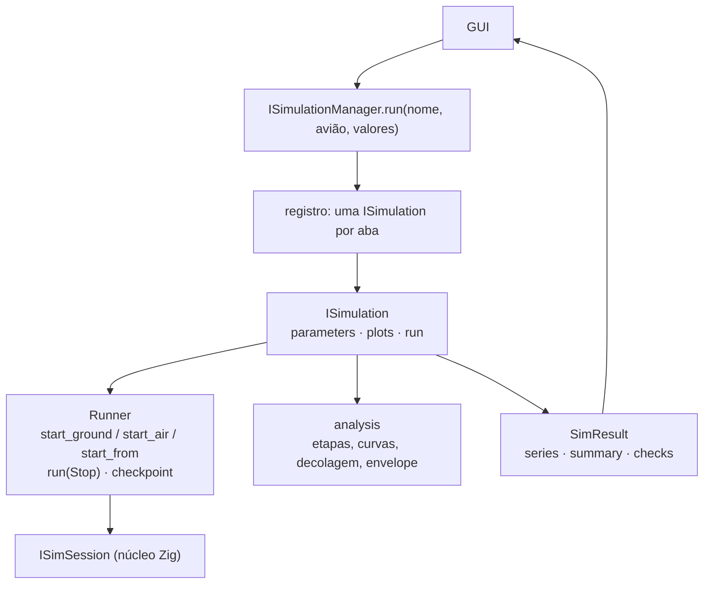
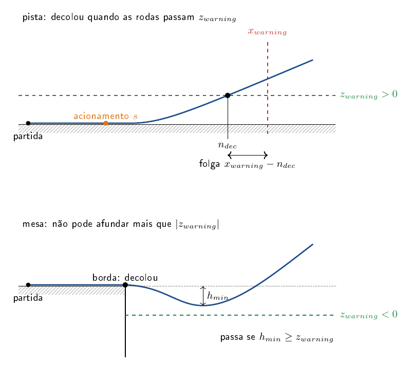

# aerosim/manager — gerenciador de simulações

Aqui ficam as análises. Cada aba da GUI que roda alguma coisa (missão, desempenho, tração, aerodinâmica,
estabilidade, cargas, dimensionamento) é uma simulação registrada aqui. Com ela se roda uma análise pelo nome e se
recebe séries, resumo e diagnóstico; se voa uma missão por etapas (decolagem, subida, curvas, cruzeiro), parando no
fim de uma etapa, guardando o estado inteiro (o checkpoint) e retomando dali; e se otimiza a decolagem, o raio mínimo
de curva, o envelope e o MTOW. Uma simulação declara os campos que pede, os gráficos que entrega e o que faz, e a GUI
monta a aba sozinha, então nem a GUI conhece o núcleo, nem o núcleo conhece as abas.



As análises já passadas para Zig (tração, voo nivelado e envelopes, desempenho, missão, estabilidade dinâmica e do
avião montado) ficam num `.zig` ao lado do `.py` de cada uma, na lista `analyses` de `manager.zig`, e a tela em Zig
chama essas direto, sem Python no meio. Rodando o desempenho e voando a missão até o fim da primeira manobra:

```python
from aerosim.manager import SimulationManager
from aerosim.model.templates import conventional

m = SimulationManager()
ac = conventional()
r = m.run("performance", ac)                                  # contas rápidas, sem simulação
print(r.status, dict(list(r.summary.items())[1:4]))
r = m.run("mission", ac, {"until": "fim: manobra 1"})         # voa e para no fim de uma etapa
print(r.status, r.summary["parou_em"], round(r.summary["t_fim"], 1), "s")
print(r.checks[0].item, "|", r.checks[0].value, r.checks[0].criterion)
```

```
ok {'massa (kg)': 12.39, 'S (m²)': 1.0, 'teto absoluto (m)': 2700.0}
STOPPED fim: manobra 1 35.1 s
x_warning: decolou dentro da pista | n_dec = 54.2 m ≤ 60 m
```

A missão parou onde foi pedido e guardou o checkpoint; `{"start": "início: cruzeiro 1"}` retoma dali. Uma análise
nova é uma classe com `parameters`, `plots` e `run`, posta em `BUILTIN` (`simulations/__init__.py`) ou registrada com
`m.register(...)`, e a aba aparece sozinha.

Tudo o que a GUI mostra sai daqui, e o diagnóstico de cada aba (`checks`) é o que diz se o avião passa. A decolagem
acima, por exemplo, é julgada pela distância em que o avião sai do chão ($`x_{warning}`$) e pela altura que conta como
decolado ($`z_{warning}`$):


