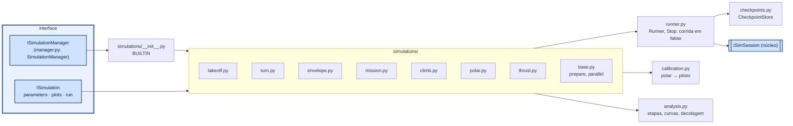

# aerosim/manager — Simulation Manager

Escolhe qual simulação roda, com que parâmetros, até onde, de onde retoma e o que itera. Fala com o
núcleo só pela `ISimSession`; a GUI fala com ele só pela `ISimulationManager`.



| simulação | orientação |
|---|---|
| `takeoff` | uma corrida até `h_end` (tempo real); opcional: varredura s_R × δe1 em paralelo |
| `turn` | por V: reta até o início da curva → **checkpoint**; para cada raio troca só a curva e retoma |
| `envelope` | por altitude (sem integrar no tempo): V_min, V_max, V_e, V*, V_cru, teto — método da planilha e/ou modelo completo; mais a tabela ao nível do mar (subida, planeio, raios, V-n) |
| `mission` | checkpoints A (piloto liga), B (perna 1), C (perna da soltura); começa do chão ou de um checkpoint, para onde pedir; bisseção do ponto de soltura a partir de C |
| `climb` | por V: nivela → checkpoint; gradientes crescentes a partir dele |
| `polar` | coeficientes estáticos, margem estática |
| `thrust` | tração/potência/corrente × V de cada motor (motor+hélice ou polinômio) |

`Runner` é a ferramenta comum: `start_ground()`, `start_air(seg)`, `start_from(checkpoint)`,
`run(Stop(t=…, segment=…, autopilot=…, takeoff=…), chunk=…)`, `checkpoint(nome)`,
`reconfigure(missão nova)`. Os checkpoints guardam só o estado; os parâmetros vêm da configuração atual.

## Envelope de voo (adaptado do `Envelope_main`)

O cálculo está no núcleo (`core/src/sim/envelope.zig`); a simulação só monta os dados e os gráficos.
Para cada altitude (passo `h_step`) calcula ρ(h) e acha V_min e V_max onde a tração disponível cruza a
requerida: varre a grade `dV` de V_f para V_i e refina cada cruzamento por bisseção até `tol` (o
original usava uma grade de 0,00005 m/s, ~520 mil pontos por altitude). O teto absoluto é refinado
por bisseção em h (0,5 m).

| | método **planilha** | método **modelo completo** |
|---|---|---|
| tração disponível | unidades propulsoras com ρ(h): `g·(ρ/ρ0)·(T0 + p10·n + p01·V + …)` | a mesma |
| tração requerida | `C_L = (W − T_d sin α)/(½ S_w ρ V²)`, `C_D = C_Dpw + C_Dph S_h/S_w + K C_L²`, `T_r = ρ V² S_w C_D / (2 cos α)` | trimagem completa (forças e momento, profundor): acelerador de equilíbrio = 1 |
| V_e | `√(2W / (ρ (S_w C_Lmax,w + S_h C_Lmax,h)))` | `√(2W / (ρ S C_Lmax))` da polar da aeronave |
| V_cru | `√|2(W − T_d(V_f) sin α) / (ρ (S_w C_Lw + S_h C_Lh))|` | V em que o α de equilíbrio é o ângulo de cruzeiro |
| V* | `V_e √n` | `V_e √n` |

**"Reproduzir o original"** (só no método planilha) faz as mesmas contas do `Envelope_main`, para
comparar com resultados antigos — `tests/manager/test_envelope.py` confere altitude por altitude contra
o código original transcrito (`tests/helpers/envelope_reference.py`). Desligado, corrige três pontos:

1. o arrasto usa ρ; o original usa ρ/ρ0 em `Tr = (rho/rho0)·v²·Sw·Cd/(2 cos α)`, o que subestima a
   potência requerida por um fator ρ0 ≈ 1,2;
2. a densidade segue a ISA, `ρ0 (1 − λh/T0)^(g/λR − 1)`; o original usa `(1 + λh/T0)^(−g/λR − 1)`
   (em 1000 m: 0,870 ρ0 contra 0,908 ρ0);
3. a tração não fica negativa fora da faixa do ajuste (o original usa o polinômio como está).

Além disso, quando sobra tração já em V_i o original quebra (`intersections[1]` com um cruzamento só);
aqui V_min fica em V_i e o cálculo segue. Dados usados: `ac.performance` (ângulo de cruzeiro, n, C_Dp,
K, ρ0) e as superfícies (S, C_Lα, C_L0, C_Lmax, incidências, downwash), todos lidos da planilha pelo
mapa `data/mappings/dados_desempenho.json`. "Exportar" grava um `.xlsx` com uma aba por tabela.

## Nova simulação

```python
from aerosim.interfaces.simulation import ParamSpec, PlotSpec, SimResult
from aerosim.manager.simulations.base import SimulationBase
from aerosim.manager.runner import Runner, Stop

class Planeio(SimulationBase):
    name, title, description = "glide", "Planeio", "motor cortado a partir de voo nivelado"
    def parameters(self): return [ParamSpec("V", "Velocidade", 14.0, unit="m/s")]
    def plots(self): return [PlotSpec("h", "Altura", "t", ("h",), "t (s)", "m")]
    def run(self, ctx):
        ac, info = self.prepare(ctx)                  # cópia calibrada da aeronave
        with Runner(ctx.backend, ac, overrides={"ap": {"Dtrim": 0.0, "KV": 0.0, "KIV": 0.0, "KHT": 0.0}}, ctx=ctx) as r:
            r.start_air(1)
            out = r.run(Stop(t=30.0))
        return SimResult(log=out.log, summary={"perda_h": float(out.log["h"][0] - out.log["h"][-1])})
```

Coloque a classe em `BUILTIN` (`simulations/__init__.py`) ou chame `manager.register(Planeio())`;
a GUI cria a aba sozinha.
